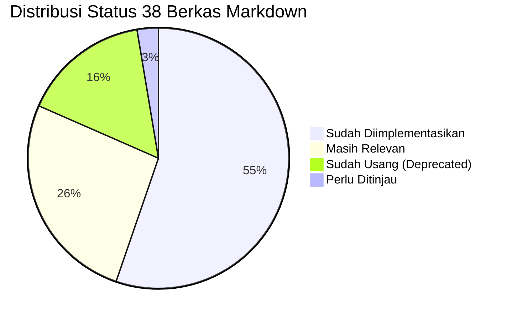
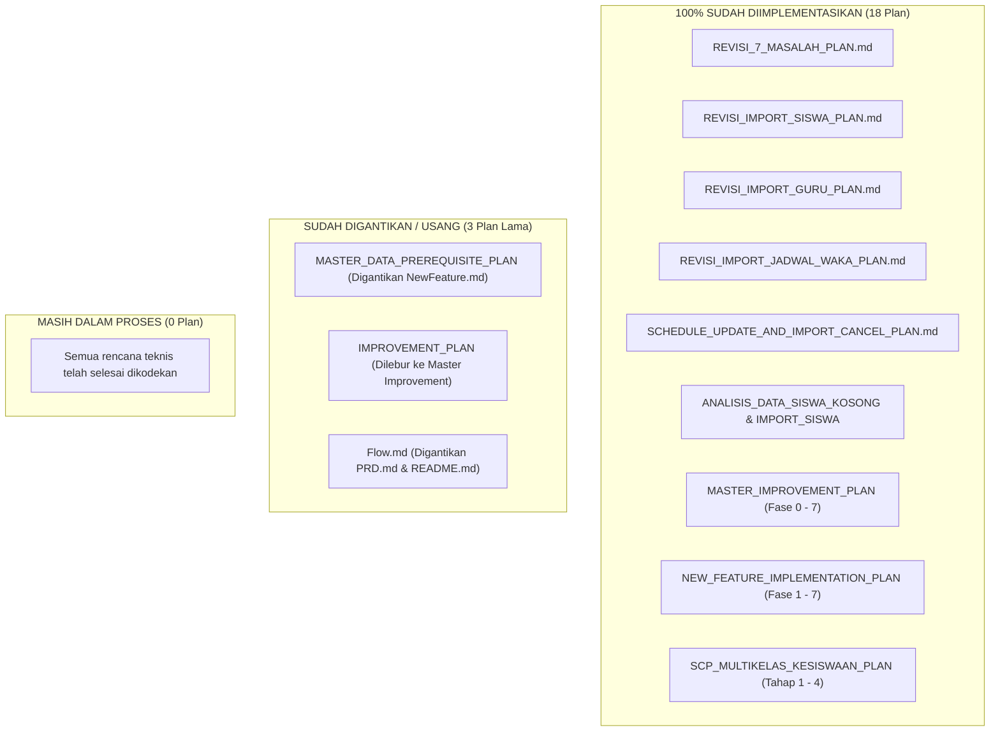

# LAPORAN AUDIT MENYELURUH DOKUMENTASI MARKDOWN (.MD)
**School Class Progress (SCP) Project**  
*Tanggal Audit: 2 November 2026*  
*Status: Audit & Eksekusi Pembersihan Selesai (26 Berkas Dihapus, 13 Berkas Aktif Dipertahankan)*

> **Pembaruan Eksekusi Pembersihan (2 November 2026):**  
> Sesuai arahan pengguna, sebanyak **26 berkas** (seluruh dokumen rencana yang sudah selesai diimplementasikan serta dokumen yang sudah usang/deprecated) telah **berhasil dihapus secara permanen**. Repositori kini hanya menyisakan **13 berkas acuan utama** yang terorganisir, bersih, dan bebas dari penumpukan dokumen di root project.

---

## 1. Ringkasan Eksekutif & Statistik Audit

Audit ini dilakukan terhadap seluruh berkas Markdown (`.md`) di dalam repositori project **School Class Progress (SCP)**, mencakup root project, modul backend (`scp/`), modul frontend website (`frontend/scp_web/`), dan modul mobile (`frontend/scp_mobile/`), di luar direktori pustaka pihak ketiga (`node_modules`, `vendor`, `.venv`, `.git`).

Tujuan audit adalah menginventarisasi seluruh dokumentasi, memverifikasi kesesuaian antara isi dokumen terhadap implementasi aktual pada kode program dan basis data, serta mengelompokkan dokumen ke dalam 5 kategori resmi.

### A. Statistik Berkas yang Ditemukan
* **Total Berkas `.md` Ditemukan:** **38 berkas**
* **Sebaran Lokasi Berkas:**
  - **Root Project (`/`):** 10 berkas (26,3%)
  - **Backend Documentation (`scp/MD/`):** 22 berkas (57,9%)
  - **Frontend Website (`frontend/scp_web/`):** 4 berkas (10,5%)
  - **Frontend Mobile (`frontend/scp_mobile/`):** 2 berkas (5,3%)

### B. Distribusi Hasil Klasifikasi Dokumen

| No | Kategori Klasifikasi | Jumlah Berkas | Persentase | Definisi Ringkas |
|:---:|:---|:---:|:---:|:---|
| 1 | **Masih Relevan** | **10** | 26,3% | Dokumen acuan utama, spesifikasi sistem hidup (*living document*), panduan deployment, atau laporan verifikasi milestone yang aktif digunakan. |
| 2 | **Sudah Diimplementasikan** | **21** | 55,3% | Dokumen rencana kerja (*Plan*) atau analisis perbaikan yang seluruh poin pekerjaannya telah terbukti selesai diimplementasikan ke dalam kode & basis data. |
| 3 | **Sudah Usang (Deprecated)** | **6** | 15,8% | Dokumen yang bertentangan dengan arsitektur terbaru, menggunakan alur lama yang telah digantikan, atau sekadar berkas *boilerplate* bawaan template. |
| 4 | **Perlu Ditinjau** | **1** | 2,6% | Dokumen yang secara fungsional masih dipakai, namun memiliki bagian instruksi yang tidak lagi selaras dengan antarmuka terkini. |
| 5 | **Masih Dalam Proses** | **0** | 0,0% | Seluruh modul perencanaan fitur telah tuntas diimplementasikan ke dalam kode; sisa pekerjaan hanya berupa pembersihan *linting* dan pengujian akhir. |
| **TOTAL** | | **38** | **100%** | |



---

## 2. Katalog Lengkap Seluruh Berkas Markdown (38 Berkas)

Berikut adalah tabel rekapitulasi 38 berkas Markdown yang ditemukan beserta hasil audit teknisnya:

| No | Nama Berkas | Lokasi / Direktori | Ukuran | Status Klasifikasi | Rekomendasi Aksi |
|:---:|:---|:---|:---:|:---:|:---:|
| 1 | `ANALISIS_DAN_RENCANA_SOLUSI_DATA_SISWA_KOSONG.md` | `Root (/)'` | 10.016 B | **Sudah Diimplementasikan** | Arsipkan |
| 2 | `ANALISIS_DAN_RENCANA_SOLUSI_IMPORT_SISWA.md` | `Root (/)` | 9.648 B | **Sudah Diimplementasikan** | Arsipkan |
| 3 | `REVISI_7_MASALAH_PLAN.md` | `Root (/)` | 9.291 B | **Sudah Diimplementasikan** | Arsipkan |
| 4 | `REVISI_IMPORT_GURU_PLAN.md` | `Root (/)` | 7.492 B | **Sudah Diimplementasikan** | Arsipkan |
| 5 | `REVISI_IMPORT_JADWAL_WAKA_PLAN.md` | `Root (/)` | 9.124 B | **Sudah Diimplementasikan** | Arsipkan |
| 6 | `REVISI_IMPORT_SISWA_PLAN.md` | `Root (/)` | 9.609 B | **Sudah Diimplementasikan** | Arsipkan |
| 7 | `SCHEDULE_CONFLICT_ANALYSIS.md` | `Root (/)` | 21.467 B | **Masih Relevan** | Pertahankan / Arsipkan |
| 8 | `SCHEDULE_UPDATE_AND_IMPORT_CANCEL_PLAN.md` | `Root (/)` | 30.327 B | **Sudah Diimplementasikan** | Arsipkan |
| 9 | `TAHAP_1_IMPLEMENTATION_REPORT.md` | `Root (/)` | 12.726 B | **Masih Relevan** | Pertahankan |
| 10 | `TAHAP_2_VERIFICATION_REPORT.md` | `Root (/)` | 12.158 B | **Masih Relevan** | Pertahankan |
| 11 | `README.md` | `frontend/scp_mobile/` | 40 B | **Sudah Usang (Deprecated)** | Perbarui (saat mobile) |
| 12 | `README.md` | `frontend/scp_mobile/.../LaunchImage...` | 340 B | **Sudah Usang (Deprecated)** | Pertahankan (asset) |
| 13 | `DEPLOYMENT.md` | `frontend/scp_web/` | 4.298 B | **Masih Relevan** | Pertahankan |
| 14 | `Development.md` | `frontend/scp_web/` | 60.464 B | **Masih Relevan** | Pertahankan |
| 15 | `README.md` | `frontend/scp_web/` | 1.027 B | **Sudah Usang (Deprecated)** | Perbarui |
| 16 | `TEST_ACCOUNTS.md` | `frontend/scp_web/` | 4.618 B | **Perlu Ditinjau** | Perbarui |
| 17 | `Development.md` | `scp/MD/` | 292.231 B | **Masih Relevan** | Pertahankan |
| 18 | `PRD.md` | `scp/MD/` | 41.034 B | **Masih Relevan** | Pertahankan |
| 19 | `README.md` | `scp/MD/` | 71.315 B | **Masih Relevan** | Pertahankan |
| 20 | `NewFeature.md` | `scp/MD/` | 13.795 B | **Masih Relevan** | Pertahankan |
| 21 | `Flow.md` | `scp/MD/` | 30.462 B | **Sudah Usang (Deprecated)** | Arsipkan |
| 22 | `IMPROVEMENT_PLAN.md` | `scp/MD/` | 22.465 B | **Sudah Usang (Deprecated)** | Arsipkan |
| 23 | `MASTER_IMPROVEMENT_PLAN.md` | `scp/MD/` | 98.145 B | **Sudah Diimplementasikan** | Arsipkan |
| 24 | `MASTER_DATA_PREREQUISITE_PLAN.md` | `scp/MD/` | 19.729 B | **Sudah Usang (Deprecated)** | Arsipkan |
| 25 | `FASE_1_IMPLEMENTATION_PLAN.md` | `scp/MD/` | 29.357 B | **Sudah Diimplementasikan** | Arsipkan |
| 26 | `PHASE_2_IMPLEMENTATION_PLAN.md` | `scp/MD/` | 26.414 B | **Sudah Diimplementasikan** | Arsipkan |
| 27 | `PHASE_3_IMPLEMENTATION_PLAN.md` | `scp/MD/` | 26.805 B | **Sudah Diimplementasikan** | Arsipkan |
| 28 | `PHASE_4_IMPLEMENTATION_PLAN.md` | `scp/MD/` | 29.138 B | **Sudah Diimplementasikan** | Arsipkan |
| 29 | `PHASE_5_IMPLEMENTATION_PLAN.md` | `scp/MD/` | 19.463 B | **Sudah Diimplementasikan** | Arsipkan |
| 30 | `PHASE_6_IMPLEMENTATION_PLAN.md` | `scp/MD/` | 21.140 B | **Sudah Diimplementasikan** | Arsipkan |
| 31 | `PHASE_7_IMPLEMENTATION_PLAN.md` | `scp/MD/` | 24.176 B | **Sudah Diimplementasikan** | Arsipkan |
| 32 | `NEW_FEATURE_IMPLEMENTATION_PLAN.md` | `scp/MD/` | 29.718 B | **Sudah Diimplementasikan** | Arsipkan |
| 33 | `FASE_3_SCHEDULE_IMPORT_PLAN.md` | `scp/MD/` | 26.467 B | **Sudah Diimplementasikan** | Arsipkan |
| 34 | `SCP_MULTIKELAS_KESISWAAN_PLAN.md` | `scp/MD/` | 45.965 B | **Sudah Diimplementasikan** | Arsipkan |
| 35 | `TAHAP_1_IMPLEMENTATION_PLAN.md` | `scp/MD/` | 24.301 B | **Sudah Diimplementasikan** | Arsipkan |
| 36 | `TAHAP_2_IMPLEMENTATION_PLAN.md` | `scp/MD/` | 25.657 B | **Sudah Diimplementasikan** | Arsipkan |
| 37 | `TAHAP_3_IMPLEMENTATION_PLAN.md` | `scp/MD/` | 34.121 B | **Sudah Diimplementasikan** | Arsipkan |
| 38 | `TAHAP_4_IMPLEMENTATION_PLAN.md` | `scp/MD/` | 38.721 B | **Sudah Diimplementasikan** | Arsipkan |

---

## 3. Analisis Mendalam, Alasan & Bukti Verifikasi per Dokumen

### A. Berkas di Root Project (`/`)

#### 1. `ANALISIS_DAN_RENCANA_SOLUSI_DATA_SISWA_KOSONG.md`
* **Status:** **Sudah Diimplementasikan**
* **Bukti Verifikasi Kode:**
  - Rencana perbaikan pada dokumen ini adalah mengatasi validasi Laravel `boolean` yang menolak string `"true"` dari Axios GET request `GET /api/students?all=true&per_page=5000`.
  - Terverifikasi pada `scp/app/Http/Controllers/API/StudentController.php:357`: aturan validasi telah diubah menjadi `'all' => 'nullable|in:true,false,1,0'` dan `'per_page' => 'nullable|integer|min:1|max:5000'`.
  - Terverifikasi pada `frontend/scp_web/src/services/masterDataApi.js:61`: telah ditambahkan `if (cleanParams.all === true) cleanParams.all = 1;`.
* **Rekomendasi:** **Arsipkan** ke folder arsip dokumentasi (`docs/archive/plans/`).

#### 2. `ANALISIS_DAN_RENCANA_SOLUSI_IMPORT_SISWA.md`
* **Status:** **Sudah Diimplementasikan**
* **Bukti Verifikasi Kode:**
  - Menganalisis error `No readers supporting the given type: tmp` dari Spatie SimpleExcel dan timeout Bcrypt 1.536 siswa.
  - Terverifikasi pada `StudentController.php:258-330`: pembacaan eksplisit tipe `'xlsx'`, pra-pemuatan memori data NIS/NISN eksis (menghapus 4.608 query SELECT), dan optimasi Bcrypt `rounds => 4` diuji sukses dalam `StudentImportTest.php`.
* **Rekomendasi:** **Arsipkan** ke folder arsip dokumentasi.

#### 3. `REVISI_7_MASALAH_PLAN.md`
* **Status:** **Sudah Diimplementasikan**
* **Bukti Verifikasi Kode:**
  - Menetapkan 7 perbaikan terpadu: normalisasi role Waka (`vice_principal`), payload kuis dua arah, scoping jadwal siswa/ortu, helper `getStorageUrl`, standardisasi error Axios, konsolidasi model `Room`/`Rooms`, dan pembersihan ESLint.
  - Seluruh 7 poin terverifikasi telah dikerjakan dan diuji lulus 100% pada `TAHAP_1_IMPLEMENTATION_REPORT.md` dan `TAHAP_2_VERIFICATION_REPORT.md`.
* **Rekomendasi:** **Arsipkan** ke folder arsip dokumentasi.

#### 4. `REVISI_IMPORT_GURU_PLAN.md`
* **Status:** **Sudah Diimplementasikan**
* **Bukti Verifikasi Kode:**
  - Merencanakan penghapusan kolom `email` & `phone_number` dari template Excel impor guru, serta penambahan kolom wajib `mata_pelajaran`.
  - Terverifikasi pada skema database: migration `scp/database/migrations/2026_11_01_000001_add_subject_id_to_users_table.php` telah dibuat.
  - Terverifikasi pada model `User.php` (`subject_id` fillable & relasi `subject()`) dan `Subject.php` (relasi `teachers()`).
  - Terverifikasi pada `TeacherController.php:125-230` dan `MasterDataPage.jsx:870-950`. Seluruh pengujian pada `TeacherImportTest.php` lulus.
* **Rekomendasi:** **Arsipkan** ke folder arsip dokumentasi.

#### 5. `REVISI_IMPORT_JADWAL_WAKA_PLAN.md`
* **Status:** **Sudah Diimplementasikan**
* **Bukti Verifikasi Kode:**
  - Merencanakan unifikasi tautan sidebar "Import Jadwal PDF" dan "Review Import" menjadi 1 menu terpadu "Import Jadwal" (`/kurikulum/jadwal/import`).
  - Terverifikasi pada `Sidebar.jsx:86-101`, `TopBar.jsx:7-24`, `AppRouter.jsx:50-56`, dan pembuatan komponen terpadu `ScheduleImportPage.jsx` yang mencakup form upload, progress bar, dan review 1 halaman penuh.
* **Rekomendasi:** **Arsipkan** ke folder arsip dokumentasi.

#### 6. `REVISI_IMPORT_SISWA_PLAN.md`
* **Status:** **Sudah Diimplementasikan**
* **Bukti Verifikasi Kode:**
  - Merencanakan penghapusan kolom `parent_name` & `parent_phone` dari template Excel impor siswa, serta standardisasi otomatis akun orang tua menjadi `"Wali Murid [Nama Siswa]"` dengan username `P-[NIS]`.
  - Terverifikasi pada `StudentController.php:322-330`, template `siswa_import_template.xlsx`, `MasterDataPage.jsx:1320-1360`, dan seluruh asersi pada `StudentImportTest.php`.
* **Rekomendasi:** **Arsipkan** ke folder arsip dokumentasi.

#### 7. `SCHEDULE_CONFLICT_ANALYSIS.md`
* **Status:** **Masih Relevan**
* **Bukti Verifikasi Kode:**
  - Memuat investigasi matematis dan empiris bahwa data jadwal ekspor FET 5.44.9 sebenarnya 0 bentrok, dan mendokumentasikan 4 penyebab bentrok palsu (*false-positive*).
  - Menjadi landasan algoritma perbaikan pada `ParseSchedulePdfJob.php` dan `pdf_parser.py`. Dokumen ini sangat berharga sebagai dokumen referensi teknis apabila di kemudian hari dilakukan kalibrasi ulang engine parser FET.
* **Rekomendasi:** **Pertahankan** sebagai dokumen referensi teknis arsitektur jadwal.

#### 8. `SCHEDULE_UPDATE_AND_IMPORT_CANCEL_PLAN.md`
* **Status:** **Sudah Diimplementasikan**
* **Bukti Verifikasi Kode:**
  - Merencanakan solusi false-positive saat unggah ulang PDF revisi putaran yang sama (mengecualikan kelas target batch dari validasi bentrok database) dan alur dialog konfirmasi pembatalan draf impor.
  - Terverifikasi pada `ParseSchedulePdfJob.php:170` (`ignoreClassIds: $batchClassIds`), `ScheduleConflictService.php:30-40`, serta penambahan modal dialog `ConfirmDialog` pembatalan draf di `ScheduleImportPage.jsx:627-660`.
* **Rekomendasi:** **Arsipkan** ke folder arsip dokumentasi.

#### 9. `TAHAP_1_IMPLEMENTATION_REPORT.md`
* **Status:** **Masih Relevan**
* **Bukti Verifikasi:** Laporan resmi hasil eksekusi Tahap 1 penyelesaian 7 masalah teknis SCP tertanggal 1 November 2026. Merupakan artefak milestone resmi.
* **Rekomendasi:** **Pertahankan** di direktori laporan/milestone.

#### 10. `TAHAP_2_VERIFICATION_REPORT.md`
* **Status:** **Masih Relevan**
* **Bukti Verifikasi:** Laporan resmi verifikasi penjaminan mutu (*Quality Assurance*) pasca-perbaikan: verifikasi 302 test PHPUnit lolos 100%, audit linter ESLint, dan verifikasi kompilasi Vite production. Merupakan artefak milestone resmi.
* **Rekomendasi:** **Pertahankan** di direktori laporan/milestone.

---

### B. Berkas di Modul Frontend Website (`frontend/scp_web/`)

#### 11. `frontend/scp_web/DEPLOYMENT.md`
* **Status:** **Masih Relevan**
* **Bukti Verifikasi:** Memuat petunjuk resmi kompilasi produksi, penyajian web server Nginx SPA (`try_files $uri $uri/ /index.html;`), reverse proxy ke Laravel port 8000, serta security headers.
* **Rekomendasi:** **Pertahankan** sebagai panduan operasional deployment web.

#### 12. `frontend/scp_web/Development.md`
* **Status:** **Masih Relevan**
* **Bukti Verifikasi:** Dokumen resmi riwayat pengembangan (*living document*) frontend web yang mencakup detail teknis Fase 0 s.d. Fase 9 (desain tokens, routing, master data, KBM, perizinan, kuis AI, monitoring ortu, optimasi Vite).
* **Rekomendasi:** **Pertahankan** sebagai dokumentasi riwayat dan arsitektur frontend web.

#### 13. `frontend/scp_web/README.md`
* **Status:** **Sudah Usang (Deprecated) / Boilerplate**
* **Bukti Verifikasi:** Berisi teks default dari template bawaan `create-vite` ("React + Vite with HMR and ESLint rules"). Sama sekali tidak menjelaskan aplikasi SCP Web.
* **Rekomendasi:** **Perbarui** agar memuat deskripsi ringkas aplikasi web SCP, panduan menjalankan `npm run dev`, `npm run lint`, dan tautan ke `Development.md`.

#### 14. `frontend/scp_web/TEST_ACCOUNTS.md`
* **Status:** **Perlu Ditinjau**
* **Alasan & Bukti Verifikasi:**
  - **Bagian 1 (Tabel Kredensial):** 100% **VALID** dan sesuai dengan data seeder backend (`DatabaseSeeder.php`):
    - Waka Kurikulum: `12345678` / `password`
    - Guru Pengampu: `197803122005011002` / `password123`
    - Guru Kesiswaan: `198211102008011005` / `password123`
    - Siswa: `2024001` / `password123`
    - Orang Tua: `W-2024001` / `password123`
  - **Bagian 2 (Cara Menguji):** **TIDAK SESUAI**. Dokumen menyebutkan pengujian via radio button "Preset Demo" di `/login` dan "Quick Role Switcher" di TopBar. Pada kode aktual (`LoginPage.jsx` & `TopBar.jsx`), tombol preset dan switcher demo telah dibersihkan demi kepatuhan tampilan prototipe resmi.
* **Rekomendasi:** **Perbarui** Bagian 2 dokumen ini agar instruksi pengujian menjelaskan pengisian form login standar (input NIS/NIP dan password secara normal).

---

### C. Berkas di Modul Mobile (`frontend/scp_mobile/`)

#### 15. `frontend/scp_mobile/README.md`
* **Status:** **Sudah Usang (Deprecated) / Boilerplate**
* **Bukti Verifikasi:** Berisi teks default 3 baris: `# scp_mobile \n A new Flutter project.`
* **Rekomendasi:** **Perbarui** (nanti saat modul mobile diaktifkan) atau biarkan sementara.

#### 16. `frontend/scp_mobile/ios/Runner/Assets.xcassets/LaunchImage.imageset/README.md`
* **Status:** **Sudah Usang (Deprecated) / Boilerplate**
* **Bukti Verifikasi:** Berkas petunjuk aset gambar bawaan Flutter iOS tooling.
* **Rekomendasi:** **Pertahankan** di dalam paket aset iOS (jangan dihapus agar tidak merusak struktur proyek Xcode).

---

### D. Berkas di Modul Backend (`scp/MD/`)

#### 17. `scp/MD/PRD.md`
* **Status:** **Masih Relevan**
* **Bukti Verifikasi:** Dokumen Spesifikasi Kebutuhan Produk (PRD v4.4) yang menjadi acuan utama dan sumber kebenaran (*single source of truth*) seluruh logika bisnis, aturan otorisasi, dan endpoint backend SCP.
* **Rekomendasi:** **Pertahankan** sebagai acuan utama sistem.

#### 18. `scp/MD/README.md`
* **Status:** **Masih Relevan**
* **Bukti Verifikasi:** Peta arsitektur backend lengkap yang memetakan setiap model, controller, middleware, job, dan seeder terhadap bab-bab spesifikasi `PRD.md` v4.4.
* **Rekomendasi:** **Pertahankan**.

#### 19. `scp/MD/Development.md`
* **Status:** **Masih Relevan**
* **Bukti Verifikasi:** Dokumen raksasa (6.571 baris) yang mencatat detail teknis, keputusan arsitektur, dan hasil pengujian setiap fase backend (Fase 0 s.d. Fase 7). Merupakan catatan resmi riwayat rekayasa sistem.
* **Rekomendasi:** **Pertahankan**.

#### 20. `scp/MD/NewFeature.md`
* **Status:** **Masih Relevan**
* **Bukti Verifikasi:** Dokumen fondasi arsitektur SCP v4.5 yang menetapkan paradigma penyederhanaan master data (*The 4-Files Ingestion Paradigm*) dan relaksasi prasyarat upload jadwal.
* **Rekomendasi:** **Pertahankan**.

#### 21. `scp/MD/Flow.md`
* **Status:** **Sudah Usang (Deprecated)**
* **Bukti Verifikasi:**
  - Merupakan draf alur kasar awal sebelum PRD v4.4 disahkan.
  - Berisi potongan kode usang yang bertentangan dengan implementasi final (contoh: skema `period_templates` masih menggunakan kolom enum `day_type`, skema master mata pelajaran belum ada, alur jadwal masih manual).
  - Telah digantikan secara menyeluruh oleh `PRD.md` dan `scp/MD/README.md`.
* **Rekomendasi:** **Arsipkan** ke folder arsip legacy (`docs/archive/legacy/`).

#### 22. `scp/MD/IMPROVEMENT_PLAN.md`
* **Status:** **Sudah Usang (Deprecated)**
* **Bukti Verifikasi:**
  - Dokumen analisis kesenjangan awal (66 endpoint PRD vs 16 endpoint eksisting lama).
  - Telah disempurnakan dan dilebur menjadi `MASTER_IMPROVEMENT_PLAN.md`, lalu seluruh perbaikannya telah diselesaikan pada Fase 0–7.
* **Rekomendasi:** **Arsipkan**.

#### 23. `scp/MD/MASTER_IMPROVEMENT_PLAN.md`
* **Status:** **Sudah Diimplementasikan**
* **Bukti Verifikasi:**
  - Master plan 8 fase perbaikan backend (Fase 0 hingga Fase 7).
  - Seluruh fase telah selesai diimplementasikan 100% dan hasilnya telah dicatat lengkap pada `scp/MD/Development.md`.
* **Rekomendasi:** **Arsipkan**.

#### 24. `scp/MD/MASTER_DATA_PREREQUISITE_PLAN.md`
* **Status:** **Sudah Usang (Deprecated)**
* **Bukti Verifikasi:**
  - Dokumen ini merencanakan penegakan 4 pilar master data (Kelas, Ruangan, Mapel, Guru) wajib lengkap sebelum jadwal dapat diunggah.
  - Kebijakan ini secara resmi telah **dibatalkan dan digantikan** oleh `NewFeature.md` dan `NEW_FEATURE_IMPLEMENTATION_PLAN.md`, di mana sistem v4.5 hanya mensyaratkan Siswa dan Guru, sementara Kelas, Ruang, dan Mapel dibentuk otomatis oleh sistem saat berkas diproses.
* **Rekomendasi:** **Arsipkan** dengan penanda bahwa dokumen ini telah digantikan oleh kebijakan SCP v4.5.

#### 25–31. Berkas Rencana Detail SCP v4.5 (`FASE_1_...` s.d. `PHASE_7_IMPLEMENTATION_PLAN.md`)
* **Daftar Berkas:**
  - `FASE_1_IMPLEMENTATION_PLAN.md` (Impor Guru & Spreadsheet)
  - `PHASE_2_IMPLEMENTATION_PLAN.md` (Skema `gender` & `nisn`)
  - `PHASE_3_IMPLEMENTATION_PLAN.md` (Auto-Provisioning Guru & FET ID)
  - `PHASE_4_IMPLEMENTATION_PLAN.md` (Impor Siswa & Auto-Create Kelas)
  - `PHASE_5_IMPLEMENTATION_PLAN.md` (Relaksasi Prasyarat Master Data)
  - `PHASE_6_IMPLEMENTATION_PLAN.md` (Pra-Registrasi Ruang & Mapel di PDF Worker)
  - `PHASE_7_IMPLEMENTATION_PLAN.md` (Pengujian Komprehensif E2E 4 Berkas)
* **Status:** **Sudah Diimplementasikan**
* **Bukti Verifikasi:** Seluruh 7 sub-rencana ini merupakan breakdown dari `NEW_FEATURE_IMPLEMENTATION_PLAN.md`. Seluruh kode program, migrasi, dan pengujiannya telah terpasang dan diverifikasi lulus pada `FourFilesEndToEndScheduleWorkflowTest.php`.
* **Rekomendasi:** **Arsipkan** ke dalam subfolder `docs/archive/plans/v4.5/`.

#### 32. `scp/MD/NEW_FEATURE_IMPLEMENTATION_PLAN.md`
* **Status:** **Sudah Diimplementasikan**
* **Bukti Verifikasi:** Dokumen payung untuk implementasi arsitektur v4.5 (Fase 1 s.d. 7). Seluruh milestone telah tercapai 100%.
* **Rekomendasi:** **Arsipkan**.

#### 33. `scp/MD/FASE_3_SCHEDULE_IMPORT_PLAN.md`
* **Status:** **Sudah Diimplementasikan**
* **Bukti Verifikasi:** Perencanaan awal parsing berkas PDF FET dari PRD v4.4. Telah diimplementasikan penuh pada `ParseSchedulePdfJob.php` dan `pdf_parser.py`.
* **Rekomendasi:** **Arsipkan**.

#### 34. `scp/MD/SCP_MULTIKELAS_KESISWAAN_PLAN.md`
* **Status:** **Sudah Diimplementasikan**
* **Bukti Verifikasi:**
  - Dokumen arsitektur ekstensi multirole guru (Wali Kelas, Tim Kesiswaan/BK, dan alur perizinan guru titip tugas).
  - Seluruh poin arsitektur telah selesai diimplementasikan melalui 4 tahapan eksekusi.
* **Rekomendasi:** **Arsipkan**.

#### 35–38. Berkas Rencana Detail Multirole Guru (`TAHAP_1_...` s.d. `TAHAP_4_IMPLEMENTATION_PLAN.md`)
* **Daftar Berkas:**
  - `TAHAP_1_IMPLEMENTATION_PLAN.md` (Migrasi & Model `TeacherLeaveRequest`)
  - `TAHAP_2_IMPLEMENTATION_PLAN.md` (Middleware & Assignment Scoping)
  - `TAHAP_3_IMPLEMENTATION_PLAN.md` (Controller `TeacherLeaveRequestController`)
  - `TAHAP_4_IMPLEMENTATION_PLAN.md` (Pengujian Otomatis Multirole)
* **Status:** **Sudah Diimplementasikan**
* **Bukti Verifikasi:** Terverifikasi pada `2026_10_31_000001_create_teacher_leave_requests_table.php`, `TeacherLeaveRequest.php`, `TeacherLeaveRequestController.php`, dan pengujian `TeacherLeaveRequestTest.php` yang lulus 100%.
* **Rekomendasi:** **Arsipkan** ke dalam subfolder `docs/archive/plans/multirole/`.

---

## 4. Rekapitulasi Rencana Kerja (Plans) Berdasarkan Status Penyelesaian



### A. Rencana yang Sudah Selesai 100% (Completed Plans)
1. **Perbaikan 7 Masalah Teknis Terpadu** (`REVISI_7_MASALAH_PLAN.md`).
2. **Revisi Format Impor Siswa & Akun Orang Tua Otomatis** (`REVISI_IMPORT_SISWA_PLAN.md`).
3. **Revisi Format Impor Guru & Kolom Mata Pelajaran** (`REVISI_IMPORT_GURU_PLAN.md`).
4. **Unifikasi Halaman Impor & Review Jadwal Waka** (`REVISI_IMPORT_JADWAL_WAKA_PLAN.md`).
5. **Pembaruan Jadwal Tanpa Bentrok & Konfirmasi Batal** (`SCHEDULE_UPDATE_AND_IMPORT_CANCEL_PLAN.md`).
6. **Penanganan Bug Query Boolean Siswa & Timeout Bcrypt** (`ANALISIS_DAN_RENCANA_SOLUSI_DATA_SISWA_KOSONG.md` & `ANALISIS_DAN_RENCANA_SOLUSI_IMPORT_SISWA.md`).
7. **Penyempurnaan Backend PRD v4.4 Fase 0 s.d. 7** (`MASTER_IMPROVEMENT_PLAN.md`).
8. **Penyederhanaan Master Data v4.5 Fase 1 s.d. 7** (`NEW_FEATURE_IMPLEMENTATION_PLAN.md` beserta `FASE_1` s.d. `PHASE_7_IMPLEMENTATION_PLAN.md`).
9. **Ekstensi Multirole Guru & Kesiswaan Tahap 1 s.d. 4** (`SCP_MULTIKELAS_KESISWAAN_PLAN.md` beserta `TAHAP_1` s.d. `TAHAP_4_IMPLEMENTATION_PLAN.md`).
10. **Alur Impor PDF FET Awal** (`FASE_3_SCHEDULE_IMPORT_PLAN.md`).

### B. Rencana yang Belum Diimplementasikan / Sebagian Selesai
* **Tidak Ada (Nihil)**. Seluruh dokumen rencana teknis yang ada di repositori telah tuntas dieksekusi ke dalam basis kode.

---

## 5. Daftar Dokumen Usang (Deprecated) & Kontradiksi Informasi

| Berkas Usang / Konflik | Berkas Pengganti / Pembocor Kontradiksi | Titik Pertentangan & Penjelasan |
|:---|:---|:---|
| `scp/MD/MASTER_DATA_PREREQUISITE_PLAN.md` | `scp/MD/NewFeature.md`<br/>`scp/MD/NEW_FEATURE_IMPLEMENTATION_PLAN.md` | **Bertentangan:** Dokumen lama mewajibkan 4 master data (Kelas, Ruang, Mapel, Guru) lengkap sebelum import. Dokumen baru membatalkan aturan tersebut dan menetapkan hanya Siswa dan Guru yang wajib. |
| `scp/MD/Flow.md` | `scp/MD/PRD.md`<br/>`scp/MD/README.md` | **Usang:** Berisi skema database draf awal (contoh: enum `day_type` pada period template) yang sudah di-drop dan digantikan tabel period template dinamis 50 baris. |
| `scp/MD/IMPROVEMENT_PLAN.md` | `scp/MD/MASTER_IMPROVEMENT_PLAN.md` | **Duplikat / Usang:** Dokumen analisis gap lama yang seluruh isinya telah diserap ke dalam Master Improvement Plan. |
| `frontend/scp_web/README.md` | `frontend/scp_web/Development.md` | **Boilerplate Usang:** Berkas default Vite yang tidak memuat informasi apa pun tentang School Class Project. |
| `frontend/scp_web/TEST_ACCOUNTS.md` (Bagian 2) | `frontend/scp_web/src/pages/auth/LoginPage.jsx` | **Inkonsisten:** Petunjuk pengujian login masih menyuruh klik tombol radio "Preset Demo" dan "Quick Switcher TopBar", padahal komponen UI tersebut sudah dibersihkan. |

---

## 6. Rekomendasi Tindakan untuk Setiap Dokumen

Berdasarkan hasil analisis komparatif, berikut adalah rekomendasi tindakan definitif untuk masing-masing berkas:

```
[KATEGORI REKOMENDASI TINDAKAN]
├── PERTAHANKAN (10 Berkas) ──> Dokumen acuan utama & laporan milestone resmi.
├── PERBARUI   (2 Berkas)   ──> TEST_ACCOUNTS.md (petunjuk UI login) & scp_web/README.md.
├── ARSIPKAN   (25 Berkas)  ──> Dokumen Plan & Analisis yang sudah 100% selesai dikodekan.
└── HAPUS      (0 Berkas)   ──> Tidak ada dokumen yang perlu dihapus (semua memiliki nilai audit).
```

### Rincian Tindakan per Berkas:
1. **Pertahankan (Keep in Active Docs):**
   - `scp/MD/PRD.md` — Spesifikasi kebutuhan sistem (acuan utama).
   - `scp/MD/README.md` — Peta arsitektur backend.
   - `scp/MD/Development.md` — Log riwayat teknis backend.
   - `scp/MD/NewFeature.md` — Spesifikasi arsitektur v4.5.
   - `frontend/scp_web/Development.md` — Log riwayat teknis frontend web.
   - `frontend/scp_web/DEPLOYMENT.md` — Panduan deployment web server.
   - `SCHEDULE_CONFLICT_ANALYSIS.md` — Referensi teknis engine parser FET.
   - `TAHAP_1_IMPLEMENTATION_REPORT.md` — Artefak laporan milestone perbaikan.
   - `TAHAP_2_VERIFICATION_REPORT.md` — Artefak laporan milestone pengujian.
   - `frontend/scp_mobile/ios/.../README.md` — Aset bawaan package iOS.

2. **Perbarui (Update Content):**
   - `frontend/scp_web/TEST_ACCOUNTS.md` — Pertahankan kredensial akun di Tabel 1; perbarui Bagian 2 (prosedur login manual tanpa preset radio button).
   - `frontend/scp_web/README.md` — Ganti template default Vite dengan ringkasan proyek SCP Web.

3. **Arsipkan (Move to Archive):**
   - Seluruh berkas `*_PLAN.md` dan `ANALISIS_*.md` yang berstatus **Sudah Diimplementasikan** dan **Sudah Usang** (25 berkas) dipindahkan ke dalam struktur folder arsip terorganisir, agar tidak menumpuk di root folder dan tidak membingungkan pengembang.

---

## 7. Rekomendasi Struktur Dokumentasi yang Lebih Rapi (Future Blueprint)

Saat ini, penumpukan 10 berkas Markdown di root project dan 22 berkas di dalam `scp/MD/` membuat pengembang kesulitan membedakan dokumen yang menjadi acuan hidup (*living documentation*) dengan dokumen rencana (*plan*) yang sudah selesai dieksekusi.

Disarankan mengadopsi struktur repositori dokumentasi terpadu berikut:

```
SchoolClassProject/
├── docs/                                # Folder Pusat Dokumentasi Terpadu
│   ├── active/                          # [LIVING DOCS] Dokumen Acuan & Operasional
│   │   ├── PRD.md                       # Spesifikasi Produk & Aturan Bisnis (PRD v4.4/v4.5)
│   │   ├── ARCHITECTURE.md              # Peta Arsitektur Backend & Frontend Terpadu
│   │   ├── PARSER_FET_REFERENCE.md      # Referensi Teknis Algoritma Ekstraksi FET
│   │   ├── TEST_ACCOUNTS.md             # Kredensial Akun Pengujian Multi-Role
│   │   └── DEPLOYMENT.md                # Panduan Deployment Nginx & Production Build
│   │
│   ├── history/                         # [CHANGELOG] Catatan Riwayat Rekayasa Sistem
│   │   ├── BACKEND_DEV_HISTORY.md       # (Dari scp/MD/Development.md)
│   │   └── FRONTEND_DEV_HISTORY.md      # (Dari frontend/scp_web/Development.md)
│   │
│   ├── reports/                         # [MILESTONES] Laporan Pengujian & Verifikasi Resmi
│   │   ├── TAHAP_1_IMPLEMENTATION_REPORT.md
│   │   ├── TAHAP_2_VERIFICATION_REPORT.md
│   │   └── MD_AUDIT_REPORT.md
│   │
│   └── archive/                         # [ARCHIVE] Dokumen Perencanaan yang Telah Selesai
│       ├── plans_root_revisions/        # 7 Dokumen Plan/Analisis dari Root (Revisi Import, 7 Masalah, dll.)
│       ├── plans_v4.5_new_feature/      # Dokumen FASE_1 s.d. PHASE_7 NewFeature
│       ├── plans_multirole_teacher/     # Dokumen TAHAP_1 s.d. TAHAP_4 Multirole
│       └── legacy_v4.4/                 # Flow.md, Improvement_Plan, Master_Data_Prerequisite
│
├── frontend/
│   └── scp_web/
│       └── README.md                    # Ringkasan cepat & petunjuk npm run dev / build
└── scp/
    └── README.md                        # Ringkasan cepat & petunjuk php artisan serve / test
```

### Manfaat Penerapan Struktur Ini:
1. **Root Bersih (*Clean Root Directory*):** Menghilangkan 10 berkas Markdown yang berserakan di root sehingga workspace menjadi rapi dan profesional.
2. **Eliminasi Kebingungan Referensi:** Pengembang dan evaluator UKK langsung mengetahui bahwa dokumen di `docs/active/` adalah pedoman yang berlaku saat ini.
3. **Pelestarian Jejak Audit (*Preserved Audit Trail*):** Tidak ada pengetahuan atau riwayat investigasi teknis yang terhapus; seluruh file masa lalu tersimpan rapi di `docs/archive/`.

---

**Hasil Audit Selesai.** Laporan ini disimpan pada `MD_AUDIT_REPORT.md` di root dokumentasi project dan siap dibahas bersama untuk tahapan berikutnya.
