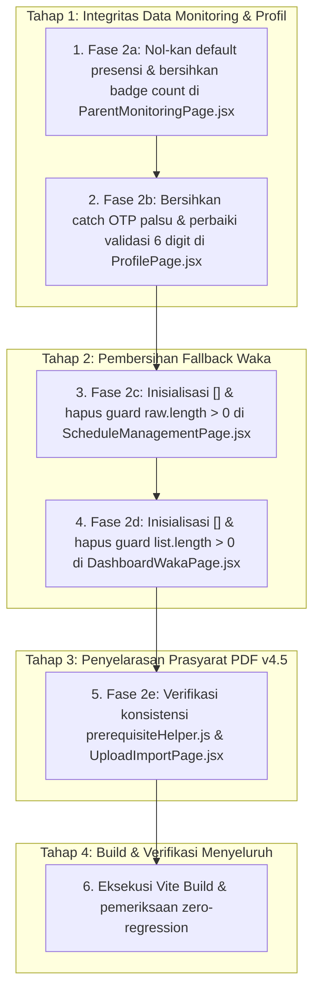

# Implementation Plan — Fase 2 (P1): Integritas Data & Penyelarasan Prasyarat PDF (Zero-Manual v4.5)

> **Dokumen Status:** Final Technical Specification & Implementation Plan  
> **Versi:** 1.0  
> **Tanggal Perencanaan:** 1 November 2026  
> **Target Eksekusi:** Frontend (`frontend/scp_web/`) & Penyelarasan Kontrak Backend SCP v4.5 (`scp/`)  
> **Tingkat Prioritas:** **P1 (Tinggi — Integritas Data, Eliminasi Data Dummy & Penyelarasan Prasyarat)**  
> **Acuan Utama:** [`INTEGRATION_FIX_PLAN.md`](file:///D:/MyUKK/SchoolClassProject/INTEGRATION_FIX_PLAN.md) Bab 5, 10 & [`CRITICAL_FINDINGS_RESOLUTION_PLAN.md`](file:///D:/MyUKK/SchoolClassProject/CRITICAL_FINDINGS_RESOLUTION_PLAN.md)

---

## 1. Overview

Fase 2 (P1) bertujuan untuk **membersihkan seluruh representasi data palsu (*fake fallback metrics*)** pada antarmuka pengguna serta **menyelaraskan prasyarat impor jadwal dengan arsitektur Zero-Manual Master Data SCP v4.5**.

Pada fase ini, frontend dituntut untuk menyajikan data secara jujur (*data truthfulness*):
1. Menghilangkan data absensi palsu pada portal orang tua yang selama ini memicu peringatan alpa tidak berdasar.
2. Memperbaiki alur verifikasi kontak OTP (Email dan WhatsApp) pada profil pengguna agar tidak lagi menandai kontak terverifikasi secara sepihak saat request backend gagal.
3. Menghilangkan guard `length > 0` dan inisialisasi dataset dummy pada matriks jadwal dan dashboard Waka Kurikulum, sehingga saat database belum memiliki data, komponen menampilkan state kosong (*empty state*) resmi.
4. Menyelaraskan prasyarat impor berkas PDF FET dengan backend v4.5, di mana master ruangan dan mata pelajaran dibuat secara otomatis oleh worker ekstraksi sehingga form unggah hanya mensyaratkan keberadaan data siswa dan guru ber-FET.

---

## 2. Reference Documents

| Dokumen / Berkas Sumber | Path Berkas | Bagian / Fokus Analisis |
|---|---|---|
| **Rencana Induk Integrasi** | [`INTEGRATION_FIX_PLAN.md`](file:///D:/MyUKK/SchoolClassProject/INTEGRATION_FIX_PLAN.md) | Bab 5 (Fase 2a s.d. 2e) & Bab 10 (Berkas Terdampak). |
| **Spesifikasi Zero-Manual v4.5** | [`scp/MD/NewFeature.md`](file:///D:/MyUKK/SchoolClassProject/scp/MD/NewFeature.md) | Bab 1.1, 1.2, & 4 (Kebijakan Prasyarat Baru & Matriks Otomatisasi). |
| **Product Requirements Document** | [`scp/MD/PRD.md`](file:///D:/MyUKK/SchoolClassProject/scp/MD/PRD.md) | Bab 5.2 (Verifikasi Kontak Mandiri), 5.12 (Portal Orang Tua). |
| **Service Prasyarat Backend** | [`scp/app/Services/MasterDataPrerequisiteService.php`](file:///D:/MyUKK/SchoolClassProject/scp/app/Services/MasterDataPrerequisiteService.php#L39-L70) | Implementasi `validateForPdfImport` & `validateForManualSchedule`. |
| **Controller Presensi Backend** | [`scp/app/Http/Controllers/API/AttendanceController.php`](file:///D:/MyUKK/SchoolClassProject/scp/app/Http/Controllers/API/AttendanceController.php#L57-L60) | Scoping presensi untuk role `parent` (`linked_student_id`). |
| **Controller Profil Backend** | [`scp/app/Http/Controllers/API/ProfileController.php`](file:///D:/MyUKK/SchoolClassProject/scp/app/Http/Controllers/API/ProfileController.php#L98-L245) | Endpoint `verifyEmailOtp` & `verifyPhoneOtp` (validasi kode 6-digit). |
| **Portal Orang Tua Frontend** | [`frontend/scp_web/src/pages/parent/ParentMonitoringPage.jsx`](file:///D:/MyUKK/SchoolClassProject/frontend/scp_web/src/pages/parent/ParentMonitoringPage.jsx#L81-L125) | Perhitungan metrik presensi (`summary`) & tab badge count. |
| **Halaman Profil Frontend** | [`frontend/scp_web/src/pages/profile/ProfilePage.jsx`](file:///D:/MyUKK/SchoolClassProject/frontend/scp_web/src/pages/profile/ProfilePage.jsx#L51-L136) | Catch blocks verifikasi & pengiriman OTP Email / WhatsApp. |
| **Matriks Jadwal Waka Frontend** | [`frontend/scp_web/src/pages/waka/ScheduleManagementPage.jsx`](file:///D:/MyUKK/SchoolClassProject/frontend/scp_web/src/pages/waka/ScheduleManagementPage.jsx#L31-L255) | Konstanta `FALLBACK_SCHEDULES` & guard `raw.length > 0`. |
| **Dashboard Waka Frontend** | [`frontend/scp_web/src/pages/waka/DashboardWakaPage.jsx`](file:///D:/MyUKK/SchoolClassProject/frontend/scp_web/src/pages/waka/DashboardWakaPage.jsx#L10-L115) | Konstanta `FALLBACK_HISTORY`, `FALLBACK_MISSING_JOURNALS`, & guard. |
| **Helper Prasyarat Frontend** | [`frontend/scp_web/src/utils/prerequisiteHelper.js`](file:///D:/MyUKK/SchoolClassProject/frontend/scp_web/src/utils/prerequisiteHelper.js) | Validator `checkPdfImportPrerequisites` & `checkManualSchedulePrerequisites`. |
| **Halaman Unggah PDF FET** | [`frontend/scp_web/src/pages/waka/UploadImportPage.jsx`](file:///D:/MyUKK/SchoolClassProject/frontend/scp_web/src/pages/waka/UploadImportPage.jsx#L50-L305) | Integrasi banner checklist prasyarat & proteksi tombol unggah. |

---

## 3. Current Condition Analysis

### 3.1 Fase 2a — Data Kehadiran Palsu pada Portal Orang Tua
* **Lokasi Kode:** [`ParentMonitoringPage.jsx` L81-96 & L120-123](file:///D:/MyUKK/SchoolClassProject/frontend/scp_web/src/pages/parent/ParentMonitoringPage.jsx#L81-L96)
* **Kondisi Aktual:**
  ```javascript
  // L81-84:
  const summary = useMemo(() => {
    if (attendances.length === 0) {
      return { hadir: 42, sakit: 3, izin: 2, alpa: 1 };
    }
    // ...
  });

  // L120-123:
  const tabs = [
    { id: 'attendance', label: 'Rekapitulasi Kehadiran', count: attendances.length || 48 },
    { id: 'permissions', label: 'Riwayat Izin & Dispensasi', count: leaveRequests.length || 1 },
    { id: 'quizzes', label: 'Capaian Nilai Kuis AI', count: quizzes.length || 4 },
  ];
  ```
* **Masalah Kritis:**
  1. Ketika orang tua login dan anak yang bersangkutan belum memiliki riwayat presensi di database (`attendances.length === 0`), `summary` mengembalikan data hardcoded: **42 hadir, 3 sakit, 2 izin, dan 1 alpa**.
  2. Nilai `summary.alpa = 1` memicu blok evaluasi peringatan kehadiran (L99–106):
     ```javascript
     if (summary.alpa > 0) {
       return {
         hasAlert: true,
         type: 'danger',
         title: 'Peringatan Ketidakhadiran Tanpa Keterangan (Alpa)',
         message: `Terdeteksi ${summary.alpa} kali catatan alpa...`,
       };
     }
     ```
     Akibatnya, orang tua selalu disambut oleh banner merah darurat palsu yang menyatakan anaknya memiliki 1 catatan alpa.
  3. Badge counter pada tab navigasi menggunakan operator fallback logika JavaScript: `attendances.length || 48`. Ketika jumlah presensi adalah `0`, angka `0` diperlakukan sebagai nilai falsy sehingga badge justru menampilkan angka **48**, izin menampilkan **1**, dan kuis menampilkan **4**.

---

### 3.2 Fase 2b — Catch Block Verifikasi OTP pada Profil Pengguna
* **Lokasi Kode:** [`ProfilePage.jsx` L51-136](file:///D:/MyUKK/SchoolClassProject/frontend/scp_web/src/pages/profile/ProfilePage.jsx#L51-L136)
* **Kondisi Aktual:**
  ```javascript
  // Verifikasi Email (L81-92):
  try {
    await authApi.verifyEmailOtp({ email, code: emailOtp });
    setEmailVerified(true);
    setEmailOtpSent(false);
    updateUserProfile({ email, email_verified_at: new Date().toISOString() });
  } catch {
    setEmailVerified(true);
    setEmailOtpSent(false);
    updateUserProfile({ email, email_verified_at: new Date().toISOString() });
  }

  // Verifikasi WhatsApp (L124-135):
  try {
    await authApi.verifyPhoneOtp({ phone_number: waNumber, code: waOtp });
    setWaVerified(true);
    setWaOtpSent(false);
    updateUserProfile({ phone_number: waNumber });
  } catch {
    setWaVerified(true);
    setWaOtpSent(false);
    updateUserProfile({ phone_number: waNumber });
  }
  ```
* **Masalah Kritis:**
  1. Jika backend mengembalikan respons error (HTTP 422 Kode OTP salah / kedaluwarsa, HTTP 429 rate limit, atau HTTP 500), blok `catch` tetap menandai `setEmailVerified(true)` dan `setWaVerified(true)`, serta memutakhirkan state pengguna lokal. Pengguna dapat memasukkan kode acak apa pun dan profil langsung dianggap terverifikasi.
  2. Pada fungsi kirim OTP (`handleSendEmailOtp` L64–68 dan `handleSendWaOtp` L108–111), blok `catch` masih menyertakan komentar *"Fallback demo support"* yang tetap mengeksekusi `setOtpSent(true)` saat request kirim gagal di server.
  3. Validasi panjang input di form (L74 dan L117) memeriksa `otp.length < 4`. Padahal backend [`ProfileController.php` L102 & L224](file:///D:/MyUKK/SchoolClassProject/scp/app/Http/Controllers/API/ProfileController.php#L102) secara tegas mewajibkan kode berukuran 6 karakter (`size:6`).

---

### 3.3 Fase 2c — Fallback Jadwal Waka & Guard `raw.length > 0`
* **Lokasi Kode:** [`ScheduleManagementPage.jsx` L31-123, L131, L228-254](file:///D:/MyUKK/SchoolClassProject/frontend/scp_web/src/pages/waka/ScheduleManagementPage.jsx#L31-L123)
* **Kondisi Aktual:**
  ```javascript
  // L131:
  const [scheduleList, setScheduleList] = useState(FALLBACK_SCHEDULES);

  // L228-231:
  const schedRes = await scheduleApi.getSchedules({ cycle: selectedCycle });
  if (isMounted && schedRes?.data) {
    const raw = Array.isArray(schedRes.data) ? schedRes.data : schedRes.data.data || [];
    if (raw.length > 0) {
      const mapped = raw.map((s) => ({ ... }));
      setScheduleList(mapped);
    }
  }
  ```
* **Masalah Kritis:**
  1. State `scheduleList` diinisialisasi dengan konstanta `FALLBACK_SCHEDULES` (4 baris jadwal tiruan guru Drs. Ahmad Fauzi).
  2. Ketika database sekolah belum memiliki data jadwal sama sekali pada putaran terkait (`raw.length === 0`), blok guard `if (raw.length > 0)` dilewati. Akibatnya, pemanggilan `setScheduleList` tidak pernah dijalankan, dan antarmuka secara permanen menampilkan 4 baris jadwal dummy tersebut.
  3. Waka Kurikulum tidak dapat melihat kondisi jadwal riil yang kosong, dan grid jadwal tidak merepresentasikan status database yang sebenarnya.

---

### 3.4 Fase 2d — Fallback Dashboard Waka & Guard `list.length > 0`
* **Lokasi Kode:** [`DashboardWakaPage.jsx` L10-40, L50, L53, L90-115](file:///D:/MyUKK/SchoolClassProject/frontend/scp_web/src/pages/waka/DashboardWakaPage.jsx#L10-L40)
* **Kondisi Aktual:**
  ```javascript
  // L50 & L53:
  const [historyList, setHistoryList] = useState(FALLBACK_HISTORY);
  const [missingJournals, setMissingJournals] = useState(FALLBACK_MISSING_JOURNALS);

  // L91-96 (Riwayat Putaran):
  const historyRes = await academicSettingApi.getCycleHistory();
  if (isMounted && historyRes?.data) {
    const list = Array.isArray(historyRes.data) ? historyRes.data : historyRes.data.data || [];
    if (list.length > 0) setHistoryList(list);
  }
  ```
* **Masalah Kritis:**
  1. `historyList` diinisialisasi dengan `FALLBACK_HISTORY` (2 catatan log audit palsu). Jika tabel database `cycle_history` masih kosong (`list.length === 0`), guard `if (list.length > 0)` mencegah pembaruan state ke array kosong.
  2. Tabel riwayat putaran pada baris 458 sebenarnya telah memiliki prop `emptyMessage="Belum ada riwayat perubahan putaran jadwal."`, namun komponen ini tidak pernah muncul karena state tidak pernah menjadi array kosong.
  3. `missingJournals` diinisialisasi dengan `FALLBACK_MISSING_JOURNALS` (2 sesi jurnal terlambat dummy). Meskipun pembaruan API dijalankan, inisialisasi ini menimbulkan kedipan data palsu (*data flashing*) sebelum request API selesai.

---

### 3.5 Fase 2e — Penyelarasan Prasyarat Import PDF FET (Aturan v4.5)
* **Lokasi Kode:**
  - [`frontend/scp_web/src/utils/prerequisiteHelper.js`](file:///D:/MyUKK/SchoolClassProject/frontend/scp_web/src/utils/prerequisiteHelper.js)
  - [`frontend/scp_web/src/pages/waka/UploadImportPage.jsx`](file:///D:/MyUKK/SchoolClassProject/frontend/scp_web/src/pages/waka/UploadImportPage.jsx)
  - Acuan Backend: [`MasterDataPrerequisiteService.php` L39-70](file:///D:/MyUKK/SchoolClassProject/scp/app/Services/MasterDataPrerequisiteService.php#L39-L70)
* **Kondisi Aktual:**
  - Pada commit `bd1e903` (penyelesaian temuan kritis CRIT-03), fungsi `checkPdfImportPrerequisites` telah ditambahkan pada `prerequisiteHelper.js` dan banner checklist dinamis telah dipasang pada `UploadImportPage.jsx`.
  - **Pemeriksaan Keselarasan Kontrak:**
    Backend `validateForPdfImport` mensyaratkan:
    1. Minimal 1 Siswa aktif (`role = student`, `deleted_at is null`).
    2. Minimal 1 Guru aktif (`role = teacher`, `deleted_at is null`).
    3. Minimal 1 Guru aktif yang memiliki `fet_staff_id`.
    Seluruh entitas lain (`classes`, `rooms`, `subjects`) **secara tegas dilepas dari prasyarat upload PDF**.
  - **Kondisi UI:**
    Banner prasyarat sudah membedakan antara status "Siap Impor" dan "Perlu Aksi Waka", serta mengunci tombol *"Mulai Proses Impor & Ekstraksi"* jika prasyarat siswa atau FET ID guru belum terpenuhi.
  - **Area yang Perlu Dikonfirmasi:**
    Memastikan tidak ada sisa pemanggilan fungsi validator lama `checkMasterDataPrerequisites` yang masih mewajibkan kelas/ruang/mapel pada alur impor PDF, dan memastikan styling banner responsif pada seluruh ukuran layar.

---

## 4. Technical Implementation Plan

### 4.1 Rencana Teknis Fase 2a: Nol-kan Default Kehadiran Portal Orang Tua

#### Berkas Terdampak: [`frontend/scp_web/src/pages/parent/ParentMonitoringPage.jsx`](file:///D:/MyUKK/SchoolClassProject/frontend/scp_web/src/pages/parent/ParentMonitoringPage.jsx)
1. **Pembersihan Fallback Metrik Presensi (Baris 81–96):**
   Ubah blok perhitungan `summary`:
   ```javascript
   // SEBELUM:
   const summary = useMemo(() => {
     if (attendances.length === 0) {
       return { hadir: 42, sakit: 3, izin: 2, alpa: 1 };
     }
     return attendances.reduce( ... );
   }, [attendances]);

   // SESUDAH:
   const summary = useMemo(() => {
     if (attendances.length === 0) {
       return { hadir: 0, sakit: 0, izin: 0, alpa: 0 };
     }
     return attendances.reduce(
       (acc, item) => {
         const st = (item.status || '').toLowerCase();
         if (st === 'hadir' || st === 'present') acc.hadir += 1;
         else if (st === 'sakit' || st === 'sick') acc.sakit += 1;
         else if (st === 'izin' || st === 'permit') acc.izin += 1;
         else if (st === 'alpa' || st === 'absent') acc.alpa += 1;
         return acc;
       },
       { hadir: 0, sakit: 0, izin: 0, alpa: 0 }
     );
   }, [attendances]);
   ```
2. **Pembersihan Badge Counter Tab (Baris 120–124):**
   Hapus operator `|| <angka>` pada array tab navigasi:
   ```javascript
   // SEBELUM:
   const tabs = [
     { id: 'attendance', label: 'Rekapitulasi Kehadiran', count: attendances.length || 48 },
     { id: 'permissions', label: 'Riwayat Izin & Dispensasi', count: leaveRequests.length || 1 },
     { id: 'quizzes', label: 'Capaian Nilai Kuis AI', count: quizzes.length || 4 },
   ];

   // SESUDAH:
   const tabs = [
     { id: 'attendance', label: 'Rekapitulasi Kehadiran', count: attendances.length },
     { id: 'permissions', label: 'Riwayat Izin & Dispensasi', count: leaveRequests.length },
     { id: 'quizzes', label: 'Capaian Nilai Kuis AI', count: quizzes.length },
   ];
   ```
3. **Hasil yang Diharapkan:**
   - Saat anak belum memiliki catatan presensi di database, 4 kartu metrik presensi menampilkan angka `0` secara presisi dan jujur.
   - Peringatan alpa palsu tidak pernah muncul jika memang tidak ada catatan alpa riil di database.
   - Badge tab menampilkan angka `0` jika dataset kosong.

---

### 4.2 Rencana Teknis Fase 2b: Perbaikan Catch Block OTP Profil

#### Berkas Terdampak: [`frontend/scp_web/src/pages/profile/ProfilePage.jsx`](file:///D:/MyUKK/SchoolClassProject/frontend/scp_web/src/pages/profile/ProfilePage.jsx)
1. **Refactor Handler Verifikasi OTP Email (`handleVerifyEmailOtp`, Baris 73–93):**
   - Validasi panjang kode: periksa `emailOtp.trim().length !== 6`.
   - Hapus pembaruan status sukses palsu pada blok `catch`:
   ```javascript
   const handleVerifyEmailOtp = async () => {
     if (emailOtp.trim().length !== 6) {
       setEmailError('Masukkan 6 digit kode OTP verifikasi email dengan benar.');
       return;
     }
     setEmailLoading(true);
     setEmailError('');

     try {
       await authApi.verifyEmailOtp({ email, code: emailOtp.trim() });
       setEmailVerified(true);
       setEmailOtpSent(false);
       updateUserProfile({ email, email_verified_at: new Date().toISOString() });
     } catch (err) {
       setEmailError(
         err.message || err.raw?.response?.data?.message || 'Kode verifikasi email tidak valid atau telah kedaluwarsa.'
       );
     } finally {
       setEmailLoading(false);
     }
   };
   ```
2. **Refactor Handler Pengiriman OTP Email (`handleSendEmailOtp`, Baris 51–71):**
   - Hapus simulasi demo sukses di blok `catch`:
   ```javascript
   const handleSendEmailOtp = async () => {
     if (!email || !email.includes('@')) {
       setEmailError('Alamat email valid wajib diisi.');
       return;
     }
     setEmailLoading(true);
     setEmailError('');
     setEmailMsg('');

     try {
       await authApi.requestEmailOtp(email);
       setEmailOtpSent(true);
       setEmailMsg('Kode OTP 6-digit berhasil dikirim ke email Anda.');
     } catch (err) {
       setEmailError(
         err.message || err.raw?.response?.data?.message || 'Gagal mengirim kode OTP ke email. Coba beberapa saat lagi.'
       );
     } finally {
       setEmailLoading(false);
     }
   };
   ```
3. **Refactor Handler Verifikasi OTP WhatsApp (`handleVerifyWaOtp`, Baris 116–136):**
   - Validasi panjang kode: periksa `waOtp.trim().length !== 6`.
   - Hapus pembaruan status sukses palsu pada blok `catch`:
   ```javascript
   const handleVerifyWaOtp = async () => {
     if (waOtp.trim().length !== 6) {
       setWaError('Masukkan 6 digit kode OTP verifikasi WhatsApp dengan benar.');
       return;
     }
     setWaLoading(true);
     setWaError('');

     try {
       await authApi.verifyPhoneOtp({ phone_number: waNumber, code: waOtp.trim() });
       setWaVerified(true);
       setWaOtpSent(false);
       updateUserProfile({ phone_number: waNumber });
     } catch (err) {
       setWaError(
         err.message || err.raw?.response?.data?.message || 'Kode verifikasi WhatsApp tidak valid atau telah kedaluwarsa.'
       );
     } finally {
       setWaLoading(false);
     }
   };
   ```
4. **Refactor Handler Pengiriman OTP WhatsApp (`handleSendWaOtp`, Baris 95–114):**
   - Hapus simulasi demo sukses di blok `catch`:
   ```javascript
   const handleSendWaOtp = async () => {
     if (!waNumber || waNumber.length < 9) {
       setWaError('Nomor WhatsApp valid wajib diisi.');
       return;
     }
     setWaLoading(true);
     setWaError('');
     setWaMsg('');

     try {
       await authApi.requestPhoneOtp(waNumber);
       setWaOtpSent(true);
       setWaMsg('Kode OTP telah dikirim ke nomor WhatsApp Anda.');
     } catch (err) {
       setWaError(
         err.message || err.raw?.response?.data?.message || 'Gagal mengirim kode OTP WhatsApp. Periksa nomor Anda.'
       );
     } finally {
       setWaLoading(false);
     }
   };
   ```
5. **Hasil yang Diharapkan:**
   - Status centang hijau terverifikasi **HANYA muncul jika API backend merespons HTTP 200**.
   - Kesalahan kode OTP (HTTP 422) menampilkan pesan kesalahan resmi server di bawah input OTP.

---

### 4.3 Rencana Teknis Fase 2c: Pembersihan Guard & Fallback Jadwal Waka

#### Berkas Terdampak: [`frontend/scp_web/src/pages/waka/ScheduleManagementPage.jsx`](file:///D:/MyUKK/SchoolClassProject/frontend/scp_web/src/pages/waka/ScheduleManagementPage.jsx)
1. **Inisialisasi State ke Array Kosong (Baris 131):**
   ```javascript
   // SEBELUM:
   const [scheduleList, setScheduleList] = useState(FALLBACK_SCHEDULES);

   // SESUDAH:
   const [scheduleList, setScheduleList] = useState([]);
   ```
2. **Hapus Guard `raw.length > 0` (Baris 226–254):**
   ```javascript
   // SEBELUM:
   try {
     const schedRes = await scheduleApi.getSchedules({ cycle: selectedCycle });
     if (isMounted && schedRes?.data) {
       const raw = Array.isArray(schedRes.data) ? schedRes.data : schedRes.data.data || [];
       if (raw.length > 0) {
         const mapped = raw.map((s) => ({ ... }));
         setScheduleList(mapped);
       }
     }
   } catch { ... }

   // SESUDAH:
   try {
     const schedRes = await scheduleApi.getSchedules({ cycle: selectedCycle });
     if (isMounted && schedRes?.data) {
       const raw = Array.isArray(schedRes.data) ? schedRes.data : schedRes.data.data || [];
       const mapped = raw.map((s) => ({
         id: s.id,
         cycle: Number(s.cycle_type || s.cycle || 1),
         cycle_type: Number(s.cycle_type || s.cycle || 1),
         day: typeof s.day_of_week === 'number' ? NUMBER_TO_DAY[s.day_of_week] || 'Senin' : s.day || 'Senin',
         day_of_week: typeof s.day_of_week === 'number' ? s.day_of_week : DAY_TO_NUMBER[s.day] || 1,
         slot: Number(s.period_number || s.slot || 1),
         period_number: Number(s.period_number || s.slot || 1),
         duration: Number(s.duration_periods || s.duration || 1),
         duration_periods: Number(s.duration_periods || s.duration || 1),
         teacher_id: s.teacher_id || s.teacher?.id,
         class_id: s.class_id || s.school_class?.id,
         room_id: s.room_id || s.room?.id,
         subject_id: s.subject_id || s.subject?.id,
         teacherName: s.teacher?.name || s.teacherName || 'Guru',
         className: s.school_class?.name || s.className || 'Kelas',
         level: s.school_class?.level || s.level || 10,
         roomName: s.room?.name || s.roomName || 'Ruang',
         roomType: s.room?.type || s.roomType || 'kelas',
         subjectName: s.subject?.name || s.subjectName || 'Mata Pelajaran',
       }));
       setScheduleList(mapped);
     }
   } catch (err) {
     console.error('Gagal mengambil daftar jadwal pelajaran:', err);
     if (isMounted) setScheduleList([]);
   }
   ```
3. **Hapus Konstanta Dummy `FALLBACK_SCHEDULES` (Baris 31–123):**
   Hapus deklarasi konstanta array fallback untuk membersihkan file dari kode mati (*dead code*).
4. **Hasil yang Diharapkan:**
   - Jika putaran yang dipilih belum memiliki jadwal, matriks jadwal menampilkan sel-sel kosong yang bersih.
   - Tidak ada lagi jadwal dummy guru Ahmad Fauzi yang membingungkan Waka Kurikulum.

---

### 4.4 Rencana Teknis Fase 2d: Pembersihan Guard & Fallback Dashboard Waka

#### Berkas Terdampak: [`frontend/scp_web/src/pages/waka/DashboardWakaPage.jsx`](file:///D:/MyUKK/SchoolClassProject/frontend/scp_web/src/pages/waka/DashboardWakaPage.jsx)
1. **Inisialisasi State ke Array Kosong (Baris 50 & 53):**
   ```javascript
   // SEBELUM:
   const [historyList, setHistoryList] = useState(FALLBACK_HISTORY);
   const [missingJournals, setMissingJournals] = useState(FALLBACK_MISSING_JOURNALS);

   // SESUDAH:
   const [historyList, setHistoryList] = useState([]);
   const [missingJournals, setMissingJournals] = useState([]);
   ```
2. **Hapus Guard `list.length > 0` pada Riwayat Putaran (Baris 90–100):**
   ```javascript
   // SEBELUM:
   try {
     const historyRes = await academicSettingApi.getCycleHistory();
     if (isMounted && historyRes?.data) {
       const list = Array.isArray(historyRes.data)
         ? historyRes.data
         : historyRes.data.data || [];
       if (list.length > 0) setHistoryList(list);
     }
   } catch { ... }

   // SESUDAH:
   try {
     const historyRes = await academicSettingApi.getCycleHistory();
     if (isMounted && historyRes?.data) {
       const list = Array.isArray(historyRes.data)
         ? historyRes.data
         : historyRes.data.data || [];
       setHistoryList(list);
     }
   } catch (err) {
     console.error('Gagal memuat riwayat putaran:', err);
     if (isMounted) setHistoryList([]);
   }
   ```
3. **Pembersihan Missing Journals (Baris 102–118):**
   Pastikan jika fetch gagal, `setMissingJournals([])` dipanggil alih-alih mempertahankan data dummy.
4. **Hapus Konstanta Dummy `FALLBACK_HISTORY` & `FALLBACK_MISSING_JOURNALS` (Baris 10–40).**
5. **Hasil yang Diharapkan:**
   - Tabel riwayat menampilkan status resmi: *"Belum ada riwayat perubahan putaran jadwal."* jika database masih baru.
   - Peringatan keterlambatan jurnal menampilkan badge hijau *"Lengkap"* dan teks *"Seluruh guru pengampu telah mengisi jurnal KBM hari ini dengan lengkap."* jika tidak ada keterlambatan riil.

---

### 4.5 Rencana Teknis Fase 2e: Penyelarasan Prasyarat Import PDF FET (Aturan v4.5)

#### Berkas Terdampak:
- [`frontend/scp_web/src/utils/prerequisiteHelper.js`](file:///D:/MyUKK/SchoolClassProject/frontend/scp_web/src/utils/prerequisiteHelper.js)
- [`frontend/scp_web/src/pages/waka/UploadImportPage.jsx`](file:///D:/MyUKK/SchoolClassProject/frontend/scp_web/src/pages/waka/UploadImportPage.jsx)

#### Verifikasi & Refinement Teknis:
1. **Validator `checkPdfImportPrerequisites`:**
   - Memastikan validator mengevaluasi:
     - `studentCount > 0` (Kriteria: Siswa Aktif).
     - `teacherCount > 0` (Kriteria: Guru Aktif).
     - `fetTeacherCount > 0` (Kriteria: Guru dengan FET Staff ID).
   - Memastikan tidak ada ketergantungan pada `classes`, `rooms`, atau `subjects`.
2. **Komponen Banner Checklist di `UploadImportPage.jsx`:**
   - Menampilkan checklist interaktif:
     - [x] Data Siswa Aktif Terdaftar ($N$ siswa) $\rightarrow$ Tombol *"Impor Siswa"* jika belum ada.
     - [x] Data Guru & Kode Staf FET Terisi ($M$ guru) $\rightarrow$ Tombol *"Lengkapi FET ID Guru"* jika belum ada.
     - [i] Keterangan informatif: *"Kebijakan Zero-Manual v4.5: Master Ruangan dan Mata Pelajaran tidak perlu diinput manual. Sistem akan mengekstrak dan mendaftarkannya secara otomatis saat berkas PDF diproses."*
   - Memastikan tombol *"Mulai Proses Impor & Ekstraksi"* terkunci (`disabled`) jika `!prerequisiteStatus?.isReady`.

---

## 5. Affected Files

| # | Path Berkas | Peran Komponen | Jenis Perubahan |
|---|---|---|---|
| 1 | [`frontend/scp_web/src/pages/parent/ParentMonitoringPage.jsx`](file:///D:/MyUKK/SchoolClassProject/frontend/scp_web/src/pages/parent/ParentMonitoringPage.jsx) | Portal Monitoring Orang Tua | Ganti fallback `summary` ke `{ hadir: 0, sakit: 0, izin: 0, alpa: 0 }`; bersihkan operator `|| <angka>` pada badge tab. |
| 2 | [`frontend/scp_web/src/pages/profile/ProfilePage.jsx`](file:///D:/MyUKK/SchoolClassProject/frontend/scp_web/src/pages/profile/ProfilePage.jsx) | Manajemen Akun & Profil | Hapus mutasi sukses pada `catch` verifikasi OTP email & WA; tangkap pesan error HTTP 422; perbaiki validasi panjang OTP ke 6 digit. |
| 3 | [`frontend/scp_web/src/pages/waka/ScheduleManagementPage.jsx`](file:///D:/MyUKK/SchoolClassProject/frontend/scp_web/src/pages/waka/ScheduleManagementPage.jsx) | Matriks Jadwal Waka | Inisialisasi state `useState([])`; hapus guard `raw.length > 0`; hapus konstanta `FALLBACK_SCHEDULES`. |
| 4 | [`frontend/scp_web/src/pages/waka/DashboardWakaPage.jsx`](file:///D:/MyUKK/SchoolClassProject/frontend/scp_web/src/pages/waka/DashboardWakaPage.jsx) | Dashboard Utama Waka | Inisialisasi state `useState([])`; hapus guard `list.length > 0`; hapus konstanta `FALLBACK_HISTORY` & `FALLBACK_MISSING_JOURNALS`. |
| 5 | [`frontend/scp_web/src/utils/prerequisiteHelper.js`](file:///D:/MyUKK/SchoolClassProject/frontend/scp_web/src/utils/prerequisiteHelper.js) | Utility Prasyarat Master Data | Verifikasi konsistensi ekspor `checkPdfImportPrerequisites` (Zero-Manual v4.5) & `checkManualSchedulePrerequisites`. |
| 6 | [`frontend/scp_web/src/pages/waka/UploadImportPage.jsx`](file:///D:/MyUKK/SchoolClassProject/frontend/scp_web/src/pages/waka/UploadImportPage.jsx) | Upload Jadwal PDF FET | Verifikasi checklist banner prasyarat & proteksi tombol impor berbasis `prerequisiteStatus.isReady`. |

---

## 6. Execution Sequence & Dependensi

Kelima sub-pekerjaan pada Fase 2 bersifat **saling independen (*orthogonal*)** karena menyentuh modul dan halaman yang terisolasi. Namun, untuk menjamin pengujian terstruktur, urutan eksekusi berikut direkomendasikan:



---

## 7. Risk Analysis

| # | Potensi Risiko | Tingkat Dampak | Probabilitas | Strategi Mitigasi Teknis |
|---|---|:---:|:---:|---|
| 1 | Halaman orang tua tampak rusak jika `summary` bernilai nol | Rendah | Rendah | Komponen kartu metrik telah mendukung angka `0` dengan format visual rapi. Tabel telah memiliki `emptyMessage` bawaan. |
| 2 | Pengguna tidak dapat memverifikasi OTP jika backend layanan email/WA belum terkonfigurasi | Sedang | Sedang | Pesan error dari server (HTTP 422/500) ditampilkan secara jelas di antarmuka agar pengguna/penguji memahami bahwa masalah berada pada kredensial SMTP/Twilio, bukan bug aplikasi. |
| 3 | Matriks jadwal kosong membingungkan Waka yang ingin melihat contoh jadwal | Rendah | Rendah | Matriks tetap merender seluruh header hari dan slot jam (1–10). Waka dapat langsung mengeklik sel slot kosong untuk membuat jadwal baru atau memanfaatkan impor PDF. |
| 4 | Pengecekan prasyarat PDF memblokir Waka jika database belum memiliki FET ID guru | Sedang | Rendah | Banner checklist menyajikan tombol tautan langsung (*direct action*) menuju menu Master Data untuk melengkapi data yang kurang. |

---

## 8. Testing Strategy

### 8.1 Verifikasi Backend (Prerequisite Service Test)
Jalankan pengujian unit dan fitur backend untuk memastikan aturan prasyarat v4.5 valid:
```powershell
cd scp; php artisan test --filter=MasterDataPrerequisiteRuleTest
```
**Kriteria Hasil:** Seluruh test assertion lulus (**PASS**).

### 8.2 Verifikasi Frontend (Manual E2E)

#### Skenario 1: Integritas Presensi Orang Tua (Fase 2a)
1. Login menggunakan akun Orang Tua (`role: parent`).
2. Buka halaman `/parent/monitoring`.
3. **Hasil yang Diharapkan:**
   - Jika anak belum memiliki data absen: 4 kartu metrik presensi menunjukkan angka **0 Hadir, 0 Sakit, 0 Izin, 0 Alpa**.
   - Tidak ada banner merah peringatan alpa.
   - Badge tab navigasi presensi menampilkan angka `0` (bukan 48).
   - Tabel menampilkan pesan kosong resmi: *"Belum ada catatan presensi anak untuk periode ini."*

#### Skenario 2: Integritas Verifikasi OTP Profil (Fase 2b)
1. Login sebagai akun Guru atau Siswa, buka `/profile`.
2. Masukkan alamat email baru dan kirim OTP.
3. Masukkan kode OTP salah (misal: `000000`) lalu klik Verifikasi.
4. **Hasil yang Diharapkan:**
   - Muncul pesan error merah: *"Kode verifikasi tidak valid atau telah kedaluwarsa."*
   - Status **TIDAK berubah menjadi centang hijau terverifikasi**.
   - Masukkan kode kurang dari 6 digit $\rightarrow$ Form memvalidasi: *"Masukkan 6 digit kode OTP verifikasi email dengan benar."*

#### Skenario 3: Pembersihan Jadwal Dummy Waka (Fase 2c)
1. Login sebagai Waka Kurikulum, buka `/web/schedules`.
2. Pilih Putaran 1 atau Putaran 2 yang belum memiliki data di database.
3. **Hasil yang Diharapkan:**
   - Grid matriks menampilkan sel kosong bersih tanpa baris dummy guru Ahmad Fauzi.
   - Slot waktu upacara hari Senin tetap ter-render sesuai setting akademik.

#### Skenario 4: Pembersihan Dashboard Waka (Fase 2d)
1. Buka dashboard Waka (`/web/dashboard`).
2. **Hasil yang Diharapkan:**
   - Jika tidak ada keterlambatan jurnal: Card menampilkan badge hijau *"Lengkap"*, 0 sesi belum diisi, dan banner centang hijau *"Seluruh guru pengampu telah mengisi jurnal KBM hari ini dengan lengkap."*.
   - Tabel riwayat putaran menampilkan: *"Belum ada riwayat perubahan putaran jadwal."*.

#### Skenario 5: Checklist Prasyarat PDF FET (Fase 2e)
1. Buka halaman `/web/upload-import`.
2. **Hasil yang Diharapkan:**
   - Muncul banner checklist Master Data prasyarat (Siswa & Guru ber-FET).
   - Terdapat catatan informatif Zero-Manual bahwa ruangan dan mapel akan didaftarkan otomatis dari berkas PDF.
   - Tombol unggah terkunci jika siswa atau FET ID guru belum tersedia.

---

## 9. Acceptance Criteria (Definisi Selesai)

- [ ] `ParentMonitoringPage.jsx`: Fallback metrik presensi bernilai `{ hadir: 0, sakit: 0, izin: 0, alpa: 0 }`.
- [ ] `ParentMonitoringPage.jsx`: Badge count tab presensi, izin, dan kuis tidak lagi menggunakan fallback `|| 48`, `|| 1`, `|| 4`.
- [ ] `ProfilePage.jsx`: Blok `catch` pada `handleVerifyEmailOtp` dan `handleVerifyWaOtp` tidak lagi menandai status kontak terverifikasi secara sepihak.
- [ ] `ProfilePage.jsx`: Validasi kode OTP memeriksa panjang tepat 6 digit numerik.
- [ ] `ScheduleManagementPage.jsx`: State jadwal diinisialisasi `[]`, guard `raw.length > 0` dihapus, konstanta `FALLBACK_SCHEDULES` dibersihkan.
- [ ] `DashboardWakaPage.jsx`: State riwayat dan missing journals diinisialisasi `[]`, guard `list.length > 0` dihapus, konstanta `FALLBACK_HISTORY` & `FALLBACK_MISSING_JOURNALS` dibersihkan.
- [ ] `UploadImportPage.jsx` & `prerequisiteHelper.js`: Menggunakan aturan prasyarat Zero-Manual v4.5 (hanya mengecek siswa aktif dan guru ber-FET ID).
- [ ] Build frontend Vite (`npm run build`) berhasil 100% tanpa error kompilasi.

---

## 10. Open Questions & Decisions

Sebelum mengeksekusi implementasi, berikut dua pertanyaan desain teknis untuk konfirmasi:

1. **Perilaku Tombol Kirim OTP pada `ProfilePage.jsx`:**
   - Pada `handleSendEmailOtp` dan `handleSendWaOtp`, saat request gagal di server, kode lama menyimulasikan sukses (*"Fallback demo support"*).
   - *Rekomendasi:* Hapus total simulasi demo tersebut, sehingga jika pengiriman OTP gagal (misal server belum terhubung ke SMTP/Twilio), antarmuka menampilkan pesan error merah *"Gagal mengirim kode OTP. Periksa koneksi/kredensial layanan."*, bukan memunculkan form input OTP.
2. **Penanganan Kasus Gagal Fetch (Network Error) pada Jadwal & Dashboard Waka:**
   - Ketika request jadwal atau riwayat putaran mengalami error jaringan/server (catch block), kode direncanakan menyetel state ke array kosong `[]` disertai log error, bukan mengisi dengan data dummy.
   - *Rekomendasi:* Disetujui, agar antarmuka konsisten tidak pernah menyajikan data tiruan kepada pengguna.

---

## 11. Implementation Boundaries (Batasan Wajib)

1. **Scope Freeze:** Dilarang mengubah berkas di luar ruang lingkup Fase 2 (misalnya `MasterDataPage.jsx`, `TeacherSchedulePage.jsx`, `PermissionVerifyPage.jsx`, atau `quizApi.js` yang masuk ke Fase 3, 4, dan 5).
2. **Larangan Modifikasi Backend:** Tidak boleh mengubah controller, service, atau test di `scp/` karena backend v4.5 sudah sesuai spesifikasi.
3. **Penyimpanan State:** Dilarang memperkenalkan fallback data tiruan baru dalam bentuk apa pun.
