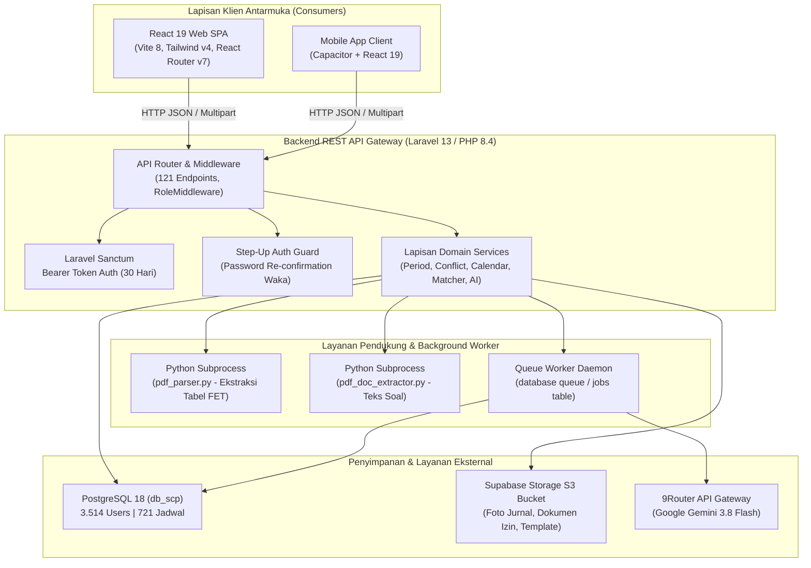
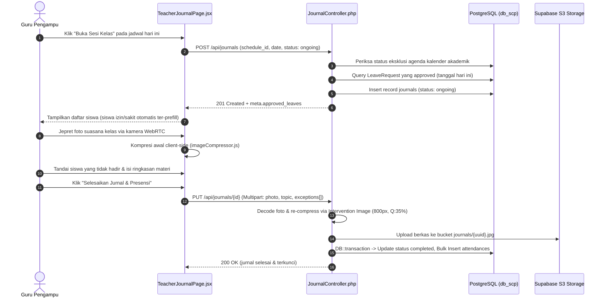
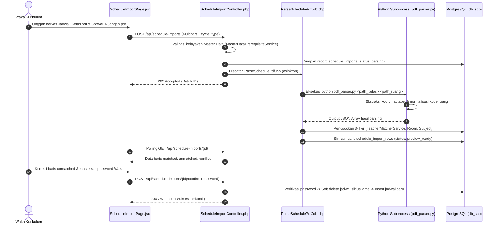

# School Class Progress (SCP)
### Platform Manajemen Operasional Akademik, Jadwal KBM, Presensi Siswa, & Asesmen Kuis AI Terpadu

> **Fase Pengembangan:** Uji Kompetensi Keahlian (UKK) Rekayasa Perangkat Lunak 2026/2027 — SMK Negeri 1 Bantul  
> **Arsitektur Sistem:** *Headless API-First Architecture* (Backend REST API murni, Frontend Web SPA, dan Mobile App Client)  
> **Status Implementasi:** Production-Ready & Tested (425+ Automated Tests)

---

## DAFTAR ISI
1. [Informasi Project](#1-informasi-project)
   - [1.1 Deskripsi & Tujuan Project](#11-deskripsi--tujuan-project)
   - [1.2 Spesifikasi & Arsitektur Sistem](#12-spesifikasi--arsitektur-sistem)
   - [1.3 Teknologi & Tech Stack](#13-teknologi--tech-stack)
   - [1.4 Daftar Library, Package, & Tools Beserta Fungsinya](#14-daftar-library-package--tools-beserta-fungsinya)
   - [1.5 Sistem Autentikasi, Otorisasi, & Pembagian Role](#15-sistem-autentikasi-otorisasi--pembagian-role)
   - [1.6 Database, Standar API, & Integrasi Layanan Eksternal](#16-database-standar-api--integrasi-layanan-eksternal)
2. [Struktur dan Tata Letak File](#2-struktur-dan-tata-letak-file)
   - [2.1 Struktur Folder Proyek](#21-struktur-folder-proyek)
   - [2.2 Tabel Pemetaan Fitur, File, dan Fungsinya](#22-tabel-pemetaan-fitur-file-dan-fungsinya)
   - [2.3 Hubungan Antarfile dalam Alur Kerja Fitur Utama](#23-hubungan-antarfile-dalam-alur-kerja-fitur-utama)
3. [Panduan Pengembangan & Pengoperasian](#3-panduan-pengembangan--pengoperasian)
   - [3.1 Persyaratan Sistem & Dependensi](#31-persyaratan-sistem--dependensi)
   - [3.2 Langkah Instalasi & Konfigurasi Backend](#32-langkah-instalasi--konfigurasi-backend)
   - [3.3 Langkah Instalasi & Menjalankan Frontend Web](#33-langkah-instalasi--menjalankan-frontend-web)
   - [3.4 Referensi Variabel Lingkungan (.env)](#34-referensi-variabel-lingkungan-env)
   - [3.5 Perintah Artisan, Testing, & Database Migration](#35-perintah-artisan-testing--database-migration)
4. [Catatan Status Fitur & Penyesuaian Arsitektur](#4-catatan-status-fitur--penyesuaian-arsitektur)

---

## 1. INFORMASI PROJECT

### 1.1 Deskripsi & Tujuan Project
**School Class Progress (SCP)** adalah sistem informasi terpadu yang dirancang untuk mengelola seluruh aspek operasional Kegiatan Belajar Mengajar (KBM) pada jenjang sekolah menengah kejuruan (SMK), dengan studi kasus implementasi nyata di **SMK Negeri 1 Bantul**.

Tujuan utama project ini:
- Menyediakan **Single Source of Truth** berupa REST API terpusat yang aman, efisien, dan konsisten untuk dikonsumsi oleh Web Client (Waka, Guru, Siswa, Orang Tua) maupun Mobile Client.
- Mengotomatisasi siklus penyusunan jadwal sekolah berbasis **Siklus Putaran (Putaran 1 & Putaran 2)** serta integrasi impor otomatis dari berkas keluaran aplikasi **FET Tim Kurikulum**.
- Mengakomodasi **Resolusi Jam Pelajaran Dinamis** yang menyesuaikan durasi jam belajar secara otomatis terhadap agenda rutin (Upacara Senin, Literasi Selasa, Tadarus/Pendalaman Iman Rabu–Kamis, serta KBM Pendek Jumat).
- Meningkatkan akuntabilitas KBM melalui **Jurnal Mengajar Guru Berbasis Bukti Kamera Realtime** dan **Presensi Exception-Based** yang terintegrasi langsung dengan perizinan siswa.
- Mengintegrasikan evaluasi pembelajaran modern melalui **Modul Kuis Berbantuan AI (*Google Gemini 3.8 Flash*)** untuk pembuatan soal otomatis, ekstraksi dokumen materi, dan koreksi semantik soal esai.

---

### 1.2 Spesifikasi & Arsitektur Sistem
Project mengadopsi pola **Headless API-First Architecture**:
- **Backend Service (`scp/`)**: Dibangun sebagai API Provider mandiri berbasis Laravel 13 dan Laravel Sanctum. Seluruh hak otorisasi dan validasi logika bisnis ditegakkan di sisi server.
- **Frontend Web Service (`frontend/scp_web/`)**: Dibangun sebagai Single Page Application (SPA) berbasis React 19 dan Vite, mengonsumsi endpoint JSON RESTful.
- **Worker & Subprocess**: Pemrosesan berkas PDF tabular kompleks didelegasikan ke subprocess Python (`pdf_parser.py`), sementara pemanggilan AI dan evaluasi kuis dikelola melalui job antrean asinkron.



---

### 1.3 Teknologi & Tech Stack

| Domain | Teknologi | Versi | Peran Teknis |
|:---|:---|:---|:---|
| **Backend Framework** | Laravel Framework | 13.17 (PHP ^8.3 / 8.4) | RESTful API Engine, ORM Eloquent, Form Validation, Scheduled Jobs |
| **Autentikasi API** | Laravel Sanctum | 4.0 | Multi-device Personal Access Token (Bearer Token) |
| **Basis Data Utama** | PostgreSQL | 18 | Relational database dengan indexing komposit dan transaction rollback |
| **File Storage** | Supabase Storage (S3 SDK) | AWS S3 Client v3 | Penyimpanan awan persisten untuk foto jurnal, surat izin, dan lampiran tugas |
| **Ekstraksi PDF** | Python + `pdfplumber` | 3.10+ / >=0.11.0 | Parsing koordinat matriks tabel PDF FET Kurikulum |
| **AI Gateway** | 9Router Gateway | API v1 | Proxy LLM Google Gemini `ag/gemini-3.8-flash` |
| **Frontend Web** | React.js | 19.2 | Library antarmuka komponen reaktif |
| **Build Tool & Bundler**| Vite | 8.3 | HMR cepat, ESM bundling, dynamic import code-splitting |
| **Styling & CSS** | Tailwind CSS | 4.3 | Utility-first CSS styling dengan `@tailwindcss/vite` |
| **Navigasi Web** | React Router DOM | 7.18 | Declarative client-side routing & nested route protection |
| **HTTP Client** | Axios | 1.20 | Interceptor header auth, bounded retry, standard envelope parsing |
| **Manipulasi Excel** | SheetJS (`xlsx`) / Simple Excel | 0.18 / 3.11 | Import/export spreadsheet (.xlsx) di sisi browser & server streaming |
| **Icon Set** | Lucide React | 0.511 | Ikonografi antarmuka |

---

### 1.4 Daftar Library, Package, & Tools Beserta Fungsinya

#### Backend (PHP / Composer)
- `laravel/framework` (`^13.17`): Kerangka kerja utama backend REST API.
- `laravel/sanctum` (`^4.0`): Mengelola pembuatan dan validasi token otentikasi API lintas perangkat.
- `spatie/simple-excel` (`^3.11`): Membaca dan menulis berkas spreadsheet Excel (`.xlsx`) berukuran besar dengan konsumsi memori rendah (*streaming reader/writer*).
- `intervention/image-laravel` (`^4.1`): Mengompresi dan me-resize foto dokumentasi KBM secara otomatis (target lebar 800px, kualitas 35%).
- `league/flysystem-aws-s3-v3` (`3.0`): Driver Flysystem untuk menghubungkan penyimpanan file Laravel ke Supabase S3 bucket.
- `symfony/process` (`^7.0`): Memanggil subprocess Python dari job antrean Laravel secara aman.
- `phpunit/phpunit` (`^12.5`): Framework automated testing (unit & feature tests).

#### Frontend (JavaScript / NPM)
- `react` & `react-dom` (`^19.2.8`): Core library UI deklaratif berbasis komponen.
- `react-router-dom` (`^7.18.4`): Routing SPA dengan perlindungan *Route Guards* berbasis role.
- `axios` (`^1.20.0`): Klien HTTP terkonfigurasi dengan penanganan retry eksponensial (khusus GET) dan pencegahan logout prematur.
- `@tailwindcss/vite` & `tailwindcss` (`^4.3.3`): Framework CSS modern generasi terbaru.
- `xlsx` (`^0.18.5`): Library pemrosesan spreadsheet di sisi klien untuk ekspor rekap harian.
- `lucide-react` (`^0.511.0`): Koleksi ikon SVG teroptimasi.

#### Python Parser (`scp/requirements.txt`)
- `pdfplumber` (`>=0.11.0`): Ekstraksi teks berbasis koordinat batas sel (*cell bounding box*) dari tabel jadwal PDF FET.

---

### 1.5 Sistem Autentikasi, Otorisasi, & Pembagian Role

#### Model Autentikasi
1. **Login Kredensial Standar (`POST /api/login`)**:
   - Menggunakan NIS (Siswa), NIP (Guru/Waka), atau identifier khusus.
   - Mengembalikan Bearer Token dengan masa kedaluwarsa 30 hari (43.200 menit).
   - Flag `must_change_password`: Mengharuskan pengguna mengganti kata sandi acak awal sebelum mengakses data operasional.
2. **Google OAuth SSO (`POST /api/auth/google`)**:
   - Menerima `id_token` dari SDK Google One-Tap/Sign-In, memverifikasi identitas via Google API Client, dan menerbitkan sesi Sanctum.
3. **Step-Up Authentication (Password Re-confirmation)**:
   - Sesuai revisi PRD v4.4, fitur global *Lock Schedule* dihapus dan digantikan kewajiban menyertakan `password` akun Waka yang sedang login pada setiap mutasi kritis (tambah/edit/hapus jadwal manual, konfirmasi komit impor PDF, ubah siklus putaran, ubah status upacara Senin, dan ubah tahun ajaran).

#### Pembagian Role & Penugasan Tambahan (*Multirole*)
Sistem mengombinasikan kolom `role` pada tabel `users` dengan tabel relasi `teacher_assignments`:

| Role Pengguna (`users.role`) | Penugasan Tambahan (`teacher_assignments`) | Hak Akses Utama |
|:---|:---|:---|
| **`vice_principal`** *(Waka Kurikulum)* | — | Pengelolaan penuh Kurikulum: CRUD Master Data, Manajemen Jadwal Pelajaran (manual & PDF), Siklus Kenaikan Kelas, Kalender Akademik, Konfigurasi Upacara, Reset Master Data, Monitoring Seluruh Sekolah. |
| **`teacher`** *(Guru Pengampu)* | *(Dasar tanpa assignment)* | *Read-only* Jadwal Mengajar mandiri, membuka sesi kelas KBM, upload foto dokumentasi berkamera, presensi siswa *exception-based*, pengajuan izin mengajar mandiri, serta penyusunan dan evaluasi Kuis AI. |
| **`teacher`** | **`kesiswaan`** *(Guru Kesiswaan/BK)* | Hak Guru Pengampu ditambah: Memantau rekap presensi seluruh sekolah, verifikasi perizinan siswa, verifikasi izin mengajar guru, menandai jam kosong (*teacher_absent*), dan bertindak sebagai Guru Pengganti (*substitute teacher*) pada jadwal guru yang berhalangan hadir. |
| **`teacher`** | **`wali_kelas`** *(Wali Kelas)* | Hak Guru Pengampu ditambah: Monitoring kehadiran siswa kelas binaan, deteksi siswa berisiko kehadiran (alpa $\ge 3$), rekap presensi kelas binaan, unduh laporan Excel rombel, serta hak inval khusus pada kelas binaannya. |
| **`student`** *(Peserta Didik)* | — | Melihat jadwal kelasnya, ringkasan presensi mandiri, mengajukan permohonan izin (tidak masuk / keluar sekolah) dengan bukti surat, mengerjakan kuis AI aktif, dan melihat riwayat nilai yang dirilis. |
| **`parent`** *(Orang Tua / Wali)* | — *(Terkoneksi via `linked_student_id`)* | Akses *read-only* atas kehadiran anak per jam pelajaran, status izin anak, jadwal kelas anak, dan nilai asesmen kuis anak. |

---

### 1.6 Database, Standar API, & Integrasi Layanan Eksternal

#### Struktur Entitas Database Utama (PostgreSQL `db_scp`)
- `users`: Induk akun seluruh pengguna (Waka, Guru, Siswa, Orang Tua) beserta kontak verifikasi, Google ID, dan penautan relasi.
- `classes`: Rombongan belajar sekolah (tingkat 10, 11, 12). Kolom `next_class_id` memetakan jalur promosi kenaikan kelas.
- `rooms`: Ruang teori dan laboratorium beserta kapasitas maksimal.
- `subjects`: Master mata pelajaran resmi sekolah.
- `teacher_assignments`: Menyimpan penugasan multirole guru (`kesiswaan` atau `wali_kelas`) beserta rombel yang dinaungi.
- `period_templates`: Jam awal dan akhir KBM per nomor periode (1–11) untuk masing-masing kondisi hari.
- `schedules`: Jadwal KBM per putaran (`cycle_type` 1 atau 2). Terhubung ke guru, kelas, ruang, mapel, hari, jam periode, dan durasi slot.
- `schedule_imports` & `schedule_import_rows`: Batch log proses impor PDF FET (tahap upload, parsing, preview, dan resolusi baris).
- `journals`: Sesi KBM per jadwal dan tanggal (`UNIQUE(schedule_id, date)`), menyimpan topik, foto terkompresi, dan id guru pengganti.
- `attendances`: Presensi individual siswa per jurnal KBM (`status`: Hadir, Sakit, Izin, Alpa, beserta kolom `notes` catatan guru).
- `leave_requests`: Permohonan izin siswa (tipe `tidak_masuk` multi-hari atau `keluar_sekolah`).
- `teacher_leave_requests`: Permohonan izin mengajar guru berhalangan hadir beserta lampiran berkas dan instruksi tugas titipan.
- `academic_events`: Kalender akademik sekolah dan agenda peniadaan KBM dengan cakupan global, jenjang, atau rombel spesifik.
- `notifications`: Notifikasi in-app untuk pengguna (peringatan pengisian jurnal KBM oleh Waka, status dibaca `read_at`, dan metadata aksi).
- `ai_quizzes`, `quiz_questions`, `quiz_submissions`: Metadata kuis, butir soal AI/manual, dan lembar jawaban siswa beserta hasil evaluasi AI.
- `system_configurations`: Menyimpan konfigurasi global putaran aktif (`active_cycle`), tahun ajaran, dan status upacara Senin (`monday_is_upacara`).
- `cycle_history`: Log audit pergantian putaran jadwal.

#### Standar Format Respons JSON REST API
Seluruh endpoint menghasilkan struktur *envelope* yang seragam:

```json
// Format Sukses:
{
  "success": true,
  "message": "Deskripsi hasil operasi",
  "data": { ... } // Objek atau Array koleksi data
  "meta": { "current_page": 1, "per_page": 15, "total": 100, "last_page": 7 } // Opsional
}

// Format Gagal / Error:
{
  "success": false,
  "message": "Pesan kesalahan",
  "errors": {
    "field_name": ["Rincian pesan validasi."]
  }
}
```

#### Integrasi Layanan Eksternal
1. **Google Gemini 3.8 Flash (via 9Router Gateway)**:
   - Digunakan untuk: (a) Pembuatan soal kuis otomatis berbasis instruksi prompt materi, (b) Ekstraksi soal terstruktur dari dokumen PDF/TXT, dan (c) Koreksi semantik otomatis jawaban esai siswa.
2. **Supabase Cloud Storage (S3-Compatible)**:
   - Digunakan untuk menyimpan foto bukti fisik KBM, berkas surat izin dokter/ortu, dan template dokumen impor.
3. **Google Identity Services (OAuth 2.0)**:
   - Verifikasi Google ID Token untuk penautan akun profil mandiri dan login cepat tanpa kata sandi.
4. **WhatsApp OTP Gateway (Fonnte / Twilio)**:
   - Verifikasi nomor telepon seluler mandiri pada profil pengguna via One-Time Password (OTP).

---

## 2. STRUKTUR DAN TATA LETAK FILE

### 2.1 Struktur Folder Proyek
```
SchoolClassProject/
├── .github/                   # Workflow CI/CD & konfigurasi repositori
├── deploy/                    # Berkas konfigurasi deployment Nginx & container
├── scp/                       # BACKEND REST API (Laravel 13)
│   ├── app/
│   │   ├── Console/Commands/  # Artisan commands (pembersihan data lama)
│   │   ├── Http/
│   │   │   ├── Controllers/API/ # 20 Controller RESTful Resource
│   │   │   └── Middleware/    # RoleMiddleware, AssignmentMiddleware, LogSlowRequests
│   │   ├── Jobs/              # Queue jobs (AI generation, grading, PDF parser)
│   │   ├── Models/            # 23 Model Eloquent ORM
│   │   ├── Providers/         # Service Providers
│   │   └── Services/          # 13 Domain Business Services
│   ├── bootstrap/             # Inisialisasi app.php (routing, middleware, exception)
│   ├── config/                # Konfigurasi Laravel (database, services, filesystems)
│   ├── database/
│   │   ├── factories/         # Data generator untuk testing
│   │   ├── migrations/        # 46 Berkas migrasi skema database PostgreSQL
│   │   └── seeders/           # DatabaseSeeder & PeriodTemplateSeeder
│   ├── routes/                # api.php (121 routes), console.php, web.php
│   ├── script/                # Script Python pemroses PDF (pdf_parser.py, pdf_doc_extractor.py)
│   ├── storage/               # Penyimpanan lokal sementara & templates
│   └── tests/                 # 67 Automated Feature & Unit Test files
│
├── frontend/
│   ├── scp_web/               # FRONTEND WEBSITE SPA (React 19 + Vite 8)
│   │   ├── public/            # Aset publik statis (favicon, manifest)
│   │   ├── src/
│   │   │   ├── assets/        # Gambar & ilustrasi visual
│   │   │   ├── components/    # Komponen antarmuka modular
│   │   │   │   ├── calendar/  # SharedCalendarView, UpcomingEvents, EventDetailModal
│   │   │   │   ├── feedback/  # EmptyState, ErrorState, ForbiddenState, Skeletons
│   │   │   │   ├── layout/    # WebLayout, Sidebar, TopBar
│   │   │   │   ├── schedule/  # ScheduleTimetableMatrix, BreakRow, LegendBar
│   │   │   │   └── shared/    # Button, Input, Modal, PasswordModal, Table, Badge, dll.
│   │   │   ├── context/       # AuthContext & state sesi pengguna
│   │   │   ├── hooks/         # useAuth, useGoogleAuth
│   │   │   ├── pages/         # 39 Halaman antarmuka terkelompok per role
│   │   │   │   ├── auth/      # LoginPage, ForgotPasswordPage, ChangePasswordPage
│   │   │   │   ├── landing/   # LandingPage portal publik
│   │   │   │   ├── parent/    # ParentMonitoringPage, ParentCalendarPage
│   │   │   │   ├── profile/   # ProfilePage (universal profile)
│   │   │   │   ├── student/   # StudentHome, Schedule, Permission, Quiz, Calendar
│   │   │   │   ├── teacher/   # Dashboard, Schedule, Journal, Leave, Quiz, Verification
│   │   │   │   └── waka/      # DashboardWaka, Schedule, MasterData, Promotion, dll.
│   │   │   ├── routes/        # AppRouter, ProtectedRoute, PublicRoute, RoleRoute
│   │   │   ├── services/      # 10 Modul pemanggil endpoint REST API Axios
│   │   │   ├── styles/        # global.css, tokens.css
│   │   │   └── utils/         # dateUtils (WIB), responseHelper, timetableHelper
│   │   ├── package.json       # Konfigurasi dependensi frontend
│   │   └── vite.config.js     # Konfigurasi Vite, Tailwind plugin, & Build Guard
│   │
│   └── scp_mobile/            # APLIKASI MOBILE (Capacitor + React 19)
├── ANALISIS_PERFORMA_DAN_STABILITAS_SISTEM.md # Dokumen baseline performa & root cause
└── README.md                  # Dokumentasi teknis utama project (file ini)
```

---

### 2.2 Tabel Pemetaan Fitur, File, dan Fungsinya

| Fitur | Lokasi File Backend | Lokasi File Frontend | Fungsi & Tanggung Jawab |
|:---|:---|:---|:---|
| **Autentikasi & Sesi** | `scp/app/Http/Controllers/API/AuthController.php`<br>`scp/app/Http/Middleware/RoleMiddleware.php` | `frontend/scp_web/src/pages/auth/LoginPage.jsx`<br>`frontend/scp_web/src/context/AuthContext.jsx`<br>`frontend/scp_web/src/routes/ProtectedRoute.jsx` | Mengelola login multi-role via NIS/NIP, Google SSO, token Sanctum, dan otorisasi rute. |
| **Pemulihan Kata Sandi** | `scp/app/Http/Controllers/API/ForgotPasswordController.php`<br>`scp/app/Services/PasswordResetOtpService.php` | `frontend/scp_web/src/pages/auth/ForgotPasswordPage.jsx`<br>`frontend/scp_web/src/services/forgotPasswordApi.js` | Wizard 5 langkah reset password mandiri via kode OTP email dan token reset aman. |
| **Profil & Tautan Kontak**| `scp/app/Http/Controllers/API/ProfileController.php`<br>`scp/app/Services/GoogleAuthService.php`<br>`scp/app/Services/WhatsAppService.php` | `frontend/scp_web/src/pages/profile/ProfilePage.jsx`<br>`frontend/scp_web/src/pages/auth/ChangePasswordPage.jsx` | Pengaturan data profil, ganti kata sandi, tautan akun Google SSO, dan verifikasi OTP WA/Email. |
| **Pengaturan Akademik** | `scp/app/Http/Controllers/API/AcademicSettingController.php`<br>`scp/app/Models/SystemConfiguration.php` | `frontend/scp_web/src/pages/waka/DashboardWakaPage.jsx`<br>`frontend/scp_web/src/services/scheduleApi.js` | Pengaturan siklus Putaran 1/2 TeFa, status upacara Senin, tahun ajaran, dan riwayat pergantian putaran. |
| **Resolusi Jam KBM** | `scp/app/Services/PeriodResolutionService.php`<br>`scp/app/Models/PeriodTemplate.php` | `frontend/scp_web/src/utils/timetableHelper.js`<br>`frontend/scp_web/src/components/schedule/*` | Menghitung waktu pasti KBM per slot jam dinamis sesuai kondisi hari dan menampilkan matriks jadwal. |
| **Manajemen Master Data** | `scp/app/Http/Controllers/API/{SchoolClass,Room,Subject,Teacher,Student}Controller.php` | `frontend/scp_web/src/pages/waka/MasterDataPage.jsx`<br>`frontend/scp_web/src/services/masterDataApi.js` | CRUD data Kelas, Ruangan, Mapel, Guru (+ penugasan tambahan), Siswa (+ akun orang tua otomatis). |
| **Tempat Sampah & Dependensi**| `scp/app/Http/Controllers/API/RecycleBinController.php`<br>`scp/app/Services/MasterDataDependencyService.php` | `frontend/scp_web/src/pages/waka/components/DeleteConflictDialog.jsx`<br>`MasterDataPage.jsx` (Tab Tempat Sampah) | Deteksi keterikatan foreign key sebelum penghapusan, soft delete, restore, dan force delete. |
| **Jadwal Manual Waka** | `scp/app/Http/Controllers/API/ScheduleController.php`<br>`scp/app/Services/ScheduleConflictService.php` | `frontend/scp_web/src/pages/waka/ScheduleManagementPage.jsx`<br>`frontend/scp_web/src/components/shared/PasswordModal.jsx` | Input jadwal manual per putaran, deteksi bentrok guru/ruang/kelas real-time, dan password re-confirmation. |
| **Impor Jadwal PDF FET** | `scp/app/Http/Controllers/API/ScheduleImportController.php`<br>`scp/app/Jobs/ParseSchedulePdfJob.php`<br>`scp/script/pdf_parser.py` | `frontend/scp_web/src/pages/waka/ScheduleImportPage.jsx`<br>`frontend/scp_web/src/services/scheduleImportApi.js` | Upload 2 PDF (jadwal kelas & ruangan), parsing tabel via Python, preview 3-tier, resolusi guru/ruang, komit final. |
| **Kalender & Peniadaan KBM**| `scp/app/Http/Controllers/API/AcademicEventController.php`<br>`scp/app/Services/AcademicCalendarExclusionService.php` | `frontend/scp_web/src/pages/waka/AcademicCalendarPage.jsx`<br>`frontend/scp_web/src/components/calendar/SharedCalendarView.jsx` | Manajemen kegiatan sekolah, penanda hari libur/ujian, dan pemblokiran otomatis kewajiban jurnal KBM. |
| **Jurnal Mengajar Guru** | `scp/app/Http/Controllers/API/JournalController.php`<br>`scp/app/Models/Journal.php` | `frontend/scp_web/src/pages/teacher/TeacherJournalPage.jsx`<br>`frontend/scp_web/src/services/journalApi.js` | Membuka sesi kelas KBM, jepret foto dokumentasi via webcam/HP, kompresi foto otomatis, dan materi pembelajaran. |
| **Presensi Siswa Exception**| `scp/app/Http/Controllers/API/JournalController.php` (update)<br>`scp/app/Models/Attendance.php` | `TeacherJournalPage.jsx` (Tabel presensi)<br>`frontend/scp_web/src/utils/imageCompressor.js` | Presensi presisi: hanya siswa tidak hadir (Sakit/Izin/Alpa) yang dikirim; siswa lainnya otomatis Hadir di DB. |
| **Perizinan Siswa** | `scp/app/Http/Controllers/API/LeaveRequestController.php`<br>`scp/app/Models/LeaveRequest.php` | `frontend/scp_web/src/pages/student/StudentPermissionPage.jsx`<br>`frontend/scp_web/src/pages/teacher/PermissionVerifyPage.jsx` | Pengajuan izin siswa multi-hari/keluar KBM dengan surat bukti, serta verifikasi oleh Kesiswaan/Wali Kelas. |
| **Perizinan Mengajar Guru**| `scp/app/Http/Controllers/API/TeacherLeaveRequestController.php`<br>`scp/app/Services/TeacherLeaveAuthorityResolver.php` | `frontend/scp_web/src/pages/teacher/TeacherLeavePage.jsx`<br>`PermissionVerifyPage.jsx` (Tab Izin Guru) | Pengajuan izin guru berhalangan hadir disertai surat izin dan instruksi tugas titipan untuk guru pengganti. |
| **Inval & Guru Pengganti** | `scp/app/Http/Controllers/API/JournalController.php` (store)<br>`scp/app/Models/Journal.php` | `TeacherJournalPage.jsx` (Mode Pengganti)<br>`TeacherDashboardPage.jsx` | Mengizinkan Guru Kesiswaan atau Wali Kelas membuka dan mengisi jurnal/presensi pada jadwal guru yang berhalangan. |
| **Rekapitulasi Kehadiran** | `scp/app/Http/Controllers/API/AttendanceRecapController.php`<br>`scp/app/Http/Controllers/API/AttendanceController.php` | `frontend/scp_web/src/pages/teacher/StudentAttendanceRecapPage.jsx`<br>`frontend/scp_web/src/pages/waka/MonitoringRecapPage.jsx` | Agregasi SQL rekap kehadiran siswa, filter periode, deteksi siswa berisiko (alpa $\ge 3$), dan ekspor Excel `.xlsx`. |
| **Kuis Berbantuan AI** | `scp/app/Http/Controllers/API/QuizController.php`<br>`scp/app/Services/AIService.php`<br>`scp/app/Jobs/GenerateQuizFromPromptJob.php` | `frontend/scp_web/src/pages/teacher/TeacherQuizPage.jsx`<br>`frontend/scp_web/src/pages/student/StudentQuizPage.jsx`<br>`frontend/scp_web/src/services/quizApi.js` | Pembuatan kuis AI via Prompt (konfigurasi komposisi PG/Esai ketat), ekstraksi dokumen PDF/TXT, pengerjaan kuis siswa, koreksi esai semantik AI, override nilai guru, dan rilis hasil. |
| **Kenaikan Kelas & Alumni** | `scp/app/Http/Controllers/API/SchoolClassController.php` (promote)<br>`scp/app/Http/Controllers/API/StudentController.php` (holdBack) | `frontend/scp_web/src/pages/waka/GradePromotionPage.jsx` | Simulasi promosi kenaikan rombel massal akhir tahun, menandai siswa tinggal kelas, dan tanggal kelulusan kelas 12. |
| **Monitoring Anak (Ortu)** | Scoped query pada `JournalController`, `AttendanceController`, `QuizController` | `frontend/scp_web/src/pages/parent/ParentMonitoringPage.jsx`<br>`frontend/scp_web/src/pages/parent/ParentCalendarPage.jsx` | Portal pemantauan orang tua atas kehadiran anak per jam pelajaran, status permohonan izin, dan nilai kuis. |
| **Notifikasi Internal (Lonceng)** | `scp/app/Http/Controllers/API/NotificationController.php`<br>`scp/app/Models/Notification.php` | `frontend/scp_web/src/components/layout/TopBar.jsx`<br>`frontend/scp_web/src/services/notificationApi.js`<br>`DashboardWakaPage.jsx` | Sistem pengingat KBM & teguran jurnal in-app: tombol pengingat Waka, polling badge unread di lonceng TopBar, popover dropdown, dan navigasi langsung ke formulir jurnal. |

---

### 2.3 Hubungan Antarfile dalam Alur Kerja Fitur Utama

#### Alur 1: Pembukaan Sesi KBM, Presensi Exception-Based, & Kompresi Foto


#### Alur 2: Ekstraksi Jadwal PDF FET Kurikulum


---

## 3. PANDUAN PENGEMBANGAN & PENGOPERASIAN

### 3.1 Persyaratan Sistem & Dependensi
Sebelum menjalankan project di lingkungan lokal maupun server, pastikan dependensi berikut terpasang:
- **PHP**: Versi 8.3 atau 8.4 (ekstensi wajib: `pdo_pgsql`, `pgsql`, `mbstring`, `fileinfo`, `gd` atau `imagick`, `curl`).
- **Composer**: Versi 2.7+.
- **Node.js**: Versi 20.x atau 22.x LTS, serta package manager **npm** versi 10+.
- **Database**: PostgreSQL versi 16, 17, atau 18.
- **Python**: Versi 3.10+ (untuk script ekstraksi PDF).
- **Web Server (Produksi)**: Nginx dengan PHP-FPM (hindari menjalankan `php artisan serve` atau `php -S` di lingkungan produksi).

---

### 3.2 Langkah Instalasi & Konfigurasi Backend

1. **Masuk ke direktori backend:**
   ```bash
   cd scp
   ```

2. **Pasang dependensi PHP melalui Composer:**
   ```bash
   composer install
   ```

3. **Salin berkas konfigurasi environment:**
   ```bash
   cp .env.example .env
   ```

4. **Generate Application Encryption Key:**
   ```bash
   php artisan key:generate
   ```

5. **Siapkan Virtual Environment Python untuk PDF Parser:**
   ```bash
   # Windows (PowerShell):
   python -m venv .venv
   .\.venv\Scripts\pip install -r requirements.txt

   # Linux / macOS:
   python3 -m venv .venv
   ./.venv/bin/pip install -r requirements.txt
   ```

6. **Konfigurasi Database PostgreSQL di `.env`:**
   Sesuaikan parameter `DB_HOST`, `DB_PORT`, `DB_DATABASE`, `DB_USERNAME`, dan `DB_PASSWORD`.

7. **Jalankan Migrasi Skema & Seeder Data Awal:**
   ```bash
   php artisan migrate --seed
   ```
   *Seeder akan membuat akun Waka Kurikulum awal (`nis_nip: 12345678`, `password: password`), template jam pelajaran dinamis, serta data master awal.*

8. **Jalankan Worker Antrean (Wajib untuk AI & Background Tasks):**
   ```bash
   php artisan queue:work --tries=3 --timeout=120
   ```

9. **Jalankan Backend Development Server:**
   ```bash
   php artisan serve --port=8000
   ```

---

### 3.3 Langkah Instalasi & Menjalankan Frontend Web

1. **Buka terminal baru dan masuk ke direktori web:**
   ```bash
   cd frontend/scp_web
   ```

2. **Pasang dependensi Node.js:**
   ```bash
   npm install
   ```

3. **Salin berkas konfigurasi environment:**
   ```bash
   cp .env.example .env
   ```
   *Pada mode development lokal, `VITE_API_BASE_URL` diset ke `http://localhost:8000/api` (atau menggunakan proxy `/api` bawaan `vite.config.js`).*

4. **Jalankan Frontend Development Server:**
   ```bash
   npm run dev
   ```
   Aplikasi web dapat diakses melalui browser pada alamat default `http://localhost:5173`.

5. **Build untuk Rilis Produksi:**
   ```bash
   npm run build
   ```
   *Catatan:* `vite.config.js` dilengkapi dengan *Security Build Guard* yang akan menggagalkan proses build jika `VITE_API_BASE_URL` masih berisi alamat `localhost` atau IP privat pada mode produksi.

---

### 3.4 Referensi Variabel Lingkungan (.env)

#### Konfigurasi Kunci Backend (`scp/.env`)
```ini
APP_NAME=SchoolClassProgress
APP_ENV=local
APP_KEY=base64:...
APP_DEBUG=true
APP_URL=http://localhost:8000
APP_TIMEZONE=Asia/Jakarta

# Database PostgreSQL
DB_CONNECTION=pgsql
DB_HOST=127.0.0.1
DB_PORT=5432
DB_DATABASE=db_scp
DB_USERNAME=postgres
DB_PASSWORD=your_db_password

# Cache, Session, & Queue
SESSION_DRIVER=database
CACHE_STORE=file
QUEUE_CONNECTION=database

# Supabase S3 File Storage
FILESYSTEM_DISK=s3
AWS_ACCESS_KEY_ID=your_supabase_s3_key
AWS_SECRET_ACCESS_KEY=your_supabase_s3_secret
AWS_DEFAULT_REGION=us-east-1
AWS_BUCKET=scp-storage
AWS_ENDPOINT=https://<project-id>.supabase.co/storage/v1/s3
AWS_USE_PATH_STYLE_ENDPOINT=true

# AI Service (Google Gemini via 9Router Gateway)
AI_BASE_URL=https://9router.wekanz.id/v1
AI_API_KEY=your_9router_api_key
AI_MODEL=ag/gemini-3.8-flash
AI_TIMEOUT=60

# WhatsApp OTP Gateway (Fonnte)
WHATSAPP_DRIVER=fonnte
FONNTE_TOKEN=your_fonnte_token
FONNTE_BASE_URL=https://api.fonnte.com

# Google SSO Client
GOOGLE_CLIENT_ID=your_google_client_id.apps.googleusercontent.com
GOOGLE_CLIENT_SECRET=your_google_client_secret
```

#### Konfigurasi Kunci Frontend Web (`frontend/scp_web/.env`)
```ini
# Base URL API (Pada development lokal menunjuk ke backend port 8000)
VITE_API_BASE_URL=http://localhost:8000/api

# Base URL publik storage Supabase untuk menampilkan dokumen/foto
VITE_STORAGE_BASE_URL=https://<project-id>.supabase.co/storage/v1/object/public/scp-storage

# Google OAuth Client ID untuk integrasi Google SSO Web
VITE_GOOGLE_CLIENT_ID=your_google_client_id.apps.googleusercontent.com
```

---

### 3.5 Perintah Artisan, Testing, & Database Migration

- **Menjalankan Seluruh Automated Test Suite (Feature & Unit):**
  ```bash
  php artisan test
  ```
- **Menjalankan Tes Spesifik Modul:**
  ```bash
  php artisan test tests/Feature/ScheduleTest.php
  php artisan test tests/Feature/QuizTest.php
  php artisan test tests/Unit/PeriodResolutionBenchmarkTest.php
  ```
- **Membersihkan dan Me-reset Database ke Kondisi Bersih:**
  ```bash
  php artisan migrate:fresh --seed
  ```
- **Membersihkan Batch Impor PDF Lama / Kedaluwarsa:**
  ```bash
  php artisan scp:prune-failed-imports
  ```
- **Mengoptimalkan Cache Konfigurasi & Rute (Hanya untuk Produksi):**
  ```bash
  php artisan config:cache
  php artisan route:cache
  ```

---

## 4. CATATAN STATUS FITUR & PENYESUAIAN ARSITEKTUR

Untuk memudahkan developer baru memahami divergensi antara dokumen perencanaan awal (Paket 3 / PRD lama) dengan kode aktual saat ini:

1. **Pengelolaan Jadwal Terpusat di Waka Kurikulum:**
   - *Status:* **Aktif Penuh.**
   - Guru tidak memiliki hak mutasi jadwal sama sekali (`TeacherSchedulePage.jsx` berstatus *read-only*). Seluruh penambahan, pengeditan, impor PDF, dan penghapusan jadwal dilakukan oleh Waka Kurikulum.
2. **Penghapusan Kolom `fet_staff_id`:**
   - *Status:* **Aktif Penuh.**
   - Kolom `fet_staff_id` telah dihapus dari tabel `users` via migration `2026_11_04_000003`. Pencocokan jadwal impor FET kini menggunakan nama guru dan normalisasi gelar melalui `TeacherMatcherService.php`.
3. **Wewenang Inval Guru Pengganti (*Substitute Teacher*):**
   - *Status:* **Aktif pada Kode Sumber.**
   - Di implementasi kode nyata (`JournalController.php` dan `TeacherJournalPage.jsx`), selain Guru Kesiswaan, **Wali Kelas juga memiliki wewenang untuk membuka dan mengisi sesi KBM pengganti pada kelas binaannya sendiri**.
4. **Ekspor Data Rekapitulasi (Excel vs PDF):**
   - *Status:* **Excel Lengkap, PDF Native Belum.**
   - Ekspor rekapitulasi kehadiran dan rekapitulasi jurnal mengajar telah berfungsi penuh dalam format **Excel Spreadsheet (`.xlsx`)** menggunakan Spatie Simple Excel dan SheetJS. Ekspor langsung dalam format berkas PDF native (misalnya menggunakan DomPDF) belum diimplementasikan dan saat ini mengandalkan fungsi cetak browser (*Print to PDF*).
5. **Konfigurasi Background Queue Worker:**
   - *Status:* **Memerlukan Perhatian Operasional.**
   - Kode backend menggunakan antrean job (`ExtractQuizFromDocumentJob`, `GenerateQuizFromPromptJob`, `GradeQuizSubmissionJob`, `ParseSchedulePdfJob`). Pastikan perintah `php artisan queue:work` selalu berjalan sebagai daemon (misal via Supervisor/systemd) di server agar proses pembuatan kuis AI dan evaluasi pengerjaan siswa tidak tertahan di status `generating`/`pending`.

---

*Dokumentasi ini disusun secara objektif berdasarkan verifikasi menyeluruh terhadap source code aktual pada repositori School Class Progress (SCP).*
