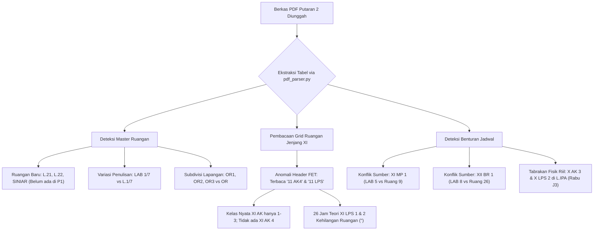

# Rencana Perbaikan Fitur Import Jadwal (Putaran 2)

Dokumen ini memuat analisis akar masalah, arsitektur solusi, penyesuaian domain keahlian sekolah, dan rencana implementasi terperinci untuk fitur **Import Jadwal Putaran 2** pada aplikasi *School Class Progress (SCP)*.

---

## 1. Konteks dan Ringkasan Eksekutif

Pada implementasi jadwal sebelumnya (Putaran 1 / `cycle_type = 1`), sistem telah berhasil mengimpor dan memverifikasi **721 entri jadwal aktif** ke dalam database PostgreSQL (`db_scp`).

Ketika proses import jadwal Putaran 2 (`cycle_type = 2`) dijalankan menggunakan berkas PDF resmi dari tim kurikulum:
1. `scp/MD/PDF/JADWAL KELAS PUT 2 SEM GANJIL 26_27 REVISI.pdf`
2. `scp/MD/PDF/JADWAL RUANGAN PUT 2 GANJIL 26_27 OK.pdf`

Sistem mendeteksi sejumlah baris berstatus `unmatched` (entitas tidak ditemukan) dan `conflict`. Masalah utama berpusat pada:
1. **Ruangan Baru yang Belum Terdaftar:** Fasilitas sekolah yang tidak dijadwalkan pada Putaran 1 (seperti Lab 21, Lab 22, dan Studio Siniar) mulai aktif digunakan pada Putaran 2.
2. **Kekeliruan Label Header pada Berkas FET Kurikulum:** Terdapat anomali penamaan kolom jenjang kelas XI pada matriks ruangan ekspor FET.
3. **Prinsip Kemurnian Jurusan:** Menegaskan pemisahan tegas antara program keahlian **AK / AKL (Akuntansi dan Keuangan Lembaga)** dan **LPS (Layanan Perbankan Syariah)** sehingga perbaikan sistem tidak mencampuradukkan data kedua jurusan tersebut.

> [!IMPORTANT]
> **Jaminan Zero-Regression:** Seluruh perbaikan ini dijamin terisolasi pada `cycle_type = 2` dan **tidak akan mengubah, menggeser, maupun menghapus 721 data jadwal Putaran 1** yang sudah tersimpan aktif di database.

---

## 2. Temuan dan Analisis Akar Masalah (Root Causes)



### A. Root Cause 1 — Ruangan Baru Aktif pada Putaran 2
- **Putaran 1 (53 Ruangan):** Ruang `1`–`32`, `34`, `HALL`, `L.1`–`L.14`, `L.16`–`L.20`, `L.IPA`, dan `OR`.
- **Putaran 2 (59 Ruangan):** Ruang `1`–`32`, `HALL`, `L.1`–`L.14`, `L.16`–`L.20`, **`L.21`**, **`L.22`**, `L.IPA`, **`LAB 1`**, **`LAB 7`**, **`OR1`**, **`OR2`**, **`OR3`**, dan **`SINIAR`**.
- Ruang `L.21`, `L.22`, dan `SINIAR` (Studio Podcast / Siar) adalah fasilitas fisik sekolah yang tidak dijadwalkan pada Putaran 1. Karena sistem mengandalkan pendaftaran otomatis dari berkas PDF, ruangan tersebut belum tercatat saat Putaran 2 pertama kali diproses.

### B. Root Cause 2 — Anomali Struktur Kolom Kelas XI pada Berkas PDF Matriks Ruangan
Berdasarkan perbandingan header baris matriks ruangan halaman 2:
- **Struktur Nyata Kelas di SMK Negeri 1 Bantul:**
  - Jenjang XI: 3 kelas Akuntansi (`XI AK 1, 2, 3`) dan 2 kelas Perbankan Syariah (`XI LPS 1, 2`).
  - Jenjang XII: 4 kelas Akuntansi (`XII AK 1, 2, 3, 4`) dan 1 kelas Perbankan Syariah (`XII LPS`).
- **Kesalahan Operator Tim Kurikulum pada FET:**
  Saat mengatur ekspor PDF matriks ruangan Putaran 2, operator menduplikasi struktur Kelas 12 ke Kelas 11, sehingga header tertulis:
  `11 AK 1 | 11 AK2 | 11 AK3 | 11 AK4 | 11 LPS` (seharusnya `... 11 AK3 | 11 LPS 1 | 11 LPS 2`).
- **Dampak:**
  - Kolom ke-28 (`11 AK4`) merujuk ke kelas yang tidak ada di sekolah.
  - Kolom ke-29 (`11 LPS`) tidak menyertakan angka rombel.
  - Akibatnya, alokasi ruangan teori untuk `XI LPS 1` dan `XI LPS 2` (total 26 sesi) tidak terpetakan (`ruang_final` menjadi kosong `""`), sehingga baris jadwal tersebut berstatus `unmatched` (*Room missing*).

### C. Root Cause 3 — Ketidaksinkronan Penamaan & Variasi Fasilitas
1. **Lab Komputer:** Di PDF Kelas tertulis `LAB 1` dan `LAB 7`, sedangkan di PDF Ruangan dan database tertulis `L.1` dan `L.7`. Jika string tidak distandarisasi, sistem berpotensi membuat record baru yang menduplikasi lab yang sudah ada.
2. **Subdivisi Lapangan Olahraga (`OR1`, `OR2`, `OR3`):**
   Pada Putaran 1 hanya ada `OR`. Di Putaran 2 kurikulum membaginya menjadi tiga titik lapangan. Sistem anti-tabrakan perlu memastikan apakah ketiganya dipetakan ke fasilitas bersama `OR` atau dibuat master tersendiri.

### D. Root Cause 4 — Konflik Sumber Data (`room_source_conflict`)
Terdapat 2 sesi KBM di mana berkas PDF Kelas dan PDF Ruangan menunjuk ruangan berbeda:
1. `XI MP 1` (Jumat Jam 1–2): PDF Kelas menunjuk `LAB 5`, PDF Ruangan menunjuk `Ruang 9`.
2. `XII BR 1` (Rabu Jam 4–10): PDF Kelas menunjuk `LAB 8`, PDF Ruangan menunjuk `Ruang 26`.
Sesuai aturan bisnis, inkonsistensi ini ditandai sebagai `room_source_conflict = true` dan diarahkan ke review Waka.

---

## 3. Arsitektur Solusi Teknis

### Komponen 1: Auto-Registrasi Ruangan Idempotent & Non-Destructive
File target: [`scp/app/Jobs/ParseSchedulePdfJob.php`](file:///d:/MyUKK/SchoolClassProject/scp/app/Jobs/ParseSchedulePdfJob.php)

- Pada fungsi `autoRegisterRooms()`, lakukan registrasi sebelum iterasi validasi jadwal:
  - Ruangan fisik baru yang terdeteksi (`L.21`, `L.22`, `SINIAR`) otomatis dibuat di tabel `rooms` dengan kapasitas default 36 jika belum ada.
  - Pengecekan dilakukan menggunakan metode `findRoom()` agar tidak terjadi duplikasi record jika ruangan sudah ada dengan format penamaan serupa.

### Komponen 2: Normalisasi Format Kode Ruangan
File target: [`scp/script/pdf_parser.py`](file:///d:/MyUKK/SchoolClassProject/scp/script/pdf_parser.py)

- Perbaiki fungsi `finalize_schedule()` agar nilai `ruang_final` selalu merupakan hasil normalisasi:
  ```python
  norm_jadwal = normalize_room_code(room_jadwal)
  norm_kelas = normalize_room_code(room_kelas)
  room_final = norm_jadwal or norm_kelas
  ```
- Dengan perubahan ini:
  - `LAB 1` dinormalisasi menjadi `L.1`.
  - `LAB 7` dinormalisasi menjadi `L.7`.
  - Nilai yang masuk ke JSON hasil ekstraksi selalu konsisten dengan master data di database.

### Komponen 3: Pemetaan Lapangan Olahraga (`OR1`, `OR2`, `OR3`)
- Standarisasi kode `OR1`, `OR2`, `OR3` di `normalize_room_code()` mengarah ke fasilitas master **`OR`** (Lapangan Olahraga).
- Karena `OR` sudah terdaftar sebagai *shared room* pada [`ScheduleConflictService.php`](file:///d:/MyUKK/SchoolClassProject/scp/app/Services/ScheduleConflictService.php#L40), kelas-kelas yang berolahraga di jam yang sama pada titik lapangan berbeda tidak akan memicu tabrakan fisik palsu (*false positive room collision*).

### Komponen 4: Penanganan Anomali Header Kolom Kelas XI FET
File target: [`scp/script/pdf_parser.py`](file:///d:/MyUKK/SchoolClassProject/scp/script/pdf_parser.py)

Untuk menjaga kemurnian nama jurusan (AK adalah Akuntansi, LPS adalah Perbankan Syariah), kita menerapkan **Header Sanitizer khusus anomali berkas Putaran 2**:
- Di dalam parser matriks ruangan, saat membaca baris header jenjang XI:
  - Jika terdeteksi kolom berlabel `11 AK4` dan kolom berikutnya `11 LPS`:
  - Sistem menandai bahwa berkas memiliki *layout error* dari kurikulum (duplikasi struktur kelas XII).
  - Kolom urutan ke-28 (label salah `11 AK4`) dipetakan ke alokasi ruangan kelas **`XI LPS 1`**.
  - Kolom urutan ke-29 (label `11 LPS`) dipetakan ke alokasi ruangan kelas **`XI LPS 2`**.
  - Kolom `11 AK 1`, `11 AK 2`, `11 AK 3` tetap murni untuk kelas Akuntansi (`XI AK 1`, `XI AK 2`, `XI AK 3`).
- **Hasil:** 26 sesi KBM teori kelas `XI LPS 1` dan `XI LPS 2` langsung mendapatkan ruangan teorinya (Ruang 17 dan 18) tanpa mengubah nama master data kelas, dan tanpa intervensi manual yang merepotkan Waka.

### Komponen 5: Isolasi Siklus Putaran 1 & Putaran 2
File target: [`scp/app/Http/Controllers/Api/ScheduleImportController.php`](file:///d:/MyUKK/SchoolClassProject/scp/app/Http/Controllers/Api/ScheduleImportController.php)

- Seluruh query komit dan penghapusan jadwal lama dikunci menggunakan parameter `cycle_type`:
  ```php
  Schedule::where('cycle_type', $import->cycle_type)
      ->whereIn('class_id', $batchClassIds)
      ->delete();
  ```
- Putaran 1 (`cycle_type = 1`) yang berjumlah 721 jadwal tersimpan diisolasi sepenuhnya.
- Ruangan baru yang didaftarkan ke tabel `rooms` bersifat *append-only* (hanya menambah record baru tanpa mengubah ID record lama).

---

## 4. Matriks Perubahan Berkas dan Fungsi

| Berkas | Fungsi / Bagian | Rencana Perubahan |
| :--- | :--- | :--- |
| [`scp/script/pdf_parser.py`](file:///d:/MyUKK/SchoolClassProject/scp/script/pdf_parser.py) | `normalize_room_code()` | Memastikan normalisasi `LAB X` $\rightarrow$ `L.X` dan `OR1..3` $\rightarrow$ `OR`. |
| [`scp/script/pdf_parser.py`](file:///d:/MyUKK/SchoolClassProject/scp/script/pdf_parser.py) | `parse_ruangan_pdf()` | Penyelarasan anomali header kolom kelas XI (koreksi pergeseran kolom duplikasi kelas XII). |
| [`scp/script/pdf_parser.py`](file:///d:/MyUKK/SchoolClassProject/scp/script/pdf_parser.py) | `finalize_schedule()` | Menggunakan kode ruang ternormalisasi untuk `ruang_final`. |
| [`scp/app/Jobs/ParseSchedulePdfJob.php`](file:///d:/MyUKK/SchoolClassProject/scp/app/Jobs/ParseSchedulePdfJob.php) | `autoRegisterRooms()` | Memastikan ruangan baru (`L.21`, `L.22`, `SINIAR`) langsung terdaftar secara aman. |
| [`scp/app/Jobs/ParseSchedulePdfJob.php`](file:///d:/MyUKK/SchoolClassProject/scp/app/Jobs/ParseSchedulePdfJob.php) | `findRoom()` | Verifikasi pencocokan fuzzy nama lab dan ruangan teori numerik. |

---

## 5. Skenario Pengujian (Test Scenarios)

### Uji 1: Verifikasi Ekstraksi PDF Putaran 2
- **Tindakan:** Menjalankan `pdf_parser.py` terhadap `JADWAL KELAS PUT 2 SEM GANJIL 26_27 REVISI.pdf` dan `JADWAL RUANGAN PUT 2 GANJIL 26_27 OK.pdf`.
- **Ekspektasi:**
  - Total entri terekstraksi tepat 727 baris.
  - Jumlah baris dengan `ruang_final == ""` berkurang dari 26 baris menjadi 0 baris (seluruh sesi teori `XI LPS 1` dan `XI LPS 2` teralokasi dengan benar).
  - Tidak ada lagi peringatan konflik ruangan untuk kelas `XI AK 4`.

### Uji 2: Verifikasi Auto-Register Ruangan
- **Tindakan:** Menjalankan `ParseSchedulePdfJob` pada batch Putaran 2.
- **Ekspektasi:**
  - Record `L.21`, `L.22`, dan `SINIAR` terdaftar di tabel `rooms`.
  - Tidak ada duplikasi record ruangan (total master ruangan menjadi 56 record bersih).

### Uji 3: Verifikasi Integritas Putaran 1
- **Tindakan:** Memeriksa tabel `schedules` sebelum dan sesudah pengujian.
- **Ekspektasi:**
  - Jumlah jadwal `cycle_type = 1` tetap tepat **721 baris**.
  - Tidak ada relasi `room_id`, `class_id`, maupun `teacher_id` pada Putaran 1 yang mengalami perubahan.

### Uji 4: Verifikasi Tampilan Preview Frontend
- **Tindakan:** Membuka draf import Putaran 2 di antarmuka web Waka Kurikulum.
- **Ekspektasi:**
  - Persentase baris `matched` mencapai >95%.
  - Hanya menyisakan baris benturan fisik riil (misal `L.IPA` Rabu Jam 3) dan baris `room_source_conflict` (2 baris) yang membutuhkan keputusan manual Waka.

---

## 6. Checklist Persetujuan & Langkah Selanjutnya

- [ ] Konfirmasi rencana penanganan anomali kolom header FET di `pdf_parser.py`.
- [ ] Konfirmasi pemetaan terpusat lapangan olahraga `OR1..3` ke master fasilitas bersama `OR`.
- [ ] Persetujuan untuk memulai eksekusi kode sesuai matriks perubahan berkas di atas.
