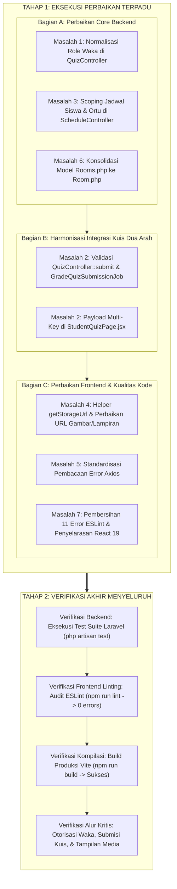

# Rencana Perbaikan 7 Masalah Teknis & Integrasi — School Class Progress (SCP)

Dokumen ini berisi rencana kerja (*action plan*) terpadu untuk menyelesaikan 7 masalah teknis, inkonsistensi integrasi, dan kebersihan kode pada **Backend (Laravel 13)** dan **Frontend Website (React 19)**, yang disederhanakan menjadi **2 Tahap Kerja**:
1. **Tahap 1:** Eksekusi Seluruh Perbaikan Terpadu (Masalah 1 s/d 7).
2. **Tahap 2:** Verifikasi Akhir Menyeluruh (PHPUnit, ESLint, & Vite Production Build).

> **Status Dokumen:** Rencana Disetujui untuk 2 Tahap (Menunggu konfirmasi mulai pengerjaan).

---

## 1. Ringkasan Matriks Masalah & Skala Prioritas

| No | Masalah | Layer | Tingkat Urgensi | File Terdampak Utama | Solusi Inti |
|:--:|:---|:---:|:---:|:---|:---|
| **1** | Inkonsistensi Role Waka (`waka` vs `vice_principal`) | Backend | **Kritis** | `scp/app/Http/Controllers/API/QuizController.php` `scp/app/Models/User.php` | Normalisasi pengecekan role Waka ke `vice_principal` agar akses kuis tidak ditolak 403. |
| **2** | Mismatch Kunci Payload Submisi Kuis Siswa | Integrasi (FE & BE) | **Kritis** | `frontend/scp_web/src/pages/student/StudentQuizPage.jsx` `scp/app/Http/Controllers/API/QuizController.php` `scp/app/Jobs/GradeQuizSubmissionJob.php` | Harmonisasi dua arah untuk kunci `student_answer`, `answer`, dan `selected_option` agar penilaian kuis akurat (tidak 0 lagi). |
| **3** | Unscoped Data Jadwal Siswa & Orang Tua | Backend | **Sedang** | `scp/app/Http/Controllers/API/ScheduleController.php` | Tambahkan filter otomatis berdasarkan `class_id` siswa dan `linkedStudent->class_id` orang tua agar jadwal kelas lain tidak bocor. |
| **4** | URL Aset Foto Jurnal & Lampiran Rusak (Port 5173 vs 8000) | Frontend | **Sedang** | `frontend/scp_web/src/utils/formatters.js` `MonitoringRecapPage.jsx` `PermissionVerifyPage.jsx` `TeacherSchedulePage.jsx` | Buat helper `getStorageUrl(path)` untuk memetakan aset ke storage backend (`http://localhost:8000/storage/...`). |
| **5** | Penanganan Error Objek Axios Tidak Konsisten | Frontend | **Kecil** | `TeacherJournalPage.jsx` `StudentPermissionPage.jsx` | Standarisasi pembacaan error form agar mengonsumsi properti `err.status` dan `err.message` dari interceptor `api.js`. |
| **6** | Duplikasi Model Eloquent `Room.php` dan `Rooms.php` | Backend | **Arsitektur** | `scp/app/Models/Room.php` `scp/app/Models/Rooms.php` Controllers & Services terkait | Standarisasi menggunakan singular `Room.php` dan perbarui seluruh referensi impor terkait. |
| **7** | 11 Error ESLint pada Frontend Website | Frontend | **Kualitas Kode** | `TopBar.jsx`, `ProfilePage.jsx`, `PermissionVerifyPage.jsx`, `TeacherJournalPage.jsx`, `TeacherSchedulePage.jsx`, `MasterDataPage.jsx` | Perbaiki dependensi memoization React Compiler, isolasi efek `useEffect`, dan hapus variabel/impor tidak terpakai (Target: 0 error / 0 warning). |

---

## 2. Struktur Alur Kerja 2 Tahap

---

## 3. Rincian Teknis Eksekusi

### TAHAP 1: Eksekusi Perbaikan Terpadu (Masalah 1 s/d 7)

#### Bagian A: Perbaikan Core Backend (Masalah 1, 3, 6)
1. **Perbaikan Masalah 1 (Inkonsistensi Role Waka pada Modul Kuis):**
   - File target: `scp/app/Http/Controllers/API/QuizController.php`.
   - Mengubah seluruh pengecekan peran Waka dari string statis `'waka'` menjadi `'vice_principal'` (atau mendukung alias ganda `$user->role === 'vice_principal' || $user->role === 'waka'`).
   - Memperbarui pengecekan assignment penugasan agar tidak lagi mengandalkan `type = 'waka'` yang tidak ada di skema database.
2. **Perbaikan Masalah 3 (Scoping Jadwal Siswa & Orang Tua):**
   - File target: `scp/app/Http/Controllers/API/ScheduleController.php`.
   - Menambahkan cabang scoping khusus untuk role `student` (dikunci ke `$user->class_id`) dan `parent` (dikunci ke `$user->linkedStudent?->class_id`).
   - Mencegah data jadwal dari kelas lain di sekolah bocor ke tampilan beranda siswa.
3. **Perbaikan Masalah 6 (Konsolidasi Model Ganda Room & Rooms):**
   - File target: `scp/app/Http/Controllers/API/ScheduleController.php`, `scp/app/Services/MasterDataPrerequisiteService.php`, dan `scp/app/Models/Rooms.php`.
   - Mengarahkan seluruh impor model ke `App\Models\Room`.
   - Mempertahankan `Rooms.php` sebagai kelas pewarisan (`class Rooms extends Room {}`) agar aman dari *breaking changes* sebelum dibersihkan penuh.

#### Bagian B: Harmonisasi Integrasi Kuis Dua Arah (Masalah 2)
1. **Di Sisi Backend (`QuizController.php` & `GradeQuizSubmissionJob.php`):**
   - Menambahkan aturan validasi `'answers.*.student_answer' => ['nullable', 'string']` pada `QuizController::submit`.
   - Memperbarui logika pembacaan jawaban di `GradeQuizSubmissionJob.php` agar membaca secara berurutan:
     `$ans['student_answer'] ?? $ans['answer'] ?? $ans['selected_option'] ?? ''`.
2. **Di Sisi Frontend (`StudentQuizPage.jsx`):**
   - Menyusun payload submission yang memuat ketiga variasi kunci: `student_answer`, `answer`, dan `selected_option` (khusus pilihan ganda) untuk menjamin kompatibilitas backward & forward.

#### Bagian C: Perbaikan Frontend & Kualitas Kode (Masalah 4, 5, 7)
1. **Perbaikan Masalah 4 (URL Aset Foto Jurnal & Lampiran Izin):**
   - Menambahkan fungsi helper `getStorageUrl(path)` di `frontend/scp_web/src/utils/formatters.js` yang secara dinamis memetakan path penyimpanan relatif ke origin backend (`http://localhost:8000/storage/...`).
   - Mengintegrasikan helper `getStorageUrl` pada:
     - `MonitoringRecapPage.jsx` (foto bukti KBM)
     - `PermissionVerifyPage.jsx` (lampiran surat izin siswa & tugas guru)
     - `TeacherSchedulePage.jsx` (lampiran surat izin & tugas mengajar)
     - `StudentPermissionPage.jsx` & `ParentMonitoringPage.jsx` (pratinjau surat izin)
2. **Perbaikan Masalah 5 (Standardisasi Penanganan Objek Error Axios):**
   - Memperbarui blok `catch (err)` pada `TeacherJournalPage.jsx` dan `StudentPermissionPage.jsx` agar membaca `err.status` dan `err.message` dari objek terformat `api.js` (dengan fallback aman ke `err.response`).
3. **Perbaikan Masalah 7 (Pembersihan 11 Error ESLint):**
   - Menyelaraskan dependensi `useMemo` di `TopBar.jsx` dan `TeacherJournalPage.jsx` agar sesuai dengan aturan React 19 Compiler.
   - Merefaktor pemanggilan fetch di dalam `useEffect` pada `PermissionVerifyPage.jsx` dan `TeacherSchedulePage.jsx` menjadi fungsi async terisolasi untuk mengeliminasi peringatan `react-hooks/set-state-in-effect`.
   - Menghapus variabel dan impor yang tidak digunakan pada `ProfilePage.jsx`, `TeacherSchedulePage.jsx`, dan `MasterDataPage.jsx`.

---

### TAHAP 2: Verifikasi Akhir Menyeluruh

Setelah seluruh pekerjaan di Tahap 1 selesai, dilakukan pengujian terpadu untuk memastikan stabilitas dan kesiapan produksi:

1. **Pengujian Otomatis Backend (Laravel Testing):**
   - Menjalankan test suite menggunakan `php artisan test` di folder `scp` untuk memastikan seluruh fitur autentikasi, jadwal, perizinan, dan kuis tetap lulus tanpa regresi.
2. **Audit Kualitas Kode Frontend (ESLint):**
   - Menjalankan `npm run lint` di folder `frontend/scp_web` untuk memverifikasi tercapainya status **0 Error / 0 Warning**.
3. **Kompilasi Produksi Frontend (Vite Build):**
   - Menjalankan `npm run build` di folder `frontend/scp_web` untuk memastikan aplikasi ter-compile dengan sukses, bersih dari peringatan ukuran chunk, dan siap dideploy.
4. **Verifikasi Alur Kritis (End-to-End Checklist):**
   - Memastikan akun Waka (`vice_principal`) dapat mengakses seluruh modul kuis (HTTP 200).
   - Memastikan akun Siswa (`student`) hanya melihat jadwal kelasnya sendiri.
   - Memastikan pengerjaan kuis siswa dinilai secara benar oleh background grading worker.
   - Memastikan foto dokumentasi KBM dan berkas surat izin termuat secara presisi dari storage backend.

---

*Dokumen ini merupakan panduan resmi pengerjaan 2 tahap. Silakan konfirmasi untuk memulai eksekusi Tahap 1.*
