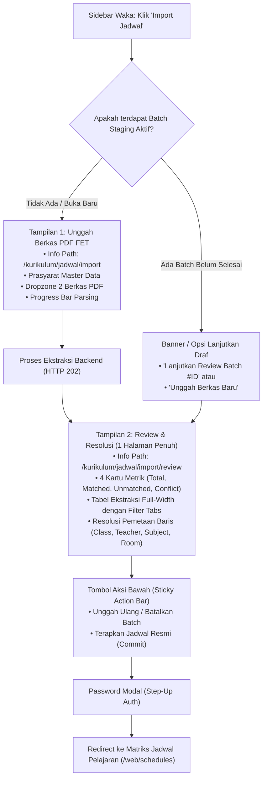

# RENCANA REVISI: UNIFIKASI IMPORT & REVIEW JADWAL WAKA
**School Class Progress (SCP) Project — Modul Waka Kurikulum**  
*Tanggal: 1 November 2026*  
*Status: Draf Rencana (Menunggu Konfirmasi User sebelum Implementasi)*

---

## 1. Latar Belakang & Analisis Masalah

### Kondisi Saat Ini (Current State):
1. **Pemisahan Menu di Navigasi Sidebar:**
   Pada sidebar Waka (`Sidebar.jsx`), menu pengelolaan jadwal terpecah menjadi dua tautan terpisah:
   - `Import Jadwal PDF` (`/web/upload-import`)
   - `Review Import` (`/web/review-import`)
2. **Kendala UX pada Menu "Review Import":**
   Ketika Waka mengklik menu `Review Import` dari sidebar tanpa memiliki parameter ID batch aktif, halaman langsung memunculkan pop-up alert:
   > *"Silakan pilih atau unggah berkas jadwal terlebih dahulu."*  
   lalu memantulkan pengguna kembali (*bounce redirect*) ke halaman unggah. Hal ini membingungkan dan tidak efisien.
3. **Format Tampilan Review:**
   Tinjauan hasil impor saat ini perlu dipastikan tampil dalam **1 halaman penuh (*full-page view*)** yang leluasa, lengkap dengan ringkasan status ekstraksi, filter tabel, resolusi pemetaan entitas, dan aksi komit jadwal ke sistem aktif.
4. **Informasi Path Halaman di Bagian Atas:**
   Belum terdapat indikator path rute yang eksplisit dan seragam di bagian atas halaman (seperti `/kurikulum/jadwal/import` atau `/kurikulum/jadwal/review`), sehingga pengguna memerlukan kejelasan konteks posisi menu.

---

## 2. Sasaran & Ruang Lingkup Revisi

1. **Unifikasi Navigasi Menu:**
   - Menggabungkan menu `Import Jadwal PDF` dan `Review Import` menjadi **1 menu tunggal: "Import Jadwal"** pada Sidebar Waka di bawah kelompok *"Kurikulum & Jadwal"*.
   - Menghapus alert pop-up yang mengganggu saat menu diakses langsung.
2. **Halaman Terpadu Berbasis Alur (*Integrated Multi-Step Workflow*):**
   - Menyatukan proses impor dalam satu kesatuan alur yang berkesinambungan:
     - **Langkah 1: Unggah & Ekstraksi PDF FET:** Formulir pemilihan putaran, verifikasi prasyarat master data, dropzone berkas ganda (`Jadwal_Kelas.pdf` & `Jadwal_Ruangan.pdf`), dan progress bar ekstraksi backend.
     - **Langkah 2: Review & Resolusi (1 Halaman Penuh):** Tampilan matriks tabel ekstraksi full-page, 4 kartu ringkasan (Total, Matched, Unmatched, Conflict), filter status baris, panel resolusi pemetaan master data, serta konfirmasi komit jadwal.
   - Jika pengguna membuka menu dan telah memiliki draf staging aktif, sistem menyediakan opsi cepat untuk melanjutkan tinjauan draf tersebut atau mengunggah berkas baru.
3. **Penanda Path Halaman `/kurikulum...` di Bagian Atas:**
   - Menyediakan path header informatif di bagian atas konten halaman:
     `📁 /kurikulum/jadwal/import` (atau `/kurikulum/jadwal/import/review/:id`).
   - Menyelaraskan teks breadcrumb pada TopBar (`TopBar.jsx`) menjadi:
     `/ Kurikulum & Jadwal / Import Jadwal`.
4. **Kompatibilitas Routing ke Belakang (*Backward Compatibility*):**
   - Rute lama (`/web/upload-import`, `/web/review-import`, `/web/review-import/:id`) tetap didukung melalui alias atau redirect agar tombol aksi pada Dashboard Waka dan Halaman Kelola Jadwal tidak rusak.

---

## 3. Rencana Desain Antarmuka & Alur Kerja (User Journey)



---

## 4. Rincian Perubahan File

### A. Frontend (`frontend/scp_web`)

| No | File | Jenis Perubahan | Deskripsi Perubahan |
|---|---|---|---|
| 1 | `src/components/layout/Sidebar.jsx` | Modifikasi | Menghapus tautan `Review Import`. Mengubah tautan `Import Jadwal PDF` menjadi satu menu terpadu `Import Jadwal` dengan path `/web/schedule-import` (alias `/kurikulum/jadwal/import`). |
| 2 | `src/components/layout/TopBar.jsx` | Modifikasi | Menambahkan pemetaan breadcrumb untuk path `/kurikulum/jadwal/import`, `/web/schedule-import`, `/web/upload-import`, dan `/web/review-import` menjadi `Kurikulum & Jadwal / Import Jadwal`. |
| 3 | `src/routes/AppRouter.jsx` | Modifikasi | Mendaftarkan rute terpadu `/web/schedule-import` dan `/kurikulum/jadwal/import`. Menjaga rute `/web/upload-import` dan `/web/review-import/:id` tetap mengarah ke komponen terpadu untuk backward compatibility. |
| 4 | `src/pages/waka/ScheduleImportPage.jsx` *(Baru / Penggabungan)* | Pembuatan File | Komponen utama terpadu yang memadukan alur Upload, deteksi staging batch, progress parsing, dan **Review 1 Halaman Penuh** dengan header path `/kurikulum/jadwal/import`. |
| 5 | `src/pages/waka/ScheduleImport.css` *(Baru / Penyesuaian)* | Pembuatan/Pembaruan | CSS layout untuk 1 halaman penuh responsif, kartu statistik, tabel matriks penuh, sticky action bar, dan penanda path `/kurikulum...`. |
| 6 | `src/pages/waka/DashboardWakaPage.jsx` | Modifikasi Kecil | Memperbarui tombol pintasan import dari `/web/upload-import` ke rute terpadu `/web/schedule-import`. |
| 7 | `src/pages/waka/ScheduleManagementPage.jsx` | Modifikasi Kecil | Memperbarui tombol "Import PDF FET" ke rute terpadu `/web/schedule-import`. |

### B. Backend (`scp`)
- **Tidak ada perubahan backend.** Seluruh endpoint API yang sudah ada (`POST /api/schedule-imports`, `GET /api/schedule-imports/{id}`, `PATCH /api/schedule-imports/{id}/rows/{row_id}`, `POST /api/schedule-imports/{id}/confirm`, `DELETE /api/schedule-imports/{id}`) telah 100% lulus uji pada Tahap 2 dan siap digunakan langsung.

---

## 5. Rencana Tahapan Eksekusi

### Tahap A — Pembuatan Komponen Terpadu `ScheduleImportPage.jsx`
1. Membangun struktur komponen terpadu dengan state controller:
   - State aktif: `'upload'` (formulir upload) vs `'review'` (halaman review penuh).
   - Indikator path di bagian atas:
     - Saat mode upload: `/kurikulum/jadwal/import`
     - Saat mode review: `/kurikulum/jadwal/import/review` (dengan badge Batch ID).
2. Memindahkan logika formulir upload dan prerequisite gate dari `UploadImportPage.jsx` ke dalam mode upload.
3. Memindahkan logika tabel matriks ekstraksi, kartu statistik, resolusi manual per baris, dan komit jadwal dari `ReviewImportPage.jsx` ke dalam mode review 1 halaman penuh.
4. Menambahkan fitur pendeteksi draf: jika pengguna membuka halaman tanpa upload baru, pengguna dapat melihat opsi draf terakhir atau langsung mengunggah berkas baru tanpa pesan alert error.

### Tahap B — Penyatuan Menu Navigasi & Penyelarasan Breadcrumb
1. Mengedit `Sidebar.jsx`:
   - Mengganti tautan terpisah menjadi 1 menu:
     ```jsx
     <NavLink to="/web/schedule-import" className="...">
       <Calendar size={15} />
       <span>Import Jadwal</span>
     </NavLink>
     ```
2. Mengedit `TopBar.jsx`:
   - Memastikan breadcrumb membaca rute `/web/schedule-import` dan `/kurikulum/...` dengan label kategori `"Kurikulum & Jadwal"` dan halaman `"Import Jadwal"`.
3. Mengedit `AppRouter.jsx`:
   - Mendaftarkan rute baru dan alias pengalihan.

### Tahap C — Pengujian & Verifikasi Kualitas
1. Menjalankan `npm run lint` di `frontend/scp_web` untuk memastikan 0 error dan 0 warning.
2. Menjalankan `npm run build` di `frontend/scp_web` untuk memastikan kompilasi bundle produksi sukses.
3. Memverifikasi kelancaran transisi alur:
   - Membuka menu "Import Jadwal" -> Tampil halaman upload dengan path `/kurikulum/jadwal/import`.
   - Mengunggah berkas -> Parsing selesai -> Otomatis masuk ke halaman review 1 halaman penuh.
   - Melakukan filter baris, resolusi pemetaan, dan komit password.
   - Memastikan tidak ada lagi alert popup mengganggu saat menu diakses langsung.

---

## 6. Pertanyaan / Keputusan Desain yang Perlu Dikonfirmasi

Sebelum mulai menulis kode perbaikan, mohon konfirmasi hal-hal berikut:
1. **Nama Menu di Sidebar:** Apakah nama menu **"Import Jadwal"** sudah sesuai, atau Anda lebih memilih **"Import & Review Jadwal"**?
2. **Format Path Header di Bagian Atas:** Teks path di atas halaman akan kita tampilkan dalam format breadcrumb path:
   ```text
   /kurikulum/jadwal/import
   ```
   atau saat sedang meninjau hasil:
   ```text
   /kurikulum/jadwal/import/review
   ```
   Apakah format ini sudah sesuai dengan yang Anda inginkan?

---

*Silakan konfirmasi rencana di atas agar kita dapat langsung memulai eksekusi revisinya.*
