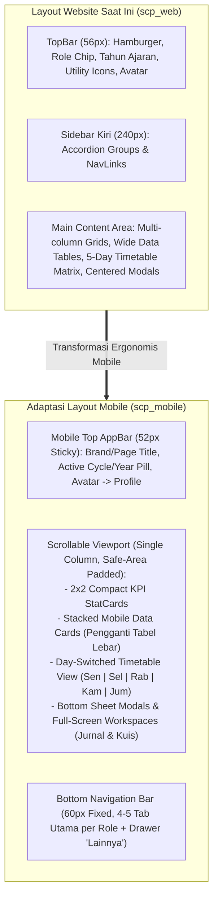

# MASTER PLAN PENGEMBANGAN FRONTEND MOBILE — SCHOOL CLASS PROGRESS (SCP)

**Nama Proyek:** School Class Progress (SCP) — Mobile Edition (`scp_mobile`)  
**Versi Dokumen:** 1.0 (Architecture & Development Master Plan)  
**Tanggal Penyusunan:** 6 November 2026  
**Lokasi Target Proyek Mobile:** `d:\MyUKK\SchoolClassProject\frontend\scp_mobile\`  
**Referensi Utama:** Backend Laravel 13 (`scp/`) & Frontend Website React 19 (`frontend/scp_web/`)  
**Status:** Menunggu Review & Persetujuan Pengguna (*No Code Modified*)

---

## 1. Project Overview

### 1.1 Tujuan Pengembangan
Pengembangan **Frontend Mobile SCP (`scp_mobile`)** bertujuan menghadirkan seluruh kapabilitas operasional dan manajerial dari aplikasi website **School Class Progress (`scp_web`)** ke dalam antarmuka perangkat bergerak (*smartphone*) yang ergonomis, responsif, cepat, dan mudah dioperasikan dengan satu tangan (*thumb-friendly*), tanpa mengurangi kelengkapan fitur bisnis maupun mengubah aturan validasi yang telah berjalan di sisi backend.

### 1.2 Ruang Lingkup Pengembangan
1. **Dukungan Penuh Multi-Role & Multi-Assignment:**
   * **Waka Kurikulum (`vice_principal` / `waka`)** — seluruh fitur pengelolaan akademik, master data, jadwal manual, kalender akademik, kenaikan kelas, tempat sampah (*recycle bin*), dan monitoring (dengan **pengecualian khusus seluruh fitur Import Data**).
   * **Guru Pengampu (`teacher`)** — dashboard harian, jadwal mengajar, pembukaan sesi KBM & pengisian jurnal berfoto kamera terkompresi, presensi *exception-based*, pengajuan izin mengajar beserta tugas titipan, manajemen & evaluasi Kuis AI (Prompt AI, Ekstraksi Dokumen, Manual, Override Nilai), serta kalender akademik.
   * **Guru Wali Kelas (`teacher` dengan penugasan `wali_kelas`)** — sakelar jadwal kelas binaan, mode guru pengganti kelas binaan, pemantauan izin siswa kelas binaan, dan rekap presensi/jurnal kelas binaan.
   * **Guru Kesiswaan / BK (`teacher` dengan penugasan `kesiswaan`)** — verifikasi (setujui/tolak) perizinan siswa dan perizinan mengajar guru, penandaan jam kosong (`teacher_absent`), mode guru pengganti, serta monitoring & ekspor rekapitulasi presensi/jurnal.
   * **Siswa (`student`)** — beranda kehadiran & kegiatan hari ini, jadwal pelajaran kelas, pengajuan izin (Tidak Masuk & Izin Keluar Jam KBM), pengerjaan Kuis AI dengan timer & *auto-save*, serta kalender akademik.
   * **Orang Tua / Wali (`parent`)** — portal pemantauan anak tertaut (statistik & riwayat presensi, riwayat surat izin, nilai hasil kuis AI, jadwal pelajaran kelas anak) dan kalender akademik sekolah.
2. **Konsistensi Identitas Visual (*Single Design Language*):**
   * Mempertahankan 100% bahasa desain **Exness Precision Fintech Clean** dari versi website (`tokens.css` & `global.css`), meliputi palet warna (`#FFDE00` kuning aksen utama, `#0F172A` slate gelap, `#FFFFFF` latar bersih, `#F9FAFB` permukaan kartu), tipografi (`Plus Jakarta Sans` & `JetBrains Mono`), sudut tegas (`4px`–`8px`), dan indikator status titik (*status dot*).
3. **Zero Backend Business Logic Duplication:**
   * Menggunakan secara langsung seluruh endpoint REST API pada backend Laravel (`scp/`) yang sudah teruji oleh 425+ pengujian otomatis PHPUnit tanpa mengubah skema database atau membuat ulang proses bisnis.

---

## 2. Existing Project Analysis

### 2.1 Analisis Frontend Website (`frontend/scp_web/`)

> **Catatan Struktur Direktori Aktual:** Di dalam repositori saat ini, folder aplikasi web bernama `frontend/scp_web/` (yang pada instruksi tugas dirujuk sebagai `frontend/scp_website`). Sesuai batasan tugas, nama folder `frontend/scp_web/` tidak diubah dan tetap dipertahankan apa adanya.

#### A. Struktur Direktori Website
```text
frontend/scp_web/
├── public/                        # Aset statis publik
├── src/
│   ├── assets/                    # Ikon & ilustrasi lokal
│   ├── components/
│   │   ├── calendar/              # SharedCalendarView, UpcomingEventsList, AcademicEventDetailModal
│   │   ├── feedback/              # EmptyState, ErrorBoundary, ErrorState, ForbiddenState,
│   │   │                          # LoadingOverlay, ScheduleTableSkeleton, SkeletonCard, SkeletonRow
│   │   ├── layout/                # WebLayout, Sidebar, TopBar
│   │   ├── schedule/              # ScheduleTimetableMatrix, ScheduleCardItem, ScheduleBreakRow,
│   │   │                          # ScheduleMorningRow, ScheduleLegendBar
│   │   └── shared/                # Badge, Button, Card, ConfirmDialog, ExportButton, FileUpload,
│   │                              # FilterBar, Input, Modal, Pagination, PasswordModal, ProgressBar,
│   │                              # RowCard, SearchInput, Select, StatCard, Table, Tabs
│   ├── context/                   # AuthContext.jsx, authConstants.js, authContextInstance.js
│   ├── hooks/                     # useAuth.js, useDebounce.js, useGoogleAuth.js
│   ├── pages/
│   │   ├── auth/                  # LoginPage, ForgotPasswordPage, ChangePasswordPage
│   │   ├── profile/               # ProfilePage
│   │   ├── waka/                  # DashboardWakaPage, AcademicCalendarPage, ScheduleManagementPage,
│   │   │   │                      # ScheduleImportPage, MasterDataPage, GradePromotionPage,
│   │   │   │                      # MonitoringRecapPage, UploadImportPage (alias), ReviewImportPage (alias)
│   │   │   └── components/        # AcademicEventModal, ClassAssignmentEditModal, DeleteConfirmationModal,
│   │   │                          # DeleteConflictDialog, InitialCredentialModal,
│   │   │                          # TeacherAssignmentImportModal, TeacherAssignmentModal, TeacherAssignmentTab
│   │   ├── teacher/               # TeacherDashboardPage, TeacherCalendarPage, TeacherSchedulePage,
│   │   │                          # TeacherJournalPage, TeacherLeavePage, TeacherQuizPage, PermissionVerifyPage
│   │   ├── student/               # StudentHomePage, StudentCalendarPage, StudentSchedulePage,
│   │   │                          # StudentPermissionPage, StudentQuizPage
│   │   └── parent/                # ParentMonitoringPage, ParentCalendarPage
│   ├── routes/                    # AppRouter.jsx, ProtectedRoute.jsx, PublicRoute.jsx, RoleRoute.jsx
│   ├── services/                  # api.js, academicEventApi.js, forgotPasswordApi.js, journalApi.js,
│   │                              # leaveApi.js, masterDataApi.js, quizApi.js, scheduleApi.js, scheduleImportApi.js
│   ├── styles/                    # tokens.css, global.css
│   └── utils/                     # cn.js, formatters.js, imageCompressor.js, prerequisiteHelper.js, timetableHelper.js
├── .env / .env.example            # Konfigurasi URL API, Supabase Storage URL, Google Client ID
├── package.json                   # Dependensi & script Vite
└── vite.config.js                 # Konfigurasi bundler Vite + plugin React & Tailwind v4
```

#### B. Sistem Routing, Autentikasi, & State Management Website
1. **Pengelolaan Sesi & Token (`AuthContext.jsx`):**
   * Menyimpan Bearer Token di `localStorage` dengan kunci `'scp_token'` dan profil pengguna di `'scp_user'`.
   * Saat aplikasi dimuat (*mount*), menjalankan `authApi.getMe()` (`GET /api/me`) untuk memvalidasi sesi aktif dan menyegarkan daftar `assignments` guru (`wali_kelas` / `kesiswaan`).
   * Menormalisasi nama role backend `'vice_principal'` menjadi `'waka'` melalui helper `hasRole()` sehingga komponen cukup memeriksa `hasRole('waka')`.
   * Menyediakan helper otorisasi penugasan: `isKesiswaan()` dan `isWaliKelas(classId)`.
2. **Route Guards (`ProtectedRoute.jsx`, `PublicRoute.jsx`, `RoleRoute.jsx`):**
   * `PublicRoute`: Mengalihkan pengguna yang sudah login langsung ke `getHomeRoute()` sesuai role-nya, atau ke `/change-password` jika `mustChangePassword === true`.
   * `ProtectedRoute`: Memastikan pengguna telah login; jika belum, diarahkan ke `/login`. Jika `mustChangePassword === true`, pengguna dikunci di `/change-password` hingga sandi diperbarui.
   * `RoleRoute`: Memvalidasi `allowedRoles` serta flag khusus `requireKesiswaan`, `requireWaliKelas`, atau `requireKesiswaanOrWaliKelas`. Menampilkan komponen `ForbiddenState` jika wewenang tidak mencukupi.
3. **Komunikasi API (`services/api.js`):**
   * Menggunakan instance Axios dengan `baseURL = import.meta.env.VITE_API_BASE_URL || 'http://localhost:8000/api'` dan `timeout = 15000` (serta `120000` pada endpoint unggah berkas besar).
   * Request Interceptor menyisipkan header `Authorization: Bearer ${token}`.
   * Response Interceptor langsung mengekstrak `response.data`, sehingga pemanggil menerima objek standar `{ success, message, data, meta }` dan menangani status `401 Unauthorized` dengan membersihkan `localStorage` serta mengarahkan ke `/login`.

---

### 2.2 Analisis Backend (`scp/`)

#### A. Arsitektur & Komponen Inti Backend
* **Framework & Runtime:** Laravel 13 (PHP ^8.3) berarsitektur *Headless API Provider*.
* **Controllers (`app/Http/Controllers/API/`):** 19 controller terpisah berdasarkan domain (Autentikasi, Profil, Lupa Sandi, Pengaturan Akademik, Kalender Akademik, Master Data Ringkasan, Kelas, Ruangan, Mapel, Guru, Siswa, Tempat Sampah, Jadwal, Import Jadwal, Jurnal, Presensi, Izin Siswa, Izin Guru, dan Kuis AI).
* **Service Layer (`app/Services/`):**
  1. `PeriodResolutionService`: Menghitung jam mulai dan selesai aktual (`HH:MM:SS`) setiap slot jadwal berdasarkan `day_type` (`senin_upacara`, `senin_reguler`, `selasa`, `rabu_kamis`, `jumat`) dengan *in-memory caching*.
  2. `ScheduleConflictService`: Mendeteksi tabrakan jadwal guru, ruangan, dan kelas pada putaran dan rentang jam yang sama, serta mengecualikan ruangan bersama seperti Lapangan Olahraga (`OR`, `OR1`, `LAPANGAN`).
  3. `AcademicCalendarExclusionService`: Memeriksa apakah suatu tanggal dan kelas sedang memiliki agenda akademik dengan `disables_teaching = true` untuk memblokir pembukaan jurnal dan meniadakan alert keterlambatan.
  4. `TeacherLeaveAuthorityResolver`: Menentukan cakupan verifikasi perizinan guru berdasarkan kelas binaan Guru Kesiswaan.
  5. `MasterDataPrerequisiteService`: Memvalidasi kesiapan master data sebelum pembuatan jadwal manual (wajib ada Kelas, Guru, Mapel, Ruangan) maupun import PDF.
  6. `MasterDataDependencyService`: Menghitung jumlah ketergantungan relasional sebelum entitas dihapus (*Smart Delete*).
  7. `AIService`: Berkomunikasi dengan Google Gemini (`gemini-3.1-flash-lite` / `ag/gemini-3.8-flash`) untuk men-generate soal dari prompt, mengekstrak soal dari teks dokumen, dan menilai jawaban esai siswa secara semantik.
  8. `GoogleAuthService`, `WhatsAppService` (Fonnte / Log), dan `PasswordResetOtpService`.

#### B. Ketentuan Khusus Backend saat Dikonsumsi Aplikasi Mobile
1. **Multipart FormData pada HTTP PUT (`POST` + `_method: 'PUT'`):**
   * Endpoint penyelesaian jurnal KBM (`PUT /api/journals/{id}`) menerima unggahan foto (`multipart/form-data`). Karena PHP native tidak mengurai multipart body pada method `PUT`, aplikasi mobile **wajib** mengirim request menggunakan HTTP `POST` ke `/api/journals/{id}` dengan menyertakan field `_method = 'PUT'` di dalam `FormData` (persis seperti implementasi `journalApi.completeJournal` di website).
2. **Step-Up Authentication (Password Re-confirmation):**
   * Seluruh endpoint mutasi sensitif milik Waka Kurikulum dan pelepasan tautan Google (`POST /api/me/google-unlink`) mewajibkan pengiriman field `password` di dalam body JSON atau parameter request (`DELETE` dengan `{ data: { password } }`).
3. **Penamaan `device_name` saat Login Sanctum:**
   * Endpoint `POST /api/login` dan `POST /api/auth/google` menerima field `device_name`. Pada versi mobile, field ini sebaiknya mengirimkan identitas perangkat mobile (misal: `"SCP Mobile Web (Android/iOS)"` atau model perangkat) agar token teridentifikasi jelas di tabel `personal_access_tokens`.
4. **Resolusi URL Berkas Media (Supabase Storage & Fallback Lokal):**
   * Path berkas (`photo_path`, `document_path`, `attachment_path`, `task_attachment_path`) disimpan relatif di database. Aplikasi mobile wajib menggunakan utilitas `getStorageUrl()` dan `getFallbackStorageUrl()` yang identik dengan website untuk merender pratinjau foto jurnal maupun dokumen surat izin.

---

### 2.3 Catatan Temuan pada Eksisting Project (Didokumentasikan Tanpa Diubah)

Sesuai instruksi pada Bagian 6 (Ketentuan dan Batasan Analisis), berikut adalah catatan kondisi aktual yang ditemukan pada kode sumber website/backend saat ini:
1. **Perbedaan Klausul PRD v4.4 vs Implementasi Kode terkait Wali Kelas sebagai Guru Pengganti:**
   * Dokumen PRD v4.4 menyebutkan hanya Kesiswaan yang boleh menjadi guru pengganti (`substitute_teacher_id`). Namun, kode aktual di `JournalController.php` (baris 194–204, 369–371) dan `TeacherJournalPage.jsx` (baris 107–117) secara eksplisit mengizinkan **Wali Kelas** untuk membuka dan menyelesaikan jurnal pengganti pada kelas binaannya. Versi mobile akan mengikuti perilaku kode aktual yang sudah berjalan sambil menunggu konfirmasi pada Bagian 12.
2. **Format Username Akun Orang Tua (`P-{NIS}`):**
   * Kode backend `StudentController.php` dan komponen `InitialCredentialModal.jsx` menghasilkan ID login Orang Tua dengan format `P-{NIS}` (contoh: `P-12045`), bukan `ORTU-{NIS}`.
3. **Elemen Placeholder pada `TopBar.jsx` Website:**
   * Tombol `HelpCircle` (Pusat Bantuan) dan `Bell` (Notifikasi) pada `TopBar.jsx` website belum memiliki event handler `onClick`. Selain itu, tombol Toggle Tema (`Sun`) hanya mengubah class `.dark` pada `documentElement` tanpa dukungan penuh palet gelap di seluruh komponen CSS.

---

## 3. Technology Stack

### 3.1 Teknologi Eksisting Website (`frontend/scp_web/`)
* **Core:** React `^19.2.8`, React DOM `^19.2.8`
* **Bundler & Build Tool:** Vite `^8.3.0` (`@vitejs/plugin-react` `^6.1.1`)
* **Routing:** `react-router-dom` `^7.18.4`
* **Styling:** Tailwind CSS `^4.3.3` (`@tailwindcss/vite` `^4.3.3`) + Custom CSS Design Tokens (`tokens.css`)
* **HTTP Client:** `axios` `^1.20.0`
* **Icons:** `lucide-react` `^0.511.0`
* **Spreadsheet Utility:** `xlsx` `^0.18.5`

### 3.2 Evaluasi & Perbandingan Kandidat Teknologi Mobile (`frontend/scp_mobile/`)

Untuk membangun `frontend/scp_mobile/` yang memenuhi tuntutan **100% kesamaan desain visual dengan website**, **dukungan penuh seluruh role**, dan **kompatibilitas tanpa celah dengan backend Laravel**, berikut adalah perbandingan 3 kandidat teknologi:

| Kriteria Evaluasi | Opsi A: React 19 + Vite + Tailwind CSS v4 (Mobile-First SPA / PWA + Capacitor Ready) | Opsi B: React Native (Expo) | Opsi C: Flutter (Dart) |
|---|---|---|---|
| **Konsistensi Visual dengan Website** | **100% Identik.** Dapat memakai ulang `tokens.css`, variabel warna, font `Plus Jakarta Sans` & `JetBrains Mono`, border-radius `4px`, dan gaya komponen CSS secara presisi. | **Perlu Translasi Ulang.** Semua CSS dan class harus ditulis ulang ke `StyleSheet` / NativeWind; rendering shadow, border, dan tabel memiliki perbedaan khas native widget. | **Perlu Translasi Ulang Total.** Harus membangun ulang seluruh tema dan widget dari nol menggunakan Material/Cupertino di Dart. |
| **Reusability Kode (`services/`, `context/`, `utils/`)** | **100% Dapat Dipakai Ulang.** Seluruh 9 file API service, `AuthContext`, `timetableHelper`, `formatters`, `prerequisiteHelper`, dan `imageCompressor` langsung berjalan tanpa modifikasi. | **~60% Dapat Dipakai Ulang.** `localStorage` harus diubah ke `AsyncStorage`/`SecureStore`, `imageCompressor` (Canvas DOM) dan `xlsx` DOM download harus diganti library native. | **0% Reusability Kode.** Seluruh logika bisnis klien, resolusi slot waktu, deteksi konflik jadwal, dan API layer harus ditulis ulang dalam bahasa Dart. |
| **Dukungan Kamera, Kompresi Foto, & Upload File** | **Sangat Baik.** Mendukung *live viewfinder* via `navigator.mediaDevices.getUserMedia` (WebRTC) dan `<input type="file" capture="environment">`, kompresi Canvas `<150KB`, serta upload PDF/gambar. | **Sangat Baik.** Menggunakan `expo-camera`, `expo-image-manipulator`, dan `expo-document-picker` (membutuhkan konfigurasi permission native). | **Sangat Baik.** Menggunakan plugin `camera`, `flutter_image_compress`, dan `file_picker`. |
| **Performa pada Perangkat Mid-to-Low End** | **Sangat Ringan.** Bundle web modern dengan *route-based lazy loading* hanya memuat halaman aktif (~50–80KB gzipped), hemat RAM, tanpa overhead engine tambahan. | **Sedang.** Membutuhkan jembatan JS-Native (Hermes) dan memori lebih besar saat merender daftar panjang jika tidak dioptimasi. | **Tinggi (Kompilasi Native),** namun ukuran binary APK awal lebih besar (~20–30MB). |
| **Kemudahan Debugging & Kecepatan Pengembangan 6 Role** | **Sangat Cepat & Mudah.** Dapat diinspeksi langsung dengan Chrome DevTools (Mobile Device Emulation) maupun di perangkat fisik melalui jaringan lokal / pembungkus APK Capacitor. | **Sedang.** Membutuhkan Expo Go / Android Emulator dan penanganan kompatibilitas paket native untuk 24+ layar. | **Lambat untuk Skala 24+ Layar.** Membutuhkan penulisan ulang penuh seluruh halaman untuk 6 role dari nol. |

### 3.3 Rekomendasi Teknologi Mobile
Berdasarkan analisis teknis di atas, **Opsi A (React 19 + Vite + Tailwind CSS v4 dengan Arsitektur Mobile-First App Shell & Capacitor-Ready)** sangat direkomendasikan sebagai fondasi `frontend/scp_mobile/` karena:
1. Menjamin **keselarasan visual 100%** dengan website (`tokens.css`, tipografi, warna `#FFDE00`, dan gaya komponen).
2. Memungkinkan pemakaian ulang seluruh modul `services/`, `utils/timetableHelper.js`, `utils/imageCompressor.js`, dan `context/AuthContext.jsx` yang sudah teruji matang terhadap backend Laravel 13.
3. Mendukung kamera perangkat, kompresi foto KBM, unggah PDF/gambar izin, dan ekspor laporan Excel secara native di browser mobile maupun bila dibungkus menjadi APK Android menggunakan `@capacitor/core`.

*(Keputusan final pemilihan teknologi ini tetap menunggu konfirmasi Anda pada Bagian 12).*

---

## 4. Existing UI/UX Analysis

Aplikasi website SCP menerapkan bahasa desain **Exness Precision Fintech Clean** yang diatur secara ketat melalui `src/styles/tokens.css` dan `src/styles/global.css`. Karakteristik utama yang **wajib dipertahankan** pada versi mobile meliputi:

### 4.1 Palet Warna (`tokens.css`)
| Token CSS | Nilai Hex | Penggunaan pada Komponen |
|---|---|---|
| `--color-bg` | `#FFFFFF` | Latar belakang utama halaman & kartu utama |
| `--color-surface` | `#F9FAFB` | Latar belakang sekunder, header tabel, container bagian dalam |
| `--color-surface-hover` | `#F3F4F6` | Efek tekan (*active/touch highlight*) pada kartu, tombol sekunder, & baris |
| `--color-border` | `#E5E7EB` | Garis tepi kartu, input, pemisah seksi (`1px solid`) |
| `--color-border-light` | `#F3F4F6` | Garis pemisah halus antarbaris daftar |
| `--color-text-primary` | `#0F172A` | Teks judul utama, nama entitas, nilai KPI, tombol gelap (`btn--dark`) |
| `--color-text-secondary` | `#64748B` | Teks subjudul, label kolom, deskripsi sekunder |
| `--color-text-muted` | `#94A3B8` | Teks placeholder, petunjuk mikro, status nonaktif |
| `--color-accent` | `#FFDE00` | Warna identitas utama: tombol aksi primer (`btn--primary`), fokus input, garis indikator aktif |
| `--color-accent-hover` | `#FFE63B` | Warna saat tombol aksi primer ditekan |
| `--color-accent-text` | `#000000` | Warna teks di atas latar kuning `#FFDE00` (kontras tinggi, font-weight `600`) |
| `--color-success` / `bg` | `#10B981` / `#ECFDF5` | Status Hadir, Disetujui (`approved`), Selesai (`completed`), Matched |
| `--color-warning` / `bg` | `#F59E0B` / `#FFFBEB` | Status Izin, Sakit, Menunggu (`pending`), Upacara, Berlangsung (`ongoing`) |
| `--color-error` / `bg` | `#EF4444` / `#FEF2F2` | Status Alpa, Ditolak (`rejected`), Bentrok (`conflict`), Jam Kosong (`teacher_absent`), Hapus |

### 4.2 Tipografi & Hirarki Teks
* **Font Utama (`--font-family`):** `'Plus Jakarta Sans'`, sans-serif — digunakan untuk judul, navigasi, label form, dan paragraf.
* **Font Data/Angka (`--font-family-mono`):** `'JetBrains Mono'`, monospace — wajib digunakan untuk **NIS, NIP, Nomor Absen, Kode Ruangan, Jam Pelajaran (`07:15 - 08:35`), Skor Kuis, Persentase Kehadiran, dan Nomor Urut**.
* **Ukuran & Ketebalan:**
  * Heading Halaman: `20px`–`22px` (diadaptasi dari `26px` desktop), `font-weight: 700`, `line-height: 1.25`.
  * Judul Seksi (`--font-size-section`): `16px`–`18px`, `font-weight: 600`.
  * Label Seksi Enterprise (`.section-label-enterprise`): `11px`, `uppercase`, `font-weight: 700`, `letter-spacing: 0.05em`, warna `#64748B`.
  * Body & Data (`--font-size-body`): `13.5px`, `line-height: 1.5`.
  * Label Form (`--font-size-label`): `12px`, `font-weight: 500`.
  * Micro / Badge (`--font-size-micro`): `11px`, `font-weight: 500`.

### 4.3 Karakteristik Bentuk, Sudut, & Ornamen
1. **Sudut Presisi (*No Rounded Pills*):**
   * Seluruh tombol, input, kartu, dan badge menggunakan sudut tegas `--radius-sm: 4px`, `--radius-md: 6px`, atau `--radius-lg: 8px`. Bahkan `--radius-pill` ditetapkan `4px` (tidak menggunakan bentuk kapsul bulat penuh kecuali untuk avatar lingkaran dan `.status-dot` `50%`).
2. **Flat Surface dengan Aksen Garis Tepi:**
   * Kartu tidak mengandalkan bayangan tebal (*heavy drop shadow*), melainkan border `1px solid #E5E7EB` dengan aksen garis atas atau kiri berukuran `3px` (`.accent-border-top--success/warning/danger/info` dan `.accent-border-left--*`).
3. **Indikator Titik Status (`.status-dot` & `.status-dot--pulse`):**
   * Lingkaran `6px x 6px` dengan animasi denyut halus untuk menandakan sesi aktif, siklus aktif, atau peringatan keterlambatan jurnal.

---

## 5. Role & Feature Mapping

Berikut adalah pemetaan lengkap seluruh halaman dan fitur dari `frontend/scp_web/` ke `frontend/scp_mobile/` berdasarkan setiap role pengguna:

### 5.1 Role: Publik / Tamu & Autentikasi Dasar

| No | Nama Halaman / Fitur | Rute Mobile | Fungsi & Alur Kerja | Endpoint API Backend | Komponen UI & Adaptasi Mobile | Ketergantungan |
|---|---|---|---|---|---|---|
| 1 | **Login & Google SSO** | `/login` | Autentikasi menggunakan NIS/NIP + Password atau tombol Google Sign-In. Menyimpan Bearer Token & mengecek `must_change_password`. | `POST /api/login`<br>`POST /api/auth/google`<br>`GET /api/me` | Layout satu kolom terpusat vertikal, logo sekolah di atas, input tinggi `44px`, tombol penuh (`fullWidth`) warna `#FFDE00`, tombol Google lebar 100%. | `AuthContext`, `useGoogleAuth` |
| 2 | **Pemulihan Kata Sandi Mandiri (Lupa Sandi)** | `/forgot-password` | Wizard 4 langkah: (1) Cek NIS/NIP/Email, (2) Kirim OTP ke Email terverifikasi, (3) Input 6 digit OTP, (4) Buat kata sandi baru. | `POST /api/auth/forgot-password/check-identity`<br>`.../send-otp`<br>`.../verify-otp`<br>`.../reset-password` | Stepper indikator langkah kompak di atas kartu, input kode OTP monospaced `JetBrains Mono` ukuran besar (`numeric` keyboard). | Email pengguna sudah tertaut di akun |
| 3 | **Ganti Kata Sandi Wajib Perdana** | `/change-password` | Mengunci pengguna baru (`must_change_password = true`) agar mengganti kata sandi bawaan sebelum dapat mengakses menu aplikasi. | `PATCH /api/me/password` | Layar penuh terfokus tanpa navigasi bawah, peringatan keamanan beraksen kuning/amber, validasi konfirmasi sandi baru. | Sesi login aktif |

### 5.2 Semua Role Terautentikasi (Universal)

| No | Nama Halaman / Fitur | Rute Mobile | Fungsi & Alur Kerja | Endpoint API Backend | Komponen UI & Adaptasi Mobile | Ketergantungan |
|---|---|---|---|---|---|---|
| 4 | **Profil Akun & Tautan Kontak Mandiri** | `/profile` | Menampilkan identitas pengguna, role/penugasan, menautkan & verifikasi Email via OTP, menautkan & verifikasi No. WhatsApp via OTP, menautkan/melepas akun Google SSO (dengan konfirmasi sandi), serta mengubah kata sandi. | `GET /api/me`<br>`POST /api/me/email` & `/verify`<br>`POST /api/me/phone` & `/verify`<br>`POST /api/me/google-link` & `/google-unlink`<br>`PATCH /api/me/password`<br>`POST /api/logout` | Tumpukan kartu vertikal (*stacked cards*): Kartu Identitas, Kartu Email OTP, Kartu WhatsApp OTP, Kartu Google SSO, Kartu Ubah Sandi, dan tombol Keluar Sistem di bagian bawah. Modal konfirmasi lepas Google disajikan sebagai *Bottom Sheet*. | `AuthContext`, `useGoogleAuth` |

### 5.3 Role: Waka Kurikulum (`vice_principal` / `waka`)

> **Catatan Penting Pengecualian (Bagian 2 Prompt):** Seluruh fitur **Import Data** pada role Waka (**Import PDF Jadwal, Import Excel Guru, Import Excel Siswa, dan Import Excel Penugasan Guru**) ditandai sebagai **Out of Scope for Mobile** dan tidak dimasukkan ke antarmuka mobile. Seluruh fitur pengelolaan manual Waka lainnya **wajib tetap tersedia penuh**.

| No | Nama Halaman / Fitur | Rute Mobile | Fungsi & Alur Kerja | Endpoint API Backend | Komponen UI & Adaptasi Mobile | Ketergantungan |
|---|---|---|---|---|---|---|
| 5 | **Dashboard Waka Kurikulum** | `/web/dashboard` | Menampilkan ringkasan 6 KPI Master Data, banner agenda akademik hari ini, kontrol pengubahan **Putaran Aktif (Cycle 1–4)**, sakelar **Status Senin (Upacara vs Reguler)**, pengubahan **Tahun Ajaran & Semester**, daftar **Alert Keterlambatan Jurnal (>30 menit)**, serta riwayat pergantian putaran (*Cycle History*). | `GET /api/academic-settings`<br>`PATCH /api/academic-settings`<br>`PATCH /api/academic-settings/monday-status`<br>`PATCH /api/academic-settings/year`<br>`GET /api/master-data/summary`<br>`GET /api/cycle-history`<br>`GET /api/schedules?status=missing_journal`<br>`GET /api/academic-events` | Grid 2 kolom untuk `StatCard` ringkasan master data; Kartu kontrol putaran & status Senin dengan tombol pil/segmented penuh; `PasswordModal` & `Modal` edit tahun ajaran tampil sebagai *Bottom Sheet*; tabel riwayat putaran & alert jurnal dikonversi menjadi daftar `RowCard` vertikal. | `PasswordModal` (Step-Up Auth) |
| 6 | **Kalender Akademik & Agenda KBM** | `/web/academic-calendar` | Melihat kalender bulanan sekolah, memfilter berdasarkan tipe agenda (`holiday`, `school_event`, `class_event`, `exam`), tingkat (`10/11/12`), atau rombel. Menambah, mengedit, dan menghapus agenda akademik beserta sakelar `disables_teaching`. | `GET /api/academic-events`<br>`POST /api/academic-events`<br>`PUT /api/academic-events/{id}`<br>`DELETE /api/academic-events/{id}`<br>`GET /api/classes` | Grid kalender bulanan kompak dengan indikator titik warna per tanggal; ketuk tanggal menampilkan daftar agenda hari tersebut di bagian bawah kalender; tombol mengambang/header `+ Agenda` membuka `AcademicEventModal` dalam format *Full-Screen / Bottom Sheet Modal*. | Data Master Kelas |
| 7 | **Manajemen Jadwal Pelajaran (Manual)** | `/web/schedules` | Melihat jadwal pelajaran per putaran (1–4), tingkat, rombel, dan hari. Menambah slot jadwal baru secara manual, mengedit slot jadwal, menghapus slot jadwal, mendeteksi bentrok guru/ruang/kelas secara *real-time*, serta mereset seluruh jadwal dengan verifikasi kata sandi. *(Tanpa tombol Import PDF).* | `GET /api/schedules`<br>`POST /api/schedules`<br>`PUT /api/schedules/{id}`<br>`DELETE /api/schedules/{id}`<br>`POST /api/schedules/reset`<br>`GET /api/period-templates`<br>`GET /api/classes`, `/rooms`, `/subjects`, `/teachers` | Mengadaptasi `ScheduleTimetableMatrix` menjadi **Mode Fokus Per Hari & Per Rombel** di mobile (dilengkapi tab bar horizontal `Sen | Sel | Rab | Kam | Jum` dan pemilih kelas di atasnya) serta opsi geser horizontal bila melihat multi-hari. Ketuk slot kosong `+` atau kartu jadwal membuka *Bottom Sheet Form* + `PasswordModal`. | Prasyarat 4 Master Data (`checkManualSchedulePrerequisites`) |
| 8 | **Master Data & Tempat Sampah (Tanpa Import Excel)** | `/web/master-data` | Mengelola 7 tab: **Kelas**, **Ruangan**, **Mata Pelajaran**, **Guru** (CRUD individu, lihat modal kredensial awal, bulk delete), **Siswa** (CRUD individu + auto-create Ortu `P-{NIS}`, lihat modal kredensial awal, bulk delete), **Penugasan Guru** (Matriks Wali Kelas & BK per rombel, edit penugasan via `ClassAssignmentEditModal` & `TeacherAssignmentModal`, riwayat penugasan), dan **Tempat Sampah / Recycle Bin** (cek dependensi, *restore*, *force delete* berpassword), serta **Reset Master Data**. | `GET/POST/PUT/DELETE` pada `/api/classes`, `/api/rooms`, `/api/subjects`, `/api/teachers`, `/api/students`<br>`POST/DELETE /api/teachers/{id}/assignments`<br>`GET /api/teachers/assignments/matrix` & `/histories`<br>`GET /api/master/trash`<br>`GET /api/master/{entity}/{id}/dependencies`<br>`POST /api/master/{entity}/{id}/restore`<br>`DELETE /api/master/{entity}/{id}/force`<br>`POST /api/master-data/reset` | Tab navigasi horizontal *scrollable* (`Kelas`, `Ruang`, `Mapel`, `Guru`, `Siswa`, `Penugasan`, `Sampah`); pencarian & filter di bagian atas; daftar entitas disajikan sebagai **Mobile Data Card** (dengan checkbox untuk bulk delete, badge informasi, dan tombol aksi Edit/Hapus). Modal form CRUD, `InitialCredentialModal`, `DeleteConflictDialog`, dan `DeleteConfirmationModal` diadaptasi ke layar mobile. | `PasswordModal` untuk Reset & Force Delete |
| 9 | **Kenaikan Kelas & Kelulusan** | `/web/grade-promotion` | Mengatur pemetaan kelas tujuan kenaikan (`next_class_id`: X→XI, XI→XII, XII→Lulus/Alumni), memfilter siswa per tingkat/jurusan/rombel, menandai siswa **Tinggal Kelas (*Hold Back*)**, menetapkan tanggal kelulusan (`graduation_date`), dan mengeksekusi promosi kelas massal. | `GET /api/classes?all=1`<br>`PUT /api/classes/{id}`<br>`GET /api/students?all=1`<br>`POST /api/students/{id}/hold-back`<br>`POST /api/class-promotions` | Kartu pemetaan alur kelas (`X RPL 1 ➔ XI RPL 1`) yang dapat diketuk untuk ubah target kelas; daftar siswa dalam bentuk kartu ringkas dengan tombol sakelar cepat `Naik Kelas / Tinggal Kelas`; sticky bar bawah untuk tombol eksekusi `Proses Kenaikan Kelas`. | Data Master Kelas & Siswa |
| 10 | **Monitoring & Rekapitulasi Sekolah** | `/web/monitoring` | Memantau 2 tab utama: **Rekap Presensi Siswa** (filter tanggal, kelas, status Hadir/Sakit/Izin/Alpa, pencarian nama, & ekspor `.xlsx`) dan **Rekap Jurnal KBM** (statistik kepatuhan harian `daily-recap`, filter tanggal, baca deskripsi topik, lihat foto bukti KBM, & tandai jam kosong `teacher_absent`). | `GET /api/attendances`<br>`GET /api/journals`<br>`GET /api/journals/daily-recap`<br>`PATCH /api/journals/{id}`<br>`POST /api/journals`<br>`GET /api/classes` | Tab `Presensi` & `Jurnal KBM`; kartu ringkasan statistik 2x2; daftar item berupa kartu ekspansif (ketuk untuk baca topik penuh atau buka modal pratinjau foto dokumentasi KBM dengan *pinch-to-zoom* / fallback URL); tombol `Ekspor Excel` mengunduh berkas `.xlsx`. | `xlsx` library, `getStorageUrl` |

### 5.4 Role: Guru Pengampu (`teacher`)

| No | Nama Halaman / Fitur | Rute Mobile | Fungsi & Alur Kerja | Endpoint API Backend | Komponen UI & Adaptasi Mobile | Ketergantungan |
|---|---|---|---|---|---|---|
| 11 | **Dashboard Guru** | `/teacher/dashboard` | Menampilkan statistik beban mengajar hari ini, total JP mingguan, jumlah jurnal belum diisi, status izin mengajar, banner agenda bebas KBM hari ini, peringatan jurnal terlambat (`missing_journal`), dan daftar jadwal mengajar hari ini dengan tombol pintas `Isi Jurnal`. | `GET /api/academic-settings`<br>`GET /api/schedules`<br>`GET /api/schedules?status=missing_journal`<br>`GET /api/teacher-leave-requests`<br>`GET /api/academic-events/check-exemption` | Kartu profil singkat & badge Wali Kelas/Kesiswaan; grid 2x2 metrik utama; banner alert merah untuk jurnal terlambat; kartu timeline jadwal hari ini dengan tombol aksi lebar penuh `Buka Kelas / Isi Jurnal`. | `timetableHelper` |
| 12 | **Kalender Akademik Guru** | `/teacher/calendar` | Melihat kalender agenda sekolah bulanan, indikator hari bebas KBM, filter khusus jadwal mengajar guru sendiri (`onlyMyTeaching`), serta daftar agenda mendatang. | `GET /api/academic-events/my-calendar` | Kalender bulanan responsif di atas, diikuti daftar `UpcomingEventsList` di bawahnya; ketuk agenda membuka `AcademicEventDetailModal` dalam *Bottom Sheet*. | `SharedCalendarView` |
| 13 | **Jadwal Mengajar Guru (& Kelas Binaan)** | `/teacher/schedule` | Menampilkan jadwal mengajar mingguan per siklus putaran (1–4) dan filter hari. Khusus **Wali Kelas**, tersedia sakelar beralih antara *"Jadwal Mengajar Saya"* dan *"Jadwal Kelas Binaan"*. | `GET /api/schedules`<br>`GET /api/period-templates`<br>`GET /api/schedules?status=missing_journal`<br>`GET /api/teacher-leave-requests`<br>`GET /api/academic-events/check-exemption` | Segmented toggle di bagian atas (jika Wali Kelas); pemilih hari horizontal (`Sen` s/d `Jum` + `Semua`); daftar kartu slot jam berurutan dari Pembiasaan Pagi (07:00) hingga Jam Ke-10 lengkap dengan baris istirahat. Ketuk kartu jadwal mengarah ke `/teacher/journal`. | `ScheduleTimetableMatrix` (Mobile Adapted) |
| 14 | **Jurnal KBM, Kamera & Presensi Siswa** | `/teacher/journal` | Membuka sesi kelas (`status: ongoing`), menampilkan instruksi **Tugas Titipan** (jika mode pengganti), mengambil foto dokumentasi KBM langsung dari kamera perangkat (*WebRTC* / kamera belakang/depan) atau unggah file dengan kompresi otomatis JPEG (`<150KB`), mencatat presensi *exception-based* (default `Hadir`, tombol cepat ubah ke `Sakit`/`Izin`/`Alpa`, sinkronisasi otomatis `approved_leaves`), mengisi catatan per siswa, mengisi topik materi ($\ge 10$ karakter), dan menyelesaikan jurnal secara atomik. | `POST /api/journals`<br>`PUT /api/journals/{id}` (via `POST` + `_method=PUT`)<br>`PATCH /api/journals/{id}` (`teacher_absent`)<br>`GET /api/journals`<br>`GET /api/journals/{id}`<br>`GET /api/students?class_id={id}&all=1` | Alur vertikal ramah jempol: (1) Header Info Kelas & Tombol `Buka Sesi Kelas`, (2) Viewfinder Kamera Langsung / Preview Foto Terkompresi, (3) Input Topik Materi, (4) Daftar Kartu Siswa dengan 4 tombol pil status (`H`, `S`, `I`, `A`) yang mudah diketuk + tombol ikon catatan siswa, (5) Sticky bottom button `Simpan & Selesaikan Jurnal`. | `imageCompressor.js`, WebRTC Camera / File Input |
| 15 | **Pengajuan Izin Mengajar Guru** | `/teacher/leave` | Mengajukan izin tidak mengajar pada tanggal tertentu (`sakit`, `izin_pribadi`, `dinas_luar`, `lainnya`), memilih slot jadwal terdampak pada hari tersebut, mengunggah surat bukti, serta mengisi **Instruksi Tugas Titipan** & lampiran berkas tugas untuk guru pengganti. Melihat riwayat dan status persetujuan izin. | `GET /api/teacher-leave-requests`<br>`POST /api/teacher-leave-requests`<br>`GET /api/schedules` | Daftar kartu riwayat izin guru dengan filter status; tombol `+ Ajukan Izin Mengajar` membuka modal form satu kolom: pilih tanggal ➔ daftar checkbox jadwal hari tersebut otomatis dimuat ➔ pilih kategori & alasan ➔ isi tugas titipan & unggah lampiran. | `leaveApi` |
| 16 | **Manajemen Kuis Berbantuan AI** | `/teacher/quiz` | Mengelola daftar kuis AI, membuat kuis baru (judul, pilih satu/multi kelas, tenggat waktu, maks percobaan), menyusun soal dengan **3 Metode** (1: *Generator Prompt AI* dengan validasi komposisi PG & Esai; 2: *Ekstraksi Dokumen PDF/TXT*; 3: *Input Manual*), me-review & mengedit butir soal pada tahap `draft_review`, mempublikasikan kuis (`published`), memeriksa daftar pengumpulan siswa (`submissions`), melihat skor & umpan balik AI, melakukan **Override Skor & Feedback Manual**, serta merilis hasil akhir (`published_result`). | `GET /api/quizzes`<br>`POST /api/quizzes`<br>`GET /api/quizzes/{id}`<br>`PATCH /api/quizzes/{id}`<br>`DELETE /api/quizzes/{id}`<br>`POST /api/quizzes/{id}/generate-prompt`<br>`POST /api/quizzes/{id}/extract-document`<br>`GET/POST /api/quizzes/{id}/questions`<br>`PUT/DELETE .../questions/{qId}`<br>`GET /api/quizzes/{id}/submissions`<br>`PATCH /api/quiz-submissions/{id}` | Daftar kuis dalam bentuk kartu berstatus (`Draft Review`, `Published`, `Published Result`) dengan tombol aksi kontekstual (`Kelola Soal`, `Lihat Jawaban`, `Rilis Nilai`). Modal generator AI, preview daftar soal, dan lembar pemeriksaan jawaban siswa disajikan sebagai **Full-Screen Mobile Sheet** agar nyaman membaca teks soal panjang dan memberikan override nilai. | `quizApi`, `classApi` |

### 5.5 Role Khusus Guru: Wali Kelas (`wali_kelas`) & Kesiswaan/BK (`kesiswaan`)

| No | Nama Halaman / Fitur | Rute Mobile | Role yang Berhak | Fungsi & Alur Kerja | Endpoint API Backend | Komponen UI & Adaptasi Mobile |
|---|---|---|---|---|---|---|
| 17 | **Verifikasi Perizinan Siswa & Guru** | `/teacher/permissions` | **Kesiswaan** & **Waka** (Verifikasi Aktif)<br>**Wali Kelas** (Pantau Baca Siswa Kelasnya) | Memiliki 2 tab kategori utama: **Perizinan Siswa** dan **Perizinan Guru** (khusus Kesiswaan/Waka). Memfilter status (`pending`, `approved`, `rejected`), meninjau lampiran surat bukti (gambar/PDF) dan detail tugas titipan guru, serta mengeksekusi tombol **Setujui (`Approve`)** atau **Tolak (`Reject`)**. | `GET /api/leave-requests`<br>`PATCH /api/leave-requests/{id}`<br>`GET /api/teacher-leave-requests`<br>`PATCH /api/teacher-leave-requests/{id}/approve`<br>`PATCH /api/teacher-leave-requests/{id}/reject` | Segmented tab `Izin Siswa` & `Izin Guru`, diikuti filter pil status (`Menunggu`, `Disetujui`, `Ditolak`). Setiap pengajuan ditampilkan sebagai kartu lengkap dengan tombol `Lihat Bukti` (membuka modal pratinjau gambar/PDF dengan fallback URL) serta pasangan tombol `Setujui` (hijau) & `Tolak` (merah) berukuran nyaman disentuh. |
| 18 | **Monitoring Kesiswaan / Kelas Binaan** | `/web/monitoring` | **Kesiswaan**, **Wali Kelas**, **Waka** | Sama seperti fitur No. 10, di-scope otomatis oleh backend sesuai wewenang (seluruh sekolah untuk Kesiswaan Global/Waka, atau khusus rombel binaan untuk Kesiswaan Kelas/Wali Kelas). | `GET /api/attendances`<br>`GET /api/journals`<br>`GET /api/journals/daily-recap` | Kartu daftar presensi dan jurnal KBM dengan filter tanggal, kelas, dan status, dilengkapi tombol ekspor `.xlsx`. |

### 5.6 Role: Siswa (`student`)

| No | Nama Halaman / Fitur | Rute Mobile | Fungsi & Alur Kerja | Endpoint API Backend | Komponen UI & Adaptasi Mobile | Ketergantungan |
|---|---|---|---|---|---|---|
| 19 | **Beranda Siswa** | `/student/home` | Menampilkan kartu identitas siswa & rombel, persentase kehadiran pribadi (ketuk untuk membuka modal riwayat ketidakhadiran/presensi), banner agenda sekolah hari ini, daftar jadwal pelajaran hari ini beserta status sesi, dan daftar kuis aktif yang harus dikerjakan. | `GET /api/attendances`<br>`GET /api/schedules`<br>`GET /api/quizzes`<br>`GET /api/academic-events/check-exemption` | Kartu Hero Profil & Ringkasan Presensi (Hadir, Sakit, Izin, Alpa); daftar vertikal jadwal hari ini dengan indikator jam aktif; kartu pintas kuis aktif dengan tombol `Kerjakan`. Modal riwayat presensi tampil sebagai *Bottom Sheet*. | `AuthContext`, `timetableHelper` |
| 20 | **Kalender & Kegiatan Siswa** | `/student/calendar` | Menampilkan kalender akademik sekolah bulanan yang relevan dengan tingkat dan kelas siswa beserta daftar agenda mendatang. | `GET /api/academic-events/my-calendar` | Kalender bulanan kompak + daftar kartu agenda bulanan di bawahnya. | `SharedCalendarView` |
| 21 | **Jadwal Pelajaran Siswa** | `/student/schedule` | Menampilkan jadwal pelajaran mingguan untuk rombel siswa pada putaran aktif maupun putaran lainnya (1–4) beserta informasi mata pelajaran, nama guru, dan ruangan. | `GET /api/schedules`<br>`GET /api/period-templates`<br>`GET /api/academic-events/check-exemption` | Pemilih putaran & tab hari (`Senin`–`Jumat`); kartu jadwal vertikal per slot jam pelajaran lengkap dengan informasi kegiatan pembiasaan pagi dan jam istirahat. | `ScheduleTimetableMatrix` |
| 22 | **Pengajuan Perizinan Siswa** | `/student/permissions` | Menampilkan statistik izin siswa, riwayat permohonan izin, form pengajuan izin baru (**Tidak Masuk Sekolah** dengan rentang `start_date`–`end_date` atau **Izin Keluar Sekolah** dengan `departure_time`–`expected_return_time`, kategori `sakit`/`lainnya`, unggah foto surat dokter/PDF maks 2MB), serta fitur **Edit** atau **Batalkan** selama status masih `pending`. | `GET /api/leave-requests`<br>`POST /api/leave-requests`<br>`PATCH /api/leave-requests/{id}`<br>`DELETE /api/leave-requests/{id}` | Grid 2x2 ringkasan status izin; tombol utama `+ Ajukan Permohonan Izin`; daftar riwayat izin berupa kartu dengan tombol `Lihat Bukti`, `Edit`, dan `Batalkan` (jika `pending`). Form modal menggunakan input tanggal/jam native mobile dan unggah kamera/galeri. | `leaveApi`, `getStorageUrl` |
| 23 | **Pengerjaan Kuis AI Siswa** | `/student/quiz` | Menampilkan daftar kuis kelas (`Tersedia`, `Menunggu Nilai`, `Selesai`), antarmuka pengerjaan kuis fokus penuh dengan **Timer Hitung Mundur**, navigasi nomor soal, penyimpanan jawaban otomatis di `sessionStorage`, pengiriman jawaban (`POST /submissions`), serta modal inspeksi hasil nilai akhir & umpan balik AI setelah status kuis `published_result`. | `GET /api/quizzes`<br>`GET /api/quizzes/{id}`<br>`POST /api/quizzes/{id}/submissions`<br>`GET /api/quizzes/{id}/submissions/me` | Saat mengerjakan kuis: Header sticky menampilkan judul & **Timer Monospace**, baris nomor soal horizontal yang dapat digeser (*scrollable question navigator*), kartu pertanyaan dengan opsi A/B/C/D berupa tombol kartu besar (mudah diketuk) atau textarea esai, serta sticky footer `Sebelumnya` / `Selanjutnya` / `Kumpulkan`. | `sessionStorage`, `quizApi` |

### 5.7 Role: Orang Tua / Wali Siswa (`parent`)

| No | Nama Halaman / Fitur | Rute Mobile | Fungsi & Alur Kerja | Endpoint API Backend | Komponen UI & Adaptasi Mobile | Ketergantungan |
|---|---|---|---|---|---|---|
| 24 | **Portal Monitoring Anak** | `/parent/monitoring` | Menampilkan kartu profil anak tertaut (`linkedStudent`: nama, NIS, kelas), banner agenda sekolah anak hari ini, 4 metrik kehadiran anak (`Hadir`, `Sakit`, `Izin`, `Alpa`), serta 4 tab pemantauan: (1) **Riwayat Presensi**, (2) **Riwayat Surat Izin** (lengkap dengan pratinjau dokumen bukti), (3) **Capaian Nilai Kuis AI** (`published_result`), dan (4) **Jadwal Pelajaran Kelas Anak**. | `GET /api/attendances`<br>`GET /api/leave-requests`<br>`GET /api/quizzes?status=published_result`<br>`GET /api/schedules?all=1`<br>`GET /api/academic-events/check-exemption` | Kartu identitas siswa & wali di bagian atas; grid 2x2 statistik kehadiran; tab horizontal *scrollable* (`Presensi`, `Surat Izin`, `Nilai Kuis`, `Jadwal Kelas`); seluruh isi tab dirender menggunakan kartu mobile yang bersih dan mudah dibaca. | `linked_student` pada `/api/me` |
| 25 | **Kalender Sekolah Orang Tua** | `/parent/calendar` | Menampilkan kalender akademik sekolah bulanan dan memfilter agenda yang berdampak pada kelas anak tertaut. | `GET /api/academic-events/my-calendar` | Kalender bulanan kompak + daftar kartu agenda mendatang beserta filter anak (jika tertaut lebih dari satu siswa). | `SharedCalendarView` |

---

## 6. Mobile UI/UX Adaptation Plan

Untuk menerjemahkan antarmuka desktop `scp_web` menjadi pengalaman mobile kelas satu tanpa mengubah identitas desain **Exness Precision Fintech**, berikut adalah strategi adaptasi UI/UX secara menyeluruh:



### 6.1 Sistem Navigasi Mobile (Pengganti Sidebar Desktop)
Pada layar mobile, sidebar permanen `240px` digantikan oleh kombinasi **Fixed Bottom Navigation Bar** (tinggi `60px` + `env(safe-area-inset-bottom)`) untuk 4–5 menu yang paling sering diakses dan **Slide-Up Menu Sheet ("Lainnya")** untuk menu tambahan:

1. **Role Waka Kurikulum (`waka`):**
   * **Tab 1:** `Dashboard` (`/web/dashboard`)
   * **Tab 2:** `Jadwal` (`/web/schedules`)
   * **Tab 3:** `Master Data` (`/web/master-data`)
   * **Tab 4:** `Monitoring` (`/web/monitoring`)
   * **Tab 5:** `Lainnya` (Membuka *Bottom Sheet Menu* berisi: **Kalender Akademik** `/web/academic-calendar`, **Kenaikan Kelas** `/web/grade-promotion`, **Verifikasi Perizinan** `/teacher/permissions`, **Profil Akun** `/profile`, dan **Keluar Sistem**). *(Menu Import Jadwal ditiadakan sesuai aturan pengecualian).*
2. **Role Guru (`teacher` — Dasar, Wali Kelas, & Kesiswaan):**
   * **Tab 1:** `Dashboard` (`/teacher/dashboard`)
   * **Tab 2:** `Jadwal` (`/teacher/schedule`)
   * **Tab 3:** `Jurnal KBM` (`/teacher/journal`) — *Aksen utama di tengah*
   * **Tab 4:** `Kuis AI` (`/teacher/quiz`)
   * **Tab 5:** `Menu` (Membuka *Bottom Sheet Menu* berisi: **Pengajuan Izin Mengajar** `/teacher/leave`, **Kalender Akademik** `/teacher/calendar`, ditambah **Verifikasi Perizinan** `/teacher/permissions` jika Kesiswaan/Wali Kelas, **Monitoring Kesiswaan** `/web/monitoring` jika Kesiswaan, **Profil Akun** `/profile`, dan **Keluar Sistem**).
3. **Role Siswa (`student`):**
   * **Tab 1:** `Beranda` (`/student/home`)
   * **Tab 2:** `Jadwal` (`/student/schedule`)
   * **Tab 3:** `Perizinan` (`/student/permissions`)
   * **Tab 4:** `Kuis AI` (`/student/quiz`)
   * **Tab 5:** `Kalender` (`/student/calendar`) — *(Profil diakses melalui avatar di Top AppBar).*
4. **Role Orang Tua (`parent`):**
   * **Tab 1:** `Monitoring Anak` (`/parent/monitoring`)
   * **Tab 2:** `Kalender Sekolah` (`/parent/calendar`)
   * **Tab 3:** `Profil Akun` (`/profile`)

### 6.2 Transformasi Tabel Lebar menjadi *Mobile Data Cards* (`MobileRecordCard`)
Tabel dengan 6–8 kolom pada desktop (seperti daftar Guru, Siswa, Kelas, Penugasan, Perizinan, dan Rekap Jurnal) akan sulit dibaca jika dipaksa mengecil di layar lebar `360px`–`412px`. Oleh karena itu:
* Setiap baris data dirender menggunakan pola **`MobileRecordCard`** berbasis desain `RowCard.jsx`:
  * **Header Kartu:** Menampilkan identitas utama (misal: Nama Siswa/Guru dalam font tebal `#0F172A`) di sebelah kiri dan `Badge` status di sebelah kanan.
  * **Sub-header Monospace:** Menampilkan `NIS / NIP`, `Kode Kelas`, atau `Tanggal & Jam` menggunakan font `JetBrains Mono` (`12px`, `#64748B`).
  * **Body Ringkas:** Menampilkan 2–3 atribut kunci dalam tata letak pasangan *Label: Nilai* dua kolom.
  * **Footer Aksi:** Tombol aksi kontekstual (`Edit`, `Hapus`, `Lihat Bukti`, `Setujui`, `Tolak`) dengan tinggi minimal `38px`–`44px` agar mudah diketuk tanpa salah sentuh.
* Untuk fitur **Bulk Selection** (misal: Bulk Delete Guru/Siswa di Master Data), kartu mendukung mode pilih (*selection mode*) dengan kotak centang berukuran `20px x 20px` di sudut kiri atas kartu dan *Floating Bulk Action Bar* di atas Bottom Navigation.

### 6.3 Adaptasi Matriks Jadwal Pelajaran (`ScheduleTimetableMatrix`)
Pada website desktop, `ScheduleTimetableMatrix` menampilkan tabel 5 kolom hari (`Senin` s/d `Jumat`) sekaligus. Pada mobile:
* **Mode Default (Single-Day Timeline View):** Menampilkan bar pemilih hari yang menempel di atas (*Sticky Day Selector*: `Sen | Sel | Rab | Kam | Jum`), default terpilih pada hari berjalan. Di bawahnya, slot jam (`Pembiasaan 07:00`, `Jam Ke-1` s/d `Jam Ke-10`, diselingi `Istirahat I` & `Istirahat II`) ditampilkan sebagai kartu timeline vertikal penuh yang sangat jelas, memuat nama mapel, nama guru, kode ruang, rentang waktu aktual hasil resolusi `period_templates`, serta badge bentrok/status jurnal.
* **Mode Kompak (5-Day Overview Toggle):** Menyediakan sakelar opsional *"Tampilan Matriks 5 Hari"* dengan scroll horizontal halus dan kolom `Jam Ke-X` yang terkunci (*sticky left column*) bagi pengguna (khususnya Waka) yang ingin membandingkan jadwal lintas hari secara berdampingan.

### 6.4 Adaptasi Modal, Dialog, & Formulir Input
1. **Bottom Sheet Modal & Full-Screen Sheet:**
   * Modal dialog ukuran kecil/menengah (`PasswordModal`, `ConfirmDialog`, `DeleteConflictDialog`, `AcademicEventDetailModal`, filter lanjutan) muncul dari bawah layar (*Slide-Up Bottom Sheet*) dengan *drag handle* visual di bagian atas, memudahkan jangkauan jari.
   * Modal formulir kompleks (Form CRUD Master Data, Form Buat/Edit Jadwal, Form Ajukan Izin, Preview & Edit Soal Kuis AI, Pemeriksaan Jawaban Siswa) menggunakan **Full-Screen Modal Sheet** dengan header tetap (*sticky top bar*: judul + tombol tutup `X`) dan footer tetap (*sticky bottom bar*: tombol `Batal` & `Simpan`).
2. **Standar Touch Target & Keyboard Mobile:**
   * Seluruh tombol interaktif, input teks, `Select`, dan tab memiliki tinggi minimum **`42px`–`44px`** dengan jarak antar-tombol minimal `8px`.
   * Input numerik (NIS, NIP, Nomor Absen, Kode OTP, Kapasitas Ruang, Skor Kuis) menggunakan atribut `inputMode="numeric"` agar langsung memunculkan papan ketik angka di Android/iOS.
   * Ukuran font pada `<input>`, `<select>`, dan `<textarea>` ditetapkan minimal **`16px` pada saat fokus** (atau menggunakan viewport konfigurasi yang tepat) untuk mencegah *auto-zoom* yang mengganggu pada Safari iOS / Chrome Mobile.

---

## 7. Mobile Architecture Plan

### 7.1 Target Struktur Direktori (`frontend/scp_mobile/`)
Aplikasi mobile direncanakan berada sejajar dengan `frontend/scp_web/` dengan struktur modular sebagai berikut:

```text
frontend/
├── scp_web/                           # [EKSISTING] Aplikasi Website (Tidak Diubah)
├── SCP_MOBILE_DEVELOPMENT_PLAN.md     # [DOKUMEN INI] Master Plan Pengembangan Mobile
└── scp_mobile/                        # [TARGET BARU] Aplikasi Frontend Mobile SCP
    ├── public/
    │   ├── favicon.svg
    │   └── manifest.json              # Web App Manifest untuk instalasi layar utama (PWA)
    ├── src/
    │   ├── assets/                    # Logo & aset statis
    │   ├── components/
    │   │   ├── calendar/              # MobileCalendarView, UpcomingEventsList, AcademicEventDetailSheet
    │   │   ├── feedback/              # EmptyState, ErrorBoundary, ErrorState, ForbiddenState,
    │   │   │                          # LoadingOverlay, SkeletonCard, SkeletonList
    │   │   ├── layout/                # MobileLayout, MobileTopBar, MobileBottomNav, MobileMoreDrawer
    │   │   ├── schedule/              # MobileScheduleTimeline, ScheduleMatrixCompact,
    │   │   │                          # ScheduleCardItem, ScheduleBreakBanner, ScheduleMorningBanner
    │   │   └── shared/                # Badge, Button, Card, ConfirmSheet, ExportButton, FileUpload,
    │   │                              # FilterSheet, Input, BottomSheetModal, FullScreenSheet,
    │   │                              # PaginationBar, PasswordSheet, ProgressBar, MobileRecordCard,
    │   │                              # SearchInput, Select, StatCard, SegmentedTabs
    │   ├── context/                   # AuthContext.jsx, authConstants.js, authContextInstance.js
    │   ├── hooks/                     # useAuth.js, useDebounce.js, useGoogleAuth.js
    │   ├── pages/
    │   │   ├── auth/                  # LoginPage, ForgotPasswordPage, ChangePasswordPage
    │   │   ├── profile/               # ProfilePage
    │   │   ├── waka/                  # DashboardWakaPage, AcademicCalendarPage, ScheduleManagementPage,
    │   │   │   │                      # MasterDataPage (Tanpa Import), GradePromotionPage, MonitoringRecapPage
    │   │   │   └── components/        # AcademicEventSheet, ClassAssignmentEditSheet,
    │   │   │                          # DeleteConfirmationSheet, DeleteConflictSheet,
    │   │   │                          # InitialCredentialSheet, TeacherAssignmentSheet, TeacherAssignmentTab
    │   │   ├── teacher/               # TeacherDashboardPage, TeacherCalendarPage, TeacherSchedulePage,
    │   │   │                          # TeacherJournalPage, TeacherLeavePage, TeacherQuizPage, PermissionVerifyPage
    │   │   ├── student/               # StudentHomePage, StudentCalendarPage, StudentSchedulePage,
    │   │   │                          # StudentPermissionPage, StudentQuizPage
    │   │   └── parent/                # ParentMonitoringPage, ParentCalendarPage
    │   ├── routes/                    # AppRouter.jsx, ProtectedRoute.jsx, PublicRoute.jsx, RoleRoute.jsx
    │   ├── services/                  # api.js, academicEventApi.js, forgotPasswordApi.js, journalApi.js,
    │   │                              # leaveApi.js, masterDataApi.js (Tanpa fungsi Import), quizApi.js, scheduleApi.js
    │   ├── styles/                    # tokens.css (Identik dengan web + mobile safe-area tokens), global.css
    │   ├── utils/                     # cn.js, formatters.js, imageCompressor.js, prerequisiteHelper.js, timetableHelper.js
    │   ├── App.jsx
    │   └── main.jsx
    ├── .env.example
    ├── index.html
    ├── package.json
    └── vite.config.js
```

### 7.2 Strategi Reusability & Pemisahan Layer
1. **Service & Utility Parity (100% Shared Logic):**
   * Modul `services/` dan `utils/` menggunakan kontrak fungsi, parameter, dan transformasi data yang sama persis dengan `frontend/scp_web/src/services/` dan `src/utils/`. Hal ini menjamin tidak ada perbedaan perhitungan jam pelajaran, deteksi konflik jadwal, maupun format payload API antara pengguna website dan pengguna mobile.
2. ** View Viewport Container (`MobileLayout.jsx`):**
   * Mengatur lebar kontainer responsif (`w-full max-w-md mx-auto` pada layar tablet/desktop preview, dan `100%` penuh pada layar smartphone) dengan dukungan *safe-area insets* (`padding-top: env(safe-area-inset-top)`, `padding-bottom: calc(60px + env(safe-area-inset-bottom))`).

---

## 8. Backend Integration Plan

Aplikasi `scp_mobile` terhubung langsung ke backend Laravel (`scp/`) melalui konfigurasi `.env` yang sama:
```env
VITE_API_BASE_URL=http://localhost:8000/api
VITE_STORAGE_BASE_URL=https://xwawwxwfkaexcwrbegzx.supabase.co/storage/v1/object/public/scp-storage
VITE_GOOGLE_CLIENT_ID=517786684277-4fh8cd7pg4rpk3r3daned77ksj5pgpu1.apps.googleusercontent.com
```

### 8.1 Pemetaan Kontrak Endpoint API yang Digunakan Mobile
1. **Autentikasi & Profil (`AuthController`, `ProfileController`, `ForgotPasswordController`):**
   * `POST /api/login` ➔ `{ username, password, device_name }`
   * `POST /api/auth/google` ➔ `{ id_token, device_name }`
   * `GET /api/me` ➔ Mengambil objek user beserta relasi `assignments`, `schoolClass`, dan `linkedStudent`.
   * `POST /api/logout`, `PATCH /api/me/password`, `POST /api/me/verify-password`
   * `POST /api/me/email`, `POST /api/me/email/verify`, `POST /api/me/phone`, `POST /api/me/phone/verify`
   * `POST /api/me/google-link`, `POST /api/me/google-unlink`
   * `POST /api/auth/forgot-password/{check-identity | send-otp | verify-otp | reset-password}`
2. **Pengaturan Akademik & Kalender (`AcademicSettingController`, `AcademicEventController`):**
   * `GET /api/academic-settings`, `PATCH /api/academic-settings`, `PATCH /api/academic-settings/monday-status`, `PATCH /api/academic-settings/year`, `GET /api/cycle-history`, `GET /api/period-templates`
   * `GET /api/academic-events`, `GET /api/academic-events/my-calendar`, `GET /api/academic-events/check-exemption`, `POST /api/academic-events`, `PUT /api/academic-events/{id}`, `DELETE /api/academic-events/{id}`
3. **Master Data, Penugasan, Kenaikan Kelas, & Tempat Sampah (Tanpa Endpoint Import Waka):**
   * `GET /api/master-data/summary`, `POST /api/master-data/reset`
   * `GET/POST/PUT/DELETE` untuk `/api/classes`, `/api/rooms`, `/api/subjects`, `/api/teachers`, `/api/students`
   * `GET /api/teachers/assignments/matrix`, `GET /api/teachers/assignments/histories`, `POST /api/teachers/{id}/assignments`, `DELETE /api/teachers/{id}/assignments/{assignment_id}`
   * `POST /api/students/{id}/hold-back`, `POST /api/class-promotions`
   * `GET /api/master/trash`, `GET /api/master/{entity}/{id}/dependencies`, `POST /api/master/{entity}/{id}/restore`, `DELETE /api/master/{entity}/{id}/force`
4. **Manajemen Jadwal Pelajaran Manual (`ScheduleController`):**
   * `GET /api/schedules` (mendukung query `?cycle=`, `?day=`, `?class_id=`, `?teacher_id=`, `?status=missing_journal`, `?all=1`)
   * `POST /api/schedules`, `PUT /api/schedules/{id}`, `DELETE /api/schedules/{id}`, `POST /api/schedules/reset`
5. **Jurnal KBM & Presensi Siswa (`JournalController`, `AttendanceController`):**
   * `GET /api/journals`, `GET /api/journals/daily-recap`, `GET /api/journals/{id}`
   * `POST /api/journals` (Buka sesi `ongoing` atau tandai `teacher_absent`)
   * `POST /api/journals/{id}` dengan `_method=PUT` (Multipart: `topic_description`, `photo`, `exceptions[]`)
   * `PATCH /api/journals/{id}` (Tandai `teacher_absent`)
   * `GET /api/attendances`
6. **Perizinan Siswa & Perizinan Guru (`LeaveRequestController`, `TeacherLeaveRequestController`):**
   * `GET /api/leave-requests`, `GET /api/leave-requests/{id}`, `POST /api/leave-requests` (Multipart), `PATCH /api/leave-requests/{id}`, `DELETE /api/leave-requests/{id}`
   * `GET /api/teacher-leave-requests`, `POST /api/teacher-leave-requests` (Multipart: `date`, `reason`, `schedule_ids`, `attachment`, `task_instruction`, `task_attachment`), `PATCH /api/teacher-leave-requests/{id}/approve`, `PATCH /api/teacher-leave-requests/{id}/reject`
7. **Kuis Berbantuan AI (`QuizController`):**
   * `GET /api/quizzes`, `POST /api/quizzes`, `GET /api/quizzes/{id}`, `PATCH /api/quizzes/{id}`, `DELETE /api/quizzes/{id}`
   * `POST /api/quizzes/{id}/generate-prompt`, `POST /api/quizzes/{id}/extract-document`
   * `GET/POST /api/quizzes/{id}/questions`, `PUT/DELETE /api/quizzes/{id}/questions/{question_id}`
   * `GET /api/quizzes/{id}/submissions`, `POST /api/quizzes/{id}/submissions`, `PATCH /api/quiz-submissions/{id}`, `GET /api/quizzes/{id}/submissions/me`

---

## 9. Feature Scope (In-Scope vs Out-of-Scope for Mobile)

### 9.1 Daftar Fitur yang Masuk dalam Pengembangan Mobile (*In-Scope*)
* **Autentikasi & Keamanan:** Login reguler, Login Google SSO, Lupa Kata Sandi (OTP Email), Wajib Ganti Kata Sandi Perdana, Step-Up Password Confirmation.
* **Profil Pengguna (Semua Role):** Tautkan & Verifikasi Email OTP, Tautkan & Verifikasi WhatsApp OTP, Tautkan & Lepas Akun Google, Ganti Kata Sandi.
* **Fitur Waka Kurikulum:**
  * Dashboard Waka (Statistik Master Data, Ubah Siklus Putaran 1–4, Ubah Status Upacara Senin, Ubah Tahun Ajaran & Semester, Riwayat Putaran, Alert Keterlambatan Jurnal).
  * Kalender Akademik (Lihat Kalender Bulanan, Filter, Tambah/Edit/Hapus Agenda, Sakelar `disables_teaching`).
  * Manajemen Jadwal Pelajaran Manual (Lihat Jadwal per Siklus/Hari/Kelas, Deteksi Bentrok, Tambah/Edit/Hapus Slot Jadwal Manual, Reset Jadwal).
  * Master Data (CRUD Kelas, CRUD Ruangan, CRUD Mata Pelajaran, CRUD Guru Individu + Lihat Kredensial Awal + Bulk Delete, CRUD Siswa Individu & Auto-Create Ortu + Lihat Kredensial Awal + Bulk Delete).
  * Penugasan Guru Manual (Matriks Wali Kelas & Guru BK per Kelas, Filter & Pencarian, Edit Penugasan Kelas & Guru secara Manual, Riwayat Penugasan).
  * Tempat Sampah / Recycle Bin (Filter Entitas Terhapus, Cek Dependensi, Pulihkan Data, Hapus Permanen, Reset Master Data).
  * Kenaikan Kelas & Kelulusan (Ubah Pemetaan Kelas Tujuan, Tandai Siswa Tinggal Kelas, Eksekusi Promosi Kelas Massal).
  * Monitoring & Rekapitulasi (Rekap Presensi, Rekap Jurnal & Kepatuhan Harian, Pratinjau Foto KBM, Ekspor Laporan `.xlsx`, Verifikasi Izin Siswa & Guru).
* **Fitur Guru (Pengampu, Wali Kelas, & Kesiswaan/BK):**
  * Dashboard Guru, Kalender Akademik Guru, Jadwal Mengajar & Sakelar Jadwal Kelas Binaan, Jurnal KBM (Kamera Langsung, Kompresi Foto, Presensi Exception-Based, Catatan Siswa, Mode Pengganti & Tugas Titipan, Tandai Jam Kosong), Pengajuan Izin Mengajar + Tugas Titipan, Manajemen Kuis AI (Prompt AI, Ekstraksi Dokumen Soal, Input Manual, Preview & Edit Soal, Publikasi, Koreksi & Override Nilai), Verifikasi Perizinan Siswa & Guru, serta Monitoring Kesiswaan/Wali Kelas.
* **Fitur Siswa:**
  * Beranda Siswa & Riwayat Presensi, Kalender Akademik Siswa, Jadwal Pelajaran Siswa, Pengajuan/Edit/Batal Perizinan Siswa, serta Pengerjaan Kuis AI & Lihat Hasil Nilai/Feedback AI.
* **Fitur Orang Tua:**
  * Portal Monitoring Anak (Profil Anak, Statistik & Riwayat Presensi, Riwayat Surat Izin & Bukti, Nilai Kuis AI Anak, Jadwal Pelajaran Kelas Anak) dan Kalender Sekolah Orang Tua.

### 9.2 Daftar Fitur yang Dikecualikan dari Versi Mobile (*Out of Scope for Mobile*)
Sesuai instruksi eksplisit pada Bagian 2, **seluruh fitur Import Data pada role Waka Kurikulum TIDAK DIBUAT pada versi mobile**:

| No | Nama Fitur / Komponen yang Dikecualikan | File / Rute Terkait pada Website (`scp_web`) | Endpoint API yang Tidak Dipanggil di Mobile | Perlakuan pada Antarmuka Mobile (`scp_mobile`) |
|---|---|---|---|---|
| 1 | **Halaman & Alur Import Jadwal dari PDF FET** | `ScheduleImportPage.jsx`, `UploadImportPage.jsx`, `ReviewImportPage.jsx`, `scheduleImportApi.js`<br>Rute: `/kurikulum/jadwal/import*`, `/web/schedule-import*`, `/web/upload-import`, `/web/review-import*` | `POST /api/schedule-imports`<br>`GET /api/schedule-imports/{id}`<br>`PATCH .../rows/{row_id}`<br>`POST .../resolve-teachers-bulk`<br>`POST .../confirm`<br>`DELETE /api/schedule-imports/{id}` | Rute, halaman, menu navigasi `"Import Jadwal"`, dan tombol pintas `"Import dari PDF"` pada halaman Jadwal Pelajaran **dihilangkan sepenuhnya** dari versi mobile. |
| 2 | **Import Excel Data Guru & Unduh Template Guru** | Bagian modal & state `teacherImport*` di dalam `MasterDataPage.jsx` (Tab Guru) | `GET /api/teachers/import-template`<br>`POST /api/teachers/import` | Tombol `"Import Excel"` & `"Unduh Template"` pada Tab Guru dihilangkan. Waka tetap dapat melakukan tambah/edit/hapus guru secara manual di mobile. |
| 3 | **Import Excel Data Siswa & Unduh Template Siswa** | Bagian modal & state `studentImport*` di dalam `MasterDataPage.jsx` (Tab Siswa) | `GET /api/students/import-template`<br>`POST /api/students/import` | Tombol `"Import Excel"` & `"Unduh Template"` pada Tab Siswa dihilangkan. Waka tetap dapat melakukan tambah/edit/hapus siswa secara manual di mobile. |
| 4 | **Import Excel Penugasan Guru (Wali Kelas & BK)** | `TeacherAssignmentImportModal.jsx` & tombol pemicunya di `TeacherAssignmentTab.jsx` (Tab Penugasan Master Data) | `POST /api/teachers/assignments/import-preview`<br>`POST /api/teachers/assignments/import-commit` | Komponen `TeacherAssignmentImportModal` dan tombol `"Import Excel Penugasan"` tidak disertakan di mobile. Pengelolaan penugasan per kelas/guru secara manual tetap tersedia penuh. |

---

## 10. Implementation Phases

Pengembangan `frontend/scp_mobile/` dibagi ke dalam **7 Fase Terstruktur** agar dapat dibangun, diuji, dan diverifikasi secara bertahap dan sistematis:

### Fase 1: Inisialisasi Project, Design Tokens, Services, & Core App Shell
* **Tujuan:** Membangun fondasi project `frontend/scp_mobile/`, sistem desain *Exness Precision Clean* untuk mobile, jaringan API client, manajemen autentikasi, serta kerangka navigasi mobile (`MobileTopBar`, `MobileBottomNav`, `MobileMoreDrawer`).
* **Ruang Lingkup Pekerjaan:**
  1. Setup project React 19 + Vite + Tailwind CSS v4 + React Router DOM 7 + Axios + Lucide React + `xlsx` di `frontend/scp_mobile/`.
  2. Menyalin dan mengadaptasi `tokens.css` & `global.css` (menambahkan variabel *safe-area-inset* dan ukuran *touch target* mobile).
  3. Menyiapkan seluruh modul `services/` (kecuali `scheduleImportApi.js` dan method import Waka) serta `utils/` (`cn.js`, `formatters.js`, `imageCompressor.js`, `prerequisiteHelper.js`, `timetableHelper.js`).
  4. Mengimplementasikan `AuthContext.jsx`, `useAuth.js`, `useDebounce.js`, `useGoogleAuth.js`, serta route guards (`PublicRoute`, `ProtectedRoute`, `RoleRoute`).
  5. Membangun komponen layout mobile (`MobileLayout`, `MobileTopBar`, `MobileBottomNav`, `MobileMoreDrawer`) dan komponen shared/feedback dasar (`Button`, `Badge`, `Input`, `Select`, `Card`, `StatCard`, `MobileRecordCard`, `SegmentedTabs`, `BottomSheetModal`, `FullScreenSheet`, `PasswordSheet`, `ConfirmSheet`, `FileUpload`, `EmptyState`, `ErrorState`, `ForbiddenState`, `LoadingOverlay`, `SkeletonCard`).
* **File / Modul yang Terlibat:** `package.json`, `vite.config.js`, `src/styles/*`, `src/services/*`, `src/utils/*`, `src/context/*`, `src/hooks/*`, `src/routes/*`, `src/components/layout/*`, `src/components/shared/*`, `src/components/feedback/*`.
* **Ketergantungan:** Persetujuan Master Plan oleh pengguna.
* **Hasil yang Diharapkan:** Kerangka aplikasi mobile dapat dijalankan (`npm run dev`), memiliki sistem tema dan komponen dasar yang siap pakai.
* **Kriteria Penyelesaian:** Build sukses tanpa warning/error, seluruh shared component merender sesuai palet warna & tipografi website.

### Fase 2: Modul Autentikasi, Keamanan Sesi, & Profil Pengguna
* **Tujuan:** Menyelesaikan seluruh alur masuk, pemulihan kata sandi, ganti kata sandi perdana, dan pengelolaan profil mandiri untuk semua role.
* **Ruang Lingkup Pekerjaan:**
  1. Implementasi `LoginPage.jsx` (NIS/NIP + Password & tombol Google SSO).
  2. Implementasi `ForgotPasswordPage.jsx` (Wizard 4 tahap OTP Email).
  3. Implementasi `ChangePasswordPage.jsx` (Layar penguncian wajib ganti kata sandi perdana).
  4. Implementasi `ProfilePage.jsx` (Tautkan/Verifikasi Email OTP, WhatsApp OTP, Google Link/Unlink dengan `PasswordSheet`, dan Ubah Kata Sandi).
* **File / Modul yang Terlibat:** `src/pages/auth/*`, `src/pages/profile/*`.
* **Ketergantungan:** Fase 1 selesai.
* **Hasil yang Diharapkan:** Pengguna dari keempat role dapat login, diarahkan ke rute beranda masing-masing, mengganti sandi awal, dan mengelola kontak di halaman profil.
* **Kriteria Penyelesaian:** Login valid/invalid, pengalihan `must_change_password`, alur OTP profil, dan logout berfungsi 100% terhadap backend.

### Fase 3: Modul Shared Kalender Akademik & Komponen Jadwal Mobile
* **Tujuan:** Membangun komponen lintas-role untuk Kalender Akademik dan Jadwal Pelajaran yang telah diadaptasi untuk layar sentuh mobile.
* **Ruang Lingkup Pekerjaan:**
  1. Membangun `MobileCalendarView.jsx`, `UpcomingEventsList.jsx`, dan `AcademicEventDetailSheet.jsx`.
  2. Membangun `MobileScheduleTimeline.jsx` (tampilan jadwal per hari dengan tab `Sen | Sel | Rab | Kam | Jum`, banner pembiasaan pagi `07:00`, dan banner istirahat) serta `ScheduleMatrixCompact.jsx` (opsi matriks 5 hari *horizontal scroll*).
  3. Mengimplementasikan halaman kalender untuk Guru (`TeacherCalendarPage`), Siswa (`StudentCalendarPage`), dan Orang Tua (`ParentCalendarPage`).
* **File / Modul yang Terlibat:** `src/components/calendar/*`, `src/components/schedule/*`, `src/pages/teacher/TeacherCalendarPage.jsx`, `src/pages/student/StudentCalendarPage.jsx`, `src/pages/parent/ParentCalendarPage.jsx`.
* **Ketergantungan:** Fase 1 & Fase 2 selesai.
* **Hasil yang Diharapkan:** Komponen jadwal dan kalender siap digunakan oleh seluruh role dengan tampilan mobile yang rapi dan bebas *overflow* rusak.
* **Kriteria Penyelesaian:** Resolusi waktu `period_templates` (termasuk perubahan status upacara Senin) dan penandaan agenda `disables_teaching` tampil akurat.

### Fase 4: Modul Role Waka Kurikulum (Tanpa Fitur Import Data)
* **Tujuan:** Menyediakan seluruh fitur manajerial dan operasional Waka Kurikulum pada perangkat mobile (kecuali fitur import data).
* **Ruang Lingkup Pekerjaan:**
  1. Implementasi `DashboardWakaPage.jsx` (Statistik, kontrol Siklus 1–4, status Upacara Senin, Tahun Ajaran, Riwayat Siklus, Alert Jurnal Terlambat).
  2. Implementasi `AcademicCalendarPage.jsx` + `AcademicEventSheet.jsx` (CRUD Agenda Akademik oleh Waka).
  3. Implementasi `ScheduleManagementPage.jsx` (Filter tingkat/kelas/hari/siklus, deteksi bentrok, CRUD jadwal manual berpassword, reset jadwal — **tanpa tombol/rute Import PDF**).
  4. Implementasi `MasterDataPage.jsx` beserta sub-komponennya (`TeacherAssignmentTab`, `ClassAssignmentEditSheet`, `TeacherAssignmentSheet`, `InitialCredentialSheet`, `DeleteConflictSheet`, `DeleteConfirmationSheet`) untuk 7 tab (**Kelas, Ruang, Mapel, Guru, Siswa, Penugasan, Tempat Sampah**) menggunakan `MobileRecordCard` — **tanpa tombol/modal Import Excel Guru, Siswa, maupun Penugasan**.
  5. Implementasi `GradePromotionPage.jsx` (Pemetaan kelas tujuan, tandai tinggal kelas, eksekusi kenaikan kelas massal).
  6. Implementasi `MonitoringRecapPage.jsx` (Rekap Presensi & Jurnal harian, pratinjau foto KBM, tandai `teacher_absent`, ekspor `.xlsx`).
* **File / Modul yang Terlibat:** `src/pages/waka/*`, `src/pages/waka/components/*`.
* **Ketergantungan:** Fase 1, 2, & 3 selesai.
* **Hasil yang Diharapkan:** Waka dapat menjalankan seluruh tugas pengelolaan sekolah dari smartphone dengan nyaman.
* **Kriteria Penyelesaian:** Seluruh mutasi berpassword, CRUD master data, smart delete & recycle bin, kenaikan kelas, dan monitoring berfungsi penuh; tidak ada satupun fitur import Waka yang muncul di UI mobile.

### Fase 5: Modul Role Guru, Wali Kelas, & Kesiswaan/BK
* **Tujuan:** Mengimplementasikan seluruh alur kerja harian Guru Pengampu, Wali Kelas, dan Tim Kesiswaan/BK di perangkat mobile.
* **Ruang Lingkup Pekerjaan:**
  1. Implementasi `TeacherDashboardPage.jsx` (Ringkasan JP, alert jurnal belum terisi, jadwal mengajar hari ini).
  2. Implementasi `TeacherSchedulePage.jsx` (Jadwal mengajar mandiri & toggle Jadwal Kelas Binaan untuk Wali Kelas).
  3. Implementasi `TeacherJournalPage.jsx` (Buka sesi KBM, kamera langsung WebRTC / unggah foto + kompresi `imageCompressor`, presensi *exception-based* dengan tombol cepat `H/S/I/A` & sinkronisasi izin, catatan siswa, tampilan tugas titipan untuk guru pengganti, simpan jurnal atomik).
  4. Implementasi `TeacherLeavePage.jsx` (Pengajuan izin mengajar, pilih jadwal terdampak, unggah surat & tugas titipan).
  5. Implementasi `PermissionVerifyPage.jsx` (Tab Verifikasi Izin Siswa & Izin Guru untuk Kesiswaan/Waka, serta mode baca untuk Wali Kelas).
  6. Implementasi `TeacherQuizPage.jsx` (CRUD Kuis, Generator Prompt AI, Ekstraksi Dokumen Soal PDF/TXT, Input Soal Manual, Preview & Edit Soal, Publikasi, Review Submission Siswa, & Override Skor/Feedback AI).
* **File / Modul yang Terlibat:** `src/pages/teacher/*`.
* **Ketergantungan:** Fase 1, 2, & 3 selesai.
* **Hasil yang Diharapkan:** Guru dapat mengajar, memotret kelas, mengabsen siswa, membuat kuis AI, mengajukan izin, dan memverifikasi perizinan langsung dari ponsel.
* **Kriteria Penyelesaian:** Kompresi foto kamera `<150KB`, pengiriman multipart `POST` + `_method=PUT` pada jurnal, pembuatan 3 metode kuis AI, dan verifikasi izin berjalan tanpa kendala.

### Fase 6: Modul Role Siswa & Orang Tua
* **Tujuan:** Menyelesaikan seluruh halaman operasional Siswa dan portal pemantauan Orang Tua pada aplikasi mobile.
* **Ruang Lingkup Pekerjaan:**
  1. Implementasi `StudentHomePage.jsx` (Kartu profil, statistik & bottom sheet riwayat presensi, jadwal hari ini, kuis aktif).
  2. Implementasi `StudentSchedulePage.jsx` (Jadwal pelajaran kelas siswa per putaran).
  3. Implementasi `StudentPermissionPage.jsx` (Statistik izin, riwayat izin, form ajukan izin Tidak Masuk / Keluar Sekolah + unggah bukti, edit/batal izin `pending`).
  4. Implementasi `StudentQuizPage.jsx` (Daftar kuis, layar pengerjaan kuis fokus penuh dengan timer & `sessionStorage` auto-save, submit jawaban, dan bottom sheet hasil nilai & umpan balik AI).
  5. Implementasi `ParentMonitoringPage.jsx` (Kartu anak tertaut, statistik kehadiran, serta 4 tab: Presensi, Surat Izin, Nilai Kuis AI, dan Jadwal Kelas Anak).
* **File / Modul yang Terlibat:** `src/pages/student/*`, `src/pages/parent/*`.
* **Ketergantungan:** Fase 1, 2, & 3 selesai.
* **Hasil yang Diharapkan:** Siswa dan Orang Tua mendapatkan pengalaman mobile yang cepat, intuitif, dan informatif.
* **Kriteria Penyelesaian:** Pengerjaan kuis dengan timer, pengajuan izin multipart, dan pembacaan data anak oleh akun orang tua berjalan akurat.

### Fase 7: End-to-End QA, Optimasi Performa Mobile, & Verifikasi Lintas Role
* **Tujuan:** Memastikan seluruh halaman bebas dari *layout shift*, *horizontal overflow* tidak disengaja, maupun kebocoran hak akses.
* **Ruang Lingkup Pekerjaan:**
  1. Pengujian responsivitas pada berbagai ukuran viewport mobile (`320px`, `360px`, `390px`, `412px`, `430px`, hingga tablet `768px`).
  2. Audit performa *lazy loading* rute dan pembersihan *memory leak* (menghentikan stream kamera WebRTC dan timer kuis saat komponen *unmount*).
  3. Verifikasi menyeluruh terhadap daftar *Acceptance Criteria* pada Bagian 14.
* **File / Modul yang Terlibat:** Seluruh modul di `frontend/scp_mobile/`.
* **Ketergantungan:** Fase 1 s/d 6 selesai.
* **Hasil yang Diharapkan:** Aplikasi `scp_mobile` siap dideploy dan digunakan di lingkungan produksi.
* **Kriteria Penyelesaian:** `npm run lint` dan `npm run build` lulus 100% tanpa error.

---

## 11. Dependencies & Risks

| No | Kategori Risiko / Ketergantungan | Dampak Potensial | Strategi Mitigasi pada Mobile |
|---|---|---|---|
| 1 | **Akses Kamera Perangkat (WebRTC `getUserMedia`) pada Jaringan Non-HTTPS** | Browser mobile (Chrome Android / Safari iOS) memblokir API `navigator.mediaDevices.getUserMedia` jika diakses melalui HTTP biasa (kecuali `localhost`). | Menyediakan **Dual-Capture Mechanism** pada `TeacherJournalPage`: (1) Live Camera Viewfinder via WebRTC jika konteks aman (HTTPS/`localhost`), dan (2) Fallback otomatis ke `<input type="file" accept="image/*" capture="environment">` yang membuka aplikasi kamera bawaan ponsel di semua kondisi jaringan, tetap diikuti kompresi `imageCompressor.js`. |
| 2 | **Batas Rate Limit Google Gemini AI (~15 RPM pada Free Tier)** | Saat guru men-generate soal atau banyak siswa mengumpulkan esai bersamaan, API dapat mengembalikan HTTP 429 atau memproses secara asinkron di queue. | Menampilkan indikator status *polling / loading* yang jelas pada `TeacherQuizPage` dan `StudentQuizPage`, serta menampilkan pesan *toast* ramah pengguna apabila kuota AI sedang sibuk. |
| 3 | **Konektivitas Supabase Storage vs Local Storage untuk Pratinjau Berkas** | Jika bucket Supabase tidak terjangkau atau berkas hanya tersimpan di disk lokal server, gambar foto jurnal / surat izin gagal dimuat. | Menerapkan mekanisme *auto-fallback* `onError` pada elemen `` dan pratinjau dokumen: mencoba URL utama `getStorageUrl()` terlebih dahulu, lalu otomatis beralih ke `getFallbackStorageUrl()` (server lokal) jika gagal. |
| 4 | **Kepadatan Informasi pada Layar Kecil (`360px`)** | Tabel master data, matriks jadwal 5 hari, atau form panjang dapat menyebabkan teks terpotong atau tombol sulit ditekan. | Mengganti seluruh tabel lebar dengan `MobileRecordCard`, menerapkan *Single-Day Timeline* sebagai default jadwal mobile, serta memindahkan filter sekunder ke dalam *Bottom Sheet Filter*. |
| 5 | **Konfigurasi CORS & Origin Google SSO untuk Port Mobile** | Jika `scp_mobile` dijalankan pada port berbeda dari `scp_web` (misal port `5174` sementara web di `5173`), Google Identity Services dan CORS backend perlu mengenali origin tersebut. | Menambahkan origin dev/prod `scp_mobile` pada konfigurasi CORS Laravel (`config/cors.php` jika dibatasi) dan daftar *Authorized JavaScript Origins* di Google Cloud Console. |

---

## 12. Open Questions & Required Confirmations

Sebelum tahap implementasi dimulai, mohon konfirmasi dan keputusan Anda terhadap **4 poin penting** berikut:

1. **Konfirmasi Pilihan Teknologi Mobile (`scp_mobile`):**
   * Apakah Anda menyetujui penggunaan **Opsi A: React 19 + Vite + Tailwind CSS v4 (Mobile-First SPA/PWA & Capacitor-Ready)** agar 100% konsisten dengan desain `scp_web` dan dapat memakai ulang seluruh *services*, *auth context*, serta *utils* yang sudah ada? Ataukah Anda menginginkan framework lain (seperti React Native / Flutter)?
2. **Konfirmasi Nama Folder Aplikasi Mobile:**
   * Saat ini folder website bernama `frontend/scp_web/`. Sesuai instruksi pada Bagian 4, folder baru untuk mobile akan diberi nama `frontend/scp_mobile/`. Apakah penamaan `frontend/scp_mobile/` ini sudah sesuai?
3. **Konfirmasi Batasan Fitur Ekstraksi Dokumen Kuis AI (Role Guru) & Ekspor Excel (Monitoring):**
   * Sesuai aturan Bagian 2, seluruh fitur **Import Data milik Waka** (Import PDF Jadwal, Import Excel Guru, Import Excel Siswa, Import Excel Penugasan) telah dikecualikan (*Out of Scope*).
   * Sementara itu, fitur **Ekstraksi Dokumen Soal Kuis AI (`PDF/TXT`) pada Role Guru** dan tombol **Ekspor Laporan Excel (`.xlsx`) pada halaman Monitoring** tetap kami masukkan (*In Scope*) karena bukan fitur import milik Waka. Apakah Anda setuju kedua fitur tersebut tetap dipertahankan di versi mobile?
4. **Konfirmasi Perilaku Hak Akses Wali Kelas sebagai Guru Pengganti & Elemen TopBar:**
   * Apakah pada versi mobile kita tetap mengikuti perilaku kode website & backend saat ini (di mana **Wali Kelas diperbolehkan menjadi Guru Pengganti** pada kelas binaannya)?
   * Untuk tombol **Pusat Bantuan (`?`)** dan **Notifikasi (`Bell`)** yang pada `TopBar.jsx` website masih berupa placeholder tanpa aksi, apakah pada `MobileTopBar` sebaiknya **disembunyikan** agar header mobile lebih bersih dan fokus pada informasi Siklus/Tahun Ajaran & Profil, atau tetap ditampilkan?

---

## 13. Implementation Guidelines

Ketika rencana ini telah disetujui dan tahap implementasi dimulai, seluruh pengerjaan wajib mematuhi aturan berikut:

1. **Dilarang Mengubah Kode Eksisting Website & Backend:**
   * Seluruh file di dalam `frontend/scp_web/` dan `scp/` (backend) bersifat *read-only* selama pembangunan `frontend/scp_mobile/`, kecuali apabila Anda secara eksplisit meminta penyesuaian tertentu (misalnya penambahan port di CORS).
2. **Kepatuhan Mutlak terhadap Design System Website:**
   * Dilarang memperkenalkan warna primer baru, font baru, atau gaya komponen yang menyimpang dari `tokens.css` (`#FFDE00`, `#0F172A`, `Plus Jakarta Sans`, `JetBrains Mono`, sudut `4px`–`8px`).
3. **Paritas Proses Bisnis & Validasi:**
   * Seluruh aturan bisnis (prasyarat master data sebelum input jadwal manual, verifikasi password ulang untuk aksi sensitif Waka, kompresi foto jurnal sebelum upload, pengiriman `_method: 'PUT'` untuk multipart update jurnal, batas minimal 10 karakter topik jurnal, validasi komposisi soal Prompt AI, dan auto-save jawaban kuis siswa di `sessionStorage`) wajib diterapkan secara identik dengan versi website.
4. **Pengerjaan Bertahap Per Fase:**
   * Implementasi dilakukan secara berurutan mengikuti **Fase 1 hingga Fase 7** pada Bagian 10 agar setiap modul dapat diuji dan diverifikasi kualitasnya sebelum melangkah ke fase berikutnya.

---

## 14. Acceptance Criteria

Versi mobile (`frontend/scp_mobile/`) dinyatakan selesai dan memenuhi syarat kelayakan apabila seluruh kriteria berikut terpenuhi:

- [ ] **Kelengkapan Role:** Keempat role utama (`waka`, `teacher`, `student`, `parent`) beserta penugasan khusus (`wali_kelas` dan `kesiswaan`) dapat login dan mengakses seluruh menu sesuai matriks hak akses.
- [ ] **Kepatuhan Pengecualian Fitur Import Waka:** Tidak ada halaman/komponen Import PDF Jadwal, Import Excel Guru, Import Excel Siswa, maupun Import Excel Penugasan Guru pada role Waka di versi mobile; sementara seluruh fitur Waka lainnya berfungsi 100%.
- [ ] **Konsistensi Visual (Exness Precision Clean):** Warna, tipografi (`Plus Jakarta Sans` & `JetBrains Mono`), badge, indikator titik status, dan gaya kartu konsisten dengan `frontend/scp_web/`.
- [ ] **Ergonomi & Responsivitas Mobile:** Navigasi bawah (*Bottom Navigation Bar*) dan *Bottom Sheet* berjalan mulus di layar `360px`–`430px`, seluruh tabel telah teradaptasi menjadi kartu mobile tanpa *horizontal overflow* yang merusak layout, dan seluruh tombol memenuhi ukuran sentuh ramah jempol.
- [ ] **Integrasi Penuh Backend Tanpa Mock Data:** Seluruh pembacaan dan mutasi data terhubung langsung ke REST API Laravel (`scp/`), termasuk step-up password confirmation, kamera & kompresi foto jurnal KBM, perizinan multipart, serta pembuatan dan pengerjaan Kuis AI.
- [ ] **Kualitas Kode & Build:** Aplikasi lulus pemeriksaan linter (`npm run lint`) dan proses produksi (`npm run build`) tanpa error.
