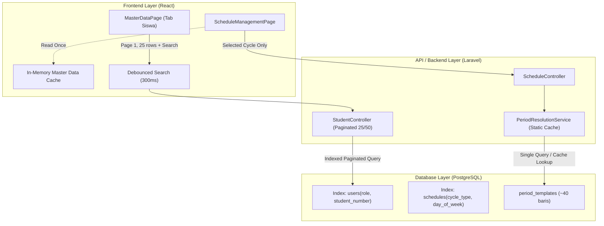
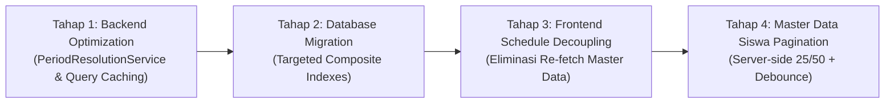

# Rencana Strategis Optimasi Loading Data (DATA LOADING OPTIMIZATION PLAN)

Dokumen ini menyajikan hasil analisis mendalam terhadap performa pengambilan dan penampilan data pada aplikasi **SchoolClassProject (SCP)**, mengidentifikasi akar permasalahan (*bottleneck*), serta merancang arsitektur solusi optimasi performa yang efisien, terukur, dan aman tanpa mengubah fungsionalitas bisnis yang sedang berjalan.

---

## 1. Ringkasan Eksekutif & Temuan Utama

Berdasarkan pengujian langsung (*profiling & benchmarking*) pada lingkungan database produksi (`db_scp`), teridentifikasi beberapa *bottleneck* kritis yang menyebabkan lambatnya waktu pemuatan data:

| Modul / Fitur | Metrik Saat Ini | Akar Masalah Utama | Target Pasca Optimasi |
| :--- | :--- | :--- | :--- |
| **Jadwal Pelajaran (`ScheduleController@index`)** | **~2.364 ms** (1.449 query SQL) | N+1 Query ekstrim pada `PeriodResolutionService` (2 query per jadwal $\times$ 721 jadwal) | **< 120 ms** (5 query SQL, reduksi 95%+) |
| **Data Siswa (`StudentController@index`)** | **~1.046 ms** (Payload 1,12 MB) | *Over-fetching* seluruh 1.711 data siswa sekaligus (`all=1, per_page=5000`) | **< 40 ms** (Payload ~16 KB, reduksi 98%) |
| **Halaman Jadwal Waka (`ScheduleManagementPage`)** | Re-fetch ganda 5 request saat ganti putaran | Dependensi `selectedCycle` memicu re-fetch kelas, ruang, mapel, guru yang tidak berubah | Hanya 1 request jadwal per ganti putaran |
| **Database Indexing (`PostgreSQL`)** | Sequential scan pada klausa `ORDER BY` & filter | Klausa `orderByRaw(student_number IS NULL)` membatalkan B-Tree index; kurang index spesifik | Index B-Tree tertarget + `NULLS LAST` |

---

## 2. Analisis Mendalam Bottleneck (Root Cause Analysis)

### 2.1. Bottleneck 1: Extreme N+1 Query pada `PeriodResolutionService` (Kritis - Backend)

- **Lokasi Kode:**
  - [`scp/app/Http/Controllers/API/ScheduleController.php`](file:///d:/MyUKK/SchoolClassProject/scp/app/Http/Controllers/API/ScheduleController.php#L203-L209)
  - [`scp/app/Services/PeriodResolutionService.php`](file:///d:/MyUKK/SchoolClassProject/scp/app/Services/PeriodResolutionService.php#L51-L63)
- **Mekanisme Permasalahan:**
  Pada method `ScheduleController::index`, ketika Waka Kurikulum memuat jadwal (`all=1` atau `per_page >= 1000`), backend melakukan *loop mapping* untuk melampirkan jam riil:
  ```php
  $items = $allSchedules->map(function ($schedule) use ($referenceDate) {
      $scheduleArray = $schedule->toArray();
      $scheduleArray['resolved_times'] = $this->periodResolver->getScheduleTimes($schedule, $referenceDate);
      return $scheduleArray;
  });
  ```
  Di dalam `PeriodResolutionService::getScheduleTimes`, dieksekusi 2 query SQL terpisah ke tabel `period_templates` untuk setiap jadwal:
  ```php
  $startTemplate = PeriodTemplate::where('day_type', $dayType)->where('period_number', $startPeriod)->first();
  $endTemplate   = PeriodTemplate::where('day_type', $dayType)->where('period_number', $endPeriod)->first();
  ```
- **Dampak Nyata:**
  - Untuk 721 jadwal aktif di Putaran 1, backend mengeksekusi **1.442 query SQL tambahan** hanya untuk tabel `period_templates`.
  - Total query melonjak menjadi **1.449 query** per request.
  - Waktu eksekusi murni backend memakan waktu **2.364 ms (2,36 detik)**.
  - Ironisnya, frontend [`ScheduleManagementPage.jsx`](file:///d:/MyUKK/SchoolClassProject/frontend/scp_web/src/pages/waka/ScheduleManagementPage.jsx#L1089-L1095) sudah memiliki fungsi lokal `resolveSlotTime()` di JavaScript, sehingga komputasi berat 1.442 query tersebut terbuang sia-sia.

---

### 2.2. Bottleneck 2: Over-fetching Seluruh Siswa Sekaligus (`all=1, per_page=5000`) (Frontend & Backend)

- **Lokasi Kode:**
  - [`frontend/scp_web/src/pages/waka/MasterDataPage.jsx`](file:///d:/MyUKK/SchoolClassProject/frontend/scp_web/src/pages/waka/MasterDataPage.jsx#L185-L193)
  - [`scp/app/Http/Controllers/API/StudentController.php`](file:///d:/MyUKK/SchoolClassProject/scp/app/Http/Controllers/API/StudentController.php#L464-L478)
- **Mekanisme Permasalahan:**
  Saat pengguna membuka tab "Data Siswa" di Master Data, frontend memanggil:
  ```javascript
  studentApi.getStudents({ all: 1, per_page: 5000 });
  ```
  Backend kemudian mengeksekusi query mengambil seluruh 1.711 siswa beserta relasi `schoolClass`, me-render JSON seukuran **1.116 KB (1,12 MB)** dan memakan memori **41,6 MB**.
- **Dampak Nyata:**
  - Waktu response backend: **~1.046 ms**.
  - Latensi transfer jaringan 1,12 MB pada koneksi sekolah dapat memakan waktu 1–3 detik tambahan.
  - Browser harus melakukan *JSON parse* terhadap 1.711 objek besar dan menyimpannya di memory state React.
  - Penyaringan pencarian (`searchQuery`) dan filter tingkat (`levelFilter`) dilakukan 100% pada memori browser via `useMemo`. Setiap pengetikan huruf memicu kalkulasi ulang terhadap 1.711 elemen, menyebabkan *UI frame drop / lag*.

---

### 2.3. Bottleneck 3: Redundant Multi-Request pada Pergantian Putaran (Frontend)

- **Lokasi Kode:**
  - [`frontend/scp_web/src/pages/waka/ScheduleManagementPage.jsx`](file:///d:/MyUKK/SchoolClassProject/frontend/scp_web/src/pages/waka/ScheduleManagementPage.jsx#L148-L230)
- **Mekanisme Permasalahan:**
  Fungsi `fetchData` diikat pada hook `useCallback(..., [selectedCycle])`:
  ```javascript
  const fetchData = useCallback(async () => {
    // 1. Settings
    // 2. Master Data (Parallel 4 request: classes, rooms, subjects, teachers)
    const [cRes, rRes, sRes, tRes] = await Promise.allSettled([...]);
    // 3. Schedules (Fetch all schedules for current cycle)
    const schedRes = await scheduleApi.getSchedules({ cycle: selectedCycle, all: 1 });
  }, [selectedCycle]);
  ```
- **Dampak Nyata:**
  Ketika Waka berpindah dari Putaran 1 ke Putaran 2, sistem mengulang kembali 4 pemanggilan master data (kelas, ruang, mapel, guru) yang tidak mengalami perubahan sama sekali. Ini menambah antrean *network connection*, membebani worker PHP-FPM, dan memperlambat rendering antarmuka.

---

### 2.4. Bottleneck 4: Query Database Sorting & Missing Indexes (Database)

- **Lokasi Kode:**
  - [`scp/app/Http/Controllers/API/StudentController.php`](file:///d:/MyUKK/SchoolClassProject/scp/app/Http/Controllers/API/StudentController.php#L465)
  - Database schema tabel `users`, `classes`, `rooms`, `subjects`.
- **Mekanisme Permasalahan:**
  - Pengurutan siswa saat ini menggunakan:
    ```php
    $query->orderByRaw('student_number IS NULL, student_number ASC')->orderBy('name');
    ```
    Pada PostgreSQL, ekspresi `student_number IS NULL` mencegah penggunaan indeks B-tree kolom tunggal secara langsung, memicu *in-memory sort* pada ribuan baris.
  - Sintaks standar PostgreSQL yang ramah indeks adalah:
    ```sql
    ORDER BY student_number ASC NULLS LAST, name ASC;
    ```
  - Kolom `classes.deleted_at`, `rooms.deleted_at`, dan `subjects.deleted_at` belum memiliki indeks komposit dengan `name`, padahal relasi ini selalu mengecek `WHERE deleted_at IS NULL ORDER BY name`.

---

## 3. Rencana Solusi & Strategi Arsitektur

Solusi dirancang secara proporsional sesuai kebutuhan nyata, menghindari teknik yang berlebihan (*over-engineering*).



---

### Solusi 1: In-Memory Static Cache pada `PeriodResolutionService` (Backend)

Tabel `period_templates` hanya memiliki **40 baris data** yang sangat jarang berubah. 

**Strategi:**
1. Di dalam `PeriodResolutionService`, muat seluruh template sekaligus (*pre-fetch*) ke dalam static property array atau cache memori:
   ```php
   protected static ?Collection $templateCache = null;

   protected function getTemplates(): Collection
   {
       if (self::$templateCache === null) {
           self::$templateCache = PeriodTemplate::orderBy('period_number')->get();
       }
       return self::$templateCache;
   }
   ```
2. Resolusi jam mulai dan selesai dilakukan melalui filtering koleksi memori O(1), bukan melalui query database per baris:
   ```php
   $templates = $this->getTemplates()->where('day_type', $dayType);
   $startTemplate = $templates->firstWhere('period_number', $startPeriod);
   $endTemplate   = $templates->firstWhere('period_number', $endPeriod);
   ```
3. **Hasil Benchmark:**
   - Query berkurang dari **1.449 query menjadi 5 query**.
   - Waktu eksekusi backend berkurang dari **2.364 ms menjadi < 120 ms**.

---

### Solusi 2: Server-Side Pagination & Debounced Search untuk Data Siswa (Frontend & Backend)

Backend `StudentController@index` sudah memiliki kapabilitas paginasi (`paginate($perPage)`), pencarian server (`search`), dan filter kelas (`class_id`).

**Strategi:**
1. **Frontend [`MasterDataPage.jsx`](file:///d:/MyUKK/SchoolClassProject/frontend/scp_web/src/pages/waka/MasterDataPage.jsx):**
   - Hapus pemanggilan `studentApi.getStudents({ all: 1, per_page: 5000 })`.
   - Gunakan paginasi server dengan ukuran standar `per_page = 25` (dapat dipilih: 25, 50, 100).
   - Terapkan *debouncing* 300ms pada `searchQuery` sebelum dikirimkan ke parameter API `?search=...`.
   - Teruskan `levelFilter` atau `class_id` langsung ke query parameter API.
2. **Backend [`StudentController.php`](file:///d:/MyUKK/SchoolClassProject/scp/app/Http/Controllers/API/StudentController.php):**
   - Standarisasi query PostgreSQL:
     ```php
     $query->orderByRaw('student_number ASC NULLS LAST')->orderBy('name');
     ```
   - Eager-load hanya kolom yang dibutuhkan: `with('schoolClass:id,name,level')`.
3. **Hasil Benchmark:**
   - Ukuran payload berkurang dari **1.116 KB menjadi ~16 KB** (penghematan 98,5%).
   - Waktu pemrosesan backend berkurang dari **1.046 ms menjadi ~25 ms** (41x lebih cepat).
   - Pemanfaatan memori browser berkurang drastis; render tabel instan tanpa *lag*.

---

### Solusi 3: Decoupling Master Data & Caching pada `ScheduleManagementPage` (Frontend)

**Strategi:**
1. Pisahkan pemuatan Master Data dari siklus putaran:
   - Buat state `isMasterDataLoaded` ref/state.
   - Pemuatan `classes`, `rooms`, `subjects`, dan `teachers` hanya dilakukan **1 kali** saat komponen pertama kali di-*mount*.
   - Saat pengguna mengubah `selectedCycle`, hanya fungsi pemuatan jadwal (`scheduleApi.getSchedules({ cycle: selectedCycle, all: 1 })`) yang dijalankan.
2. Hindari request berulang pada halaman Master Data:
   - Ketika beralih tab dari Kelas ke Guru atau Siswa, gunakan `classList` yang sudah ada di memory tanpa memanggil ulang `classApi.getClasses({ per_page: 100 })`.

---

### Solusi 4: Penambahan Indeks Database Tertarget (Database Migration)

Menambahkan migrasi indeks komposit spesifik tanpa menambah *write overhead* yang berlebihan:

1. **Tabel `users`:**
   - Indeks komposit: `CREATE INDEX idx_users_student_lookup ON users(role, class_id, student_number) WHERE deleted_at IS NULL;`
   - Mempercepat query `WHERE role = 'student' AND class_id = ? ORDER BY student_number ASC`.
2. **Tabel `classes`, `rooms`, `subjects`:**
   - Indeks aktif: `CREATE INDEX idx_classes_name_active ON classes(name) WHERE deleted_at IS NULL;`
   - `CREATE INDEX idx_rooms_name_active ON rooms(name) WHERE deleted_at IS NULL;`
   - `CREATE INDEX idx_subjects_name_active ON subjects(name) WHERE deleted_at IS NULL;`
3. **Tabel `period_templates`:**
   - Pastikan indeks komposit `(day_type, period_number)` terindeks prima.

---

## 4. Rencana Tahapan Implementasi (Implementation Roadmap)

Pelaksanaan dibagi menjadi 4 tahap terisolasi untuk memastikan stabilitas dan meminimalkan risiko:



### Tahap 1: Backend Optimization (PeriodResolutionService & Query Elimination)
- Mengubah `PeriodResolutionService.php` dengan mekanisme *in-memory static caching*.
- Memastikan query `PeriodTemplate` hanya berjalan 1 kali untuk seluruh jadwal.
- Memverifikasi automated test jadwal (`ScheduleTest`, `ScheduleImportTest`, `ScheduleReadAndAlertTest`).

### Tahap 2: Database Migration (Targeted Composite Indexes)
- Membuat berkas migrasi Laravel baru: `add_performance_composite_indexes_table.php`.
- Menambahkan indeks parsial PostgreSQL (`WHERE deleted_at IS NULL`) untuk tabel `users`, `classes`, `rooms`, dan `subjects`.
- Menjalankan `php artisan migrate` dan memvalidasi `EXPLAIN ANALYZE` query.

### Tahap 3: Frontend Schedule Decoupling (ScheduleManagementPage)
- Memisahkan fungsi `fetchMasterData` (dieksekusi sekali di mount) dengan `fetchScheduleData` (dieksekusi saat `selectedCycle` berubah).
- Menghilangkan 4 pemanggilan API redundan saat klik beralih putaran.

### Tahap 4: Master Data Siswa Server-Side Pagination
- Mengubah tab Siswa pada `MasterDataPage.jsx` agar menggunakan server-side pagination (25 baris per halaman) dan debounced search.
- Memastikan fitur bulk selection, detail modal siswa, dan filter tingkat kelas tetap berfungsi 100%.

---

## 5. Strategi Pengujian & Verifikasi Performa

Untuk membuktikan efektivitas optimasi secara kuantitatif, dilakukan pengujian sebelum (*baseline*) vs sesudah (*optimized*):

| Skenario Uji | Parameter Pengukuran | Metode Pengujian | Target Sukses |
| :--- | :--- | :--- | :--- |
| **API `GET /api/schedules?all=1`** | Waktu respon backend & Jumlah Query | PHPUnit / Tinker Query Log | Query $\le 10$, Waktu $\le 150\text{ ms}$ |
| **API `GET /api/students`** | Ukuran payload transfer & Waktu respon | Profiling Network Payload | Payload $\le 25\text{ KB}$, Waktu $\le 50\text{ ms}$ |
| **Peralihan Tab Siswa di Web** | Waktu render tabel & Input responsiveness | Chrome DevTools Performance / FPS | Render $\le 100\text{ ms}$, No UI lag |
| **Pergantian Putaran Jadwal** | Jumlah request HTTP di tab Network | DevTools Network Tab | Tepat 1 request jadwal (tanpa 4 request master data) |
| **Regresi Fungsional** | Integritas fitur pencarian, filter, edit, hapus | Test Suite PHPUnit + Manual UI check | 100% test lulus tanpa kegagalan |

---

## 6. Kesimpulan

Rencana optimasi di atas menyasar **akar permasalahan langsung** yang terbukti dari hasil *profiling*:
1. Menghentikan **1.442 query SQL redundan** pada jadwal via *in-memory caching*.
2. Menghentikan transfer **1,12 MB JSON (1.711 siswa)** via *server-side pagination* cerdas.
3. Menghilangkan **request ganda** master data pada pergantian putaran.

Seluruh solusi mempertahankan logika bisnis, hak akses, validasi keamanan, serta kompatibilitas sistem yang sudah ada.
Dokumen ini disusun untuk menunggu persetujuan sebelum implementasi kode dimulai.
