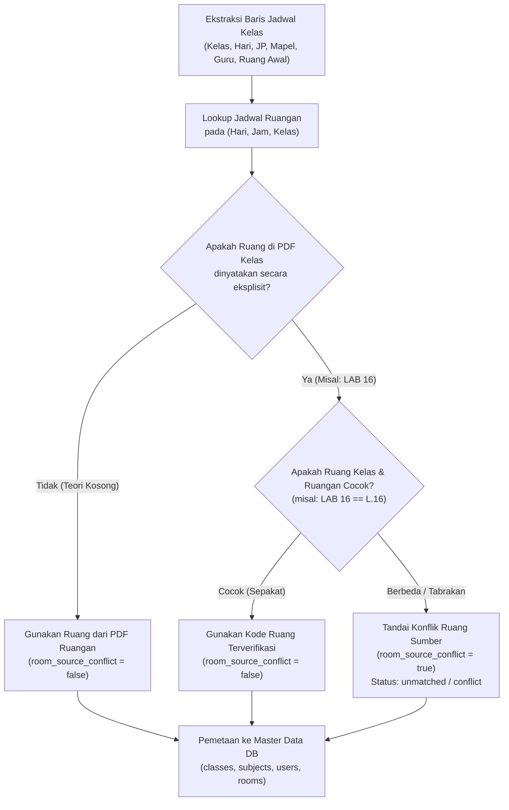
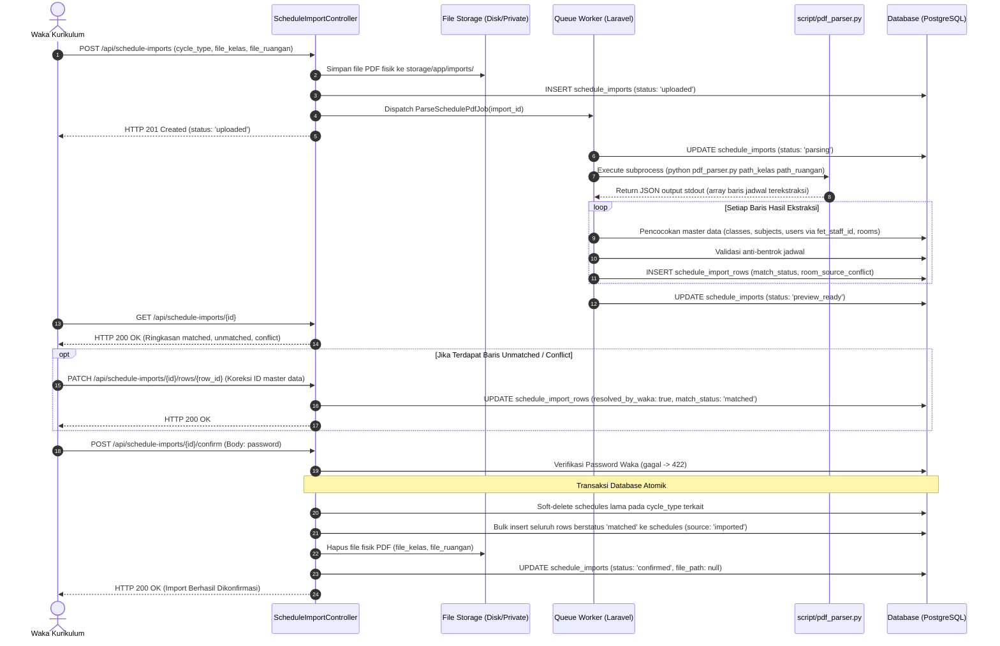
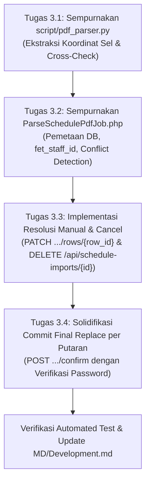

# Dokumen Analisis Dokumen PDF & Rencana Implementasi Fase 3: Import Jadwal Otomatis dari File PDF FET

**Proyek:** School Class Progress (SCP) — Backend REST API  
**Fase:** Fase 3 (Import Jadwal Otomatis dari File PDF FET)  
**Dokumen Acuan:** `MD/PRD.md` (v4.4 Bagian 5.16 & 9.5), `MD/MASTER_IMPROVEMENT_PLAN.md`, dan Sampel PDF di `MD/PDF/`  
**Penyusun:** Senior Software Engineer, Software Architect & Data Processing Specialist  
**Tanggal:** 2026-10-20  
**Status Dokumen:** Usulan Rencana (Menunggu Persetujuan Implementasi)

---

## DAFTAR ISI
1. [Bagian 1: Analisis Mendalam Dokumen PDF Aktual](#bagian-1-analisis-mendalam-dokumen-pdf-aktual)
   - 1.1 Karakteristik Dokumen Sumber
   - 1.2 Struktur & Anatomi Tabel `Jadwal_Kelas.pdf`
   - 1.3 Struktur & Anatomi Tabel `Jadwal_Ruangan.pdf`
   - 1.4 Temuan Kritis, Inkonsistensi & Anomali Data Riil
   - 1.5 Aturan Rekonsiliasi & Korelasi Silang (*Cross-Matching*)
2. [Bagian 2: Arsitektur Pipeline Pengolahan Data Jadwal](#bagian-2-arsitektur-pipeline-pengolahan-data-jadwal)
   - 2.1 Tujuan & Ruang Lingkup Pipeline
   - 2.2 Diagram Alur Data End-to-End
   - 2.3 Strategi & Pilihan Teknologi Parsing PDF
   - 2.4 Format Standar Kontrak Data Ekstraksi Python
   - 2.5 Logika Pemetaan ke Database Master Data
   - 2.6 Penanganan Error, Nilai Kosong & Data Duplikat
3. [Bagian 3: Rencana Pelaksanaan Fase 3 (Work Breakdown Structure)](#bagian-3-rencana-pelaksanaan-fase-3-work-breakdown-structure)
   - 3.1 Tugas 3.1: Penyempurnaan Script Ekstraksi PDF Python (`script/pdf_parser.py`)
   - 3.2 Tugas 3.2: Worker Pemetaan & Deteksi Bentrok Asinkron (`ParseSchedulePdfJob.php`)
   - 3.3 Tugas 3.3: Endpoint Resolusi Manual & Pembatalan Import (`ScheduleImportController.php`)
   - 3.4 Tugas 3.4: Solidifikasi Commit Final Replace per Putaran (`confirm`)
4. [Bagian 4: Rencana Pengujian, Risiko & Kriteria Keberhasilan](#bagian-4-rencana-pengujian-risiko--kriteria-keberhasilan)
   - 4.1 Rencana Pengujian Otomatis & Kasus Uji
   - 4.2 Analisis Risiko & Mitigasi Teknis
   - 4.3 Kriteria Keberhasilan (*Definition of Done*)

---

## Bagian 1: Analisis Mendalam Dokumen PDF Aktual

### 1.1 Karakteristik Dokumen Sumber
Kedua dokumen PDF yang berada di folder `MD/PDF/` merupakan dokumen hasil ekspor dari aplikasi timetable generator **FET versi 5.44.9**:

| Parameter Dokumen | `MD/PDF/Jadwal_Kelas.pdf` | `MD/PDF/Jadwal_Ruangan.pdf` |
|---|---|---|
| **Ukuran File** | 234.586 Bytes (~229 KB) | 539.912 Bytes (~527 KB) |
| **Jumlah Halaman** | 49 Halaman | 3 Halaman |
| **Orientasi Halaman** | Portrait | Landscape |
| **Peruntukan Data** | Jadwal mata pelajaran, guru, durasi JP per kelas (Sumber Utama). | Alokasi fisik ruangan per kelas per JP (Sumber Cross-Check). |
| **Cakupan Waktu** | Semester Ganjil TA 2026/2027 (Putaran 1 & Putaran 2 kompatibel). | Tertulis spesifik: **Putaran 1 Semester Ganjil TA 2026/2027**. |
| **Identitas Sekolah** | SMK NEGERI 1 BANTUL | SMK NEGERI 1 BANTUL |
| **Jumlah Kelas** | 48 Kelas (16 kelas level 10, 16 kelas level 11, 16 kelas level 12). | 48 Kelas (sama persis dengan jadwal kelas). |

---

### 1.2 Struktur & Anatomi Tabel `Jadwal_Kelas.pdf`
1. **Halaman 1 (Daftar Isi):** Berisi tautan indeks ke seluruh 48 kelas.
2. **Halaman 2 s.d. 49 (Jadwal Kelas):** Tepat 1 halaman per kelas.
   - **Header Tabel (Baris 0):** Berisi nama kelas pada kolom kedua (misal: `X RPL1`, `X TKJ2`, `XI AK1`, `XII BD`).
   - **Header Hari (Baris 1):** Terdiri dari 6 kolom:
     - Kolom 0: `Jam` (Waktu mulai JP)
     - Kolom 1: `Senin`
     - Kolom 2: `Selasa`
     - Kolom 3: `Rabu`
     - Kolom 4: `Kamis`
     - Kolom 5: `Jumat`
   - **Baris Slot Waktu (Baris 2 s.d. 11 = 10 JP):**
     - Baris 2: `07:15` ➔ JP 1
     - Baris 3: `08:00` ➔ JP 2
     - Baris 4: `08:45` ➔ JP 3
     - Baris 5: `09:45` ➔ JP 4 (setelah Istirahat 1)
     - Baris 6: `10:30` ➔ JP 5
     - Baris 7: `11:15` ➔ JP 6
     - Baris 8: `12:30` ➔ JP 7 (setelah Istirahat 2 / Dhuhur)
     - Baris 9: `13:15` ➔ JP 8
     - Baris 10: `14:00` ➔ JP 9
     - Baris 11: `14:45` ➔ JP 10
     - Baris 12: Footer (`Jadwal dihasilkan dengan FET 5.44.9 pada 09/09/26 04.11`).
3. **Anatomi Konten Sel Jadwal Kelas:**
   Suatu sel memuat informasi bertingkat yang dipisahkan oleh baris baru (`\n`):
   ```text
   Line 1: Nama Mata Pelajaran (misal: "DDPK 3 RPL Dasar Algoritma Pemrograman")
   Line 2: Identitas Guru dalam Tanda Kutip (misal: ""51.ROSYIDA RAMADHANI, S.Pd"")
   Line 3: Kode Ruangan Khusus (Opsional, misal: "LAB 16", "OR1", "LAB IPA")
   ```
4. **Perilaku Sel Gabungan (*Merged Cells / Multi-JP*):**
   - Bila mapel berlangsung lebih dari 1 JP (misal 3 JP dari pukul 07:15 s.d. 09:30), teks hanya muncul pada baris JP pertama (Baris 2 / `07:15`).
   - Pada baris JP berikutnya (Baris 3 dan Baris 4), `pdfplumber` mengekstrak nilai sel sebagai `None`.
   - Durasi JP (`duration_periods`) dapat dihitung secara pasti dengan menghitung jumlah baris `None` berturut-turut sampai ditemukan sel berisi teks berikutnya atau batas akhir hari.

---

### 1.3 Struktur & Anatomi Tabel `Jadwal_Ruangan.pdf`
1. **Format Grid Matriks Horizontal (Landscape):**
   - Terdiri dari 3 halaman yang memuat 5 sub-tabel hari:
     - Halaman 1: Sub-tabel hari `Senin` (10 JP) dan `Selasa` (10 JP).
     - Halaman 2: Sub-tabel hari `Rabu` (10 JP) dan `Kamis` (10 JP).
     - Halaman 3: Sub-tabel hari `Jumat` (8 JP) + Tabel Legenda Keterangan Ruang.
2. **Struktur Kolom (51 Kolom):**
   - Kolom 0: `Hari` (`Senin`, `Selasa`, `Rabu`, `Kamis`, `Jumat`).
   - Kolom 1: `Jam` (`1` s.d. `10`, serta baris penanda jeda `'IST'`).
   - Kolom 2: `Waktu` (misal: `08.00 - 08.35`, `08.35 - 09.10`).
   - Kolom 3 s.d. 50: **48 Kolom Kelas**, berurutan dari `10 RPL 1` sampai `12 BD`.
3. **Isi Sel Ruangan:**
   - Berisi kode ringkas ruang untuk kelas bersangkutan pada JP tersebut.
   - Contoh isi sel:
     - `12`, `22`, `34`: Ruang kelas teori standar (Ruang 12, 22, 34).
     - `L.1` s.d. `L.22`: Laboratorium Komputer 1 s.d. 22.
     - `L.IPA`: Laboratorium Ilmu Pengetahuan Alam.
     - `L.PB`: Laboratorium Penataan Barang.
     - `OR`: Lapangan Olahraga.
     - `HALL`: Ruang untuk menari / Hall serbaguna.

---

### 1.4 Temuan Kritis, Inkonsistensi & Anomali Data Riil

Berdasarkan ekstraksi programatik mendalam terhadap kedua file PDF aktual, ditemukan **6 anomali kritis** yang wajib ditangani oleh parser agar tidak gagal mengekstrak data:

#### 1. Anomali Kutip Terbuka Tanpa Penutup (78 Sel pada `Jadwal_Kelas.pdf`)
- *Temuan:* Ditemukan sebanyak **78 sel** di mana nama guru dibuka dengan tanda kutip `"` namun **tidak pernah ditutup** dengan tanda kutip penutup karena batas sel terpotong oleh layout FET.
- *Contoh Aktual:*
  ```text
  Bahasa Indonesia
  "82. RAHMAWATI YOGA PAMUNGKAS, M.Pd
  ```
- *Bahaya Teknis:* Regex konvensional seperti `re.search(r'"([^"]+)"', text)` akan mengabaikan seluruh 78 sel ini, menyebabkan mata pelajaran Bahasa Indonesia dan Sejarah hilang dari database.
- *Solusi Parser:* Menggunakan regex yang toleran terhadap akhir sel:
  ```python
  re.search(r'"(\d+)\.?\s*([^"\n\r]+?)(?:"|\s+(?:LAB|OR|HALL)\b|$)', text)
  ```

#### 2. Format Penomoran Kode Guru (`fet_staff_id`) di Awal Nama
- *Temuan:* Di dalam teks kutipan guru, selalu terdapat nomor urut staf di bagian depan:
  - `"34.DWI LESMIYATI, S.Pd."` ➔ `fet_staff_id = 34`
  - `"11WAHYUNI, S.Pd"` ➔ `fet_staff_id = 11` (tanpa titik)
  - `"9.SUJAR HARTONO, S.Pd"` ➔ `fet_staff_id = 9`
- *Nilai Strategis:* Field `fet_staff_id` ini adalah **kunci pencocokan utama (primary lookup key)** sesuai PRD 5.16 & 5.17, yang jauh lebih akurat daripada pencocokan nama string guru (yang rentan typo gelar seperti `S.Pd.` vs `S.Pd`).

#### 3. Perbedaan Konvensi Penamaan Kelas antara Kedua PDF
- *Temuan:*
  - `Jadwal_Kelas.pdf` menggunakan angka Romawi tanpa spasi: `X RPL1`, `XI TKJ2`, `XII AK4`.
  - `Jadwal_Ruangan.pdf` menggunakan angka Arab dengan spasi dan baris baru: `10\nRPL\n1`, `11\nTKJ\n2`, `12\nAK\n4`.
- *Solusi Parser:* Mengimplementasikan fungsi kanonisasi kelas standar (misal dikonversi ke format resmi database: `X RPL 1`, `XI TKJ 2`, `XII AK 4`).

#### 4. Ruang Kelas Teori yang Dikosongkan pada `Jadwal_Kelas.pdf`
- *Temuan:* Pada `Jadwal_Kelas.pdf`, mata pelajaran teori (seperti Matematika, Bahasa Indonesia, Agama, Pancasila) **tidak mencantumkan nama ruangan** di dalam selnya. Ruangan hanya dicantumkan bila pelajaran diadakan di lab (`LAB 16`) atau lapangan (`OR1`).
- *Solusi Parser:* Nilai ruangan untuk pelajaran teori diambil langsung dari `Jadwal_Ruangan.pdf` (misal kelas `X RPL 1` dialokasikan di ruang `12`).

#### 5. Perbedaan Notasi Kode Ruangan antara Kedua PDF
- *Temuan:*
  - Laboratorium: `LAB 16` di PDF Kelas ➔ `L.16` di PDF Ruangan.
  - Laboratorium IPA: `LAB IPA` di PDF Kelas ➔ `L.IPA` di PDF Ruangan.
  - Lapangan Olahraga: `OR1`, `OR2`, `OR3` di PDF Kelas ➔ `OR` di PDF Ruangan.
- *Solusi Parser:* Membangun kamus normalisasi alias ruang (*Room Alias Dictionary*) sebelum membandingkan kode dari kedua file.

#### 6. Tabel Legenda / Catatan Tambahan di Halaman 3 `Jadwal_Ruangan.pdf`
- *Temuan:* Halaman 3 memuat tabel kedua di bawah jadwal hari Jumat yang berisi daftar keterangan lab komputer (`L.1` s.d. `L.22`) dan tanda tangan Kepala Sekolah. Jika diekstrak secara membabi buta, teks legenda ini akan masuk sebagai baris jadwal fiktif.
- *Solusi Parser:* Membatasi baris yang diparsing hanya baris yang memiliki nilai `Jam` numerik (`1` s.d. `10`) atau `'IST'`.

---

### 1.5 Aturan Rekonsiliasi & Korelasi Silang (*Cross-Matching*)

Berdasarkan PRD Bagian 5.16 Alur 3, proses penggabungan data dilakukan dengan matriks keputusan berikut:



---

## Bagian 2: Arsitektur Pipeline Pengolahan Data Jadwal

### 2.1 Tujuan & Ruang Lingkup Pipeline
Pipeline ini bertugas mentransformasikan 2 dokumen PDF mentah menjadi catatan jadwal pelajaran aktif pada database SCP tanpa interupsi operasional, dengan karakteristik:
- **Asinkron & Non-Blocking:** Ekstraksi dilakukan di background job queue agar HTTP request Waka tidak mengalami timeout (file jadwal berukuran total 52 halaman).
- **Aman & Terisolasi Per Putaran (*Replace per Cycle*):** Hanya menggantikan jadwal pada putaran yang dipilih (`cycle_type = 1` atau `cycle_type = 2`), dengan soft-delete jadwal lama sehingga riwayat jurnal mengajar historis tidak menjadi yatim (*orphan*).
- **Transparan dengan Pratinjau (*Preview & Audit Trail*):** Menyediakan antarmuka pratinjau hasil parsing yang mengelompokkan data ke dalam status `matched`, `unmatched`, dan `conflict` sebelum di-commit secara permanen.

---

### 2.2 Diagram Alur Data End-to-End



---

### 2.3 Strategi & Pilihan Teknologi Parsing PDF

1. **Pemilihan Teknologi Parser:**
   - **`pdfplumber` (Python 3.11)** dipilih sebagai engine ekstraksi utama karena memiliki algoritma deteksi garis tabel berbasis koordinat visual (`explicit_vertical_lines` & `explicit_horizontal_lines`). Pendekatan ini mampu melacak sel gabungan (*merged cells*) yang membentang multi-JP secara konsisten dan mengembalikan matriks sel terstruktur (bukan sekadar stream teks linear).
   - Orkestrasi pemanggilan via **`uv run --with pdfplumber python`** atau virtual environment mandiri memastikan dependensi Python terisolasi tanpa merusak environment sistem operasi.
2. **Algoritma Ekstraksi Jadwal Kelas:**
   - Buka `Jadwal_Kelas.pdf`, lewati Halaman 1 (Daftar Isi).
   - Iterasi Halaman 2 s.d. 49:
     - Ambil nama kelas dari baris 0, kolom 1 (`X RPL1`).
     - Telusuri kolom hari 1 s.d. 5 (`Senin` s.d. `Jumat`).
     - Pada tiap kolom, telusuri baris slot waktu JP 1 s.d. 10.
     - Lacak baris sel teks pertama dan hitung sel `None` di bawahnya untuk menentukan `period_number` dan `duration_periods`.
3. **Algoritma Ekstraksi Jadwal Ruangan:**
   - Buka `Jadwal_Ruangan.pdf`.
   - Iterasi Halaman 1 s.d. 3:
     - Petakan header kolom kelas (Kolom 3 s.d. 50).
     - Identifikasi hari dan jam dari Kolom 0 dan Kolom 1.
     - Simpan alokasi ruang ke dalam struktur lookup: `room_lookup[(norm_class, day_num, period_num)] = room_code`.
4. **Algoritma Rekonsiliasi & Output:**
   - Gabungkan data dari parser kelas dengan parser ruangan berdasarkan tuple `(class_name, day_of_week, period_number)`.
   - Cetak output berupa JSON terstruktur murni ke `stdout` untuk ditangkap oleh worker Laravel.

---

### 2.4 Format Standar Kontrak Data Ekstraksi Python

Output dari `script/pdf_parser.py` akan dicetak ke `stdout` dalam format JSON Array berikut:

```json
[
  {
    "kelas_mentah": "X RPL 1",
    "hari_mentah": "Senin",
    "day_of_week": 1,
    "period_number": 1,
    "duration_periods": 3,
    "mapel_mentah": "Matematika",
    "fet_staff_id": "34",
    "guru_mentah": "DWI LESMIYATI, S.Pd.",
    "ruang_kelas": null,
    "ruang_jadwal": "12",
    "ruang_final": "12",
    "room_source_conflict": false
  },
  {
    "kelas_mentah": "X RPL 2",
    "hari_mentah": "Senin",
    "day_of_week": 1,
    "period_number": 1,
    "duration_periods": 4,
    "mapel_mentah": "DDPK 3 RPL Dasar Algoritma Pemrograman",
    "fet_staff_id": "51",
    "guru_mentah": "ROSYIDA RAMADHANI, S.Pd",
    "ruang_kelas": "LAB 16",
    "ruang_jadwal": "L.16",
    "ruang_final": "L.16",
    "room_source_conflict": false
  }
]
```

---

### 2.5 Logika Pemetaan ke Database Master Data

Saat queue job Laravel (`ParseSchedulePdfJob.php`) memproses JSON di atas:
1. **Pemetaan Kelas (`matched_class_id`):**
   - Cari kelas: `Classes::where('name', $item['kelas_mentah'])->first()`.
2. **Pemetaan Guru (`matched_teacher_id`):**
   - **Prioritas 1 (fet_staff_id):** Jika `fet_staff_id` tersedia, cari `User::where('role', 'teacher')->where('fet_staff_id', $item['fet_staff_id'])->first()`.
   - **Prioritas 2 (Nama Guru):** Jika Prioritas 1 gagal/kosong, cari secara case-insensitive: `User::where('role', 'teacher')->where('name', $like, '%' . $item['guru_mentah'] . '%')->first()`.
3. **Pemetaan Mata Pelajaran (`matched_subject_id`):**
   - Cari mapel: `Subject::where('name', $like, '%' . $item['mapel_mentah'] . '%')->first()`.
4. **Pemetaan Ruangan (`matched_room_id`):**
   - Normalisasi kode ruang (misal `L.16` ➔ cari Room dengan nama `Lab Komputer 16` atau `L.16` atau `Lab 16`).
   - Cari room: `Room::where('name', $like, '%' . $item['ruang_final'] . '%')->first()`.
5. **Klasifikasi Status Baris (`match_status`):**
   - Jika ke-4 entitas master data (`class`, `teacher`, `subject`, `room`) berhasil dipetakan ➔ Periksa bentrok slot waktu via `ScheduleConflictService`.
   - Jika bentrok dengan sesama baris import atau jadwal eksisting ➔ `match_status = 'conflict'`.
   - Jika bebas bentrok ➔ `match_status = 'matched'`.
   - Jika ada entitas master data yang bernilai `null` (belum terdaftar di DB) ➔ `match_status = 'unmatched'`.

---

## Bagian 3: Rencana Pelaksanaan Fase 3 (Work Breakdown Structure)

Sesuai `MD/MASTER_IMPROVEMENT_PLAN.md`, Fase 3 mencakup **4 tugas terstruktur**:



---

### Tugas 3.1 · Penyempurnaan Script Ekstraksi PDF FET (`script/pdf_parser.py`)
- **Tujuan:** Menggantikan script stub/dummy yang saat ini mengembalikan data statis dengan implementasi parser Python yang membaca struktur kedua PDF aktual (`Jadwal_Kelas.pdf` dan `Jadwal_Ruangan.pdf`) secara utuh dan presisi.
- **File Terdampak:** `script/pdf_parser.py`.
- **Langkah Kerja:**
  1. Buat parser tabel kelas: ekstrak 48 kelas dari halaman 2–49, petakan hari dan rentang JP (menggabungkan sel berturut-turut untuk menghitung `duration_periods`).
  2. Tangani 78 anomali sel dengan tanda kutip terbuka agar nama guru dan `fet_staff_id` terekstrak sempurna.
  3. Buat parser tabel ruangan: ekstrak matriks alokasi ruang per kelas per jam untuk 5 hari sekolah, filter tabel legenda di halaman 3.
  4. Lakukan cross-check ruangan dan rekonsiliasi kode lab/lapangan.
  5. Format output ke JSON dan cetak ke `sys.stdout`.

---

### Tugas 3.2 · Worker Pemetaan & Deteksi Bentrok Asinkron (`ParseSchedulePdfJob.php`)
- **Tujuan:** Menghapus seluruh hardcode (`id=1`) pada queue worker, mengintegrasikan pencocokan guru berbasis `fet_staff_id`, mencocokkan mapel, kelas, dan ruangan ke tabel database aktual, serta menguji bentrok jadwal.
- **File Terdampak:** `app/Jobs/ParseSchedulePdfJob.php`.
- **Langkah Kerja:**
  1. Jalankan proses `pdf_parser.py` via Symfony `Process`.
  2. Parse output JSON dan tangani error process.
  3. Loop setiap baris jadwal:
     - Cari `Classes` via nama kelas normalisasi.
     - Cari `User` (guru) mengutamakan `fet_staff_id` (fallback nama).
     - Cari `Subject` via nama mapel.
     - Cari `Room` via kode/nama ruang normalisasi.
  4. Jika semua entitas ditemukan, jalankan pengecekan bentrok via `ScheduleConflictService`.
  5. Simpan baris ke tabel `schedule_import_rows` beserta kolom `room_source_conflict`.
  6. Ubah status `schedule_imports` menjadi `'preview_ready'` (atau `'failed'` jika parser error).

---

### Tugas 3.3 · Endpoint Resolusi Manual & Pembatalan Import (`ScheduleImportController.php`)
- **Tujuan:** Mengimplementasikan endpoint resolusi manual baris `unmatched` dan pembatalan draft import sesuai PRD 5.16 & 9.5.
- **File Terdampak:**
  - `app/Http/Controllers/API/ScheduleImportController.php`.
  - `routes/api.php`.
- **Langkah Kerja:**
  1. Buat method `resolveRow(Request $request, int $id, int $row_id)`:
     - Validasi input: `matched_class_id`, `matched_teacher_id`, `matched_room_id`, `matched_subject_id`, atau `exclude` (boolean).
     - Update baris terkait di `schedule_import_rows`: set `resolved_by_waka = true` dan ubah `match_status = 'matched'` (atau `'duplicate'` jika di-exclude).
  2. Buat method `destroy(int $id)`:
     - Cari import dengan status bukan `confirmed`.
     - Hapus file fisik PDF dari storage.
     - Hapus data `schedule_import_rows` dan `schedule_imports`.
  3. Daftarkan rute pada `routes/api.php`:
     - `PATCH /api/schedule-imports/{id}/rows/{row_id}`
     - `DELETE /api/schedule-imports/{id}`

---

### Tugas 3.4 · Solidifikasi Commit Final Replace per Putaran (`confirm`)
- **Tujuan:** Memastikan method `confirm` pada `ScheduleImportController` berjalan dalam transaksi atomik, memvalidasi kata sandi Waka (status 422 jika salah), meng-soft delete jadwal lama **hanya pada `cycle_type` terkait**, memasukkan baris baru bertanda `source = 'imported'`, menghapus file PDF fisik dari storage, dan mengupdate status import menjadi `confirmed`.
- **File Terdampak:** `app/Http/Controllers/API/ScheduleImportController.php`.
- **Langkah Kerja:**
  1. Standarisasi verifikasi kata sandi pemanggil Waka via `$this->passwordIsConfirmed($request)`.
  2. Pastikan hanya baris berstatus `'matched'` yang di-insert ke tabel `schedules`.
  3. Hapus file fisik PDF dari disk storage setelah commit berhasil.
  4. Kosongkan path file di record `schedule_imports` dan set `status = 'confirmed'`.

---

## Bagian 4: Rencana Pengujian, Risiko & Kriteria Keberhasilan

### 4.1 Rencana Pengujian Otomatis & Kasus Uji

Akan dibuat pengujian unit dan pengujian feature yang mencakup seluruh alur:
1. **Unit Test Python Parser (`tests/Unit/SchedulePdfParserTest.php` atau test script langsung):**
   - Menjalankan `script/pdf_parser.py` terhadap `MD/PDF/Jadwal_Kelas.pdf` dan `MD/PDF/Jadwal_Ruangan.pdf`.
   - Memastikan menghasilkan output JSON valid dengan jumlah baris > 700 jadwal.
   - Memverifikasi `fet_staff_id` terekstrak dengan benar (misal ID 34 untuk Dwi Lesmiyati, ID 51 untuk Rosyida).
2. **Feature Test Upload & Queue Parsing (`ScheduleImportUploadTest.php`):**
   - Waka mengunggah 2 file PDF via `POST /api/schedule-imports` ➔ Status 201 Created, status import `'uploaded'`, job ter-dispatch.
   - Eksekusi worker `ParseSchedulePdfJob` ➔ Status import berubah menjadi `'preview_ready'`, baris-baris `schedule_import_rows` terisi.
3. **Feature Test Preview & Resolusi Manual (`ScheduleImportPreviewAndResolveTest.php`):**
   - Memanggil `GET /api/schedule-imports/{id}` ➔ Data preview menampilkan ringkasan rows, status matched, unmatched, conflict.
   - Memanggil `PATCH /api/schedule-imports/{id}/rows/{row_id}` ➔ Baris unmatched berhasil dikoreksi menjadi matched.
4. **Feature Test Pembatalan Import Draft (`ScheduleImportCancelTest.php`):**
   - Memanggil `DELETE /api/schedule-imports/{id}` ➔ Record draft import terhapus, file fisik di storage terhapus.
5. **Feature Test Konfirmasi Final Commit (`ScheduleImportConfirmTest.php`):**
   - Memanggil `POST /api/schedule-imports/{id}/confirm` dengan password salah ➔ Ditolak HTTP 422.
   - Memanggil confirm dengan password benar ➔ Jadwal lama pada putaran tersebut di-soft-delete, jadwal baru di-insert dengan `source = 'imported'`, status menjadi `'confirmed'`.

---

### 4.2 Analisis Risiko & Mitigasi Teknis

| No | Risiko Potensial | Dampak | Langkah Mitigasi |
|---|---|---|---|
| 1 | Lingkungan server/host belum menginstal `pdfplumber` secara global di sistem Python. | Job queue gagal menjalankan script Python (`ModuleNotFoundError`). | Memanggil script menggunakan `uv run --with pdfplumber python` atau memastikan paket terpasang pada virtual environment Laravel worker. |
| 2 | Master data Guru, Mapel, atau Ruang di database belum diisi lengkap sehingga banyak baris berstatus `unmatched`. | Jadwal tidak otomatis ter-commit seluruhnya jika Waka belum memasukkan master data. | Hal ini merupakan perilaku yang diinginkan (*by design* sesuai PRD 5.16). Disediakan endpoint `PATCH .../rows/{row_id}` untuk resolusi manual, atau Waka dapat melengkapi master data terlebih dahulu. |
| 3 | Ekstraksi file PDF berukuran besar (49 halaman) memakan waktu beberapa detik. | Potensi timeout jika dijalankan pada siklus request HTTP langsung. | Proses ekstraksi diisolasi 100% di dalam asynchronous Queue Job (`ParseSchedulePdfJob`), API upload langsung mengembalikan response 201 dalam hitungan milidetik. |

---

### 4.3 Kriteria Keberhasilan (*Definition of Done*)

Fase 3 dinyatakan selesai apabila:
1. Script `script/pdf_parser.py` mampu membaca kedua file PDF aktual di `MD/PDF/` dan menghasilkan JSON data jadwal lengkap tanpa error.
2. Queue job `ParseSchedulePdfJob` memetakan baris jadwal secara dinamis ke tabel database (`classes`, `subjects`, `users` via `fet_staff_id`, `rooms`) tanpa ada nilai yang di-hardcode.
3. Seluruh 5 endpoint import jadwal (`POST /api/schedule-imports`, `GET /api/schedule-imports/{id}`, `PATCH /api/schedule-imports/{id}/rows/{row_id}`, `POST /api/schedule-imports/{id}/confirm`, `DELETE /api/schedule-imports/{id}`) berfungsi sesuai spesifikasi PRD 9.5.
4. Mekanisme commit final menggantikan jadwal secara aman (*replace per cycle* via soft delete) dan menghapus file PDF fisik dari storage.
5. Seluruh automated test (Fase 0, 1, 2, dan 3) lulus **100% tanpa regresi**.
6. Dokumentasi teknis dan panduan pengujian Postman untuk seluruh endpoint import telah ditambahkan ke `MD/Development.md`.
