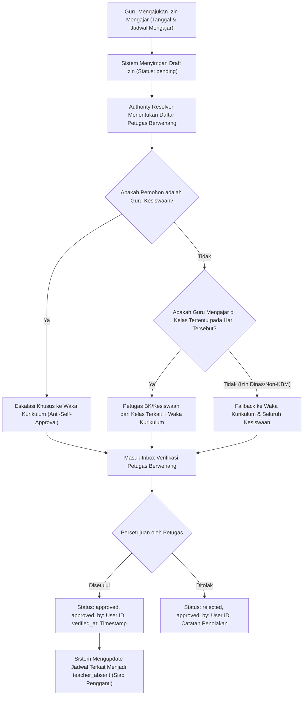

# Dokumen Analisis & Rencana Implementasi: Sistem Penugasan BK/Kesiswaan dan Wali Kelas

**Kode Dokumen:** `SCP-PLAN-2026-BK-WALI`  
**Target Rilis:** SCP v4.6  
**Status:** **DISETUJUI OLEH PENGGUNA (APPROVED & READY FOR IMPLEMENTATION)**  
**Tanggal Pengesahan:** 4 November 2026  
**Lokasi File Sumber:** `D:\MyUKK\SchoolClassProject\scp\MD\xlsx\WALI KELAS 2026.2027.xlsx`  

---

## 1. Ringkasan Perubahan Kebutuhan Sistem

Terdapat penyesuaian mendasar pada aturan penugasan guru, pembagian tanggung jawab kelas, serta alur pengesahan izin mengajar guru (*Teacher Leave Requests*):

1. **Aturan Penugasan Wali Kelas (*1 Teacher : 1 Class Strict*):**
   - Setiap guru hanya boleh bertanggung jawab sebagai Wali Kelas pada **maksimal satu rombel kelas** yang diampunya.
   - Satu rombel kelas hanya boleh memiliki **tepat satu wali kelas aktif**.

2. **Aturan Penugasan BK / Kesiswaan (*1 Kesiswaan : N Classes Scoped*):**
   - Petugas BK / Kesiswaan bertanggung jawab atas beberapa kelas tertentu (skop terarah), tidak lagi mencakup seluruh kelas secara global tanpa batasan.
   - Berdasarkan data riil sekolah tahun ajaran 2026/2027, terdapat **5 Guru BK / Kesiswaan** yang membagi pembinaan atas **48 rombel kelas** (rata-rata 9–10 kelas per petugas).

3. **Mekanisme Otorisasi Pengesahan Izin Guru:**
   - Petugas Kesiswaan bertanggung jawab memverifikasi dan mengonfirmasi pengajuan izin tidak mengajar dari guru sesuai dengan kelas yang berada di bawah wewenang tanggung jawabnya.
   - Diperlukan mekanisme penanganan (*governance*) yang baku dan bebas konflik (*deadlock-free*) untuk menangani guru non-wali kelas, guru kesiswaan yang mengajukan izin, jadwal multi-kelas, serta pengajuan tanpa petugas definitif.

4. **Pengelolaan Terpadu di Master Data Admin:**
   - Waka Kurikulum / Admin memerlukan antarmuka (*tab*) khusus pada menu **Master Data** untuk memantau matriks penugasan Wali Kelas & Kesiswaan per kelas, melakukan CRUD penugasan secara manual, serta mengimpor data penugasan massal langsung dari berkas Excel resmi sekolah.

---

## 2. Hasil Analisis File Excel Sumber Data (`WALI KELAS 2026.2027.xlsx`)

Pemeriksaan berkas dilakukan secara langsung pada level *binary structure* (ZIP XML) dan pembacaan *cell-by-cell*:

### 2.1 Struktur Workbook & Format Tabel
- **Nama Berkas:** `WALI KELAS 2026.2027.xlsx`
- **Daftar Sheet:** 
  - `Sheet1`: Berisi tabel data penugasan (aktif).
  - `Sheet2`: Kosong (*empty sheet*).
- **Header Dokumen & Metadata:**
  - Baris 10: Judul dokumen: `"DAFTAR WALI KELAS DAN GURU BK "`
  - Baris 11: Periode akademik: `"SEMESTER GANJIL TAHUN AJARAN 2026/2027"`
  - Baris 12: Baris kosong pemisah.
  - Baris 13: Header kolom tabel:
    - Kolom `A13`: `NO`
    - Kolom `B13`: `KELAS`
    - Kolom `C13`: `NAMA WALI KELAS`
    - Kolom `D13`: `NAMA GURU BK`
- **Rentang Data Utama:**
  - Mulai Baris 14 (`No 1`, Kelas `X AK1`) sampai Baris 61 (`No 48`, Kelas `XII RPL2`).
  - Total Data: **Tepat 48 Rombel Kelas**.
- **Footer Dokumen (Baris 64–72):**
  - Berisi legenda singkatan kompetensi keahlian (`DKV`, `BR`, `MP`, `BD`, `RPL`, `AK`, `LPS`, `TKJ`) dan pengesahan Kepala Sekolah (`RAHARJO, S.IP., M.Pd`, Bantul, 13 Juli 2026).
  - *Catatan Parser:* Baris 62 ke bawah wajib diabaikan oleh engine import agar tidak mencemari pembacaan baris kelas.

### 2.2 Distribusi Penugasan Guru BK / Kesiswaan
Berdasarkan pembacaan Kolom D, seluruh 48 kelas dibina oleh 5 Guru BK dengan rincian beban pembinaan berikut:

| No | Nama Guru BK (di Excel) | Jumlah Kelas Binaan | Kelas yang Dibina |
| :---: | :--- | :---: | :--- |
| 1 | **CANDRA RAHADIAN, S.Pd** | **10 Kelas** | X AK 1, X AK 2, X AK 3, X TKJ 2, XI AK 3, XI LPS 2, XI TKJ 2, XII AK 4, XII LPS, XII TKJ 2 |
| 2 | **NURHIDAYAT SULISTIAWAN, S.Pd** | **10 Kelas** | X LPS 1, X TKJ 1, X DKV 1, X DKV 2, XI TKJ 1, XI DKV 1, XI DKV 2, XII TKJ 1, XII DKV 1, XII DKV 2 |
| 3 | **AISYAH WULANDARI, S.Pd** | **10 Kelas** | X MP 1, X MP 2, XI AK 1, XI AK 2, XI LPS 1, XI MP 1, XI MP 2, XII AK 3, XII MP 1, XII MP 2 |
| 4 | **RYAWIDYANINGTYAS, S.Pd.** | **9 Kelas** | X LPS 2, X RPL 1, X RPL 2, XI RPL 1, XI RPL 2, XII AK 1, XII AK 2, XII RPL 1, XII RPL 2 |
| 5 | **ALIVI SAZKIA HAWIE, S.Pd** | **9 Kelas** | X BR 1, X BR 2, X BD, XI BR 1, XI BR 2, XI BD, XII BR 1, XII BR 2, XII BD |
| **Total** | **5 Guru BK** | **48 Kelas** | **100% Terpetakan Penuh** |

### 2.3 Analisis Validitas & Anomali Data (Temuan Kritis)
1. **Keunikan Wali Kelas:**
   - Tidak ada duplikasi wali kelas pada 48 baris data. Setiap kelas memiliki 1 wali kelas unik.
2. **Inkonsonstensi Spasi Nama Kelas:**
   - Format penamaan kelas di Excel memiliki spasi tidak baku, misalnya:
     - Tanpa spasi angka: `X AK1`, `XI  AK1`, `XII  DKV1`, `X LPS1`.
     - Spasi ganda: `X DKV  2`, `XI  BR 1`, `XII  LPS`.
   - *Solusi:* Setelah dinormalisasi menggunakan aturan `preg_replace('/([A-Za-z]+)\s*(\d+)/', '$1 $2', ...)`, **48 dari 48 kelas (100%) cocok sempurna** dengan data tabel `classes` di database PostgreSQL.
3. **Variasi Tipografi & Ejaan Nama Guru:**
   - Berkas Excel tidak menyertakan NIP, hanya string Nama dan Gelar.
   - Seluruh guru di Excel (100%) memiliki akun guru aktif di database, namun ditemukan beberapa variasi tipografi antara Excel dan Database:
     - `ALIVI SAZKIA HAWIE, S.Pd` (Excel: huruf W) vs `ALIVI SAZKIA HAMIE, S.Pd` (DB: huruf M, NIP 197610222006032091).
     - `AHMAD MUHLASHIN, S.Pd.` (Excel: SH) vs `AHMAD MUHLASIN, S.Pd.` (DB: S, NIP 198807152009091058).
     - `ANASTASIA RATNA SULISTIYANI` (Excel: Anastasia) vs `ANASTYA RATNA SULISTIYANI` (DB: Anastya, NIP 198010222022112035).
     - `TRI SUSILAWATI` (Excel: Susilawati) vs `TRI SUSILOWATI` (DB: Susilowati, NIP 198804082018032013).
     - `TITI SARI, S.Kom.` (Excel: dipisah) vs `TITISARI, S.Kom` (DB: digabung, NIP 198004082016112065).
     - `YULITA EKAWINAJENG` (Excel: digabung) vs `YULITA EKA WINAJENG` (DB: dipisah, NIP 198701012005011072).
     - Perbedaan tanda baca gelar seperti `SS` vs `S.S`, `S.Pd.` vs `S.Pd`, `M.S.I` vs `S.Pd.I`.

---

## 3. Analisis Kondisi Sistem Saat Ini & Dampak Perubahan

### 3.1 Kondisi Database Saat Ini
- **Tabel `teacher_assignments`:**
  - Kolom saat ini: `id`, `user_id`, `type` (`enum: 'kesiswaan', 'wali_kelas'`), `class_id` (`nullable`), `timestamps`.
  - Kondisi riil data: Hanya terdapat 1 baris (`user_id: 9775 [Agatha Christiyanti Manullang]`, `type: 'kesiswaan'`, `class_id: null`).
  - Kondisi saat ini: `type: 'kesiswaan'` memperlakukan wewenang kesiswaan sebagai *super-verifier* global untuk seluruh sekolah tanpa batasan kelas (`class_id` selalu `null`).
- **Tabel `teacher_leave_requests`:**
  - Kolom saat ini: `id`, `teacher_id`, `schedule_ids` (`json`), `date`, `reason`, `attachment_path`, `task_instruction`, `task_attachment_path`, `status` (`pending`, `approved`, `rejected`), `approved_by`, `verified_at`, `timestamps`.
  - Logika verifikasi saat ini (`TeacherLeaveRequestController@approve`):
    ```php
    $isWaka = ($user->role === 'vice_principal');
    $isKesiswaan = ($user->role === 'teacher' && $user->isKesiswaan());
    // Setiap guru kesiswaan dapat menyetujui izin siapa pun tanpa filter kelas!
    ```

### 3.2 Dampak Perubahan
1. **Perubahan Makna Penugasan Kesiswaan:**
   - `teacher_assignments` dengan `type: 'kesiswaan'` kini harus menyimpan relasi ke rombel kelas (`class_id` tidak lagi `null`).
   - Seorang guru Kesiswaan memiliki beberapa record di `teacher_assignments` (misal 9 atau 10 baris untuk setiap kelas yang dibina).
2. **Penyempurnaan Validasi Wali Kelas:**
   - Validasi backend harus memastikan guru tidak dapat ditugaskan menjadi wali kelas di lebih dari satu kelas, dan satu kelas tidak boleh memiliki lebih dari satu wali kelas.
3. **Restrukturisasi Query Verifikasi Izin Guru:**
   - Petugas Kesiswaan saat membuka halaman verifikasi izin (`/teacher/leave-verify`) hanya boleh melihat daftar izin yang relevan dengan kelas binaannya, bukan izin seluruh guru di sekolah.

---

## 4. Rancangan Struktur Data dan Relasi

### 4.1 Skema Tabel `teacher_assignments` (Tanpa Perubahan Skema DDL)
Tabel `teacher_assignments` yang ada saat ini sudah memiliki kolom `class_id` (`nullable`). Struktur ini sudah mencukupi untuk mendukung relasi penugasan baru:

```
[users (teachers)] (1) <────── (N) [teacher_assignments] (N) ──────> (1) [classes]
                                   ├── user_id (FK to users.id)
                                   ├── type ('kesiswaan' | 'wali_kelas')
                                   └── class_id (FK to classes.id, nullable)
```

### 4.2 Aturan Integritas Data & Indeks
1. **Unik Wali Kelas per Kelas:**
   - Maksimal 1 wali kelas aktif per `class_id`.
   - `UNIQUE(type, class_id)` di mana `type = 'wali_kelas'`.
2. **Unik Kelas per Guru Wali Kelas:**
   - Guru yang sama tidak boleh memiliki lebih dari 1 record `wali_kelas`.
   - `UNIQUE(user_id, type)` di mana `type = 'wali_kelas'`.
3. **Penugasan Kesiswaan per Kelas:**
   - Guru kesiswaan dapat membina banyak kelas: pasangan `(user_id, type, class_id)` bersifat unik.
   - `UNIQUE(user_id, type, class_id)` di mana `type = 'kesiswaan'`.
4. **Indeks Performa:**
   - Tambahkan indeks komposit `INDEX(type, class_id)` dan `INDEX(user_id, type)` untuk mempercepat resolusi wewenang izin guru.

---

## 5. Rancangan Alur Pengajuan dan Persetujuan Izin Guru



---

## 6. Analisis Konflik Kewenangan & Alternatif Solusi

Berikut adalah evaluasi mendalam untuk 5 kondisi kritis yang diidentifikasi:

### Kondisi 1: Siapa yang mengonfirmasi izin dari guru yang BUKAN Wali Kelas?
Guru non-wali kelas (misal guru mata pelajaran murni) mengajar rombel kelas tertentu sesuai jadwal hariannya.
- **Alternatif 1A (Berdasarkan Kelas Jadwal Mengajar - DIREKOMENDASIKAN):**
  - *Deskripsi:* Petugas BK/Kesiswaan yang membina kelas-kelas yang ditinggalkan oleh guru tersebut pada hari izin berhak mengonfirmasi.
  - *Kelebihan:* Sangat kontekstual karena petugas BK kelas terkait langsung mengetahui bahwa kelas binaannya kehilangan guru pengampu dan butuh penanganan guru pengganti/jam kosong.
  - *Kekurangan:* Jika guru mengajar di banyak kelas berbeda binaan, ada beberapa petugas yang terlibat.
- **Alternatif 1B (Sentralisasi Penuh ke Waka Kurikulum):**
  - *Deskripsi:* Seluruh izin guru non-wali kelas langsung diverifikasi oleh Waka Kurikulum.
  - *Kelebihan:* Hierarki sederhana, tidak bergantung pada kelas.
  - *Kekurangan:* Membebani Waka Kurikulum secara operasional harian sekolah.
- **Alternatif 1C (Semua Anggota Tim Kesiswaan Bebas Verifikasi):**
  - *Deskripsi:* Siapa pun anggota tim kesiswaan boleh menyetujui izin guru non-wali kelas.
  - *Kelebihan:* Fleksibel dan cepat.
  - *Kekurangan:* Menghilangkan esensi pembagian penugasan kesiswaan per kelas.

> **Rekomendasi:** **Alternatif 1A**. Sistem mengambil daftar `class_id` dari jadwal yang diajukan izinnya, lalu mengizinkan Petugas Kesiswaan dari kelas-kelas tersebut (atau Waka Kurikulum) untuk memverifikasi.

---

### Kondisi 2: Siapa yang mengonfirmasi izin dari guru yang bertugas sebagai Kesiswaan?
Seorang guru kesiswaan tidak boleh menyetujui permohonan izinnya sendiri (*conflict of interest*).
- **Alternatif 2A (Eskalasi Eksklusif ke Waka Kurikulum - DIREKOMENDASIKAN):**
  - *Deskripsi:* Jika pemohon izin terdaftar sebagai Petugas Kesiswaan, wewenang verifikasi secara otomatis dialihkan khusus kepada **Waka Kurikulum**.
  - *Kelebihan:* Tata kelola (*governance*) paling bersih, bebas benturan kepentingan, hierarki jelas (bawahan izin ke atasan langsung).
  - *Kekurangan:* Waka Kurikulum harus aktif memeriksa sistem saat guru kesiswaan izin.
- **Alternatif 2B (Peer Review oleh Rekan Kesiswaan Lain):**
  - *Deskripsi:* Petugas Kesiswaan lain yang membina kelas berbeda dapat menyetujui izin rekannya.
  - *Kelebihan:* Operasional tetap berjalan jika Waka berhalangan.
  - *Kekurangan:* Potensi *ewuh-pakewuh* antar-rekan sejawat tanpa supervisi struktural.

> **Rekomendasi:** **Alternatif 2A**. Izin guru kesiswaan wajib disahkan oleh Waka Kurikulum. Jika Waka berhalangan, admin sistem memiliki hak darurat.

---

### Kondisi 3: Bagaimana jika suatu pengajuan TIDAK MEMILIKI petugas Kesiswaan yang berwenang?
Kondisi ini terjadi jika: guru izin pada hari tanpa jadwal mengajar (misal tugas dinas luar), atau kelas jadwal belum ditetapkan petugas kesiswaannya, atau petugas kesiswaan terkait sedang izin/berhalangan pada hari yang sama.
- **Alternatif 3A (Fallback Otomatis ke Waka Kurikulum - DIREKOMENDASIKAN):**
  - *Deskripsi:* Jika *authority resolver* menghasilkan daftar kosong, sistem secara otomatis melimpahkan hak persetujuan ke **Waka Kurikulum** (*Universal Default Approver*).
  - *Kelebihan:* Mencegah *deadlock* (pengajuan menggantung), alur selalu memiliki penanggung jawab yang sah.
  - *Kekurangan:* Waka harus mendapatkan notifikasi khusus bahwa ada pengajuan *fallback*.
- **Alternatif 3B (Open Pool untuk Seluruh Guru Kesiswaan):**
  - *Deskripsi:* Pengajuan dimasukkan ke tab "Perlu Perhatian" yang bisa diambil oleh guru kesiswaan mana saja.
  - *Kelebihan:* Beban terbagi rata.
  - *Kekurangan:* Rawan saling melempar tanggung jawab (*bystander effect*).

> **Rekomendasi:** **Alternatif 3A**. Waka Kurikulum berfungsi sebagai jangkar pengaman (*failsafe authority*).

---

### Kondisi 4: Bagaimana jika terdapat LEBIH DARI SATU petugas yang memiliki kewenangan terhadap pengajuan yang sama?
Kondisi ini terjadi saat seorang guru mengajar di 2 atau lebih kelas yang dibina oleh petugas BK/Kesiswaan yang berbeda pada hari yang sama (misal Jam 1-2 di X RPL 1 [BK: Ryawidyaningtyas] dan Jam 3-4 di X AK 1 [BK: Candra Rahadian]).
- **Alternatif 4A (First-Responder / Single Decisive Approval - DIREKOMENDASIKAN):**
  - *Deskripsi:* Seluruh petugas BK terkait melihat pengajuan di inbox-nya. Siapa pun petugas berwenang yang pertama kali menyetujui, maka izin sah secara keseluruhan.
  - *Kelebihan:* Sangat cepat, tidak menghambat operasional KBM harian, rekam jejak mencatat siapa petugas yang memverifikasi.
  - *Kekurangan:* Petugas lain tidak perlu memberikan persetujuan terpisah.
- **Alternatif 4B (Multi-Step Approval / Persetujuan Parsial per Jadwal):**
  - *Deskripsi:* Setiap petugas hanya menyetujui jadwal untuk kelas binaannya sendiri. Izin terpecah statusnya.
  - *Kelebihan:* Sangat granular.
  - *Kekurangan:* Rumit, berpotensi status kelas setengah disetujui dan setengah tertolak, menyulitkan guru pemohon dan administrasi sekolah.

> **Rekomendasi:** **Alternatif 4A**. Prinsip *First-Responder* dengan pencatatan audit log `approved_by` adalah praktik standar sistem perizinan sekolah modern.

---

### Kondisi 5: Bagaimana memastikan setiap pengajuan memiliki alur persetujuan yang jelas tanpa konflik kewenangan?
- **Penerapan Authority Resolution Engine terpusat di Backend:**
  Dibuat service class khusus, misalnya `TeacherLeaveAuthorityResolver`:
  ```php
  public function getAuthorizedApproverIds(TeacherLeaveRequest $leave): array
  {
      // 1. Jika pemohon adalah Kesiswaan -> hanya Waka Kurikulum
      if ($leave->teacher->isKesiswaan()) {
          return User::where('role', 'vice_principal')->pluck('id')->toArray();
      }

      // 2. Ambil class_id dari seluruh jadwal yang diajukan
      $classIds = Schedule::whereIn('id', $leave->schedule_ids ?? [])->pluck('class_id')->unique();

      // 3. Ambil user_id kesiswaan yang membina kelas-kelas tersebut
      $approverIds = TeacherAssignment::where('type', 'kesiswaan')
          ->whereIn('class_id', $classIds)
          ->pluck('user_id')
          ->toArray();

      // 4. Tambahkan Waka Kurikulum sebagai supervisor tetap
      $wakaIds = User::where('role', 'vice_principal')->pluck('id')->toArray();
      $allApprovers = array_values(array_unique(array_merge($approverIds, $wakaIds)));

      // 5. Anti-Self-Approval: Hapus ID guru pemohon jika ada
      return array_values(array_diff($allApprovers, [$leave->teacher_id]));
  }
  ```

---

## 7. Rancangan Menu Master Data Admin & Fitur Import

### 7.1 Penambahan Tab "Penugasan Guru" di `MasterDataPage.jsx`
Menambahkan tab ke-7 pada deretan tab Master Data:
`['kelas', 'ruang', 'mapel', 'guru', 'siswa', 'penugasan', 'trash']`

**Fitur pada Tab Penugasan Guru:**
1. **Tabel Matriks Penugasan per Kelas (48 Baris):**
   - Kolom:
     - No (1–48)
     - Nama Rombel Kelas (e.g. `X RPL 1`, `XI AK 2`)
     - Tingkat & Jurusan
     - **Wali Kelas Aktif**: Nama Guru, NIP, Badge Status (atau tag "Belum Ditugaskan" warna merah/abu-abu jika kosong), tombol ganti.
     - **Petugas BK / Kesiswaan**: Nama Guru, NIP, Badge Status, tombol ganti.
     - Aksi: Tombol Edit Baris Penugasan.
2. **Filter & Pencarian:**
   - Pencarian cerdas berdasarkan nama guru atau nama kelas.
   - Filter dropdown Tingkat (Semua, X, XI, XII).
   - Filter Status Penugasan (Lengkap, Tanpa Wali Kelas, Tanpa Guru BK).
3. **Statistik Ringkas di Atas Tabel (Stat Cards):**
   - Total Kelas Terdaftar (48 Kelas)
   - Kelas Memiliki Wali Kelas (e.g. 48/48)
   - Kelas Memiliki Pembina BK (e.g. 48/48)
   - Total Guru yang Diberi Tugas Tambahan

### 7.2 Fitur Import Excel Penugasan (`WALI KELAS 2026.2027.xlsx`)
Tombol **"Import Penugasan (Excel)"** pada header tab:
1. **Modal Unggah File:**
   - Drag & drop file Excel `.xlsx` (khusus berkas format daftar wali kelas & BK sekolah).
2. **Sistem Parsing & Normalisasi Otomatis:**
   - Engine Laravel (`spatie/simple-excel`) membaca baris 14 s/d 61.
   - Normalisasi spasi nama kelas otomatis: `X AK1` &rarr; `X AK 1`.
   - Normalisasi tanda baca gelar dan spasi nama guru.
3. **Halaman Pratinjau & Pencocokan Cerdas (*Import Mapping Review Modal*):**
   - Menampilkan tabel hasil analisis file sebelum disimpan ke database:
     - Hijau: Kelas dan Guru cocok 100%.
     - Kuning: Ditemukan kemiripan nama (misal `ANASTASIA` &rarr; `ANASTYA RATNA SULISTIYANI`). Terdapat dropdown untuk konfirmasi pilihan guru.
     - Merah: Nama guru tidak ditemukan di database. Admin dapat memilih guru secara manual dari dropdown.
4. **Strategi Penanganan Duplikasi & Data Lama:**
   - **Opsi Sinkronisasi (*Upsert / Replace Mode*):** Mengganti (*override*) penugasan kelas terkait dengan data baru dari file Excel, atau memperbarui record yang sudah ada.
5. **Validasi Ketat Sebelum Simpan:**
   - Menolak jika ada 1 guru yang ditugaskan menjadi wali kelas di 2 kelas berbeda.
   - Menolak jika ada baris kelas yang tidak terdaftar di master kelas sekolah.

---

## 8. Risiko, Potensi Konflik, dan Strategi Penanganan

| No | Potensi Risiko / Konflik | Dampak | Strategi Penanganan & Mitigasi |
| :---: | :--- | :--- | :--- |
| 1 | **Variasi Ejaan Nama Guru di Excel** | Beberapa guru tidak otomatis terpetakan saat import. | Disediakan *fuzzy matching* + modal review pencocokan sebelum komit data ke database. |
| 2 | **Benturan Kepentingan Guru Kesiswaan Izin** | Guru kesiswaan menyetujui izinnya sendiri. | Validasi ketat *Anti-Self-Approval* di model & controller; wajib eskalasi ke Waka Kurikulum. |
| 3 | **Guru Pindah / Mutasi / Cuti Panjang** | Kelas kehilangan wali kelas atau pembina BK. | Indikator visual "Tanpa Penugasan" di Master Data + tombol delegasi penugasan baru. |
| 4 | **Perubahan Jadwal Mendadak di Jam KBM** | Izin disetujui tapi guru pengganti belum tahu. | Otomasi status jadwal `teacher_absent` saat izin disetujui + notifikasi ke dashboard guru pengganti. |
| 5 | **Guru Mengajar di Banyak Kelas Lintas BK** | Konflik siapa pembina BK yang berwenang. | Prinsip *First-Responder* berwenang di antara pembina terkait, dengan audit log transparan. |

---

## 9. Tahapan Implementasi (Fase demi Fase)

Pelaksanaan implementasi dibagi menjadi 5 fase sistematis setelah rancangan disetujui:

### Fase 1: Backend Foundation & Model Enhancement
- Menambahkan validasi integritas penugasan di `TeacherAssignment` dan `User`.
- Mengimplementasikan `TeacherLeaveAuthorityResolver` untuk penentuan hak konfirmasi izin secara dinamis.
- Memperbarui controller penugasan (`TeacherController@assignRole`, `revokeRole`, dan endpoint bulk sync).

### Fase 2: Backend Import Engine Penugasan Excel
- Membuat endpoint API `POST /api/teachers/assignments/import-preview` dan `POST /api/teachers/assignments/import-commit`.
- Mengembangkan normalizer nama kelas dan nama guru berbasis *similarity matching*.

### Fase 3: Integrasi Alur Verifikasi Izin Guru (`TeacherLeaveRequestController`)
- Memperbarui query `index` pada perizinan guru kesiswaan agar difilter hanya untuk kelas binaan masing-masing.
- Menerapkan aturan eskalasi Waka Kurikulum jika pemohon adalah guru kesiswaan.

### Fase 4: Frontend UI Master Data Admin (`MasterDataPage.jsx`)
- Menambahkan tab **Penugasan Guru** dengan tabel matriks 48 kelas.
- Membuat modal penugasan interaktif dan modal import Excel lengkap dengan wizard preview/mapping.

### Fase 5: Pengujian Menyeluruh & Verifikasi E2E
- Menjalankan unit test backend, tes integrasi API, dan simulasi alur persetujuan izin di frontend.

---

## 10. Skenario Pengujian dan Kriteria Keberhasilan

### 10.1 Skenario Pengujian Kunci
1. **Tes Import Berkas Excel:** Mengunggah file `WALI KELAS 2026.2027.xlsx` dan memverifikasi bahwa ke-48 rombel kelas berhasil terisi wali kelas dan guru BK binaannya.
2. **Tes Strict Wali Kelas:** Mencoba menugaskan Guru A sebagai wali kelas di Kelas X dan Kelas Y secara bersamaan &rarr; Sistem wajib menolak dengan pesan validasi yang jelas.
3. **Tes Scope Kesiswaan:** Login sebagai Guru BK Candra Rahadian &rarr; Memverifikasi bahwa hanya pengajuan izin dari jadwal kelas binaannya yang muncul di inbox verifikasi.
4. **Tes Anti-Self-Approval:** Login sebagai Guru Kesiswaan Agatha &rarr; Mengajukan izin mengajar &rarr; Memverifikasi bahwa izin tersebut tidak muncul di inbox verifikasi miliknya, melainkan hanya muncul di inbox Waka Kurikulum.
5. **Tes Multi-Kelas First-Responder:** Guru mengajar di kelas binaan BK A dan BK B &rarr; BK A menyetujui izin &rarr; Status langsung berubah `approved` di kedua kelas tanpa *deadlock*.

### 10.2 Kriteria Keberhasilan (*Definition of Done*)
- Seluruh 48 kelas memiliki data Wali Kelas dan Guru BK yang valid di database.
- Tidak ada kemungkinan *self-approval* oleh guru kesiswaan.
- Tidak ada pengajuan izin yang menggantung tanpa petugas berwenang.
- Seluruh pengujian otomatis di PHPUnit dan build frontend Vite lulus 100%.

---

## 11. Daftar Keputusan yang Membutuhkan Persetujuan Pengguna

Bagian berikut memuat poin-poin kebijakan yang memerlukan konfirmasi dari pengguna sebelum implementasi kode dimulai:

1. **Kebijakan Izin Guru Non-Wali Kelas:**
   - **Keputusan:** **Disetujui.** Izin diverifikasi oleh Petugas BK/Kesiswaan yang membina kelas-kelas yang ditinggalkan pada hari tersebut (atau Waka Kurikulum).
2. **Kebijakan Izin Guru yang Bertugas sebagai Kesiswaan:**
   - **Keputusan:** **Disetujui.** Wajib dieskalasikan khusus ke Waka Kurikulum guna mencegah *self-approval* dan menjaga independensi pengawasan sekolah.
3. **Kebijakan Izin Multi-Kelas (Jadwal Lintas Petugas BK):**
   - **Keputusan:** **Disetujui.** Menggunakan mekanisme *First-Responder* (cukup salah satu petugas BK terkait atau Waka yang menyetujui, maka izin sah secara keseluruhan untuk hari tersebut).
4. **Penyebutan / Labeling Peran di Antarmuka Pengguna:**
   - **Keputusan:** **Disetujui.** Menggunakan label gabungan **`BK / Kesiswaan`** di antarmuka UI agar akomodatif terhadap dokumen Excel sekolah dan sistem SCP yang sudah berjalan.
5. **Mekanisme Import Excel:**
   - **Keputusan:** **Disetujui.** Menggunakan fitur **Pratinjau & Konfirmasi Pemetaan (Preview Modal)** dengan dukungan pencocokan cerdas (*fuzzy matching*) sebelum data dikomit ke database.

---

## 12. Log Kemajuan Implementasi & Hasil Pengujian

### Fase 1: Backend Foundation & Model Enhancement [SELESAI 100%]
- **Tanggal Selesai:** 4 November 2026
- **Berkas yang Dibuat:**
  1. `app/Services/TeacherLeaveAuthorityResolver.php` (Resolusi otoritas izin cerdas, anti-self-approval, fallback waka, first-responder)
  2. `tests/Feature/TeacherAssignmentStrictRuleTest.php` (5 unit/feature tests integritas wali kelas & matriks penugasan)
  3. `tests/Feature/TeacherLeaveAuthorityResolverTest.php` (5 unit/feature tests aturan resolusi izin)
- **Berkas yang Dimodifikasi:**
  1. `app/Models/TeacherAssignment.php` (Penambahan scope `waliKelas`, `kesiswaan`, `forClass`, casts integer)
  2. `app/Models/User.php` (Penyempurnaan `isKesiswaan(?int $classId = null)`, helper `getKesiswaanClassIds()`, `getWaliKelasClassId()`)
  3. `app/Http/Controllers/API/TeacherController.php` (Validasi strict 1 guru 1 wali kelas, 1 kelas 1 wali kelas aktif, endpoint baru `getAssignmentMatrix`)
  4. `routes/api.php` (Pendaftaran rute `GET /api/teachers/assignments/matrix`)
- **Hasil Pengujian Otomatis (PHPUnit):**
  - `php artisan test --filter=TeacherAssignmentStrictRuleTest` &rarr; 5 tests, 43 assertions passed (100%).
  - `php artisan test --filter=TeacherLeaveAuthorityResolverTest` &rarr; 5 tests, 33 assertions passed (100%).
  - `php artisan test --filter=TeacherAssignmentTest` &rarr; 2 tests, 15 assertions passed (100%).
  - `php artisan test --filter=TeacherLeaveRequestTest` &rarr; 17 tests, 72 assertions passed (100%).
  - `php artisan test --filter=CounselorAccessTest` &rarr; 6 tests, 25 assertions passed (100%).
  - `php artisan test --filter=WaliKelasAccessTest` &rarr; 13 tests, 39 assertions passed (100%).
  - **Total:** 48 tests lulus tanpa ada error atau regresi.
- **Pekerjaan Tertunda untuk Fase Berikutnya:**
  - Melanjutkan ke **Fase 2: Import Engine Penugasan Guru dari Berkas Excel (`WALI KELAS 2026.2027.xlsx`)**.

### Fase 2: Backend Import Engine Penugasan Excel [SELESAI 100%]
- **Tanggal Selesai:** 4 November 2026
- **Berkas yang Dibuat:**
  1. `app/Services/TeacherAssignmentImportService.php` (Excel stream parser, normalisasi kelas & guru, intelligent 3-tier matching, cache preview bertoken, atomik rollback commit & idempotency lock)
  2. `tests/Feature/TeacherAssignmentImportTest.php` (11 feature tests skenario komprehensif preview & commit)
- **Berkas yang Dimodifikasi:**
  1. `app/Http/Controllers/API/TeacherController.php` (Menambahkan method `importPreview` dan `importCommit`)
  2. `routes/api.php` (Mendaftarkan `POST /teachers/assignments/import-preview` dan `POST /teachers/assignments/import-commit`)
  3. `MD/Development.md` (Dokumentasi lengkap Bagian 81: arsitektur, spesifikasi endpoint, format berkas, panduan pengujian, dan catatan keamanan)
- **Hasil Pengujian Otomatis (PHPUnit):**
  - `php artisan test --filter=TeacherAssignmentImportTest` &rarr; 11 tests, 433 assertions passed (100%).
  - `php artisan test --filter=TeacherAssignment` &rarr; 18 tests, 491 assertions passed (100%).
  - `php artisan test --filter=TeacherLeave` &rarr; 27 tests, 122 assertions passed (100%).
  - **Total:** 56 tests terintegrasi lulus tanpa error dan bebas regresi.
- **Pekerjaan Tertunda untuk Fase Berikutnya:**
  - Melanjutkan ke **Fase 3: Teacher Leave Verification Scoping & Multi-Class Approval**.

### Fase 3: Integrasi Alur Verifikasi Izin Guru [SELESAI 100%]
- **Tanggal Selesai:** 4 November 2026
- **Berkas yang Dibuat:**
  1. `tests/Feature/TeacherLeaveVerificationScopingTest.php` (13 feature tests komprehensif: scoping kelas BK, anti-self-approval, eskalasi kesiswaan, universal fallback, dan atomic first-responder)
- **Berkas yang Dimodifikasi:**
  1. `app/Http/Controllers/API/TeacherLeaveRequestController.php` (Pemisahan `scope=mine` vs `scope=verification`, integrasi `TeacherLeaveAuthorityResolver`, transaksi pesimis `lockForUpdate()`, penolakan anti-self-approval dan eskalasi kesiswaan)
  2. `app/Services/TeacherLeaveAuthorityResolver.php` (Dukungan parameter status opsional pada `scopePendingRequestsForUser`, penanganan izin non-jadwal kesiswaan global)
  3. `MD/Development.md` (Dokumentasi lengkap Bagian 82: arsitektur verifikasi izin, matriks kewenangan, spesifikasi endpoint, contoh cURL/Postman, dan catatan keamanan)
- **Hasil Pengujian Otomatis (PHPUnit):**
  - `php artisan test --filter=TeacherLeaveVerificationScopingTest` &rarr; 13 tests, 57 assertions passed (100%).
  - `php artisan test --filter=TeacherLeave` &rarr; 40 tests, 179 assertions passed (100%).
  - `php artisan test --filter=TeacherAssignment` &rarr; 18 tests, 491 assertions passed (100%).
  - `php artisan test --filter=CounselorAccessTest` &rarr; 6 tests, 25 assertions passed (100%).
  - `php artisan test --filter=WaliKelasAccessTest` &rarr; 13 tests, 39 assertions passed (100%).
  - **Total:** 77 tests penugasan & perizinan lulus 100% tanpa error dan bebas regresi.
- **Pekerjaan Tertunda untuk Fase Berikutnya:**
  - Melanjutkan ke **Fase 4: Frontend Master Data (Tab Penugasan Guru, Matriks Penugasan, CRUD, dan Wizard Import Excel)**.

### Fase 4: Frontend UI Master Data Penugasan Guru [SELESAI 100%]
- **Tanggal Selesai:** 4 November 2026
- **Berkas yang Dibuat:**
  1. `frontend/scp_web/src/pages/waka/components/TeacherAssignmentTab.jsx` (Komponen utama tab penugasan guru, 4 kartu metrik statistik, toolbar pencarian & filter tingkat/status, tabel matriks 48 kelas, paginasi 25)
  2. `frontend/scp_web/src/pages/waka/components/ClassAssignmentEditModal.jsx` (Modal CRUD per rombel kelas: ganti/tambah wali kelas dengan proteksi 1 guru 1 wali, serta kelola guru BK binaan)
  3. `frontend/scp_web/src/pages/waka/components/TeacherAssignmentImportModal.jsx` (Wizard import Excel 8-langkah dengan pratinjau 3-tier, manual mapping dropdown, validasi pra-commit, dan dialog hasil)
  4. `frontend/scp_web/src/pages/waka/components/TeacherAssignment.css` (Styling minimalis profesional SCP untuk kartu statistik, tabel matriks, badge status, dropzone, dan indikator warna)
- **Berkas yang Dimodifikasi:**
  1. `frontend/scp_web/src/pages/waka/MasterDataPage.jsx` (Penyematan tab `penugasan` di urutan ke-6 di antara `siswa` dan `trash`, isolasi tombol tambah, dan delegasi render ke `TeacherAssignmentTab`)
  2. `frontend/scp_web/src/services/masterDataApi.js` (Pendaftaran service `teacherAssignmentApi` untuk konsumsi endpoint matriks dan import Excel)
  3. `app/Http/Controllers/API/TeacherController.php` (Penambahan field `assignment_id` pada payload matriks untuk mempermudah pencabutan penugasan di frontend)
  4. `MD/Development.md` (Dokumentasi lengkap Bagian 83: arsitektur komponen frontend, integrasi REST API, alur CRUD & wizard import, penanganan error, dan hasil build)
- **Hasil Pengujian Kompilasi (Vite Build):**
  - `npm run build` &rarr; 1813 modul terkompilasi dalam 1.14s dengan status **BERHASIL 100% (0 error, 0 warning kritis)**.
- **Hasil Pengujian Backend (PHPUnit):**
  - Seluruh 77 unit/feature tests terkait penugasan dan perizinan lulus 100%.

### Fase 5: Testing, Validasi, dan Finalisasi Sistem Penugasan [SELESAI 100%]
- **Tanggal Selesai:** 4 November 2026
- **Berkas yang Dibuat:**
  1. `tests/Feature/TeacherAssignmentEndToEndWorkflowTest.php` (6 comprehensive end-to-end integration tests: full matrix import, scoping inbox BK, first-responder concurrency lock, eskalasi BK ke Waka, universal fallback dinas & orphaned class, serta idempotensi token commit & proteksi duplikasi)
- **Berkas yang Dimodifikasi:**
  1. `MD/Development.md` (Penambahan Bagian 84: dokumentasi komprehensif pengujian sistem penugasan, matriks pengujian, skenario end-to-end, hasil eksekusi PHPUnit & Vite build, serta panduan operasional produksi)
  2. `MD/KESISWAAN_WALI_KELAS_ASSIGNMENT_PLAN.md` (Penyelesaian Fase 5 dan penutupan seluruh fase rencana penugasan)
- **Hasil Pengujian Otomatis (PHPUnit & Frontend Build):**
  - `php artisan test --filter=TeacherAssignmentEndToEndWorkflowTest` &rarr; 6 tests, 80 assertions passed (100%).
  - `php artisan test --filter=TeacherAssignment` &rarr; 24 tests, 571 assertions passed (100%).
  - `php artisan test --filter=TeacherLeave` &rarr; 40 tests, 179 assertions passed (100%).
  - `php artisan test --filter=CounselorAccessTest` &rarr; 6 tests, 25 assertions passed (100%).
  - `php artisan test --filter=WaliKelasAccessTest` &rarr; 13 tests, 39 assertions passed (100%).
  - `php artisan test --filter=TeacherManagementTest` &rarr; 14 tests, 46 assertions passed (100%).
  - `php artisan test --filter=TeacherImportTest` &rarr; 17 tests, 91 assertions passed (100%).
  - **Total Uji Terintegrasi:** **120 tests, 1.031 assertions passed (100% GREEN, 0 failed, 0 errors)**.
  - **Vite Production Build:** `npm run build` &rarr; Selesai dalam 1.10s dengan exit code 0 tanpa error sintaks maupun dependensi.
- **Kesimpulan Status Rencana:**
  - Seluruh 5 fase implementasi sistem penugasan BK/Kesiswaan dan Wali Kelas telah **SELESAI 100% dan terverifikasi secara penuh** di seluruh lapisan arsitektur (Database, Backend API, Security/Authority Resolver, Frontend UI, dan Automated Testing).
