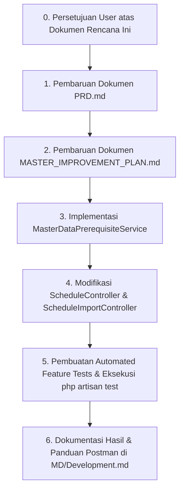

# Rencana Strategis Perubahan Aturan Bisnis: Prasyarat Master Data Sebelum Pengelolaan Jadwal

**Dokumen Rencana:** `MD/MASTER_DATA_PREREQUISITE_PLAN.md`  
**Proyek:** School Class Progress (SCP) — Backend REST API  
**Peran:** Senior Software Engineer, Software Architect & Technical Documentation Specialist  
**Tanggal:** 2026-10-20  
**Status Dokumen:** Usulan Rencana (Menunggu Persetujuan Pengguna Sebelum Modifikasi Dokumen Lama & Kode)

---

## DAFTAR ISI
1. [Bagian 1: Analisis Kondisi Aktual & Kebutuhan Aturan Bisnis Baru](#bagian-1-analisis-kondisi-aktual--kebutuhan-aturan-bisnis-baru)
   - 1.1 Kondisi Aktual Sistem Saat Ini
   - 1.2 Masalah yang Teridentifikasi & Analisis Dampak
   - 1.3 Aturan Bisnis Baru yang Ditetapkan
   - 1.4 Definisi Kriteria "Master Data Lengkap & Memenuhi Syarat"
2. [Bagian 2: Rencana Pembaruan Dokumentasi](#bagian-2-rencana-pembaruan-dokumentasi)
   - 2.1 Rencana Pembaruan `PRD.md`
   - 2.2 Rencana Pembaruan `MASTER_IMPROVEMENT_PLAN.md`
   - 2.3 Rencana Pembaruan `MD/Development.md`
3. [Bagian 3: Rencana Modifikasi Kode & Arsitektur Implementasi](#bagian-3-rencana-modifikasi-kode--arsitektur-implementasi)
   - 3.1 Komponen Domain Service Baru: `MasterDataPrerequisiteService`
   - 3.2 Modifikasi Endpoint Input Jadwal Manual (`ScheduleController@store`)
   - 3.3 Modifikasi Endpoint Upload Import PDF (`ScheduleImportController@store`)
   - 3.4 Modifikasi Endpoint Konfirmasi Import PDF (`ScheduleImportController@confirm`)
   - 3.5 Standardisasi Kontrak Respons API & Status HTTP
4. [Bagian 4: Strategi Testing & Kasus Uji](#bagian-4-strategi-testing--kasus-uji)
   - 4.1 Matriks Skenario Pengujian Otomatis
   - 4.2 Kasus Uji Master Data Kosong & Belum Lengkap
   - 4.3 Kasus Uji Autentikasi & Otorisasi
5. [Bagian 5: Kriteria Keberhasilan (*Definition of Done*)](#bagian-5-kriteria-keberhasilan-definition-of-done)
6. [Bagian 6: Urutan Pengerjaan & Dependensi](#bagian-6-urutan-pengerjaan--dependensi)

---

## Bagian 1: Analisis Kondisi Aktual & Kebutuhan Aturan Bisnis Baru

### 1.1 Kondisi Aktual Sistem Saat Ini
Saat ini, sistem memiliki dua pintu masuk (*entry points*) pembuatan jadwal oleh Waka Kurikulum:
1. **Input Jadwal Manual Satu Baris:** `POST /api/schedules` melalui `ScheduleController@store`.
2. **Import Jadwal Otomatis dari 2 File PDF FET:** `POST /api/schedule-imports` melalui `ScheduleImportController@store` yang kemudian diproses asinkron oleh `ParseSchedulePdfJob`, lalu di-commit melalui `POST /api/schedule-imports/{id}/confirm`.

### 1.2 Masalah yang Teridentifikasi & Analisis Dampak
Berdasarkan pengujian nyata di lingkungan PostgreSQL:
1. **Upload Diizinkan Saat Master Data Kosong:** `POST /api/schedule-imports` mengizinkan Waka mengunggah kedua file PDF meskipun tabel `classes`, `users` (guru), `subjects`, dan `rooms` masih kosong (0 record).
2. **Pemborosan Sumber Daya Worker & Staging Kotor:** Worker antrean `ParseSchedulePdfJob` tetap berjalan memproses 52 halaman PDF dan mengekstrak 721 alokasi jadwal ke tabel staging `schedule_import_rows`. Namun, karena master data kosong, **100% baris (721 dari 721 baris) berstatus `unmatched`**.
3. **Konfirmasi Palsu (*False Sense of Success*):** Saat Waka memanggil `POST /api/schedule-imports/{id}/confirm`, sistem mengembalikan response HTTP 200 OK dengan `"inserted_schedules_count": 0`. Secara visual, Waka mengira import berhasil, namun tabel `schedules` tetap kosong karena sistem hanya memasukkan baris `matched`.
4. **Input Manual Hanya Mengandalkan Error Foreign Key Generik:** Pada `POST /api/schedules`, jika tabel kelas kosong, validasi Laravel hanya memunculkan `The selected class id is invalid.`, bukan pesan bisnis yang informatif bahwa sistem belum siap karena Master Data sekolah belum dikonfigurasi.

### 1.3 Aturan Bisnis Baru yang Ditetapkan
> **"Waka Kurikulum wajib melengkapi seluruh Master Data prasyarat terlebih dahulu sebelum dapat melakukan input jadwal, baik melalui jalur manual maupun import PDF. Jika sistem mendeteksi bahwa Master Data masih kosong atau belum memenuhi persyaratan kelayakan, seluruh proses input jadwal wajib ditolak di gerbang awal request dengan penjelasan terperinci."**

### 1.4 Definisi Kriteria "Master Data Lengkap & Memenuhi Syarat"
Untuk dapat membuat atau mengimpor jadwal, 4 pilar Master Data berikut wajib memenuhi syarat:

| Entitas Master Data | Tabel Database | Syarat Jalur Manual (`/api/schedules`) | Syarat Jalur Import PDF (`/api/schedule-imports`) |
|---|---|---|---|
| **Master Kelas** | `classes` | Minimal terdapat $\ge 1$ kelas aktif (`deleted_at IS NULL`). | Minimal terdapat $\ge 1$ kelas aktif (direkomendasikan 48 kelas lengkap). |
| **Master Guru** | `users` (`role='teacher'`) | Minimal terdapat $\ge 1$ guru aktif (`deleted_at IS NULL`). | Minimal terdapat $\ge 1$ guru aktif **DAN** memiliki `fet_staff_id IS NOT NULL` (karena kunci pencocokan utama FET adalah ID numerik staf). |
| **Master Mata Pelajaran** | `subjects` | Minimal terdapat $\ge 1$ mapel aktif (`deleted_at IS NULL`). | Minimal terdapat $\ge 1$ mapel aktif (`deleted_at IS NULL`). |
| **Master Ruangan** | `rooms` | Minimal terdapat $\ge 1$ ruangan aktif (`deleted_at IS NULL`). | Minimal terdapat $\ge 1$ ruangan aktif (`deleted_at IS NULL`). |

---

## Bagian 2: Rencana Pembaruan Dokumentasi

Dokumentasi akan diperbarui secara terstruktur pada ketiga dokumen utama dengan rincian berikut:

### 2.1 Rencana Pembaruan `PRD.md`

| Lokasi pada `PRD.md` | Informasi yang Perlu Ditambahkan / Diperbarui | Alasan Perubahan |
|---|---|---|
| **Catatan Revisi Versi 4.4 / Menuju 4.5** | Menambahkan butir revisi: Penegasan prasyarat kelengkapan Master Data (Kelas, Guru beserta `fet_staff_id`, Mapel, Ruang) sebagai syarat mutlak (*mandatory precondition*) sebelum input jadwal manual maupun import PDF dapat dilakukan. | Menjaga riwayat evolusi dokumen spesifikasi resmi UKK. |
| **Bagian 2: Gambaran Sistem & Asumsi** | Menambahkan klausul dependensi domain: Modul Jadwal berada pada layer di atas Master Data; mutasi jadwal tidak dapat diakses sebelum Master Data lolos validasi integritas. | Menegaskan arsitektur dependensi sistem secara global. |
| **Bagian 5.3: Resolusi Jam Pelajaran & Aturan Input Jadwal** | Menambahkan sub-bagian baru **5.3.1 Prasyarat Master Data Sebelum Pembuatan Jadwal**: <br>1. Pemeriksaan holistik sebelum aksi `POST /api/schedules`.<br>2. Penolakan HTTP 422 jika salah satu master data kosong. | Memberikan acuan spesifikasi fungsional untuk jalur input jadwal manual. |
| **Bagian 5.16: Import Jadwal dari PDF** | **Memperbarui Langkah 1 (Alur Upload):** Sebelum file PDF disimpan dan job queue di-dispatch, backend melakukan verifikasi kelayakan Master Data. Jika master data belum memenuhi syarat (misal: belum ada guru dengan `fet_staff_id`), request ditolak dengan HTTP 422.<br>**Memperbarui Langkah 7 (Konfirmasi):** Menambahkan aturan bahwa konfirmasi ditolak jika `matched_count === 0` (mencegah konfirmasi tanpa data valid). | Mencegah file diunggah dan queue worker berjalan sia-sia saat master data belum siap. |
| **Bagian 9.4: Spesifikasi Endpoint `/api/schedules`** | Menambahkan deskripsi status error `422 Unprocessable Entity` pada `POST /api/schedules` ketika Master Data belum lengkap, beserta contoh payload respons error. | Panduan integrasi client (Frontend Web/Mobile). |
| **Bagian 9.5: Spesifikasi Endpoint `/api/schedule-imports`** | Menambahkan deskripsi status error `422 Unprocessable Entity` pada `POST /api/schedule-imports` (Master Data belum lengkap) dan pada `POST /api/schedule-imports/{id}/confirm` (tidak ada baris `matched` untuk dikonfirmasi). | Menyelaraskan kontrak API dengan perilaku backend yang baru. |

---

### 2.2 Rencana Pembaruan `MASTER_IMPROVEMENT_PLAN.md`

| Lokasi pada `MASTER_IMPROVEMENT_PLAN.md` | Informasi yang Perlu Ditambahkan / Diperbarui | Alasan Perubahan |
|---|---|---|
| **Ringkasan Dependensi Antar-Fase** | Menambahkan diagram dependensi eksplisit: **Fase 1 (Master Data) $\rightarrow$ Fase 2 (Jadwal Manual) $\rightarrow$ Fase 3 (Import PDF)**. Master data kini menjadi *hard blocking dependency* bagi fungsionalitas input jadwal. | Mencegah pengerjaan/pengujian jadwal mendahului kelengkapan master data. |
| **Tugas 2.3 (Mutasi Jadwal Manual)** | Menambahkan langkah pengecekan pra-kondisi Master Data pada implementasi `ScheduleController@store`. Kriteria keberhasilan ditambahkan: "Sistem menolak pembuatan jadwal manual jika master data kelas, guru, mapel, atau ruang kosong dengan HTTP 422". | Memastikan tugas implementasi Fase 2 mencakup aturan bisnis baru. |
| **Tugas 3.1 & 3.4 (Schedule Import Controller & Worker)** | Menambahkan tugas validasi pra-kondisi Master Data pada `ScheduleImportController@store` dan pencegahan commit kosong pada `ScheduleImportController@confirm`. | Memastikan alur import otomatis mematuhi aturan integritas yang sama. |
| **Penambahan Sub-Tugas Pendukung (Tugas 2.0 / 3.0)** | Mendefinisikan tugas pembuatan `MasterDataPrerequisiteService` sebagai modul reusable yang melayani pengecekan Master Data lintas controller. | Menjaga prinsip DRY (*Don't Repeat Yourself*) dan clean architecture. |

---

### 2.3 Rencana Pembaruan `MD/Development.md`

| Bagian yang Ditambahkan | Konten yang Direncanakan |
|---|---|
| **Section Baru: Dokumentasi Perubahan Aturan Bisnis Prasyarat Master Data** | Ditambahkan di bagian akhir `MD/Development.md` tanpa mengubah dokumentasi Fase 0, 1, 2, dan 3 yang sudah ada. |
| **Latar Belakang & Analisis Masalah Riil** | Mendokumentasikan temuan riil bahwa 721 baris import berstatus `unmatched` dan `inserted_schedules_count: 0` akibat master data PostgreSQL yang kosong saat pengujian mandiri. |
| **Daftar File yang Dibuat / Dimodifikasi** | Pencatatan file baru `app/Services/MasterDataPrerequisiteService.php`, modifikasi `ScheduleController.php`, modifikasi `ScheduleImportController.php`, dan file test baru. |
| **Potongan Kode Kunci & Logika** | Menampilkan logika pengecekan kelengkapan entitas, aturan penolakan HTTP 422, dan pengujiannya. |
| **Pembaruan Panduan Postman** | Menambahkan contoh request dan respons penolakan HTTP 422 jika Master Data kosong untuk pengujian developer dan QA. |

---

## Bagian 3: Rencana Modifikasi Kode & Arsitektur Implementasi

### 3.1 Komponen Domain Service Baru: `MasterDataPrerequisiteService`
Akan dibuat service baru di `app/Services/MasterDataPrerequisiteService.php` dengan tanggung jawab tunggal (*Single Responsibility Principle*): melakukan audit kelayakan master data sekolah sebelum operasi jadwal dijalankan.

#### Struktur Logika Service:
```php
namespace App\Services;

use App\Models\Classes;
use App\Models\Rooms;
use App\Models\Subject;
use App\Models\User;

class MasterDataPrerequisiteService
{
    /**
     * Memeriksa kelengkapan Master Data untuk input jadwal manual.
     */
    public function validateForManualSchedule(): array
    {
        return $this->evaluate([
            'classes' => Classes::whereNull('deleted_at')->exists(),
            'teachers' => User::where('role', 'teacher')->whereNull('deleted_at')->exists(),
            'subjects' => Subject::whereNull('deleted_at')->exists(),
            'rooms' => Rooms::whereNull('deleted_at')->exists(),
        ], isPdfImport: false);
    }

    /**
     * Memeriksa kelengkapan Master Data untuk import PDF FET.
     */
    public function validateForPdfImport(): array
    {
        $hasTeachers = User::where('role', 'teacher')->whereNull('deleted_at')->exists();
        $hasTeachersWithFetId = User::where('role', 'teacher')
            ->whereNull('deleted_at')
            ->whereNotNull('fet_staff_id')
            ->exists();

        return $this->evaluate([
            'classes' => Classes::whereNull('deleted_at')->exists(),
            'teachers' => $hasTeachers,
            'fet_staff_id' => $hasTeachersWithFetId,
            'subjects' => Subject::whereNull('deleted_at')->exists(),
            'rooms' => Rooms::whereNull('deleted_at')->exists(),
        ], isPdfImport: true);
    }

    private function evaluate(array $checks, bool $isPdfImport): array
    {
        $missing = [];
        $errors = [];

        if (!$checks['classes']) {
            $missing[] = 'classes';
            $errors['classes'] = ['Master data kelas masih kosong. Waka wajib mendaftarkan kelas terlebih dahulu.'];
        }
        if (!$checks['teachers']) {
            $missing[] = 'teachers';
            $errors['teachers'] = ['Master data guru masih kosong. Waka wajib mendaftarkan guru terlebih dahulu.'];
        } elseif ($isPdfImport && isset($checks['fet_staff_id']) && !$checks['fet_staff_id']) {
            $missing[] = 'fet_staff_id';
            $errors['fet_staff_id'] = ['Belum ada guru yang memiliki nomor staf FET (fet_staff_id). Waka wajib melengkapi fet_staff_id guru untuk import PDF.'];
        }
        if (!$checks['subjects']) {
            $missing[] = 'subjects';
            $errors['subjects'] = ['Master data mata pelajaran masih kosong. Waka wajib mendaftarkan mata pelajaran terlebih dahulu.'];
        }
        if (!$checks['rooms']) {
            $missing[] = 'rooms';
            $errors['rooms'] = ['Master data ruangan masih kosong. Waka wajib mendaftarkan ruangan terlebih dahulu.'];
        }

        return [
            'is_valid' => empty($missing),
            'missing' => $missing,
            'errors' => $errors,
        ];
    }
}
```

---

### 3.2 Modifikasi Endpoint Input Jadwal Manual (`ScheduleController@store`)
- **Lokasi File:** `app/Http/Controllers/API/ScheduleController.php` (sekitar baris 180).
- **Perubahan Logika:**
  Sebelum validasi body atau pembuatan transaksi:
  1. Inject/instansiasi `MasterDataPrerequisiteService`.
  2. Panggil `$check = $this->prerequisiteService->validateForManualSchedule()`.
  3. Jika `!$check['is_valid']`:
     Segera hentikan proses dan kembalikan response HTTP 422 dengan pesan edukatif dan detail master data yang masih kurang.

---

### 3.3 Modifikasi Endpoint Upload Import PDF (`ScheduleImportController@store`)
- **Lokasi File:** `app/Http/Controllers/API/ScheduleImportController.php` (sekitar baris 20).
- **Perubahan Logika:**
  1. Panggil `$check = $this->prerequisiteService->validateForPdfImport()`.
  2. Jika `!$check['is_valid']`:
     Kembalikan response HTTP 422:
     - **File fisik PDF TIDAK disimpan ke disk storage.**
     - **Record `schedule_imports` TIDAK dibuat di database.**
     - **Queue job `ParseSchedulePdfJob` TIDAK di-dispatch.**
  3. Hal ini melindungi server dari pemborosan CPU dan antrean parsing yang sia-sia.

---

### 3.4 Modifikasi Endpoint Konfirmasi Import PDF (`ScheduleImportController@confirm`)
- **Lokasi File:** `app/Http/Controllers/API/ScheduleImportController.php` (sekitar baris 200).
- **Perubahan Logika:**
  1. Sebelum memulai transaksi soft-delete dan commit:
     Periksa apakah ada setidaknya 1 baris yang berstatus `'matched'`:
     ```php
     $matchedCount = $import->rows()->where('match_status', 'matched')->count();
     if ($matchedCount === 0) {
         return response()->json([
             'success' => false,
             'message' => 'Konfirmasi gagal. Tidak ada baris jadwal yang berstatus matched untuk dimasukkan ke jadwal aktif.',
             'errors' => [
                 'import' => ['Seluruh baris import masih berstatus unmatched atau conflict. Harap lengkapi master data atau lakukan resolusi baris terlebih dahulu.']
             ]
         ], 422);
     }
     ```
  2. Mencegah status import berubah menjadi `confirmed` jika tidak ada satupun jadwal yang berhasil di-commit.

---

### 3.5 Standardisasi Kontrak Respons API & Status HTTP
Sesuai standar PRD Bagian 7:

#### Contoh Respons Penolakan Master Data Belum Lengkap (HTTP 422 Unprocessable Entity):
```json
{
  "success": false,
  "message": "Master Data belum lengkap. Waka wajib mengisi Master Data terlebih dahulu sebelum dapat menginput jadwal.",
  "errors": {
    "classes": [
      "Master data kelas masih kosong. Waka wajib mendaftarkan kelas terlebih dahulu."
    ],
    "teachers": [
      "Master data guru masih kosong. Waka wajib mendaftarkan guru terlebih dahulu."
    ]
  },
  "meta": {
    "missing_entities": [
      "classes",
      "teachers"
    ]
  }
}
```

---

## Bagian 4: Strategi Testing & Kasus Uji

Akan dibuat suite pengujian otomatis baru di `tests/Feature/MasterDataPrerequisiteRuleTest.php` yang mencakup 7 skenario pengujian:

1. **Jalur Input Manual:**
   - `test_manual_schedule_rejected_when_any_master_data_table_is_empty`:
     Dikosongkan salah satu tabel (misal `classes`), panggil `POST /api/schedules` $\rightarrow$ Ditolak HTTP 422 dengan detail error spesifik.
   - `test_manual_schedule_allowed_when_all_master_data_tables_exist`:
     Tabel kelas, guru, mapel, dan ruang terisi $\rightarrow$ `POST /api/schedules` diizinkan (201 Created).

2. **Jalur Import PDF FET:**
   - `test_pdf_upload_rejected_when_master_data_empty`:
     Database kosong $\rightarrow$ `POST /api/schedule-imports` ditolak HTTP 422, tidak ada file di storage, tidak ada job di queue.
   - `test_pdf_upload_rejected_when_teachers_lack_fet_staff_id`:
     Guru ada tapi belum ada `fet_staff_id` $\rightarrow$ Ditolak HTTP 422 meminta Waka melengkapi nomor staf FET.
   - `test_pdf_upload_allowed_when_master_data_ready`:
     Master data kelas, guru (dengan `fet_staff_id`), mapel, dan ruang ada $\rightarrow$ Upload diterima HTTP 202 Accepted.

3. **Jalur Konfirmasi Import:**
   - `test_confirm_rejected_when_zero_matched_rows`:
     Import dengan 0 baris `matched` $\rightarrow$ `POST /api/schedule-imports/{id}/confirm` ditolak HTTP 422 dan tidak ada soft-delete jadwal lama.

4. **Keamanan Otorisasi:**
   - `test_prerequisite_endpoints_strictly_require_waka_role`:
     Pengguna tanpa token $\rightarrow$ 401; Peran Guru atau Siswa $\rightarrow$ 403 Forbidden.

---

## Bagian 5: Kriteria Keberhasilan (*Definition of Done*)

Fitur aturan bisnis baru ini dinyatakan tuntas jika memenuhi seluruh indikator berikut:
1. `PRD.md` telah diperbarui pada bagian Catatan Revisi, Bagian 2, 5.3, 5.16, 9.4, dan 9.5 dengan aturan prasyarat Master Data yang tegas.
2. `MASTER_IMPROVEMENT_PLAN.md` mencatat dependensi pemblokiran Master Data dan tugas terkait secara konsisten.
3. `MD/Development.md` mendokumentasikan implementasi baru tanpa menimpa catatan fase sebelumnya.
4. `POST /api/schedules` dan `POST /api/schedule-imports` menolak request dengan status HTTP 422 jika salah satu Master Data prasyarat masih kosong.
5. `POST /api/schedule-imports/{id}/confirm` menolak eksekusi dengan status HTTP 422 jika `matched_count === 0`.
6. Seluruh pengujian otomatis eksisting (96 tests) ditambah pengujian baru berhasil lulus **100% tanpa regresi**.

---

## Bagian 6: Urutan Pengerjaan & Dependensi

Untuk memastikan integritas dan konsistensi sistem, implementasi akan dikerjakan dalam urutan berurutan:



---

> [!IMPORTANT]
> Dokumen rencana ini berada di [`MD/MASTER_DATA_PREREQUISITE_PLAN.md`](file:///d:/MyUKK/SchoolClassProject/scp/MD/MASTER_DATA_PREREQUISITE_PLAN.md). Sesuai instruksi Anda, **belum ada kode maupun dokumen lama yang diubah**. Silakan pelajari rencana ini dan berikan konfirmasi Anda untuk memulai tahap eksekusi berikutnya.
