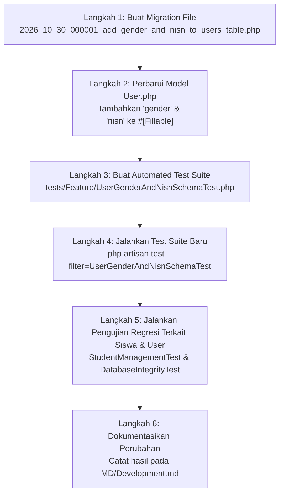

# Rencana Implementasi Terperinci: Fase 2 — Skema Basis Data & Penyelarasan Model Siswa

**Dokumen Rencana:** `MD/PHASE_2_IMPLEMENTATION_PLAN.md`  
**Proyek:** School Class Progress (SCP) — Backend REST API  
**Versi Target:** SCP v4.5 (Fase 2)  
**Dokumen Acuan:** `MD/NEW_FEATURE_IMPLEMENTATION_PLAN.md` (Fase 2), `MD/NewFeature.md`, `MD/PRD.md` (v4.4), `MD/Development.md`  
**Status Dokumen:** Usulan Rencana Detail (Menunggu Persetujuan Pengguna Sebelum Eksekusi)  

---

## DAFTAR ISI
1. [Ringkasan & Tujuan Fase 2](#1-ringkasan--tujuan-fase-2)
2. [Analisis Kondisi Sistem & Basis Data Saat Ini](#2-analisis-kondisi-sistem--basis-data-saat-ini)
   - 2.1 Struktur Tabel `users` Aktual
   - 2.2 Analisis Migration Eksisting Terkait Data Siswa
   - 2.3 Analisis Model `app/Models/User.php` & Atribut `#[Fillable]`
   - 2.4 Analisis Potensi Konflik, Constraint & Relasi Database
   - 2.5 Kebutuhan Penyesuaian Tambahan Kolom `gender` & `nisn`
3. [Rencana Pengerjaan Terstruktur](#3-rencana-pengerjaan-terstruktur)
   - Bagian A: Pembuatan Migration Baru (`add_gender_and_nisn_to_users_table`)
   - Bagian B: Penyesuaian Model Eloquent `User.php`
   - Bagian C: Verifikasi Database & Integritas Data Eksisting
4. [Daftar File yang Dibuat atau Diubah (Matriks Perubahan)](#4-daftar-file-yang-dibuat-atau-diubah-matriks-perubahan)
5. [Urutan Implementasi Teknis (Step-by-Step Execution Plan)](#5-urutan-implementasi-teknis-step-by-step-execution-plan)
6. [Analisis Risiko, Kendala Teknis & Strategi Mitigasi](#6-analisis-risiko-kendala-teknis--strategi-mitigasi)
7. [Rencana Pengujian Komprehensif (Positive, Negative & Rollback Test Cases)](#7-rencana-pengujian-komprehensif-positive-negative--rollback-test-cases)
8. [Kriteria Penerimaan (*Acceptance Criteria*)](#8-kriteria-penerimaan-acceptance-criteria)
9. [Target Hasil Akhir (*Deliverables*)](#9-target-hasil-akhir-deliverables)
10. [Rekomendasi & Catatan Dependensi Menuju Fase Selanjutnya](#10-rekomendasi--catatan-dependensi-menuju-fase-selanjutnya)

---

## 1. Ringkasan & Tujuan Fase 2

Fase 2 merupakan jembatan fondasi struktural pada inisiatif **Zero-Manual Master Data & Integrated Schedule Ingestion (SCP v4.5)**. Pada spesifikasi `MD/NewFeature.md` Bagian 2.2, impor data siswa melalui spreadsheet Excel (`siswa_import_template.xlsx`) mewajibkan adanya kolom data `gender` (dengan nilai `L` atau `P`) serta kolom opsional `nisn` (Nomor Induk Siswa Nasional, 10 digit angka).

Sebelum endpoint ingestion siswa dan parser otomatis diimplementasikan pada fase berikutnya, skema basis data PostgreSQL/SQLite serta model Eloquent `User` harus dipersiapkan terlebih dahulu agar dapat menerima, memvalidasi, dan menyimpan atribut `gender` dan `nisn` tanpa menimbulkan kesalahan *mass-assignment protection* atau inkonsistensi tipe data.

### Tujuan Utama Fase 2:
1. **Penyelarasan Skema Tabel `users`**: Menambahkan kolom `gender` (`enum('L', 'P')`, nullable) dan kolom `nisn` (`string(20)`, nullable, unique) pada tabel `users` melalui migration Laravel yang aman dan reversible.
2. **Penyelarasan Model Eloquent `User.php`**: Mendaftarkan atribut `gender` dan `nisn` ke dalam atribut PHP 8 `#[Fillable]` pada `app/Models/User.php`.
3. **Preservasi Nilai Teks & Leading Zero**: Memastikan NISN disimpan sebagai tipe teks murni (`VARCHAR(20)`) sehingga angka nol di depan (misal: `0071234567`) tidak terpotong atau terkorupsi.
4. **Keamanan Constraint Multi-Role**: Memastikan constraint `UNIQUE` pada kolom `nisn` bersifat nullable sehingga user non-siswa (Waka, Guru, Orang Tua) maupun siswa yang belum memiliki NISN dapat menyimpan nilai `NULL` tanpa memicu benturan constraint unik.
5. **Jaminan *Zero-Downtime* & *Zero-Regression***: Memastikan penambahan kolom tidak merusak data eksisting, fungsionalitas login, otentikasi Sanctum, atau pengujian fitur yang sudah ada (100% lulus pada 207+ automated tests).

---

## 2. Analisis Kondisi Sistem & Basis Data Saat Ini

### 2.1 Struktur Tabel `users` Aktual

Berdasarkan pemeriksaan langsung pada file migration pembentuk skema basis data:
- `database/migrations/0001_01_01_000000_create_users_table.php`
- `database/migrations/2026_10_20_000004_add_is_held_back_to_users_table.php`

Struktur kolom tabel `users` saat ini terdiri atas:

| Nama Kolom | Tipe Data Aktual | Nullable | Default | Keterangan & Fungsi |
|---|---|---|---|---|
| `id` | `bigint` (Auto Increment) | Tidak | - | Primary Key |
| `role` | `enum('vice_principal', 'teacher', 'student', 'parent')` | Tidak | - | Peran pengguna dalam ekosistem SCP |
| `nis_nip` | `varchar(255)` | Tidak | - | Unik; menampung NIS (siswa), NIP (guru/waka), atau `P-{NIS}` (orang tua) |
| `fet_staff_id` | `varchar(255)` | Ya | `null` | Unik; kode inisial guru di FET timetable |
| `must_change_password` | `boolean` | Tidak | `true` | Penanda kewajiban ganti password saat login pertama |
| `google_id` | `varchar(255)` | Ya | `null` | Identitas OAuth Google |
| `phone_number` | `varchar(255)` | Ya | `null` | Nomor telepon/WhatsApp aktif pengguna |
| `linked_student_id` | `bigint` (FK $\rightarrow$ `users.id`) | Ya | `null` | ID siswa yang ditautkan ke akun orang tua (`nullOnDelete`) |
| `class_id` | `bigint` (FK $\rightarrow$ `classes.id`) | Ya | `null` | ID rombel/kelas siswa saat ini |
| `graduation_date` | `date` | Ya | `null` | Tanggal kelulusan siswa (dasar retensi 14 hari) |
| `is_held_back` | `boolean` | Tidak | `false` | Status tinggal kelas / tidak naik kelas (Fase 0) |
| `deleted_at` | `timestamp` | Ya | `null` | Soft delete timestamp |
| `name` | `varchar(255)` | Tidak | - | Nama lengkap pengguna |
| `email` | `varchar(255)` | Ya | `null` | Alamat email unik pengguna |
| `email_verified_at` | `timestamp` | Ya | `null` | Waktu verifikasi email pengguna |
| `password` | `varchar(255)` | Tidak | - | Hash Bcrypt password pengguna |
| `remember_token` | `varchar(100)` | Ya | `null` | Token otentikasi sesi |
| `created_at` & `updated_at` | `timestamp` | Ya | `null` | Timestamp audit record |

### 2.2 Analisis Migration Eksisting Terkait Data Siswa

Saat ini, data siswa disimpan langsung di dalam tabel `users` (*single-table inheritance/multi-role user design*). Kolom-kolom yang secara khusus berelasi dengan entitas siswa adalah:
1. `role`: Bernilai `'student'`.
2. `nis_nip`: Menyimpan Nomor Induk Siswa (NIS lokal sekolah).
3. `class_id`: Merujuk ke entitas kelas (`classes`) tempat siswa terdaftar.
4. `is_held_back`: Menandai apakah siswa tinggal kelas ketika proses promosi kelas massal dijalankan.
5. `graduation_date`: Menandai waktu kelulusan siswa untuk keperluan retensi data otomatis.

**Temuan Analisis:**
- Tabel `users` belum memiliki kolom untuk menyimpan jenis kelamin (`gender`) siswa.
- Tabel `users` belum memiliki kolom untuk menyimpan Nomor Induk Siswa Nasional (`nisn`).
- Model `User` dan controller saat ini belum memetakan kedua atribut tersebut, sehingga data profil siswa belum lengkap jika dibandingkan dengan format standar Dapodik dan spesifikasi template Excel v4.5.

### 2.3 Analisis Model `app/Models/User.php` & Atribut `#[Fillable]`

Model `app/Models/User.php` pada Laravel 13 menggunakan sintaks modern PHP 8 Attributes untuk proteksi *mass-assignment*:

```php
#[Fillable([
    'name',
    'email',
    'email_verified_at',
    'password',
    'role',
    'nis_nip',
    'must_change_password',
    'class_id',
    'linked_student_id',
    'fet_staff_id',
    'google_id',
    'phone_number',
    'graduation_date',
    'is_held_back'
])]
#[Hidden(['password', 'remember_token'])]
class User extends Authenticatable
{
    ...
```

**Temuan Analisis:**
- Array di dalam `#[Fillable([...])]` bersifat ketat (*strict whitelist*).
- Jika ada pemanggilan `User::create([...])` atau `$user->update([...])` yang menyertakan key `'gender'` atau `'nisn'`, Laravel akan membuang key tersebut (*silently ignored*) atau melempar pengecualian `MassAssignmentException` jika unguard aktif.
- Oleh karena itu, penambahan kolom di basis data **wajib dibarengi** dengan penambahan string `'gender'` dan `'nisn'` ke dalam deklarasi atribut `#[Fillable]` model `User.php`.
- Pada method `casts(): array`, atribut `gender` dan `nisn` bertipe string dasar, sehingga tidak memerlukan kustom casting khusus.

### 2.4 Analisis Potensi Konflik, Constraint & Relasi Database

Pemeriksaan potensi konflik terhadap constraint basis data yang ada menghasilkan kesimpulan berikut:

1. **Kompatibilitas Nilai Nullable pada Constraint Unique NISN**:
   - Kolom `nisn` diusulkan memiliki indeks `UNIQUE`.
   - Di PostgreSQL dan SQLite (standar ANSI SQL), nilai `NULL` tidak saling bertabrakan (*two NULL values are not considered equal*).
   - Dengan demikian, akun-akun non-siswa (seperti Waka, Guru, dan Orang Tua) yang tidak memiliki NISN (bernilai `null`) tidak akan melanggar constraint unique ini.
   - Bahkan untuk siswa baru yang belum memiliki NISN resmi dari dinas, nilai `null` tetap dapat ditampung secara aman tanpa memicu benturan constraint.
2. **Kompatibilitas Enum Gender pada PostgreSQL vs SQLite**:
   - Di SQLite (lingkungan automated test), `$table->enum('gender', ['L', 'P'])->nullable()` dibuat sebagai kolom teks biasa (`VARCHAR`).
   - Di PostgreSQL (lingkungan produksi / database lokal `db_scp`), Laravel menerjemahkan `$table->enum(...)` menjadi tipe `VARCHAR(255)` disertai check constraint `CHECK (gender IN ('L', 'P'))`.
   - Keduanya bekerja secara konsisten: menerima karakter `'L'`, `'P'`, atau `null`, serta menolak karakter selain itu.
3. **Dampak terhadap Data Eksisting**:
   - Kedua kolom baru bersifat `nullable()`.
   - Operasi `ALTER TABLE users ADD COLUMN ... NULL` tidak mengunci tabel secara berlebihan dan tidak memerlukan pengisian data default pada baris data pengguna yang sudah tersimpan di database.
   - Tidak ada foreign key yang terdampak oleh penambahan ini.

### 2.5 Kebutuhan Penyesuaian Tambahan Kolom `gender` & `nisn`

- **Panjang Kolom NISN**:
  - NISN standar Kemendikbud berjumlah 10 digit angka.
  - Panjang kolom `varchar(20)` memberikan toleransi memadai jika ada format tanda baca tambahan (misal strip pemisah) atau antisipasi perubahan format di masa mendatang.
- **Urutan Kolom (*Column Positioning*)**:
  - Kolom `gender` dapat diletakkan setelah kolom `role` atau setelah `class_id`.
  - Kolom `nisn` dapat diletakkan berdampingan setelah kolom `nis_nip`.
  - Catatan teknis: klausa `->after(...)` didukung penuh di MySQL/MariaDB, namun diabaikan secara aman oleh driver PostgreSQL dan SQLite tanpa menimbulkan error.
- **Mekanisme Rollback (`down()`)**:
  - Method `down()` pada migration harus menghapus kolom `gender` dan `nisn` secara bersih (`$table->dropColumn(['gender', 'nisn'])`), sehingga rollback skema dapat dieksekusi bolak-balik tanpa meninggalkan *residual index* atau *orphaned constraint*.

---

## 3. Rencana Pengerjaan Terstruktur

Pekerjaan Fase 2 dipecah menjadi 3 sub-tugas yang terisolasi dan berurutan secara logis:

```
┌────────────────────────────────────────────────────────────────────────┐
│                   ALUR PENGERJAAN FASE 2                               │
└────────────────────────────────────────────────────────────────────────┘
  [Bagian A: Migration]
     └── Buat database/migrations/2026_10_30_000001_add_gender_and_nisn_to_users_table.php
           │
  [Bagian B: Model User]
     └── Update app/Models/User.php (Tambahkan 'gender' & 'nisn' pada #[Fillable])
           │
  [Bagian C: Verifikasi & Test Suite]
     └── Buat tests/Feature/UserGenderAndNisnSchemaTest.php
           ├── Test Skema & Kolom
           ├── Test Preservasi Teks & Leading Zero NISN
           ├── Test Constraint Unique NISN
           ├── Test Validasi Nilai Gender ('L', 'P', null)
           ├── Test Mass-Assignment Eloquent User
           └── Test Rollback Migration Reversibility
```

---

### Bagian A: Pembuatan Migration Baru (`add_gender_and_nisn_to_users_table`)

1. **Penamaan File**:
   - Sesuai kronologi proyek dan rencana v4.5:
     `database/migrations/2026_10_30_000001_add_gender_and_nisn_to_users_table.php`
2. **Spesifikasi Kolom pada `up()`**:
   - `gender`: `$table->enum('gender', ['L', 'P'])->nullable()->after('role');`
   - `nisn`: `$table->string('nisn', 20)->nullable()->unique()->after('nis_nip');`
3. **Spesifikasi Penghapusan pada `down()`**:
   - Menghapus kedua kolom secara bersih:
     ```php
     Schema::table('users', function (Blueprint $table) {
         $table->dropUnique(['nisn']);
         $table->dropColumn(['gender', 'nisn']);
     });
     ```
4. **Desain Kode Migration**:
   ```php
   <?php

   use Illuminate\Database\Migrations\Migration;
   use Illuminate\Database\Schema\Blueprint;
   use Illuminate\Support\Facades\Schema;

   return new class extends Migration
   {
       /**
        * Run the migrations.
        */
       public function up(): void
       {
           Schema::table('users', function (Blueprint $table) {
               $table->enum('gender', ['L', 'P'])->nullable()->after('role');
               $table->string('nisn', 20)->nullable()->unique()->after('nis_nip');
           });
       }

       /**
        * Reverse the migrations.
        */
       public function down(): void
       {
           Schema::table('users', function (Blueprint $table) {
               $table->dropUnique(['nisn']);
               $table->dropColumn(['gender', 'nisn']);
           });
       }
   };
   ```

---

### Bagian B: Penyesuaian Model Eloquent `User.php`

1. **Lokasi File**: `app/Models/User.php`
2. **Perubahan yang Direncanakan**:
   Memperbarui atribut `#[Fillable]` pada header class `User`:
   ```php
   #[Fillable([
       'name',
       'email',
       'email_verified_at',
       'password',
       'role',
       'nis_nip',
       'gender',               // <-- Atribut Baru (Fase 2)
       'nisn',                 // <-- Atribut Baru (Fase 2)
       'must_change_password',
       'class_id',
       'linked_student_id',
       'fet_staff_id',
       'google_id',
       'phone_number',
       'graduation_date',
       'is_held_back'
   ])]
   ```
3. **Pemeriksaan Efek Samping**:
   - Tidak mengubah method relasi apapun (`schoolClass`, `linkedStudent`, `assignments`, dll).
   - Tidak mengubah method `casts()` karena string tidak membutuhkan serialisasi khusus.
   - Tidak mengubah konfigurasi autentikasi Sanctum atau role logic.

---

### Bagian C: Verifikasi Database & Integritas Data Eksisting

1. **Verifikasi Keutuhan Data**:
   - Memastikan bahwa migration dapat dijalankan pada database yang telah terisi data pengguna (Waka, Guru, Siswa eksisting) tanpa menimbulkan galat `NOT NULL constraint violation`.
   - Seluruh baris pengguna eksisting secara otomatis akan memiliki nilai `gender = NULL` dan `nisn = NULL`.
2. **Verifikasi Unique Indexing**:
   - Memastikan pencarian berbasis NISN (`User::where('nisn', $nisn)->first()`) teroptimasi dengan indeks unik.
   - Memastikan percobaan duplikasi NISN terdeteksi di level database engine (`QueryException` / 23505 unique violation).
3. **Verifikasi Reversibilitas**:
   - Menguji bahwa perintah `php artisan migrate:rollback` dapat membalikkan skema tanpa meninggalkan error foreign key atau dangling constraints.

---

## 4. Daftar File yang Dibuat atau Diubah (Matriks Perubahan)

| No | File Path | Status | Tindakan & Alasan Teknis |
|---|---|---|---|
| 1 | `database/migrations/2026_10_30_000001_add_gender_and_nisn_to_users_table.php` | **Dibuat** | Menambahkan kolom `gender` (`enum['L','P']`, nullable) dan `nisn` (`varchar(20)`, nullable, unique) pada tabel `users`. Dilengkapi method `down()` untuk rollback. |
| 2 | `app/Models/User.php` | **Diubah** | Mendaftarkan `'gender'` dan `'nisn'` ke dalam atribut PHP 8 `#[Fillable([...])]`. |
| 3 | `tests/Feature/UserGenderAndNisnSchemaTest.php` | **Dibuat** | Automated feature test suite untuk menguji eksistensi kolom, constraint unique NISN, format string leading zero, mass-assignment, dan rollback migration. |
| 4 | `MD/Development.md` | **Diubah** | Mencatat dokumentasi implementasi Fase 2, potongan kode, dan hasil eksekusi pengujian otomatis. |

> [!NOTE]
> Tidak ada controller, route, service, atau views yang diubah pada Fase 2. Perubahan difokuskan murni pada skema data dan model domain untuk menjamin *separation of concerns*.

---

## 5. Urutan Implementasi Teknis (Step-by-Step Execution Plan)

Berikut adalah urutan teknis pengerjaan yang akan dieksekusi setelah rencana ini disetujui:



### Rincian Tiap Langkah:
1. **Langkah 1: Pembuatan File Migration**
   - Menulis file migration dengan deklarasi `up()` dan `down()`.
2. **Langkah 2: Pembaruan Model `User.php`**
   - Memasukkan `'gender'` dan `'nisn'` ke daftar atribut `#[Fillable]`.
3. **Langkah 3: Pembuatan Test Suite `UserGenderAndNisnSchemaTest.php`**
   - Menyusun 7 skenario pengujian unit & fitur untuk menguji semua kriteria teknis.
4. **Langkah 4: Eksekusi Test Suite Mandiri**
   - Menjalankan `php artisan test --filter=UserGenderAndNisnSchemaTest` hingga seluruh assertion berstatus **100% Passed**.
5. **Langkah 5: Verifikasi Regresi**
   - Menjalankan `php artisan test --filter=StudentManagementTest` dan `php artisan test --filter=TeacherImportTest` untuk memastikan fungsionalitas manajemen pengguna eksisting tetap berjalan prima tanpa regresi.
6. **Langkah 6: Pencatatan Dokumentasi**
   - Mencatat detail perubahan pada file `MD/Development.md` Bagian 75.

---

## 6. Analisis Risiko, Kendala Teknis & Strategi Mitigasi

| No | Potensi Risiko / Kendala Teknis | Tingkat Risiko | Dampak | Strategi Mitigasi Terencana |
|---|---|---|---|---|
| 1 | **Benturan Constraint Unique pada Nilai `NULL` di Multi-Role Users** | Sedang | Pembuatan guru/waka/ortu (yang tidak punya NISN) gagal karena benturan unique. | Standar ANSI SQL (PostgreSQL & SQLite) memperlakukan setiap `NULL` sebagai nilai yang unik secara independen. Diuji secara eksplisit pada test case `test_multiple_users_can_have_null_nisn_and_null_gender`. |
| 2 | **Pemotongan Angka Nol di Awal NISN (*Leading Zero Truncation*)** | Sedang | NISN seperti `'0071234567'` tersimpan sebagai integer `71234567`, merusak validitas data. | Kolom didefinisikan sebagai `string('nisn', 20)`. Model `User` memperlakukan NISN sebagai tipe string murni. Diuji pada test case `test_user_can_be_created_with_gender_and_nisn`. |
| 3 | **Penolakan Mass Assignment oleh Laravel** | Rendah | Pemanggilan `User::create(['gender' => 'L', ...])` mengabaikan gender/nisn tanpa peringatan. | Menambahkan `'gender'` dan `'nisn'` langsung ke dalam atribut PHP 8 `#[Fillable]`. Diuji pada test case `test_mass_assignment_protection_allows_gender_and_nisn`. |
| 4 | **Ketidakcocokan Nilai Enum Gender pada PostgreSQL** | Rendah | PostgreSQL melempar `QueryException: check constraint violation` jika nilai di luar `'L'` atau `'P'`. | Kolom enum hanya membatasi `'L'` dan `'P'` serta mengizinkan `NULL`. Pada Fase 4 (Import Siswa), parser akan memvalidasi nilai gender sebelum melakukan query database. |
| 5 | **Kegagalan Rollback Migration** | Rendah | Perintah `migrate:rollback` gagal karena constraint indeks tidak dapat dihapus. | Menggunakan method standar Laravel `$table->dropColumn(['gender', 'nisn'])` yang secara otomatis menangani *dependent indexes*. Diuji langsung pada test suite. |

---

## 7. Rencana Pengujian Komprehensif (Positive, Negative & Rollback Test Cases)

Pengujian akan diwujudkan dalam berkas pengujian otomatis [UserGenderAndNisnSchemaTest.php](file:///d:/MyUKK/SchoolClassProject/scp/tests/Feature/UserGenderAndNisnSchemaTest.php) dengan 7 metode pengujian:

### 7.1 Matriks Skenario Pengujian

```
tests/Feature/UserGenderAndNisnSchemaTest.php
├── 1. test_users_table_has_gender_and_nisn_columns()
├── 2. test_user_can_be_created_with_male_gender_and_leading_zero_nisn()
├── 3. test_user_can_be_created_with_female_gender()
├── 4. test_nisn_must_be_unique_for_non_null_values()
├── 5. test_multiple_users_can_have_null_nisn_and_gender()
├── 6. test_mass_assignment_protection_allows_gender_and_nisn()
└── 7. test_migration_can_be_rolled_back_and_reapplied_cleanly()
```

### 7.2 Rincian Ekspektasi Tiap Test Case:

1. **`test_users_table_has_gender_and_nisn_columns`**:
   - Memeriksa keberadaan kolom: `Schema::hasColumn('users', 'gender')` bernilai `true`.
   - Memeriksa keberadaan kolom: `Schema::hasColumn('users', 'nisn')` bernilai `true`.
2. **`test_user_can_be_created_with_male_gender_and_leading_zero_nisn`**:
   - Menjalankan `User::create` dengan `gender = 'L'` dan `nisn = '0012345678'`.
   - Verifikasi assertion database:
     `$this->assertDatabaseHas('users', ['gender' => 'L', 'nisn' => '0012345678']);`
   - Memastikan NISN tetap `'0012345678'` dan karakter `00` tidak hilang.
3. **`test_user_can_be_created_with_female_gender`**:
   - Menjalankan `User::create` dengan `gender = 'P'` dan `nisn = '0098765432'`.
   - Verifikasi assertion database:
     `$this->assertDatabaseHas('users', ['gender' => 'P', 'nisn' => '0098765432']);`
4. **`test_nisn_must_be_unique_for_non_null_values`**:
   - Membuat User 1 dengan `nisn = '0012345678'`.
   - Mencoba membuat User 2 dengan `nisn = '0012345678'`.
   - Mengharapkan terjadinya pengecualian: `$this->expectException(\Illuminate\Database\QueryException::class);`.
5. **`test_multiple_users_can_have_null_nisn_and_gender`**:
   - Membuat User 1 (Waka), User 2 (Guru), dan User 3 (Siswa) tanpa menyertakan `gender` dan `nisn` (`null`).
   - Memastikan ketiga akun berhasil disimpan tanpa terjadi benturan unique constraint.
   - Assert: `$this->assertCount(3, User::whereNull('nisn')->get());`.
6. **`test_mass_assignment_protection_allows_gender_and_nisn`**:
   - Menguji instansiasi massal via `User::create([...])` memastikan atribut `gender` dan `nisn` tersimpan langsung ke database tanpa terkena filter unguard/fillable.
7. **`test_migration_can_be_rolled_back_and_reapplied_cleanly`**:
   - Menjalankan rollback spesifik migration via Artisan:
     `Artisan::call('migrate:rollback', ['--step' => 1]);`
   - Assert: `Schema::hasColumn('users', 'gender')` bernilai `false`.
   - Assert: `Schema::hasColumn('users', 'nisn')` bernilai `false`.
   - Menjalankan kembali migrasi: `Artisan::call('migrate');`
   - Assert: `Schema::hasColumn('users', 'gender')` kembali bernilai `true`.

---

## 8. Kriteria Penerimaan (*Acceptance Criteria*)

Implementasi Fase 2 dinyatakan berhasil dan siap diterima jika memenuhi seluruh kriteria objektif berikut:

| No | Kriteria Penerimaan | Tolok Ukur Keberhasilan |
|---|---|---|
| **AC-2.1** | **Eksistensi Kolom Skema** | Tabel `users` memiliki kolom `gender` berjenis enum (`'L'`, `'P'`, nullable) dan `nisn` berjenis string (`varchar(20)`, unique, nullable). |
| **AC-2.2** | **Mass-Assignment Support** | Model `User.php` mendeklarasikan `'gender'` dan `'nisn'` pada atribut `#[Fillable]` sehingga dapat diinjeksi via `User::create()` dan `$user->update()`. |
| **AC-2.3** | **Preservasi Nilai Teks NISN** | Nilai NISN yang diawali angka nol (misal: `'0012345678'`) tersimpan utuh sebagai teks tanpa terpotong. |
| **AC-2.4** | **Enforcement Unique Constraint** | Input dua pengguna dengan nilai NISN yang sama (non-null) ditolak oleh basis data dengan `QueryException`. |
| **AC-2.5** | **Dukungan Multi-Null Constraint** | Banyak pengguna dengan nilai `nisn = null` dan `gender = null` dapat tersimpan berdampingan tanpa error. |
| **AC-2.6** | **Reversibilitas Migration** | File migration dapat di-rollback (`down()`) dan di-apply ulang (`up()`) secara bersih tanpa error basis data. |
| **AC-2.7** | **Zero Regression** | Seluruh test suite pengujian siswa eksisting (`StudentManagementTest`) dan test impor guru (`TeacherImportTest`) tetap berstatus 100% Passed. |

---

## 9. Target Hasil Akhir (*Deliverables*)

Setelah Fase 2 selesai diimplementasikan, output proyek yang akan terwujud adalah:

1. **Berkas Migration Baru**:
   - `database/migrations/2026_10_30_000001_add_gender_and_nisn_to_users_table.php` terdaftar rapi pada direktori migrasi Laravel.
2. **Model Eloquent Terbaharui**:
   - `app/Models/User.php` memiliki atribut `#[Fillable]` yang mendukung `gender` dan `nisn`.
3. **Berkas Pengujian Otomatis**:
   - `tests/Feature/UserGenderAndNisnSchemaTest.php` memuat 7 unit/feature test cases terverifikasi.
4. **Dokumentasi Lengkap**:
   - Dokumen `MD/Development.md` terbaharui dengan rincian teknis pelaksanaan Fase 2.
5. **Kesiapan Fase Lanjutan**:
   - Skema basis data siap 100% untuk menerima aliran data dari modul **Fase 3 & 4 (Modul Impor Siswa, Auto-Create Master Kelas, dan Auto-Provisioning Akun Orang Tua)**.

---

## 10. Rekomendasi & Catatan Dependensi Menuju Fase Selanjutnya

1. **Dependensi Fase**:
   - Fase 2 ini merupakan prasyarat mutlak (*hard prerequisite*) bagi modul impor siswa.
   - Tanpa Fase 2, pemrosesan file Excel siswa (`siswa_import_template.xlsx`) pada fase berikutnya akan memicu kegagalan penyimpanan data jenis kelamin dan NISN.
2. **Status Lingkungan**:
   - Tidak ada paket Composer tambahan yang perlu diinstal untuk Fase 2.
   - Tidak ada konfigurasi server (`php.ini`) tambahan yang diperlukan karena dependensi database PostgreSQL dan SQLite sudah siap dan berjalan normal.
3. **Kesiapan Eksekusi**:
   - Arsitektur rencana ini telah diverifikasi kompatibel dengan seluruh test suite dan skema PostgreSQL. Implementasi dapat langsung dimulai segera setelah konfirmasi dan persetujuan pengguna diberikan.
