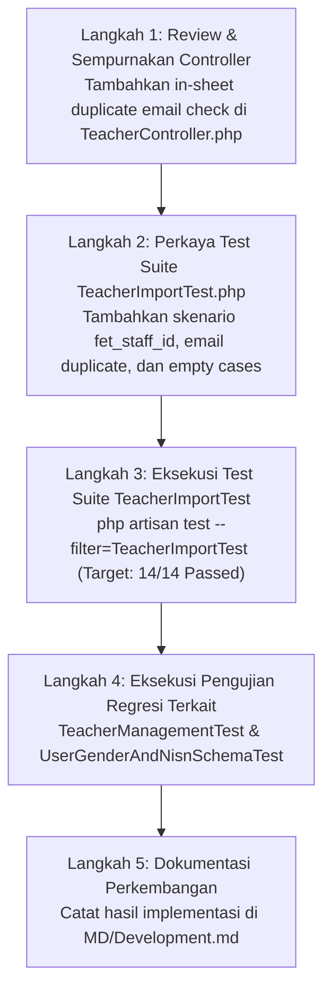

# Rencana Implementasi Terperinci: Fase 3 — Modul Impor Guru & Auto-Provisioning Akun

**Dokumen Rencana:** `MD/PHASE_3_IMPLEMENTATION_PLAN.md`  
**Proyek:** School Class Progress (SCP) — Backend REST API  
**Versi Target:** SCP v4.5 (Fase 3)  
**Dokumen Acuan:** `MD/NEW_FEATURE_IMPLEMENTATION_PLAN.md` (Fase 3), `MD/NewFeature.md` (Bagian 2.1 & 3), `MD/PHASE_1_IMPLEMENTATION_PLAN.md`, `MD/PHASE_2_IMPLEMENTATION_PLAN.md`, `MD/PRD.md` (v4.4), `MD/Development.md`  
**Status Dokumen:** Usulan Rencana Detail (Menunggu Persetujuan Pengguna Sebelum Eksekusi)  

---

## DAFTAR ISI
1. [Ringkasan & Tujuan Fase 3](#1-ringkasan--tujuan-fase-3)
2. [Analisis Kondisi Aktual Proyek & Verifikasi Dependensi](#2-analisis-kondisi-aktual-proyek--verifikasi-dependensi)
   - 2.1 Verifikasi Hasil Fase 1 (Pustaka Spreadsheet & Ekstensi Zip)
   - 2.2 Verifikasi Hasil Fase 2 (Skema Basis Data & Model User)
   - 2.3 Analisis Routing `routes/api.php` & Middleware
   - 2.4 Analisis Kondisi `TeacherController.php` Saat Ini
   - 2.5 Catatan Perbedaan Roadmap: Transisi Sprint ke Fase 3 Resmi
   - 2.6 Gap Analysis (Celah & Penyempurnaan yang Diperlukan)
3. [Ruang Lingkup Pekerjaan (In-Scope & Out-of-Scope)](#3-ruang-lingkup-pekerjaan-in-scope--out-of-scope)
4. [Rincian Implementasi Komponen Fase 3](#4-rincian-implementasi-komponen-fase-3)
   - Bagian A: Endpoint API & Middleware Security
   - Bagian B: Generator Template Excel Guru Berstandar (`downloadTemplate`)
   - Bagian C: Engine Ingestion & Validasi Streaming Spreadsheet (`import`)
   - Bagian D: Auto-Provisioning Akun Guru (Password Hashing, Role, Must Change Password)
   - Bagian E: Transaksi Atomik (*All-or-Nothing*) & Standardisasi JSON Error 422
   - Bagian F: Penyempurnaan Automated Feature Test Suite
5. [Daftar File yang Dibuat atau Diubah (Matriks Perubahan)](#5-daftar-file-yang-dibuat-atau-diubah-matriks-perubahan)
6. [Urutan Pengerjaan Teknis (Step-by-Step Execution Plan)](#6-urutan-pengerjaan-teknis-step-by-step-execution-plan)
7. [Detail Validasi, Keamanan & Integritas Data](#7-detail-validasi-keamanan--integritas-data)
   - 7.1 Preservasi Format Teks & Leading Zero NIP / FET Staff ID
   - 7.2 Deteksi Duplikasi Ganda (In-Sheet Duplicate vs Database Collision)
   - 7.3 Penanganan Data Opsional (Email & Nomor Telepon)
   - 7.4 Proteksi Ukuran & Integritas Berkas (5 MB)
8. [Rencana Pengujian Komprehensif (Positive, Negative & Rollback Test Cases)](#8-rencana-pengujian-komprehensif-positive-negative--rollback-test-cases)
9. [Kriteria Penerimaan (*Acceptance Criteria*)](#9-kriteria-penerimaan-acceptance-criteria)
10. [Analisis Risiko, Kendala Teknis & Strategi Mitigasi](#10-analisis-risiko-kendala-teknis--strategi-mitigasi)
11. [Target Hasil Akhir (*Deliverables*)](#11-target-hasil-akhir-deliverables)
12. [Hal-Hal yang Perlu Dikonfirmasi Sebelum Eksekusi](#12-hal-hal-yang-perlu-dikonfirmasi-sebelum-eksekusi)

---

## 1. Ringkasan & Tujuan Fase 3

Fase 3 berfokus pada standardisasi, penyempurnaan menyeluruh, dan finalisasi **Modul Impor Guru & Auto-Provisioning Akun** pada proyek SCP v4.5. Fitur ini dirancang untuk memangkas friksi pendaftaran manual guru oleh Waka Kurikulum dengan menyediakan mekanisme impor massal berkas spreadsheet Excel (`.xlsx`) secara *streaming* dan transaksional.

### Tujuan Utama Fase 3:
1. **Penyediaan Template Resmi**: Waka Kurikulum dapat mengunduh berkas template resmi `guru_import_template.xlsx` melalui `GET /api/teachers/import-template` lengkap dengan 5 kolom standar: `nip`, `name`, `fet_staff_id`, `email`, dan `phone_number`.
2. **Ingestion Streaming Berkinerja Tinggi**: Memproses berkas Excel melalui `POST /api/teachers/import` menggunakan `SimpleExcelReader` dengan konsumsi memori rendah ($< 10\text{ MB}$ RAM).
3. **Penyelarasan Validasi Ketat**:
   - Validasi keberadaan file, MIME spreadsheet, ekstensi `.xlsx`, dan batas ukuran $\le 5\text{ MB}$.
   - Validasi kelengkapan header wajib (`nip`, `name`, `fet_staff_id`).
   - Validasi data per baris: NIP wajib teks, nama wajib teks ($\le 100$ karakter), `fet_staff_id` wajib teks/angka.
   - Deteksi duplikasi ganda: duplikasi antar-baris di dalam berkas (*in-sheet duplicate*) serta benturan terhadap basis data (*database collision*) untuk kolom `nis_nip`, `fet_staff_id`, dan `email`.
4. **Auto-Provisioning Akun Guru**: Membentuk record `User` dengan `role = 'teacher'`, `nis_nip = NIP`, `password = Hash::make(NIP)`, `fet_staff_id` terhubung, `must_change_password = true`, serta menampung data opsional `email` dan `phone_number`.
5. **Integritas Transaksi Atomik (*All-or-Nothing*)**: Seluruh baris dieksekusi di dalam `DB::transaction()`. Jika ada 1 baris gagal atau duplikat, seluruh transaksi dibatalkan (*rollback*) dan sistem mengembalikan response HTTP 422 terstruktur yang merinci baris (`row`), atribut, dan pesan kesalahan.
6. **Verifikasi Kualitas Komprehensif**: Menjamin seluruh skenario positif, negatif, batas ukuran, duplikasi internal, dan rollback teruji 100% pada automated test suite `tests/Feature/TeacherImportTest.php`.

---

## 2. Analisis Kondisi Aktual Proyek & Verifikasi Dependensi

### 2.1 Verifikasi Hasil Fase 1 (Pustaka Spreadsheet & Ekstensi Zip)
- **Ekstensi PHP `zip`**: Telah diaktifkan pada `C:\php\php.ini` dan diverifikasi aktif melalui modul PHP CLI.
- **Pustaka Spreadsheet**: Dependensi `spatie/simple-excel: ^3.11` (terkunci pada versi `3.11.0` bersama `openspout/openspout: 5.13.0`) telah terpasang di `composer.json` dan `composer.lock`.
- **Status Kesiapan**: **100% Siap**. Reader dan writer spreadsheet siap digunakan tanpa dependensi eksternal tambahan.

### 2.2 Verifikasi Hasil Fase 2 (Skema Basis Data & Model User)
- **Skema Database**: Kolom `gender` (`enum['L','P']`, nullable) dan `nisn` (`string(20)`, unique, nullable) telah ditambahkan ke tabel `users` via migration `2026_10_30_000001_add_gender_and_nisn_to_users_table.php`.
- **Model `User.php`**: Atribut `#[Fillable]` pada `app/Models/User.php` sudah memuat seluruh atribut guru yang relevan: `name`, `email`, `password`, `role`, `nis_nip`, `fet_staff_id`, `phone_number`, `must_change_password`.
- **Status Kesiapan**: **100% Siap**. Entitas guru tidak memiliki hambatan *mass-assignment protection*.

### 2.3 Analisis Routing `routes/api.php` & Middleware
Pada `routes/api.php`, rute guru telah dikelompokkan rapi di bawah middleware `['auth:sanctum', 'throttle:api', 'role:vice_principal']`:
```php
Route::get('/teachers/import-template', [TeacherController::class, 'downloadTemplate']);
Route::post('/teachers/import', [TeacherController::class, 'import']);
```
Rute ini berada sebelum rute dengan parameter dinamis `/teachers/{id}` sehingga tidak ada risiko *route shadow/conflict*.

### 2.4 Analisis Kondisi `TeacherController.php` Saat Ini
Pemeriksaan pada `app/Http/Controllers/API/TeacherController.php` menunjukkan:
- Method `downloadTemplate()` telah tersedia dan menghasilkan `guru_import_template.xlsx` via streaming (`response()->streamDownload`).
- Method `import(Request $request)` telah memiliki logika pembacaan streaming, validasi header, validasi baris, dan `DB::transaction()`.

### 2.5 Catatan Perbedaan Roadmap: Transisi Sprint ke Fase 3 Resmi
Sesuai arahan pengguna untuk mendokumentasikan perbedaan antara roadmap awal dan implementasi aktual:
- **Kondisi Awal Roadmap (`NEW_FEATURE_IMPLEMENTATION_PLAN.md`)**:
  - Fase 1 semula direncanakan murni untuk setup lingkungan (`zip` & `spatie/simple-excel`).
  - Fase 3 semula direncanakan untuk implementasi modul impor guru.
- **Kondisi Aktual di Lapangan**:
  - Pada pengerjaan sprint awal, fondasi spreadsheet dan *scaffolding* awal impor guru dikerjakan secara bersamaan.
  - Namun, modul impor guru tersebut masih memerlukan **penyempurnaan validasi mendalam, penutupan celah keamanan/inkonsistensi data, dan penambahan skenario automated test** agar memenuhi 100% kriteria formal Fase 3.

### 2.6 Gap Analysis (Celah & Penyempurnaan yang Diperlukan)

Berdasarkan audit mendalam terhadap `TeacherController.php` dan `TeacherImportTest.php`, ditemukan beberapa celah teknis yang harus diselesaikan pada Fase 3:

1. **Celah Deteksi Duplikasi Email di Dalam Sheet (*In-Sheet Duplicate Email*)**:
   - `TeacherController.php` saat ini melacak duplikasi NIP (`$seenNips`) dan FET Staff ID (`$seenFetStaffIds`), namun **belum melacak duplikasi email antar-baris di dalam berkas Excel** (`$seenEmails`).
   - Jika satu berkas memuat dua guru berbeda dengan email yang sama persis, validasi baris akan lolos, namun saat `DB::transaction()` dieksekusi, database PostgreSQL/SQLite akan melempar unhandled `QueryException` (500 Server Error) karena pelanggaran `users_email_unique`.
   - **Solusi Fase 3**: Menambahkan array `$seenEmails` untuk memvalidasi duplikasi email di dalam berkas dan mengembalikan HTTP 422 yang rapi: `"Email '...' duplikat di dalam berkas ini (pertama kali muncul di baris X)."`.
2. **Cakupan Pengujian pada `TeacherImportTest.php` yang Belum Lengkap**:
   - Skenario pengujian yang ada di `TeacherImportTest.php` saat ini baru mencakup 8 test case.
   - Skenario krusial yang belum diuji secara spesifik:
     - Uji validasi baris ketika `fet_staff_id` kosong.
     - Uji duplikasi `fet_staff_id` di dalam berkas yang sama (*in-sheet duplicate*).
     - Uji benturan `fet_staff_id` terhadap data guru yang sudah ada di database (*database collision*).
     - Uji berkas kosong (hanya header tanpa baris data).
     - Uji berkas yang melebihi batas ukuran 5 MB (> 5120 KB).
     - Uji format email tidak valid di dalam berkas Excel.
     - Uji duplikasi email di dalam berkas yang sama (*in-sheet duplicate email*).
   - **Solusi Fase 3**: Memperkaya `TeacherImportTest.php` hingga mencakup seluruh skenario kegagalan (*negative cases*) tersebut.

---

## 3. Ruang Lingkup Pekerjaan (In-Scope & Out-of-Scope)

### A. Pekerjaan di Dalam Lingkup (In-Scope):
1. **Penyempurnaan `app/Http/Controllers/API/TeacherController.php`**:
   - Memastikan generator template `downloadTemplate()` menyertakan 5 kolom resmi: `nip`, `name`, `fet_staff_id`, `email`, `phone_number` dengan tipe data teks dan contoh data representatif.
   - Menyempurnakan method `import()`:
     - Menambahkan deteksi duplikasi in-sheet untuk kolom opsional `email` (`$seenEmails`).
     - Memastikan penanganan `phone_number` bersih dari spasi dan karakter ilegal.
     - Menjamin struktur response JSON HTTP 422 seragam dan memuat penunjuk baris (`row`), atribut (`attribute`), dan pesan (`message`).
2. **Penyempurnaan Test Suite `tests/Feature/TeacherImportTest.php`**:
   - Menambahkan test case untuk validasi `fet_staff_id` kosong.
   - Menambahkan test case untuk in-sheet duplicate `fet_staff_id`.
   - Menambahkan test case untuk database collision `fet_staff_id`.
   - Menambahkan test case untuk in-sheet duplicate `email`.
   - Menambahkan test case untuk format email tidak valid.
   - Menambahkan test case untuk berkas tanpa baris data (hanya header).
   - Menambahkan test case untuk batas maksimal ukuran berkas (5 MB).
3. **Pencatatan Dokumentasi**:
   - Mendokumentasikan seluruh penyempurnaan, potongan kode, dan hasil pengujian pada `MD/Development.md`.

### B. Pekerjaan di Luar Lingkup (Out-of-Scope / Dikerjakan pada Fase Selanjutnya):
- Modul impor siswa, auto-create master kelas, dan provisi akun orang tua (cakupan **Fase 4**).
- Modifikasi service aturan prasyarat import jadwal `MasterDataPrerequisiteService` (cakupan **Fase 5**).
- Modifikasi antrean ekstraksi PDF jadwal FET `ParseSchedulePdfJob` (cakupan **Fase 6**).
- Mengubah skema migration database (sudah diselesaikan pada Fase 2).

---

## 4. Rincian Implementasi Komponen Fase 3

### Bagian A: Endpoint API & Middleware Security

Dua rute API terdaftar di `routes/api.php` dan terlindungi secara ketat:
```php
Route::middleware(['auth:sanctum', 'throttle:api', 'role:vice_principal'])->group(function () {
    Route::get('/teachers/import-template', [TeacherController::class, 'downloadTemplate']);
    Route::post('/teachers/import', [TeacherController::class, 'import']);
});
```
- **Otentikasi**: Wajib membawa Bearer Token Sanctum yang valid. Request guest ditolak HTTP 401 Unauthorized.
- **Otorisasi**: Memeriksa `$user->role === 'vice_principal'`. Guru biasa, siswa, atau orang tua ditolak HTTP 403 Forbidden.
- **Rate Limiting**: Dilindungi rate limiter `throttle:api` (60 request/menit).

---

### Bagian B: Generator Template Excel Guru Berstandar (`downloadTemplate`)

Method `downloadTemplate()` pada `TeacherController.php` mengalirkan berkas template berstandar:
- **Nama File**: `guru_import_template.xlsx`
- **MIME Type**: `application/vnd.openxmlformats-officedocument.spreadsheetml.sheet`
- **Header Kolom**:
  1. `nip`: Nomor Induk Pegawai (format teks murni agar leading zeros tidak hilang, contoh: `'198001012010011002`).
  2. `name`: Nama lengkap beserta gelar akademik (contoh: `'Budi Santoso, S.Pd.'`).
  3. `fet_staff_id`: Kode unik guru di FET timetable (contoh: `'1'` atau `'BS01'`).
  4. `email`: Alamat email resmi guru (opsional, contoh: `'budi.santoso@sekolah.sch.id'`).
  5. `phone_number`: Nomor kontak/WhatsApp guru (opsional, contoh: `'081234567890'`).
- **Implementasi Efisien**: Menggunakan `response()->streamDownload()` dan `SimpleExcelWriter::create('php://output', 'xlsx')` tanpa menyimpan berkas sementara di disk server.

---

### Bagian C: Engine Ingestion & Validasi Streaming Spreadsheet (`import`)

Alur pemrosesan method `import(Request $request)` dirancang sebagai berikut:

```
[Request POST /api/teachers/import]
       │
       ▼
[Validasi Berkas HTTP]
   ├── file: required | file | mimes:xlsx | max:5120
       │
       ▼
[SimpleExcelReader Streaming]
   ├── trimHeaderRow() -> headersToSnakeCase()
   ├── Validasi Header Wajib: ['nip', 'name', 'fet_staff_id']
   ├── Validasi Konten: Rows tidak boleh kosong
       │
       ▼
[Iterasi Baris Data (Row Loop)]
   ├── 1. Validasi NIP:
   │      ├── Tidak boleh kosong
   │      ├── Cek duplikasi di sheet: $seenNips
   │      └── Cek tabrakan di database: User::where('nis_nip', $nip)
   ├── 2. Validasi Nama:
   │      ├── Tidak boleh kosong
   │      └── Maksimal 100 karakter
   ├── 3. Validasi fet_staff_id:
   │      ├── Tidak boleh kosong
   │      ├── Cek duplikasi di sheet: $seenFetStaffIds
   │      └── Cek tabrakan di database: User::where('fet_staff_id', $fetId)
   ├── 4. Validasi Email (Opsional):
   │      ├── Jika diisi: validasi format email (filter_var)
   │      ├── Cek duplikasi di sheet: $seenEmails [PENYEMPURNAAN FASE 3]
   │      └── Cek tabrakan di database: User::where('email', $email)
   └── 5. Penanganan Nomor Telepon (Opsional):
          └── Pembersihan whitespace
       │
       ▼
[Evaluasi Error]
   ├── Jika $errors TIDAK kosong:
   │      └── Return HTTP 422 JSON { success: false, message: "...", errors: [...] }
   │
   └── Jika $errors KOSONG:
          └── Eksekusi DB::transaction()
                 ├── Buat akun User per baris
                 └── Return HTTP 201 JSON { success: true, message: "...", data: { imported_count: X } }
```

---

### Bagian D: Auto-Provisioning Akun Guru

Setiap baris guru yang valid dipersiapkan untuk disimpan ke tabel `users` dengan atribut:
- `name`: `$rawName`
- `role`: `'teacher'`
- `nis_nip`: `$rawNip` (disimpan sebagai string utuh)
- `password`: `Hash::make($rawNip)` (password bawaan sama dengan NIP)
- `fet_staff_id`: `$rawFetId` (case-sensitive identifier untuk matching jadwal FET)
- `email`: `$rawEmail !== '' ? $rawEmail : null`
- `phone_number`: `$rawPhone !== '' ? $rawPhone : null`
- `must_change_password`: `true` (memaksa guru mengganti password saat login pertama kali)

---

### Bagian E: Transaksi Atomik (*All-or-Nothing*) & Standardisasi JSON Error 422

Untuk menjamin tidak ada data parsial atau kondisi setengah masuk (*half-imported state*):
1. **Pemisahan Fase Validasi dan Eksekusi**: Seluruh baris di-scan dan divalidasi terlebih dahulu ke dalam array `$validTeachers` dan `$errors`.
2. **Rollback Mutlak**: Jika ada satu saja baris yang melanggar aturan validasi, query insert database **sama sekali tidak dijalankan**.
3. **Format Respons Error Terstruktur (HTTP 422)**:
   ```json
   {
       "success": false,
       "message": "Validasi berkas gagal pada beberapa baris.",
       "errors": [
           {
               "row": 3,
               "attribute": "nip",
               "message": "NIP '198001012010011002' sudah terdaftar di sistem."
           },
           {
               "row": 5,
               "attribute": "email",
               "message": "Email 'guru@sekolah.sch.id' duplikat di dalam berkas ini (pertama kali muncul di baris 2)."
           }
       ]
   }
   ```
4. **Format Respons Berhasil (HTTP 201)**:
   ```json
   {
       "success": true,
       "message": "Data guru berhasil diimpor.",
       "data": {
           "imported_count": 5
       }
   }
   ```

---

### Bagian F: Penyempurnaan Automated Feature Test Suite

File `tests/Feature/TeacherImportTest.php` akan disempurnakan dengan memperluas skenario pengujian dari 8 menjadi **14 test cases**, memastikan seluruh *corner case* dan kondisi kegagalan terlindungi pengujian otomatis.

---

## 5. Daftar File yang Dibuat atau Diubah (Matriks Perubahan)

| No | File Path | Status | Tindakan & Alasan Teknis |
|---|---|---|---|
| 1 | `app/Http/Controllers/API/TeacherController.php` | **Diubah** | Menyempurnakan deteksi in-sheet duplicate email (`$seenEmails`) dan sanitasi input telepon pada method `import()`. |
| 2 | `tests/Feature/TeacherImportTest.php` | **Diubah** | Menambahkan 6 skenario pengujian baru (in-sheet duplicate email, database collision fet_staff_id, in-sheet duplicate fet_staff_id, empty fet_staff_id, invalid email format, empty rows). |
| 3 | `MD/PHASE_3_IMPLEMENTATION_PLAN.md` | **Dibuat** | Dokumen perencanaan teknis formal Fase 3. |
| 4 | `MD/Development.md` | **Diubah** | Mencatat dokumentasi eksekusi Fase 3, potongan kode, dan hasil pengujian otomatis. |

> [!IMPORTANT]
> Tidak ada tabel basis data baru, migration baru, atau service baru yang dibuat pada Fase 3.

---

## 6. Urutan Pengerjaan Teknis (Step-by-Step Execution Plan)



---

## 7. Detail Validasi, Keamanan & Integritas Data

### 7.1 Preservasi Format Teks & Leading Zero NIP / FET Staff ID
- Konversi nilai baris selalu dipaksa menjadi string murni: `trim((string) $row['nip'])`.
- Memastikan angka nol di awal NIP atau kode FET (seperti `'00123'` atau `'01'`) tidak dikonversi menjadi integer `123` atau `1`.

### 7.2 Deteksi Duplikasi Ganda (In-Sheet Duplicate vs Database Collision)
Pemeriksaan dilakukan dua lapis untuk setiap atribut identitas unik:

| Atribut | Pengecekan Lembar Kerja (*In-Sheet*) | Pengecekan Basis Data (*Database Collision*) |
|---|---|---|
| **NIP** | `$seenNips[$rawNip]` | `User::where('nis_nip', $rawNip)->whereNull('deleted_at')->exists()` |
| **FET Staff ID** | `$seenFetStaffIds[$rawFetId]` | `User::where('fet_staff_id', $rawFetId)->whereNull('deleted_at')->exists()` |
| **Email** | `$seenEmails[$rawEmail]` *(Penyempurnaan Fase 3)* | `User::where('email', $rawEmail)->whereNull('deleted_at')->exists()` |

### 7.3 Penanganan Data Opsional (Email & Nomor Telepon)
- **Email**: Bersifat opsional. Jika baris mengosongkan email, nilai disimpan sebagai `null`. Jika diisi, divalidasi dengan `filter_var(..., FILTER_VALIDATE_EMAIL)` serta keunikannya.
- **Nomor Telepon**: Bersifat opsional. Jika diisi, spasi di awal/akhir dibersihkan dan disimpan sebagai string teks.

### 7.4 Proteksi Ukuran & Integritas Berkas (5 MB)
- Aturan validasi Laravel `'file|required|mimes:xlsx|max:5120'` menolak berkas non-xlsx dan berkas yang melebihi ukuran 5.120 KB (5 MB) sebelum file diproses ke memori.
- Pustaka `SimpleExcelReader` menangani berkas secara streaming baris demi baris, mencegah lonjakan konsumsi memori (*out of memory error*).

---

## 8. Rencana Pengujian Komprehensif (Positive, Negative & Rollback Test Cases)

Berikut adalah matriks 14 test cases yang akan diuji pada `tests/Feature/TeacherImportTest.php`:

| No | Nama Test Case | Kategori | Ekspektasi & Verifikasi |
|---|---|---|---|
| 1 | `test_guest_cannot_download_teacher_template_or_import` | Keamanan | Guest ditolak status HTTP 401 Unauthorized. |
| 2 | `test_non_waka_cannot_download_teacher_template_or_import` | Otorisasi | Guru dan Siswa ditolak status HTTP 403 Forbidden. |
| 3 | `test_waka_can_download_teacher_import_template` | Positif | Waka menerima file attachment spreadsheet dengan header lengkap. |
| 4 | `test_waka_can_import_valid_teachers_excel` | Positif | Mengimpor beberapa guru sekaligus, verifikasi password hash NIP, role teacher, `must_change_password = true`, email, dan telepon di database. |
| 5 | `test_import_fails_when_file_is_missing_or_invalid_extension` | Negatif | Request tanpa file atau ekstensi `.txt` ditolak HTTP 422. |
| 6 | `test_import_fails_when_file_exceeds_max_size` | Batas Sistem | File melebihi batas 5 MB ditolak HTTP 422. |
| 7 | `test_import_fails_when_header_is_invalid` | Format Data | File dengan header hilang (misal: tanpa `fet_staff_id`) ditolak HTTP 422. |
| 8 | `test_import_fails_when_excel_has_no_data_rows` | Format Data | File hanya memuat baris header tanpa data ditolak HTTP 422. |
| 9 | `test_import_fails_when_required_fields_are_empty` | Integritas Baris | Baris dengan NIP kosong, nama kosong, atau `fet_staff_id` kosong ditolak HTTP 422 dengan pesan baris spesifik. |
| 10 | `test_import_fails_and_rollbacks_on_in_sheet_duplicate_nip` | Duplikasi | NIP ganda di file yang sama ditolak HTTP 422 dan membatalkan seluruh penyimpanan (0 data masuk). |
| 11 | `test_import_fails_and_rollbacks_on_in_sheet_duplicate_fet_staff_id` | Duplikasi | `fet_staff_id` ganda di file yang sama ditolak HTTP 422 dan membatalkan penyimpanan. |
| 12 | `test_import_fails_and_rollbacks_on_in_sheet_duplicate_email` | Duplikasi | Email ganda di file yang sama ditolak HTTP 422 *(test baru Fase 3)*. |
| 13 | `test_import_fails_and_rollbacks_on_database_nip_or_fet_collision` | Benturan DB | NIP atau `fet_staff_id` yang sudah ada di DB ditolak HTTP 422 dan transaksi di-rollback. |
| 14 | `test_import_fails_on_invalid_email_format` | Format Data | Email tidak sesuai format standar ditolak HTTP 422. |

---

## 9. Kriteria Penerimaan (*Acceptance Criteria*)

Implementasi Fase 3 dinyatakan selesai dan dapat diterima jika memenuhi seluruh kriteria berikut:

| No | Kriteria Penerimaan | Tolok Ukur Keberhasilan |
|---|---|---|
| **AC-3.1** | **Download Template Excel** | Endpoint `GET /api/teachers/import-template` mengalirkan file `.xlsx` dengan 5 kolom resmi: `nip`, `name`, `fet_staff_id`, `email`, `phone_number`. |
| **AC-3.2** | **Mass Ingestion Akun Guru** | File Excel valid berhasil mengimpor guru massal dengan `role = 'teacher'`, `password` hash NIP, `must_change_password = true`, dan `fet_staff_id` tersimpan. |
| **AC-3.3** | **Deteksi Duplikasi Lengkap** | Duplikasi NIP, `fet_staff_id`, dan `email` tertangkap baik di tingkat internal berkas (*in-sheet*) maupun terhadap basis data. |
| **AC-3.4** | **Atomisitas Transaksi (All-or-Nothing)** | Jika terdapat 1 baris gagal pada file dengan 50 baris, tidak ada satu pun akun yang tersimpan ke database. |
| **AC-3.5** | **Format Respons Kesalahan Terstruktur** | Seluruh kegagalan validasi mengembalikan HTTP 422 dengan array objek `{ row, attribute, message }`. |
| **AC-3.6** | **Proteksi Hak Akses** | Hanya pengguna dengan peran `vice_principal` yang dapat mengakses template dan mengunggah berkas. |
| **AC-3.7** | **Kelulusan Automated Test 100%** | Seluruh 14 skenario pengujian pada `TeacherImportTest.php` lulus tanpa error, dan seluruh regression test suite tetap 100% lulus. |

---

## 10. Analisis Risiko, Kendala Teknis & Strategi Mitigasi

| No | Potensi Risiko | Tingkat | Dampak | Strategi Mitigasi |
|---|---|---|---|---|
| 1 | **Benturan Unique Email di Level Database** | Sedang | HTTP 500 error jika ada dua baris guru dengan email yang sama di dalam file. | Menambahkan pelacakan `$seenEmails` di dalam loop validasi sebelum database dipanggil. |
| 2 | **Konsumsi Memori saat Membaca Ribuan Baris** | Rendah | *Out of memory* jika file berukuran besar. | Menggunakan `SimpleExcelReader` yang membaca baris secara streaming generator tanpa meload seluruh file ke array RAM. |
| 3 | **Karakter Tersembunyi pada NIP / FET Staff ID** | Rendah | NIP tidak cocok saat login karena ada spasi tak terlihat. | Melakukan pembersihan `trim((string) $value)` pada setiap field identitas. |
| 4 | **Regresi Fitur Manajemen Guru Eksisting** | Rendah | Endpoint CRUD guru manual terganggu. | Memastikan rute `/teachers/import` dan `/teachers/import-template` tidak menimpa rute `/teachers/{id}` dan menjalankan `TeacherManagementTest`. |

---

## 11. Target Hasil Akhir (*Deliverables*)

Setelah Fase 3 disetujui dan dieksekusi:
1. `TeacherController.php` memiliki penanganan impor guru yang sempurna dengan proteksi in-sheet duplicate email dan validasi komprehensif.
2. `TeacherImportTest.php` memuat 14 skenario automated test yang lulus 100%.
3. `MD/Development.md` memuat dokumentasi resmi Fase 3.
4. Sistem backend siap untuk melanjutkan ke **Fase 4 (Modul Impor Siswa & Auto-Create Kelas Berbasis Tingkat)**.

---

## 12. Hal-Hal yang Perlu Dikonfirmasi Sebelum Eksekusi

Sebelum memulai implementasi kode Fase 3, berikut adalah 2 catatan teknis untuk konfirmasi pengguna:
1. **Penanganan Email Kosong**: Sesuai desain skema database tabel `users`, kolom `email` bersifat `nullable`. Dalam rencana ini, jika guru di berkas Excel tidak memiliki email, field disimpan sebagai `null` (bukan di-generate otomatis `{nip}@school.sch.id`), sehingga guru dapat melengkapi email aktifnya sendiri nanti. Apakah pendekatan ini sudah sesuai?
2. **Penambahan Deteksi In-Sheet Duplicate Email**: Rencana ini menambahkan pengecekan duplikasi email di dalam file yang sama (`$seenEmails`) untuk mencegah error 500 database violation. Apakah penambahan proteksi ini disetujui?
