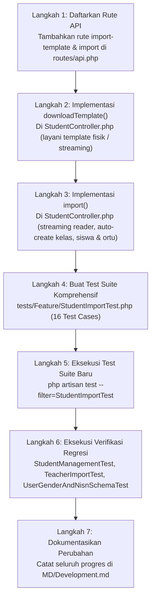

# Rencana Implementasi Terperinci: Fase 4 — Modul Impor Siswa & Auto-Create Kelas

**Dokumen Rencana:** `MD/PHASE_4_IMPLEMENTATION_PLAN.md`  
**Proyek:** School Class Progress (SCP) — Backend REST API  
**Versi Target:** SCP v4.5 (Fase 4)  
**Dokumen Acuan:** `MD/NEW_FEATURE_IMPLEMENTATION_PLAN.md` (Fase 4), `MD/NewFeature.md` (Bagian 2.2, 3, & 5), `MD/PHASE_1_IMPLEMENTATION_PLAN.md`, `MD/PHASE_2_IMPLEMENTATION_PLAN.md`, `MD/PHASE_3_IMPLEMENTATION_PLAN.md`, `MD/PRD.md` (v4.4), `MD/Development.md`  
**Status Dokumen:** Usulan Rencana Detail (Menunggu Persetujuan Pengguna Sebelum Eksekusi)  

---

## DAFTAR ISI
1. [Ringkasan & Tujuan Fase 4](#1-ringkasan--tujuan-fase-4)
2. [Analisis Kondisi Aktual Proyek & Verifikasi Dependensi](#2-analisis-kondisi-aktual-proyek--verifikasi-dependensi)
   - 2.1 Verifikasi Hasil Fase 1, 2, dan 3
   - 2.2 Struktur Tabel `users`, `classes`, dan Relasi Database
   - 2.3 Analisis Model `User.php` dan `Classes.php`
   - 2.4 Analisis `app/Http/Controllers/API/StudentController.php` Saat Ini
   - 2.5 Analisis Rute `routes/api.php` & Middleware
   - 2.6 Verifikasi Ketersediaan Berkas Template Siswa
3. [Ruang Lingkup Pekerjaan (In-Scope & Out-of-Scope)](#3-ruang-lingkup-pekerjaan-in-scope--out-of-scope)
4. [Rincian Implementasi Komponen Fase 4](#4-rincian-implementasi-komponen-fase-4)
   - Bagian A: Endpoint API & Middleware Protection
   - Bagian B: Generator Template Excel Siswa Berstandar (`downloadTemplate`)
   - Bagian C: Engine Ingestion & Validasi Streaming Spreadsheet (`import`)
   - Bagian D: Mekanisme Auto-Create Master Kelas Berbasis Tingkat Rombel
   - Bagian E: Auto-Provisioning Akun Siswa
   - Bagian F: Auto-Provisioning Akun Orang Tua (Penanganan Sibling & Relasi)
   - Bagian G: Transaksi Atomik (*All-or-Nothing*) & Standardisasi Respons JSON (201 & 422)
   - Bagian H: Penyusunan Automated Feature Test Suite `StudentImportTest.php`
5. [Daftar File yang Dibuat atau Diubah (Matriks Perubahan)](#5-daftar-file-yang-dibuat-atau-diubah-matriks-perubahan)
6. [Urutan Pengerjaan Teknis (Step-by-Step Execution Plan)](#6-urutan-pengerjaan-teknis-step-by-step-execution-plan)
7. [Detail Validasi, Integritas Data & Keamanan](#7-detail-validasi-integritas-data--keamanan)
   - 7.1 Format Teks & Preservasi Leading Zero NIS / NISN
   - 7.2 Deteksi Duplikasi Ganda (In-Sheet Duplicate vs Database Collision)
   - 7.3 Validasi Nilai Gender ('L' atau 'P')
   - 7.4 Penanganan Data Opsional (NISN, Nama Wali, Nomor Telepon Wali)
   - 7.5 Sanitasi Spasi & Batas Ukuran File (5 MB)
8. [Rencana Pengujian Komprehensif (Positive, Negative & Rollback Test Cases)](#8-rencana-pengujian-komprehensif-positive-negative--rollback-test-cases)
9. [Kriteria Penerimaan (*Acceptance Criteria*)](#9-kriteria-penerimaan-acceptance-criteria)
10. [Analisis Risiko, Kendala Teknis & Strategi Mitigasi](#10-analisis-risiko-kendala-teknis--strategi-mitigasi)
11. [Target Hasil Akhir (*Deliverables*)](#11-target-hasil-akhir-deliverables)
12. [Hal-Hal yang Perlu Dikonfirmasi Sebelum Eksekusi](#12-hal-hal-yang-perlu-dikonfirmasi-sebelum-eksekusi)

---

## 1. Ringkasan & Tujuan Fase 4

Fase 4 merupakan pilar utama kedua dalam inisiatif **Zero-Manual Master Data & Integrated Schedule Ingestion (SCP v4.5)**. Fitur ini dirancang untuk mengeliminasi beban administratif Waka Kurikulum dalam menginput data rombongan belajar (kelas), ratusan data siswa, dan data akun orang tua secara manual satu per satu.

Melalui modul ini, Waka cukup mengunggah satu berkas spreadsheet Excel (`.xlsx`) yang memuat data siswa lengkap dengan nama rombelnya. Sistem secara otomatis akan:
1. Membaca dan memvalidasi berkas secara *streaming* hemat memori.
2. Mengekstrak dan mendaftarkan master kelas (`classes`) baru jika belum ada di database, sekaligus mendeteksi tingkatan kelasnya (10, 11, atau 12) secara otomatis.
3. Membuat akun siswa (`User` role `student`) dengan password bawaan berupa NIS, atribut jenis kelamin (`gender`), NISN, dan kelas yang sesuai.
4. Membuat akun orang tua (`User` role `parent`) yang otomatis ditautkan ke akun siswa (`linked_student_id`), nomor kontak orang tua, dan kredensial login terisolasi (`P-{NIS}`).
5. Menjalankan seluruh proses dalam satu transaksi atomik (*all-or-nothing*).

---

## 2. Analisis Kondisi Aktual Proyek & Verifikasi Dependensi

### 2.1 Verifikasi Hasil Fase 1, 2, dan 3
- **Fase 1 (Pustaka Spreadsheet & Ekstensi Zip)**: Ekstensi `zip` aktif pada runtime PHP 8.4 dan pustaka streaming `spatie/simple-excel:^3.11` terpasang sempurna.
- **Fase 2 (Skema Basis Data & Model User)**: Tabel `users` telah memiliki kolom `gender` (`enum['L', 'P']`, nullable) dan `nisn` (`string(20)`, unique, nullable). Model `User.php` telah mendeklarasikan kedua field ini pada atribut `#[Fillable]`.
- **Fase 3 (Modul Impor Guru)**: Pola streaming Excel, transaksi atomik, penanganan file fisik di `storage/app/templates`, dan pemformatan error HTTP 422 terstruktur telah terbukti stabil dan lulus 100% pada 15 feature tests.
- **Kesimpulan Status**: **100% Siap**. Seluruh dependensi fondasi telah terpenuhi tanpa ada hambatan teknis.

### 2.2 Struktur Tabel `users`, `classes`, dan Relasi Database

#### Tabel `classes`:
- `id`: Bigint Auto-Increment (PK).
- `name`: Varchar(255) — Nama rombel/kelas (misal: `X RPL 1`).
- `level`: Varchar(255) / Integer — Tingkatan kelas (`10`, `11`, `12`).
- `next_class_id`: Bigint nullable (FK $\rightarrow$ `classes.id`, untuk kenaikan kelas).
- `deleted_at`: Soft delete timestamp.

#### Tabel `users`:
- `role`: `student` atau `parent`.
- `nis_nip`: Varchar(255) unik — Menampung NIS untuk siswa, dan `P-{NIS}` untuk akun orang tua.
- `class_id`: Bigint nullable (FK $\rightarrow$ `classes.id`) — Menghubungkan siswa ke kelasnya.
- `linked_student_id`: Bigint nullable (FK $\rightarrow$ `users.id`, `nullOnDelete`) — Menghubungkan akun orang tua ke ID user siswa anaknya.
- `gender`: Enum (`'L'`, `'P'`) nullable — Jenis kelamin siswa.
- `nisn`: Varchar(20) unique nullable — Nomor Induk Siswa Nasional.
- `phone_number`: Varchar(255) nullable — Nomor telepon/WhatsApp orang tua/siswa.
- `is_held_back`: Boolean default `false`.
- `must_change_password`: Boolean default `true`.

### 2.3 Analisis Model `User.php` dan `Classes.php`
- `Classes.php`:
  - `protected $fillable = ['name', 'level', 'next_class_id'];`
  - Relasi `students(): HasMany` memfilter `where('role', 'student')`.
- `User.php`:
  - Atribut `#[Fillable]` sudah memuat: `'name'`, `'email'`, `'password'`, `'role'`, `'nis_nip'`, `'gender'`, `'nisn'`, `'must_change_password'`, `'class_id'`, `'linked_student_id'`, `'phone_number'`, `'is_held_back'`.
  - Relasi `schoolClass(): BelongsTo` terhubung ke `Classes::class` melalui `class_id`.
  - Relasi `linkedStudent(): BelongsTo` terhubung ke `User::class` melalui `linked_student_id`.
  - Relasi `parents(): HasMany` terhubung ke akun orang tua melalui `linked_student_id`.

### 2.4 Analisis `app/Http/Controllers/API/StudentController.php` Saat Ini
Saat ini `StudentController.php` telah memiliki:
- `index()`: Mengambil daftar siswa berpaginasi dengan filter kelas dan pencarian nama/NIS (200 OK).
- `store()`: Input manual siswa satu per satu beserta auto-provisioning akun orang tua (`P-{nis}`) dengan password random 8 karakter (201 Created).
- `update()`: Pembaruan data siswa dan sinkronisasi nama/NIS akun orang tua (200 OK).
- `destroy()`: Soft-delete siswa dan akun orang tuanya (200 OK).
- `holdBack()`: Menandai siswa tinggal kelas (`is_held_back = true`) (200 OK).
- **Kekurangan**: Belum memiliki method `downloadTemplate()` dan `import()` untuk impor massal via spreadsheet.

### 2.5 Analisis Rute `routes/api.php` & Middleware
Rute siswa saat ini berada di bawah grup Waka Kurikulum `['auth:sanctum', 'throttle:api', 'role:vice_principal']`.
Rute baru yang akan ditambahkan:
- `GET /api/students/import-template`
- `POST /api/students/import`
Rute ini wajib diletakkan **sebelum** rute dengan parameter dinamis `/students/{id}` untuk mencegah benturan rute (*route masking*).

### 2.6 Verifikasi Ketersediaan Berkas Template Siswa
Pemeriksaan pada direktori penyimpanan menemukan berkas:
`storage/app/templates/template_import_siswa.xlsx`
Berkas ini telah memuat 7 kolom resmi:
`nis`, `name`, `class_name`, `gender`, `nisn`, `parent_name`, `parent_phone`
beserta baris contoh data untuk tingkat `X RPL 1` dan `XI TKJ 2`.

---

## 3. Ruang Lingkup Pekerjaan (In-Scope & Out-of-Scope)

### A. Pekerjaan di Dalam Lingkup (In-Scope):
1. **Registrasi Rute API**: Mendaftarkan endpoint `GET /api/students/import-template` dan `POST /api/students/import` pada `routes/api.php`.
2. **Implementasi `StudentController::downloadTemplate()`**: Mengalirkan berkas template resmi siswa baik dari berkas fisik di `storage/app/templates` maupun melalui streaming dinamis fallback.
3. **Implementasi `StudentController::import()`**:
   - Validasi berkas upload multipart (.xlsx, max 5 MB).
   - Validasi struktur header wajib (`nis`, `name`, `class_name`, `gender`).
   - Validasi baris per baris (kelengkapan field, validitas gender 'L'/'P', keunikan NIS & NISN).
   - Auto-create master kelas berbasis nama rombel dengan deteksi otomatis tingkatan kelas (X, XI, XII).
   - Auto-provisioning akun siswa (hash NIS, must_change_password, gender, nisn, class_id).
   - Auto-provisioning akun orang tua (`P-{nis}`, hash NIS, linked_student_id, parent_phone, must_change_password).
   - Penanganan transaksi atomik `DB::transaction()` all-or-nothing dengan pengembalian status HTTP 422 JSON jika ada baris gagal.
   - Respons sukses HTTP 201 dengan ringkasan jumlah kelas dibuat, kelas eksis, siswa diimpor, dan orang tua dibuat.
4. **Penyusunan Automated Test Suite `tests/Feature/StudentImportTest.php`**: Menguji seluruh skenario positif, negatif, duplikasi, auto-create kelas, dan rollback.
5. **Pencatatan Dokumentasi**: Mendokumentasikan implementasi di `MD/Development.md`.

### B. Pekerjaan di Luar Lingkup (Out-of-Scope / Dikerjakan pada Fase Selanjutnya):
- Penyelarasan aturan prasyarat import jadwal pada `MasterDataPrerequisiteService` (cakupan **Fase 5**).
- Modifikasi worker parser jadwal FET `ParseSchedulePdfJob` (cakupan **Fase 6**).
- Modifikasi skrip Python `script/pdf_parser.py`.

---

## 4. Rincian Implementasi Komponen Fase 4

### Bagian A: Endpoint API & Middleware Protection

Pada `routes/api.php`, dua rute baru didaftarkan di dalam grup Waka:
```php
// 9.3 Master Data Students: Import & Template
Route::get('/students/import-template', [StudentController::class, 'downloadTemplate']);
Route::post('/students/import', [StudentController::class, 'import']);

Route::post('/students', [StudentController::class, 'store']);
Route::put('/students/{id}', [StudentController::class, 'update']);
Route::delete('/students/{id}', [StudentController::class, 'destroy']);
Route::post('/students/{id}/hold-back', [StudentController::class, 'holdBack']);
```
- **Proteksi**: Dilindungi oleh middleware `['auth:sanctum', 'throttle:api', 'role:vice_principal']`. Request guest ditolak HTTP 401, dan request dari role guru/siswa/orang tua ditolak HTTP 403.

---

### Bagian B: Generator Template Excel Siswa Berstandar (`downloadTemplate`)

Method `downloadTemplate()` pada `StudentController.php` dirancang untuk:
1. Memeriksa keberadaan file fisik di `storage_path('app/templates/template_import_siswa.xlsx')` atau `storage_path('app/templates/siswa_import_template.xlsx')`.
2. Jika ada, mengembalikannya via `response()->download(...)` dengan nama berkas `siswa_import_template.xlsx`.
3. Jika belum ada, mengalirkan berkas secara dinamis via `response()->streamDownload(...)` menggunakan `SimpleExcelWriter::create('php://output', 'xlsx')` dengan 7 kolom resmi:
   - `nis`: Nomor Induk Siswa (wajib, teks).
   - `name`: Nama lengkap siswa (wajib, teks).
   - `class_name`: Nama rombel (wajib, contoh: `X RPL 1`, `XI TKJ 2`, `XII AK 3`).
   - `gender`: Jenis kelamin (wajib, hanya `L` atau `P`).
   - `nisn`: Nomor Induk Siswa Nasional (opsional, teks 10 digit).
   - `parent_name`: Nama orang tua/wali (opsional).
   - `parent_phone`: Nomor telepon/WhatsApp wali (opsional, contoh: `081234567890`).

---

### Bagian C: Engine Ingestion & Validasi Streaming Spreadsheet (`import`)

Alur validasi streaming pada `StudentController::import(Request $request)`:

```
[Request POST /api/students/import]
       │
       ▼
[Validasi Berkas HTTP]
   ├── file: required | file | mimes:xlsx | max:5120
       │
       ▼
[SimpleExcelReader Streaming]
   ├── trimHeaderRow() -> headersToSnakeCase()
   ├── Validasi Header Wajib: ['nis', 'name', 'class_name', 'gender']
   ├── Validasi Konten: Rows tidak boleh kosong
       │
       ▼
[Iterasi Baris Data (Row Loop)]
   ├── 1. Validasi NIS:
   │      ├── Wajib diisi (string murni)
   │      ├── Cek duplikasi di sheet: $seenNis
   │      ├── Cek tabrakan siswa di database: User::where('nis_nip', $nis)
   │      └── Cek tabrakan akun ortu di database: User::where('nis_nip', 'P-' . $nis)
   ├── 2. Validasi Nama:
   │      ├── Wajib diisi
   │      └── Maksimal 100 karakter
   ├── 3. Validasi Kelas (class_name):
   │      ├── Wajib diisi
   │      └── Maksimal 50 karakter
   ├── 4. Validasi Gender:
   │      ├── Wajib diisi
   │      └── Harus 'L' atau 'P' (case-insensitive strtoupper)
   ├── 5. Validasi NISN (Opsional):
   │      ├── Jika diisi: maksimal 20 karakter
   │      ├── Cek duplikasi di sheet: $seenNisns
   │      └── Cek tabrakan di database: User::where('nisn', $nisn)
   ├── 6. Penanganan Parent Name & Phone (Opsional):
   │      ├── Bersihkan spasi
   │      └── Maksimal panjang karakter (name <= 100, phone <= 20)
       │
       ▼
[Evaluasi Hasil Validasi]
   ├── Jika terdapat error:
   │      └── Return HTTP 422 JSON { success: false, message: "...", errors: [...] }
   │
   └── Jika seluruh baris valid:
          └── Eksekusi DB::transaction()
```

---

### Bagian D: Mekanisme Auto-Create Master Kelas Berbasis Tingkat Rombel

Sistem mengekstrak daftar nama kelas unik dari seluruh baris valid, kemudian memprosesnya dengan logika:

1. **Sanitasi Nama Kelas**:
   - Menghapus spasi ganda di tengah dan spasi di awal/akhir:
     `$cleanClassName = trim(preg_replace('/\s+/', ' ', $rawClassName));`
2. **Ekstraksi Tingkat Kelas (*Level Detection*)**:
   - Mengevaluasi prefiks rombel menggunakan regular expression:
     ```php
     if (preg_match('/^XII(\s|-|_|$)/i', $cleanClassName)) {
         $level = '12';
     } elseif (preg_match('/^XI(\s|-|_|$)/i', $cleanClassName)) {
         $level = '11';
     } elseif (preg_match('/^X(\s|-|_|$)/i', $cleanClassName)) {
         $level = '10';
     } elseif (preg_match('/^12(\s|-|_|$)/', $cleanClassName)) {
         $level = '12';
     } elseif (preg_match('/^11(\s|-|_|$)/', $cleanClassName)) {
         $level = '11';
     } elseif (preg_match('/^10(\s|-|_|$)/', $cleanClassName)) {
         $level = '10';
     } else {
         $level = '10'; // Fallback default untuk format tidak berpola
     }
     ```
3. **Penyimpanan / Pengambilan Kelas**:
   - Mencari kelas yang aktif di database:
     `$class = Classes::where('name', $cleanClassName)->whereNull('deleted_at')->first();`
   - Jika belum ada, buat record baru:
     `$class = Classes::create(['name' => $cleanClassName, 'level' => $level, 'next_class_id' => null]);`
     dan tambahkan counter `$classesCreatedCount++`.
   - Jika sudah ada, gunakan ID kelas tersebut dan tambahkan counter `$classesExistingCount++`.
   - Simpan ID kelas pada array memori `$classMap[$cleanClassName] = $class->id` agar baris siswa berikutnya tidak melakukan query ulang ke database.

---

### Bagian E: Auto-Provisioning Akun Siswa

Untuk setiap baris data siswa yang valid, dibuat record `User` dengan ketentuan:
- `name`: `$rawName`
- `role`: `'student'`
- `nis_nip`: `$rawNis` (string teks murni, menjaga leading zeros)
- `password`: `Hash::make($rawNis)` (password default adalah NIS siswa)
- `class_id`: `$classMap[$cleanClassName]`
- `gender`: `strtoupper($rawGender)` (`'L'` atau `'P'`)
- `nisn`: `$rawNisn !== '' ? $rawNisn : null`
- `is_held_back`: `false`
- `must_change_password`: `true`

---

### Bagian F: Auto-Provisioning Akun Orang Tua (Penanganan Sibling & Relasi)

Untuk setiap siswa yang dibuat, sistem secara berpasangan membuat akun orang tua pada tabel `users`:
- `name`: `$rawParentName !== '' ? $rawParentName : ('Wali dari ' . $rawName)`
- `role`: `'parent'`
- `nis_nip`: `'P-' . $rawNis` (username unik per anak)
- `password`: `Hash::make($rawNis)` (password default adalah NIS anak)
- `linked_student_id`: `$student->id` (tautan langsung ke ID siswa)
- `phone_number`: `$rawParentPhone !== '' ? $rawParentPhone : null`
- `must_change_password`: `true`

#### Analisis Kasus Siswa Bersaudara (Nomor Telepon Orang Tua Sama):
- **Kondisi**: Dua siswa bersaudara (misal: Kakak di kelas XII dan Adik di kelas X) memiliki nomor telepon orang tua yang identik di berkas Excel (`081234567890`).
- **Analisis Database**:
  - Kolom `phone_number` pada tabel `users` **tidak memiliki unique constraint**.
  - Kolom `nis_nip` akun orang tua menggunakan pola `P-{NIS}` (`P-12045` dan `P-12046`), sehingga kredensial login akun orang tua masing-masing anak **dijamin 100% unik**.
  - Relasi `linked_student_id` bernilai ID anak yang bersangkutan secara tepat.
  - Saat login, orang tua menggunakan username `P-12045` untuk mengakses presensi anak pertama, atau `P-12046` untuk anak kedua.
- **Kesimpulan**: Pendekatan ini sepenuhnya aman, tidak memicu benturan database, dan selaras dengan arsitektur multi-role SCP v4.4.

---

### Bagian G: Transaksi Atomik (*All-or-Nothing*) & Standardisasi Respons JSON

1. **Semua Baris Divalidasi di Awal**: Tidak ada operasi insert sebelum seluruh baris berkas tuntas diperiksa.
2. **Pembatalan Menyeluruh (*Full Rollback*)**: Jika ditemukan 1 error pada baris mana pun, database tidak dimutasi sedikit pun.
3. **Format Respons Error HTTP 422**:
   ```json
   {
       "success": false,
       "message": "Validasi berkas gagal pada beberapa baris.",
       "errors": [
           {
               "row": 3,
               "attribute": "nis",
               "message": "NIS '12045' duplikat di dalam berkas ini (pertama kali muncul di baris 2)."
           },
           {
               "row": 4,
               "attribute": "gender",
               "message": "Jenis kelamin harus bernilai L atau P."
           }
       ]
   }
   ```
4. **Format Respons Sukses HTTP 201**:
   ```json
   {
       "success": true,
       "message": "Data siswa dan kelas berhasil diimpor.",
       "data": {
           "classes_created": 2,
           "classes_existing": 1,
           "students_imported": 3,
           "parents_imported": 3
       }
   }
   ```

---

### Bagian H: Penyusunan Automated Feature Test Suite `StudentImportTest.php`

Dibuat berkas pengujian otomatis `tests/Feature/StudentImportTest.php` yang mencakup 16 test cases menyeluruh.

---

## 5. Daftar File yang Dibuat atau Diubah (Matriks Perubahan)

| No | File Path | Status | Tindakan & Alasan Teknis |
|---|---|---|---|
| 1 | `routes/api.php` | **Diubah** | Mendaftarkan rute `GET /api/students/import-template` dan `POST /api/students/import` pada grup middleware Waka. |
| 2 | `app/Http/Controllers/API/StudentController.php` | **Diubah** | Mengimplementasikan method `downloadTemplate()` dan `import()` (validasi streaming, auto-create kelas, auto-provisioning siswa dan orang tua). |
| 3 | `tests/Feature/StudentImportTest.php` | **Dibuat** | Automated feature test suite mencakup 16 skenario pengujian komprehensif. |
| 4 | `MD/PHASE_4_IMPLEMENTATION_PLAN.md` | **Dibuat** | Dokumen perencanaan teknis formal Fase 4. |
| 5 | `MD/Development.md` | **Diubah** | Mencatat dokumentasi implementasi Fase 4 setelah eksekusi. |

> [!NOTE]
> Tidak ada perubahan pada migration atau skema database tabel `users` maupun `classes`, karena persiapan skema sudah selesai 100% pada Fase 2.

---

## 6. Urutan Pengerjaan Teknis (Step-by-Step Execution Plan)



---

## 7. Detail Validasi, Integritas Data & Keamanan

### 7.1 Preservasi Format Teks & Leading Zero NIS / NISN
- Data NIS dan NISN selalu dikonversi menggunakan `trim((string) $row['nis'])` dan `trim((string) $row['nisn'])`.
- Memastikan angka nol di depan (misal: NIS `'0123'` atau NISN `'0081234567'`) tetap utuh tersimpan sebagai teks di basis data.

### 7.2 Deteksi Duplikasi Ganda (In-Sheet Duplicate vs Database Collision)
Pemeriksaan keunikan diterapkan dua lapis:
1. **NIS**:
   - Di dalam berkas: `$seenNis[$rawNis]`
   - Di database siswa: `User::where('nis_nip', $rawNis)->whereNull('deleted_at')->exists()`
   - Di database akun orang tua: `User::where('nis_nip', 'P-' . $rawNis)->whereNull('deleted_at')->exists()`
2. **NISN**:
   - Jika diisi:
     - Di dalam berkas: `$seenNisns[$rawNisn]`
     - Di database: `User::where('nisn', $rawNisn)->whereNull('deleted_at')->exists()`

### 7.3 Validasi Nilai Gender
- Nilai gender dinormalisasi: `$gender = strtoupper(trim((string) $row['gender']));`
- Hanya menerima `'L'` atau `'P'`. Nilai selain itu (misal: `'M'`, `'F'`, `'Pria'`, atau string acak) ditolak HTTP 422: `"Jenis kelamin harus bernilai L atau P."`.

### 7.4 Penanganan Data Opsional
- **NISN**: Jika kosong $\rightarrow$ `null`.
- **Nama Orang Tua**: Jika kosong $\rightarrow$ otomatis menggunakan fallback `"Wali dari " . $name`.
- **Telepon Orang Tua**: Jika kosong $\rightarrow$ `null`.

### 7.5 Sanitasi Spasi & Batas Ukuran File (5 MB)
- Nama kelas dibersihkan dari spasi ganda tak terlihat: `preg_replace('/\s+/', ' ', $rawClassName)`.
- Request multipart dibatasi maksimal 5.120 KB (5 MB).

---

## 8. Rencana Pengujian Komprehensif (Positive, Negative & Rollback Test Cases)

Berikut adalah matriks 16 skenario pengujian pada `tests/Feature/StudentImportTest.php`:

| No | Nama Test Case | Kategori | Ekspektasi & Verifikasi |
|---|---|---|---|
| 1 | `test_guest_cannot_download_student_template_or_import` | Keamanan | Guest ditolak HTTP 401 Unauthorized. |
| 2 | `test_non_waka_cannot_download_student_template_or_import` | Otorisasi | Guru dan Siswa ditolak HTTP 403 Forbidden. |
| 3 | `test_waka_can_download_student_import_template` | Positif | Waka menerima file attachment spreadsheet dengan header lengkap. |
| 4 | `test_waka_can_import_valid_students_and_auto_creates_classes` | Positif | Mengimpor siswa dari rombel `X RPL 1` dan `XI TKJ 2`. Kelas terbuat dengan level 10 dan 11, akun siswa & akun orang tua terbuat di database. |
| 5 | `test_import_reuses_existing_classes_without_duplication` | Idempotensi | Mengimpor siswa untuk kelas yang sudah ada di database; kelas tidak dibuat ulang. |
| 6 | `test_auto_create_class_level_detection_x_xi_xii_and_fallback` | Logika Bisnis | Menguji deteksi level untuk kelas `X`, `XI`, `XII`, format angka `10`, `11`, `12`, serta format non-standar (fallback level 10). |
| 7 | `test_import_fails_when_file_is_missing_or_invalid_extension` | Negatif | Request tanpa file atau ekstensi `.txt` ditolak HTTP 422. |
| 8 | `test_import_fails_when_file_exceeds_max_size` | Batas Sistem | Berkas berukuran > 5 MB ditolak HTTP 422. |
| 9 | `test_import_fails_when_header_is_invalid` | Format Data | Berkas dengan header wajib hilang ditolak HTTP 422. |
| 10 | `test_import_fails_when_excel_has_no_data_rows` | Format Data | Berkas hanya header tanpa data ditolak HTTP 422. |
| 11 | `test_import_fails_when_required_fields_are_empty` | Integritas Baris | NIS kosong, nama kosong, kelas kosong, atau gender kosong ditolak HTTP 422. |
| 12 | `test_import_fails_when_gender_is_invalid` | Validasi Domain | Gender bernilai selain 'L' atau 'P' (misal: 'X') ditolak HTTP 422. |
| 13 | `test_import_fails_and_rollbacks_on_in_sheet_duplicate_nis` | Duplikasi | NIS ganda di sheet yang sama ditolak HTTP 422 dan 0 data tersimpan. |
| 14 | `test_import_fails_and_rollbacks_on_in_sheet_duplicate_nisn` | Duplikasi | NISN ganda di sheet yang sama ditolak HTTP 422. |
| 15 | `test_import_fails_and_rollbacks_on_database_nis_collision` | Benturan DB | NIS yang sudah terdaftar di sistem ditolak HTTP 422 dan transaksi di-rollback. |
| 16 | `test_import_handles_siblings_with_same_parent_phone_cleanly` | Relasi Sibling | Mengimpor dua siswa bersaudara dengan nomor telepon orang tua sama; kedua akun orang tua terbuat unik (`P-{nis1}`, `P-{nis2}`) tanpa benturan database. |

---

## 9. Kriteria Penerimaan (*Acceptance Criteria*)

| No | Kriteria Penerimaan | Tolok Ukur Keberhasilan |
|---|---|---|
| **AC-4.1** | **Download Template Siswa** | Endpoint `GET /api/students/import-template` mengalirkan berkas `.xlsx` dengan 7 kolom resmi. |
| **AC-4.2** | **Auto-Create Kelas** | Kelas baru otomatis terdaftar di tabel `classes` dengan penentuan `level` ('10', '11', '12') yang tepat. |
| **AC-4.3** | **Penggunaan Kembali Kelas Eksisting** | Rombel yang sudah ada di database tidak dibuat ulang (tidak memicu duplicate entry). |
| **AC-4.4** | **Auto-Provisioning Siswa** | Akun siswa terbuat dengan `role = 'student'`, `password = Hash(NIS)`, `gender`, `nisn`, dan `class_id` yang valid. |
| **AC-4.5** | **Auto-Provisioning Orang Tua** | Akun orang tua terbuat dengan `role = 'parent'`, `nis_nip = 'P-' . $nis`, `linked_student_id = $student->id`, dan `phone_number`. |
| **AC-4.6** | **Dukungan Sibling Tanpa Benturan** | Siswa bersaudara dengan nomor kontak wali yang sama berhasil diimpor tanpa kesalahan unique constraint. |
| **AC-4.7** | **Atomisitas Transaksi (All-or-Nothing)** | Kesalahan validasi pada satu baris membatalkan seluruh operasi kelas, siswa, dan orang tua. |
| **AC-4.8** | **Kelulusan Automated Test 100%** | Seluruh 16 skenario pengujian pada `StudentImportTest.php` lolos tanpa kegagalan. |

---

## 10. Analisis Risiko, Kendala Teknis & Strategi Mitigasi

| No | Potensi Risiko | Tingkat | Dampak | Strategi Mitigasi |
|---|---|---|---|---|
| 1 | **Spasi Tak Terlihat pada Nama Rombel** | Sedang | Membuat duplikasi kelas, misal `'X RPL 1'` dan `'X  RPL 1'`. | Menggunakan sanitasi spasi regex `preg_replace('/\s+/', ' ', $name)` sebelum pemanggilan query `Classes`. |
| 2 | **Format Nama Kelas Non-Standar** | Rendah | Gagal mendeteksi level kelas. | Menerapkan multi-level regex (`XII`, `XI`, `X`, format angka `12`, `11`, `10`) dan menyediakan fallback aman level `'10'`. |
| 3 | **Pemotongan Angka Nol pada NISN** | Sedang | Nilai NISN `'0081234567'` tersimpan salah jika diperlakukan sebagai angka. | Selalu membaca dan menyimpan sebagai string teks murni `(string) $row['nisn']`. |
| 4 | **Benturan Rute API dengan `/students/{id}`** | Sedang | Request ke `/students/import` disalahartikan sebagai ID siswa dengan nilai `'import'`. | Mendaftarkan rute `/students/import-template` dan `/students/import` **sebelum** rute `/students/{id}` di `routes/api.php`. |

---

## 11. Target Hasil Akhir (*Deliverables*)

Setelah Fase 4 disetujui dan diimplementasikan:
1. Rute API `/api/students/import-template` dan `/api/students/import` aktif dan terlindungi.
2. `StudentController.php` mendukung download template dan import massal siswa, auto-create kelas, dan auto-provisioning akun siswa & orang tua.
3. Test suite `tests/Feature/StudentImportTest.php` memuat 16 test cases terverifikasi 100% lulus.
4. Dokumentasi perkembangan tercatat di `MD/Development.md`.
5. Sistem backend siap melangkah ke **Fase 5: Penyelarasan Aturan Prasyarat Master Data (Hanya Siswa & Guru)**.

---

## 12. Hal-Hal yang Perlu Dikonfirmasi Sebelum Eksekusi

Sebelum memulai implementasi kode, berikut 2 poin konfirmasi teknis:
1. **Fallback Tingkatan Kelas**: Jika ada nama rombel yang tidak memuat penanda tingkat romawi (`X`, `XI`, `XII`) maupun angka (`10`, `11`, `12`)—misalnya nama rombel hanya bertuliskan `"RPL Khusus"`—sistem akan menetapkan nilai default `level = '10'`. *Apakah aturan fallback ini disetujui?*
2. **Kredensial Orang Tua untuk Siswa Bersaudara**: Sistem menggunakan pola akun per anak dengan username `P-{NIS}` sehingga jika dua bersaudara bersekolah di tempat yang sama, orang tua memiliki akun terpisah untuk masing-masing anak dengan nomor telepon yang sama. *Apakah pola ini disetujui?*
