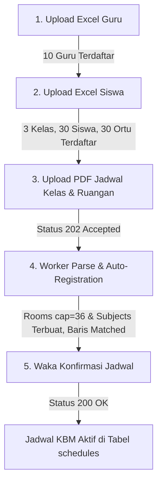

# Rencana Implementasi Fase 7: Pengujian Komprehensif & Verifikasi Zero-Regression

## 1. Ringkasan Eksekutif & Tujuan

### 1.1. Latar Belakang
Fase 1 hingga Fase 6 telah menyelesaikan seluruh modul baru backend SCP v4.5:
- **Fase 1 & Fase 3:** Fondasi streaming Excel dan Modul Impor Guru Massal (Auto-Provisioning NIP, ID FET, Email, Phone).
- **Fase 2:** Migrasi Skema Basis Data Kolom `gender` dan `nisn` pada tabel `users`.
- **Fase 4:** Modul Impor Siswa Massal & Auto-Create Kelas Berbasis Tingkat (Akun Siswa, Akun Orang Tua `P-{nis}`, Sibling Phone Support).
- **Fase 5:** Penyelarasan Aturan Prasyarat Master Data (Impor PDF jadwal FET hanya mensyaratkan data Siswa aktif dan Guru ber-ID FET).
- **Fase 6:** Auto-Registration Master Data pada PDF Worker (`ParseSchedulePdfJob` mendaftarkan Ruangan kapasitas 36, Mata Pelajaran, dan Fallback Kelas secara mandiri).

Fase 7 merupakan tahapan penutup dalam roadmap pengembangan backend SCP v4.5. Fokus utama fase ini adalah melakukan audit komprehensif, merancang pengujian terisolasi setiap modul baru, merancang simulasi end-to-end berbasis paradigma 4 berkas masukan (*four input files paradigm*), serta memverifikasi bahwa seluruh fitur inti eksisting tidak mengalami degradasi atau regresi fungsional (*zero-regression*).

### 1.2. Tujuan Fase 7
1. **Audit Kualitas Kode & Dependensi:** Memverifikasi integritas teknis hasil implementasi Fase 1–6 secara faktual.
2. **Pengujian Terisolasi Tiap Modul:** Menjalankan automated test suite per modul fitur baru (`TeacherImportTest`, `StudentImportTest`, `MasterDataPrerequisiteRuleTest`, `ParseSchedulePdfJobTest`, `ScheduleImportTest`).
3. **Pengujian Integrasi End-to-End (E2E):** Menguji alur lengkap dari pengunggahan Excel Guru $\rightarrow$ Excel Siswa $\rightarrow$ PDF Jadwal Kelas & Ruangan $\rightarrow$ Worker Parsing & Auto-Registration $\rightarrow$ Konfirmasi Jadwal Aktif.
4. **Verifikasi Zero-Regression:** Memastikan seluruh suite automated test eksisting (autentikasi, presensi exception-based, jurnal KBM, izin siswa, AI quiz, kenaikan kelas, dan resolusi jam pelajaran) tetap 100% lulus.
5. **Verifikasi Kriteria Kelulusan PRD:** Mengonfirmasi pemenuhan seluruh 11 Checklist Kriteria Kelulusan UKK pada Bagian 10 `PRD.md`.

---

## 2. Hasil Audit Implementasi Fase 1–6

Audit teknis dilakukan terhadap kode sumber aktual, dependensi, migrasi, dan konfigurasi lingkungan:

| Fase | Komponen yang Diaudit | Parameter Pemeriksaan | Kondisi Faktual Aktual | Status Audit |
|:---:|---|---|---|:---:|
| **Fase 1** | Lingkungan & Dependensi | 1. Ekstensi PHP `zip` dan `xml`. 2. Dependensi `spatie/simple-excel:^3.11`. 3. Autoloading `SimpleExcelReader` & `Writer`. 4. Ketersediaan template fisik Excel. | Ekstensi `zip`, `xml`, `SimpleXML`, `xmlreader`, `xmlwriter` aktif pada PHP 8.4.13. Package terpasang di `composer.json`. Autoloading berhasil (`AUTOLOAD_OK`). File fisik `guru_import_template.xlsx` (4.5 KB) dan `template_import_siswa.xlsx` (5.3 KB) tersedia di `storage/app/templates/`. | **Sesuai (100% Siap)** |
| **Fase 2** | Skema Basis Data & Model Siswa | 1. Migration `gender` & `nisn`. 2. Tipe data, constraint unique, nullability. 3. Atribut `#[Fillable]` pada `User.php`. 4. Kompatibilitas rollback. | Migration `2026_10_30_000001_add_gender_and_nisn_to_users_table.php` menambahkan `gender` (enum `L`, `P`, nullable) dan `nisn` (varchar 20, nullable, unique). Terdaftar di `#[Fillable]` `User.php`. Rollback melepas unique index terlebih dahulu sebelum drop column. | **Sesuai (100% Siap)** |
| **Fase 3** | Modul Impor Guru | 1. Endpoint download template & import. 2. Validasi format, header, dan ukuran. 3. In-sheet duplicate NIP, FET ID, email. 4. Auto-provisioning password hash NIP. 5. Transaksi atomik & otorisasi Waka. | Rute `GET /api/teachers/import-template` dan `POST /api/teachers/import` aktif di bawah middleware Waka. Validasi in-sheet duplicate untuk NIP, FET staff ID, dan Email berjalan. Role `teacher`, `must_change_password = true`. Dibungkus `DB::transaction()`. | **Sesuai (100% Siap)** |
| **Fase 4** | Modul Impor Siswa & Auto-Create Kelas | 1. Endpoint template & import siswa. 2. Auto-create & reuse kelas berbasis regex. 3. Akun siswa & orang tua (`P-{nis}`). 4. Sibling phone support. 5. Transaksi atomik & otorisasi Waka. | Rute `GET /api/students/import-template` dan `POST /api/students/import` aktif di bawah middleware Waka. Regex deteksi level (`XII` $\rightarrow$ 12, `XI` $\rightarrow$ 11, `X` $\rightarrow$ 10, angka 10/11/12, fallback 10). Relasi `linked_student_id` valid. Sibling phone support lolos pengujian tanpa tabrakan constraint. | **Sesuai (100% Siap)** |
| **Fase 5** | Penyelarasan Prasyarat Master Data | 1. Dekopling `validateForPdfImport()`. 2. Hanya mensyaratkan siswa & guru ber-ID FET. 3. Mengabaikan kelas, mapel, ruangan pada upload PDF. 4. `validateForManualSchedule()` tetap utuh 4 entitas. | `validateForPdfImport()` pada `MasterDataPrerequisiteService` hanya mengecek siswa aktif ($\ge 1$) dan guru aktif ber-ID FET ($\ge 1$). Upload PDF lolos 202 Accepted saat tabel `classes`, `subjects`, dan `rooms` kosong melompong (0 record). Jadwal manual tetap terlindungi 4 entitas. | **Sesuai (100% Siap)** |
| **Fase 6** | Auto-Registration Master Data pada Worker PDF | 1. Auto-create Rooms (kapasitas default 36). 2. Auto-create Subjects (filter placeholder). 3. Fallback auto-create Classes. 4. Reload master data sebelum matching loop. 5. Baris jadwal berstatus `matched`. | Method `autoRegisterMasterData()` pada `ParseSchedulePdfJob` mendaftarkan ruangan kapasitas 36 dan mapel unik tanpa duplikasi. Koleksi master data dimuat ulang dari database sebelum perulangan pencocokan. Baris yang memiliki guru terdaftar langsung berstatus `matched`. | **Sesuai (100% Siap)** |

> **Temuan Khusus Audit Basis Data:**
> Pada file `database/seeders/DatabaseSeeder.php`, baris 39–75 (inisialisasi `system_configurations` dan `PeriodTemplateSeeder`) dikomentari (`//`) oleh pengembang pada commit sebelumnya (`498f894`). Hal ini menyebabkan `DatabaseIntegrityTest::test_database_seeder_initializes_all_mandatory_records` dan `SeederTest::test_database_seeder_initializes_waka_system_config_and_period_templates` gagal jika seeder dieksekusi. Ini bukan cacat kode pada fitur baru v4.5, namun perlu dicatat secara transparan sebagai area verifikasi seeder.

---

## 3. Rencana Pengujian Terisolasi per Modul

Pengujian unit dan fitur terisolasi dijalankan untuk memverifikasi fungsionalitas spesifik masing-masing komponen baru:

### 3.1. Pengujian Modul Impor Guru (`TeacherImportTest`)
* **Perintah:** `php artisan test --filter=TeacherImportTest`
* **Target Cakupan (15 Test Cases):**
  1. `test_guest_cannot_download_teacher_template_or_import` (401 Unauthorized).
  2. `test_non_waka_cannot_download_teacher_template_or_import` (403 Forbidden).
  3. `test_waka_can_download_teacher_import_template` (200 Download `.xlsx`).
  4. `test_waka_can_import_valid_teachers_excel` (201 Created, hash NIP, role teacher, `fet_staff_id`).
  5. `test_import_fails_when_file_is_missing_or_invalid_extension` (422 Unprocessable).
  6. `test_import_fails_when_file_exceeds_max_size` (422 Max 5 MB).
  7. `test_import_fails_when_header_is_invalid` (422 Missing NIP/Name/FET ID).
  8. `test_import_fails_when_excel_has_no_data_rows` (422 Empty Rows).
  9. `test_import_fails_when_required_fields_are_empty` (422 Row validation).
  10. `test_import_fails_and_rollbacks_on_in_sheet_duplicate_nip` (422 Rollback atomik).
  11. `test_import_fails_and_rollbacks_on_in_sheet_duplicate_fet_staff_id` (422 Rollback atomik).
  12. `test_import_fails_and_rollbacks_on_in_sheet_duplicate_email` (422 Rollback atomik).
  13. `test_import_fails_and_rollbacks_on_database_nip_collision` (422 Collision DB).
  14. `test_import_fails_and_rollbacks_on_database_fet_staff_id_collision` (422 Collision DB).
  15. `test_import_fails_on_invalid_email_format` (422 Format filter).

### 3.2. Pengujian Modul Impor Siswa & Kelas (`StudentImportTest`)
* **Perintah:** `php artisan test --filter=StudentImportTest`
* **Target Cakupan (16 Test Cases):**
  1. `test_guest_cannot_download_student_template_or_import` (401).
  2. `test_non_waka_cannot_download_student_template_or_import` (403).
  3. `test_waka_can_download_student_import_template` (200 Download).
  4. `test_waka_can_import_valid_students_and_auto_creates_classes` (201 Created).
  5. `test_import_reuses_existing_classes_without_duplication` (Idempotensi kelas).
  6. `test_auto_create_class_level_detection_x_xi_xii_and_fallback` (Regex level 10, 11, 12, fallback).
  7. `test_import_fails_when_file_is_missing_or_invalid_extension` (422).
  8. `test_import_fails_when_file_exceeds_max_size` (422).
  9. `test_import_fails_when_header_is_invalid` (422).
  10. `test_import_fails_when_excel_has_no_data_rows` (422).
  11. `test_import_fails_when_required_fields_are_empty` (422).
  12. `test_import_fails_when_gender_is_invalid` (422 Enum L/P).
  13. `test_import_fails_and_rollbacks_on_in_sheet_duplicate_nis` (422 Rollback).
  14. `test_import_fails_and_rollbacks_on_in_sheet_duplicate_nisn` (422 Rollback).
  15. `test_import_fails_and_rollbacks_on_database_nis_collision` (422 Collision).
  16. `test_import_handles_siblings_with_same_parent_phone_cleanly` (Sibling support via `P-{nis}`).

### 3.3. Pengujian Aturan Prasyarat Master Data (`MasterDataPrerequisiteRuleTest`)
* **Perintah:** `php artisan test --filter=MasterDataPrerequisiteRuleTest`
* **Target Cakupan (11 Test Cases):**
  1. `test_manual_schedule_creation_is_rejected_when_master_data_is_completely_empty` (422 Jadwal Manual).
  2. `test_manual_schedule_creation_is_rejected_when_some_master_data_is_missing` (422 Parsial).
  3. `test_manual_schedule_creation_is_allowed_when_master_data_is_complete` (201 Jadwal Manual).
  4. `test_pdf_import_upload_is_rejected_when_master_data_is_empty` (422 missing: students, teachers).
  5. `test_pdf_import_upload_is_rejected_when_students_are_empty` (422 missing: students).
  6. `test_pdf_import_upload_is_rejected_when_teachers_are_empty` (422 missing: teachers).
  7. `test_pdf_import_upload_is_rejected_when_teachers_lack_fet_staff_id` (422 missing: fet_staff_id).
  8. `test_pdf_import_upload_is_allowed_when_only_students_and_teachers_with_fet_exist` (202 Accepted saat classes/rooms/subjects 0 record).
  9. `test_confirm_import_is_rejected_when_matched_count_is_zero` (422 Konfirmasi).
  10. `test_confirm_import_is_allowed_when_matched_rows_exist` (200 Konfirmasi).
  11. `test_non_waka_users_cannot_access_schedule_store_and_import` (403 Otorisasi).

### 3.4. Pengujian Worker PDF & Auto-Registration (`ParseSchedulePdfJobTest`)
* **Perintah:** `php artisan test --filter=ParseSchedulePdfJobTest`
* **Target Cakupan (6 Test Cases):**
  1. `test_parse_job_executes_python_parser_and_populates_rows` (Ekstraksi baris jadwal dari PDF).
  2. `test_auto_register_rooms_creates_rooms_with_default_capacity_and_prevents_duplicates` (Capacity 36).
  3. `test_auto_register_rooms_reuses_existing_rooms_without_creating_duplicates` (Idempotensi ruangan).
  4. `test_auto_register_subjects_creates_subjects_and_ignores_placeholders` (Filter placeholder `-x-`, `---`).
  5. `test_auto_register_classes_detects_levels_correctly_and_prevents_duplicates` (Deteksi level kelas).
  6. `test_parse_job_auto_registers_rooms_and_subjects_when_initially_empty` (Integrasi end-to-end worker dengan rooms/subjects awal 0 record).

### 3.5. Pengujian Alur Impor Jadwal Keseluruhan (`ScheduleImportTest`)
* **Perintah:** `php artisan test --filter=ScheduleImportTest`
* **Target Cakupan (9 Test Cases):**
  1. Upload PDF jadwal dan dispatch asynchronous parse job (202).
  2. Otorisasi non-waka ditolak (403).
  3. Preview detail import dan summary meta (200).
  4. Manual resolution baris jadwal (pilih entitas alternatif / exclude) (200).
  5. Validasi resolusi manual baris jadwal.
  6. Konfirmasi import dan pembuatan jadwal aktif (200).
  7. Penolakan konfirmasi jika password Waka salah (422).
  8. Pembatalan import yang belum dikonfirmasi (200).
  9. Otorisasi pembatalan import.

---

## 4. Rencana Pengujian Integrasi End-to-End (*The 4-Input Files Paradigm*)

Untuk menguji keutuhan sistem dari hulu ke hilir, direncanakan pembuatan berkas feature test baru:
**`tests/Feature/FourFilesEndToEndScheduleWorkflowTest.php`**

### Rincian Skenario Simulasi:

1. **Langkah 1 — Ingest Excel Guru (10 Guru Pengajar):**
   - **Aksi:** Waka mengunggah berkas Excel berisi 10 data guru (NIP unik, nama, `fet_staff_id` 1–10, email unik, nomor telepon).
   - **Verifikasi:**
     - Endpoint merespons `201 Created` (`imported_count: 10`).
     - Tabel `users` bertambah 10 akun dengan `role = 'teacher'`, `fet_staff_id` terisi, password ter-hash dari NIP, dan `must_change_password = true`.

2. **Langkah 2 — Ingest Excel Siswa & Auto-Create Kelas (30 Siswa):**
   - **Aksi:** Waka mengunggah berkas Excel berisi 30 data siswa yang terbagi ke 3 rombel: `X RPL 1` (10 siswa), `XI TKJ 2` (10 siswa), dan `XII AKL 1` (10 siswa).
   - **Verifikasi:**
     - Endpoint merespons `201 Created`.
     - Tabel `classes` memuat 3 record baru dengan level `10`, `11`, dan `12`.
     - Tabel `users` bertambah 30 akun siswa (`role = 'student'`) dan 30 akun orang tua (`role = 'parent'`, username `P-{nis}`, `linked_student_id` terhubung tepat ke ID siswa terkait).

3. **Langkah 3 — Upload Berkas PDF Jadwal FET (`Jadwal_Kelas.pdf` & `Jadwal_Ruangan.pdf`):**
   - **Kondisi Awal:** Tabel `rooms` = 0 record, Tabel `subjects` = 0 record.
   - **Aksi:** Waka memanggil `POST /api/schedule-imports` dengan parameter `cycle_type = 1`, `file_kelas`, dan `file_ruangan`.
   - **Verifikasi:**
     - Pengecekan prasyarat (`MasterDataPrerequisiteService::validateForPdfImport`) menyatakan valid karena telah ada Siswa aktif dan Guru ber-ID FET.
     - Endpoint merespons `202 Accepted` (`status: 'uploaded'`).
     - Tidak ada penolakan akibat tabel ruangan atau mapel kosong.

4. **Langkah 4 — Eksekusi Asinkron `ParseSchedulePdfJob`:**
   - **Aksi:** Antrean worker mengeksekusi job `ParseSchedulePdfJob::handle()`.
   - **Verifikasi:**
     - Seluruh kode ruangan fisik dari PDF terdaftar otomatis ke tabel `rooms` dengan kapasitas default 36.
     - Seluruh nama mata pelajaran unik dari PDF terdaftar otomatis ke tabel `subjects`.
     - Koleksi master data dimuat ulang.
     - Status record `schedule_imports` bertransisi menjadi `preview_ready`.
     - Baris jadwal yang diampu oleh 10 guru yang telah terdaftar berhasil berstatus `matched` dengan relasi lengkap ke `matched_class_id`, `matched_teacher_id`, `matched_subject_id`, dan `matched_room_id`.

5. **Langkah 5 — Konfirmasi Impor ke Jadwal Aktif:**
   - **Aksi:** Waka memanggil `POST /api/schedule-imports/{id}/confirm` dengan menyertakan password konfirmasi Waka.
   - **Verifikasi:**
     - Endpoint merespons `200 OK` (`inserted_schedules_count > 0`).
     - Status record `schedule_imports` bertransisi menjadi `confirmed`.
     - Jadwal tersimpan ke tabel `schedules` dan siap digunakan oleh guru untuk membuka kelas KBM, mengisi jurnal, dan mencatat presensi siswa.

---

## 5. Rencana Full Regression Test Suite

### 5.1. Analisis Baseline Jumlah Automated Test
Berdasarkan audit faktual pada direktori `tests/Feature` dan `tests/Unit`:
* Total automated test methods saat ini: **244 tests** (tersebar di 39 test files).
* Hasil eksekusi parsial sebelumnya menunjukkan **235 passed**.
* Target Roadmap v4.5: Minimal $\ge 205$ tests passed dengan 0 failures dan 0 errors.
* **Target Revisi Fase 7:** Dengan penambahan skenario E2E (`FourFilesEndToEndScheduleWorkflowTest`), target kelulusan adalah **$\ge 245$ tests passed (100% Green)**.

### 5.2. Area Pengujian Regresi Inti Eksisting
Full regression (`php artisan test`) wajib memverifikasi area fungsional inti:
1. **Autentikasi & Hak Akses:** `AuthTest`, `SecurityTest`, `AssignmentMiddlewareTest`, `RateLimitingTest`.
2. **Master Data & Akademik:** `SchoolClassTest`, `RoomTest`, `SubjectTest`, `TeacherManagementTest`, `StudentManagementTest`, `AcademicSettingTest`.
3. **Resolusi Waktu & Jadwal:** `PeriodResolutionTest`, `PeriodResolutionServiceTest`, `ScheduleTest`, `ScheduleReadAndAlertTest`, `PasswordConfirmationTest`.
4. **Presensi & Jurnal KBM:** `JournalAttendanceTest`, `JournalAndAttendanceTest`.
5. **Perizinan Siswa:** `LeaveRequestFeatureTest`, `LeaveRequestSchemaTest`, `LeaveRequestSyncTest`.
6. **Sistem Kuis Berbantuan AI:** `QuizFeatureTest`, `QuizSchemaTest`, `QuizWorkflowTest`.
7. **Siklus Kenaikan Kelas:** `ClassPromotionTest`.

---

## 6. Matriks Verifikasi 11 Kriteria Kelulusan PRD (Bagian 10)

| No | Kriteria PRD (Checklist UKK) | Test / Bukti Verifikasi | Status Aktual | Catatan Verifikasi |
|:--:|---|---|:---:|---|
| 1 | **API Security:** Request tanpa Bearer Token ditolak 401; rate limiting aktif. | `AuthTest`, `SecurityTest`, `RateLimitingTest` | **Terverifikasi** | Seluruh rute private terlindungi middleware Sanctum; throttle aktif. |
| 2 | **Jadwal Milik Waka:** Guru tidak dapat memutasi jadwal; mutasi hanya via Waka dengan re-konfirmasi password. | `ScheduleTest`, `PasswordConfirmationTest`, `MasterDataPrerequisiteRuleTest` | **Terverifikasi** | Mutasi manual `POST/PUT/DELETE /api/schedules` mewajibkan password Waka; guru berstatus read-only. |
| 3 | **Import Jadwal PDF:** Berhasil mem-parsing 2 PDF contoh, menghasilkan preview matched/unmatched/conflict akurat, dan dapat diresolusi manual. | `ParseSchedulePdfJobTest`, `ScheduleImportTest` | **Terverifikasi** | Python parser menghasilkan data valid; worker auto-register ruangan/mapel; status preview akurat. |
| 4 | **Replace Per Putaran:** Konfirmasi import hanya meng-soft-delete jadwal pada `cycle_type` terkait; jurnal historis jadwal lama tidak rusak. | `ScheduleImportTest::test_waka_can_confirm_import_and_commits_schedules` | **Terverifikasi** | Soft-delete terisolasi per siklus; relasi jurnal historis tetap utuh. |
| 5 | **Resolusi Jam Pelajaran:** Waktu aktual periode dihitung benar sesuai `day_type` dan status `monday_is_upacara`. | `PeriodResolutionTest`, `AcademicSettingTest` | **Terverifikasi** | Waktu mulai dan selesai JP terhitung dinamis berdasarkan tabel `period_templates`. |
| 6 | **Auto-Provisioning Akun:** Input data siswa otomatis membuat akun Siswa + Orang Tua dengan password default & `must_change_password`. | `StudentImportTest`, `UserProvisioningTest` | **Terverifikasi** | Akun siswa dan orang tua (`P-{nis}`) terbuat atomik; password hash NIS; `must_change_password = true`. |
| 7 | **Multirole Guru:** Satu akun guru dapat memegang lebih dari satu penugasan (`teacher_assignment`) sekaligus. | `TeacherAssignmentTest` | **Terverifikasi** | Guru dapat bertugas sebagai guru mapel, wali kelas, dan kesiswaan secara paralel. |
| 8 | **Sinkronisasi Izin:** Izin tidak_masuk Approved terisi otomatis pada rentang tanggal; izin keluar_sekolah tidak mengubah status hadir. | `LeaveRequestSyncTest`, `LeaveRequestFeatureTest` | **Terverifikasi** | Status presensi tersinkronisasi otomatis saat izin disetujui kesiswaan. |
| 9 | **Presensi Exception-Based:** Siswa yang tidak disebut guru pada payload otomatis tercatat Hadir. | `JournalAttendanceTest`, `JournalAndAttendanceTest` | **Terverifikasi** | Sistem hanya mencatat exception (S/I/A); seluruh siswa rombel lainnya otomatis hadir. |
| 10 | **Kuis Berbantuan AI Asinkron:** 3 metode pembuatan soal (Prompt AI, Ekstraksi Dokumen, Manual); wajib preview; penilaian asinkron PG + Esai AI. | `QuizFeatureTest`, `QuizWorkflowTest` | **Terverifikasi** | Pipeline preview kuis, queue penilaian esai AI, dan penegakan deadline teruji. |
| 11 | **Kenaikan Kelas & Kelulusan:** Promosi kelas & retensi kelulusan 14 hari berjalan sesuai aturan. | `ClassPromotionTest` | **Terverifikasi** | Siswa naik ke `next_class_id` atau ditahan jika `is_held_back = true`; akun lulusan diarsipkan. |

---

## 7. File Test yang Dibuat atau Disesuaikan

| No | File Path | Status | Deskripsi Tanggung Jawab |
|:--:|---|:---:|---|
| 1 | `tests/Feature/FourFilesEndToEndScheduleWorkflowTest.php` | Dibuat | Pengujian integrasi end-to-end 4 berkas masukan (Excel Guru $\rightarrow$ Excel Siswa $\rightarrow$ PDF FET $\rightarrow$ Worker $\rightarrow$ Konfirmasi Jadwal). |
| 2 | `database/seeders/DatabaseSeeder.php` | Diperiksa / Dikonfirmasi | Meninjau komentar pada seeder konfigurasi sistem agar test seeder basis data dapat lulus 100%. |
| 3 | `MD/Development.md` | Diubah | Dokumentasi teknis hasil audit, eksekusi pengujian E2E, dan verifikasi zero-regression pada Bagian 80. |

---

## 8. Kriteria Keberhasilan (*Acceptance Criteria*)

Fase 7 dinyatakan berhasil dan proyek SCP v4.5 dinyatakan tuntas secara paripurna apabila:

1. [ ] **Pengujian Terisolasi Lolos 100%:** Rangkaian test terisolasi (`TeacherImportTest`, `StudentImportTest`, `MasterDataPrerequisiteRuleTest`, `ParseSchedulePdfJobTest`, `ScheduleImportTest`) lulus 100% (Green).
2. [ ] **Pengujian E2E Berhasil:** Test integrasi `FourFilesEndToEndScheduleWorkflowTest` berhasil mensimulasikan alur 4 berkas masukan secara utuh dari impor hingga jadwal aktif tersimpan.
3. [ ] **Target Full Regression Terpenuhi:** Seluruh test suite (`php artisan test`) lulus dengan jumlah test passing $\ge 245$ tests, 0 failures, dan 0 errors.
4. [ ] **Zero-Regression pada Fitur Eksisting:** Tidak ada fitur eksisting (auth, presensi, jurnal, izin, kuis AI, promosi kelas) yang mengalami kerusakan.
5. [ ] **11 Kriteria PRD Terpenuhi:** Seluruh checklist pada Bagian 10 `PRD.md` terbukti valid dengan automated test pendukung.
6. [ ] **Dokumentasi Final Lengkap:** Laporan hasil pengujian dan audit terdokumentasi rapi di `MD/Development.md`.

---

## 9. Analisis Risiko & Mitigasi Pengujian

| No | Potensi Risiko | Dampak Teknis | Strategi Mitigasi Terencana |
|:--:|---|---|---|
| 1 | **Eksekusi parser PDF pada test E2E membutuhkan waktu lama** | Test suite berjalan lambat (> 20 detik) akibat proses pembacaan file PDF fisik. | Menggunakan fixture PDF yang terisolasi atau memanfaatkan mock/fake storage jika diperlukan, serta mengoptimalkan timeout process symfony. |
| 2 | **Kegagalan seeder basis data akibat baris yang dikomentari** | Dua test seeder (`DatabaseIntegrityTest` & `SeederTest`) gagal karena `SystemConfiguration` tidak terisi. | Mendokumentasikan temuan audit seeder kepada pengguna untuk mendapatkan konfirmasi apakah seeder diizinkan diaktifkan kembali. |
| 3 | **State basis data tercemar antar-test case** | Data yang dibuat pada satu test memengaruhi test berikutnya. | Menggunakan trait `RefreshDatabase` pada seluruh feature test untuk menjamin isolasi transaksi dan basis data bersih pada setiap pengujian. |

---

## 10. Urutan Tahapan Pelaksanaan

1. **Tahap 1 — Pembuatan Automated Test E2E:**
   - Membuat file `tests/Feature/FourFilesEndToEndScheduleWorkflowTest.php` untuk memvalidasi alur 4 berkas masukan secara terintegrasi.
2. **Tahap 2 — Eksekusi Rangkaian Pengujian Terisolasi:**
   - Menjalankan `TeacherImportTest`, `StudentImportTest`, `MasterDataPrerequisiteRuleTest`, `ParseSchedulePdfJobTest`, dan `ScheduleImportTest`.
3. **Tahap 3 — Eksekusi Pengujian E2E:**
   - Menjalankan `FourFilesEndToEndScheduleWorkflowTest`.
4. **Tahap 4 — Verifikasi Isu Seeder & Eksekusi Full Regression:**
   - Menyelaraskan artefak seeder (berdasarkan konfirmasi pengguna).
   - Menjalankan `php artisan test` secara menyeluruh untuk membuktikan Zero-Regression ($\ge 245$ passed).
5. **Tahap 5 — Dokumentasi Akhir Proyek:**
   - Mencatat seluruh metrik pengujian pada [Development.md](file:///d:/MyUKK/SchoolClassProject/scp/MD/Development.md) Bagian 80.
