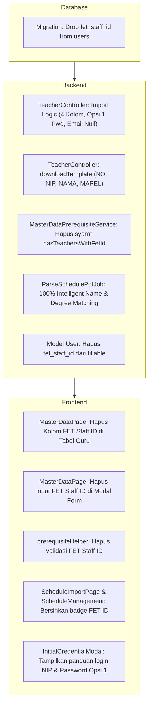

# DOKUMEN RENCANA ARSITEKTUR & IMPLEMENTASI
## REVISI SISTEM IMPORT PEGAWAI, AUTENTIKASI KREDENSIAL, DAN PENGHAPUSAN FET STAFF ID

> **Status:** Disetujui Pengguna (Menunggu Konfirmasi Eksekusi)  
> **Versi Dokumen:** 1.0  
> **Tanggal:** 4 November 2026  
> **Berkas Acuan Template:** `D:\MyUKK\SchoolClassProject\scp\MD\xlsx\Data_Pegawai_2026_Per_Juni_2026_FIX.xlsx`

---

## 1. Latar Belakang & Tujuan Revisi

Berdasarkan format template resmi terbaru dari pihak sekolah (`Data_Pegawai_2026_Per_Juni_2026_FIX.xlsx`), struktur data nominatif guru mengalami penyederhanaan:
1. Kolom `no_telp` dan `fet_staff_id` telah ditiadakan.
2. Kolom `email` tidak disertakan dalam berkas import.
3. Ketergantungan sistem terhadap atribut `fet_staff_id` dihapus secara menyeluruh dari basis data, logika bisnis, dan antarmuka pengguna.
4. Identitas login resmi bagi pegawai/guru ditetapkan menggunakan **NIP/NIK**, dengan mekanisme password awal dinamis yang aman, praktis, dan mewajibkan perubahan password saat login pertama kali (`must_change_password: true`).
5. Sesuai instruksi revisi pengguna, **sistem TIDAK membuat email tiruan/sintetis** (seperti `{nip}@guru.sch.id`). Kolom email disimpan bernilai `null` saat import, dan guru dapat menautkan/memperbarui email pribadi mereka secara mandiri melalui menu profil di kemudian hari.

---

## 2. Analisis Struktur Template Excel Terbaru

Pemeriksaan fisik terhadap berkas `Data_Pegawai_2026_Per_Juni_2026_FIX.xlsx` menghasilkan detail berikut:

- **Total Baris:** 93 baris.
  - **Baris 1:** Judul lembar (`"DATA NOMINATIF GURU"`).
  - **Baris 2:** Periode data (`"2026"`).
  - **Baris 3:** Baris Header Kolom (`NO`, `NIP`, `NAMA`, `MAPEL`).
  - **Baris 4 s.d. 93:** 90 baris data riil guru aktif.
- **Struktur Kolom Resmi:**
  1. `NO`: Nomor urut 1 sampai 90 (integer).
  2. `NIP`: Identitas resmi pegawai. Terisi 100% dan unik 100% (tidak ada baris kosong atau duplikat).
     - **78 Guru PNS/PPPK:** 18 digit format BKN (`YYYYMMDD YYYYMM G NNN`).
     - **12 Guru GTT/Honorer:** 16 digit format NIK KTP (`3402...`).
  3. `NAMA`: Nama lengkap guru beserta gelar akademik resmi (contoh: `SUNARSIH, S.Pd.`, `DINDA AYU DEWANTI, S.Kom`).
  4. `MAPEL`: Nama mata pelajaran yang diampu. Beberapa baris (contoh baris 90) bernilai string kosong `""` karena belum mengampu mapel definitif atau bertugas umum/staf.
- **Strategi Pembacaan Parser (Dynamic Header Detection):**
  Untuk mencegah kegagalan baca akibat baris judul lembar (baris 1 & 2), parser Spatie SimpleExcel akan memindai baris secara dinamis hingga menemukan baris yang memuat nilai kolom `nip` dan `nama`, lalu memproses baris data sesudahnya secara presisi.

---

## 3. Sistem Kredensial Login & Manajemen Password

### 3.1 Identitas Login (Username / ID)
- ID login resmi guru adalah **NIP / NIK** yang tersimpan di kolom `nis_nip`.
- Endpoint autentikasi `POST /api/auth/login` telah mendukung pencarian kredensial via `nis_nip`, sehingga proses login guru langsung kompatibel tanpa perlu mengubah skema routing autentikasi.

### 3.2 Mekanisme Password Awal (Opsi 1 - Terpilih)
Password awal dibuat secara deterministik dengan formula:
$$\text{Password Awal} = \text{"GuruSCP@"} + \text{4 Digit Terakhir NIP/NIK} + \text{"!"}$$

- **Contoh untuk Guru PNS:**
  - NIP: `197109021994012001` $\rightarrow$ Password Awal: `GuruSCP@2001!`
- **Contoh untuk Guru GTT/Honorer:**
  - NIK: `3403036308970002` $\rightarrow$ Password Awal: `GuruSCP@0002!`

### 3.3 Kebijakan Keamanan & Flag Wajib Ganti Password
1. **Hash Bcrypt:** Password disimpan di basis data menggunakan `Hash::make()` dengan algoritma Bcrypt.
2. **`must_change_password = true`:** Setiap akun guru hasil import otomatis diberi flag `must_change_password: true`.
3. **Lockdown Akses Pertama:** Saat guru login menggunakan password awal, backend mengembalikan status `must_change_password: true`. Frontend SCP (`ProtectedRoute.jsx` dan `AuthContext.jsx`) secara otomatis mengunci akses ke seluruh dashboard/fitur dan memaksa pengalihan (*force redirect*) ke halaman `/change-password`.
4. **Pencegahan Tebak-Tebakan Antar Rekan:** Karena akun langsung terkunci dan dipaksa mengganti password pribadi pada detik pertama login, risiko keamanan dari format password berpola langsung tereliminasi secara tuntas.

### 3.4 Kebijakan Data Email (Revisi Disepakati)
- **Tidak ada pembuatan email sintetis/sistem:** Kolom `email` diisi `null` pada saat proses import guru.
- Kolom `email` pada tabel `users` berstatus `nullable: true` (PostgreSQL), sehingga tidak memicu error *not-null constraint*.
- Guru dapat menautkan dan memverifikasi alamat email pribadi mereka secara mandiri melalui menu Pengaturan Profil di kemudian hari.

---

## 4. Perlindungan dan Kompatibilitas Akun Waka Kurikulum

### 4.1 Kondisi Database Saat Ini
Saat ini tabel `users` hanya memuat 2 akun administrator/Waka:
1. `id: 1` — **Waka Kurikulum** (`nis_nip: "12345678"`, `role: "vice_principal"`, `email: "waka@smkn1bantul.sch.id"`)
2. `id: 6320` — **Administrator Kurikulum** (`nis_nip: "admin123"`, `role: "vice_principal"`, `email: "admin@sch.id"`)

### 4.2 Aturan Proteksi Waka (Strict Guard)
1. **Isolasi Role:** Proses import data guru secara ketat hanya membuat dan memanipulasi baris dengan `role = 'teacher'`.
2. **Anti-Downgrade & Anti-Overwrite:**
   Jika suatu saat terdapat baris import yang memuat NIP yang bertabrakan dengan akun Waka/Admin (`role !== 'teacher'`):
   - Sistem **DILARANG** mengubah `role` akun tersebut menjadi `teacher`.
   - Sistem **DILARANG** me-reset password akun Waka tersebut.
   - Sistem hanya memperbarui profil (misal nama) atau melewatinya dengan catatan log informatif.
3. **Atomisitas Transaksi (`DB::transaction`):** Seluruh 90 data diimpor dalam satu blok transaksi database. Jika terjadi kegagalan validasi atau error pada baris tertentu, seluruh transaksi di-rollback sehingga akun Waka dan konsistensi data tetap aman 100%.

---

## 5. Rencana Perubahan Komponen Sistem

### 5.1 Perubahan Basis Data
- **Migration Baru:** `database/migrations/xxxx_xx_xx_xxxxxx_drop_fet_staff_id_from_users_table.php`.
  - Method `up()`: Menghapus index unik `users_fet_staff_id_unique` lalu menghapus kolom `fet_staff_id`.
  - Method `down()`: Menambahkan kembali kolom `fet_staff_id` (string, nullable, unique).

### 5.2 Perubahan Backend
1. **`app/Models/User.php`:**
   - Menghapus `'fet_staff_id'` dari properti `fillable`.
2. **`app/Http/Controllers/API/TeacherController.php`:**
   - `import()`:
     - Gunakan deteksi header dinamis.
     - Header wajib hanya: `nip`, `name`/`nama`. Header opsional: `mapel`/`mata_pelajaran`, `no`.
     - Validasi baris: NIP wajib & unik intra-sheet, nama wajib & maks 100 karakter. Mapel opsional (jika kosong, tidak membatalkan pembuatan akun).
     - Kolom `email`: diset `null`.
     - Kolom `phone_number`: diset `null`.
     - Password: `Hash::make('GuruSCP@' . substr($cleanNip, -4) . '!')`.
     - Flag: `must_change_password = true`.
   - `downloadTemplate()`:
     - Menghasilkan template Excel 4 kolom: `NO`, `NIP`, `NAMA`, `MAPEL` dengan contoh data yang relevan.
   - `store()` & `update()`:
     - Menghapus validasi dan persistensi `fet_staff_id`.
     - Menjadikan `phone_number` opsional (nullable).
3. **`app/Services/MasterDataPrerequisiteService.php`:**
   - Menghapus method atau kriteria pengecekan `hasTeachersWithFetId`.
   - Tombol upload jadwal PDF hanya mensyaratkan guru aktif ada di database, tanpa mengecek `fet_staff_id`.
4. **`app/Jobs/ParseSchedulePdfJob.php`:**
   - Menghapus dependensi pencocokan prioritas via `fet_staff_id`.
   - Mengoptimalkan algoritma pencocokan nama berbasis pembersihan gelar akademik (*academic title stripping*), pencocokan persis (*exact match*), dan pencocokan bagian (*substring match*).

### 5.3 Perubahan Frontend UI
1. **`src/pages/waka/MasterDataPage.jsx`:**
   - Menghapus kolom header dan baris `FET Staff ID` dari tabel master guru.
   - Menghapus field input `FET Staff ID` pada modal Tambah/Edit Guru.
   - Memperbarui teks panduan format import Excel (menjelaskan format 4 kolom: `NO`, `NIP`, `NAMA`, `MAPEL`).
2. **`src/utils/prerequisiteHelper.js`:**
   - Menghapus aturan `teachersWithFetId` agar status prasyarat upload jadwal PDF di frontend selaras dengan backend.
3. **`src/pages/waka/ScheduleImportPage.jsx` & `ScheduleManagementPage.jsx`:**
   - Membersihkan tampilan teks `[FET: ...]` pada dropdown dan badge guru pengganti.
4. **`src/pages/waka/components/InitialCredentialModal.jsx`:**
   - Menghapus baris tampilan FET Staff ID.
   - Menampilkan panduan kredensial resmi: Login menggunakan NIP, dan Password Awal menggunakan pola `GuruSCP@{4_angka_terakhir_NIP}!`.

---

## 6. Rencana Skenario Pengujian (Testing Plan)

### 6.1 Backend Automated Testing (PHPUnit)
1. **`TeacherImportTest`:**
   - `test_import_with_new_official_excel_template_succeeds`: Menguji import langsung berkas `Data_Pegawai_2026_Per_Juni_2026_FIX.xlsx`, memvalidasi 90 guru masuk ke database, `email` bernilai `null`, password sesuai formula Opsi 1, dan `must_change_password: true`.
   - `test_import_handles_empty_mapel_gracefully`: Memverifikasi guru pada baris dengan mapel kosong (baris 90) tetap berhasil diimpor tanpa error.
   - `test_waka_account_isolation_during_import`: Memverifikasi akun Waka (`12345678`) tidak terhapus, tidak tertimpa, dan role serta password-nya tetap utuh.
   - `test_duplicate_nip_validation_in_sheet`: Memverifikasi penolakan HTTP 422 dengan pesan error baris yang presisi jika terdapat NIP duplikat di file Excel.
2. **`MasterDataPrerequisiteTest`:**
   - `test_pdf_schedule_import_allowed_without_fet_staff_id`: Memastikan validasi prasyarat jadwal PDF lolos (HTTP 200) saat guru sudah diimpor meskipun tanpa atribut `fet_staff_id`.
3. **`AuthTest`:**
   - `test_teacher_login_with_nip_and_option_1_password`: Memverifikasi guru hasil import berhasil login menggunakan NIP dan password awal `GuruSCP@{4_digit_NIP}!`.
   - `test_teacher_must_change_password_flag_enforced`: Memverifikasi respons token login mengembalikan `must_change_password: true`.

### 6.2 Frontend & E2E Verification
1. **Kompilasi Frontend (`npm run build`):** Memastikan tidak ada error sintaks, referensi variabel hilang, atau breaking changes pada kode Vite/React.
2. **Verifikasi UI Master Data:**
   - Memastikan tab Guru menampilkan data bersih tanpa kolom FET Staff ID.
   - Menguji alur unduh template Excel baru (4 kolom).
   - Menguji unggah berkas `Data_Pegawai_2026_Per_Juni_2026_FIX.xlsx` via UI dan memverifikasi data tampil sempurna di tabel.
3. **Verifikasi Alur Login & Ganti Password:**
   - Login dengan salah satu NIP guru dan password awal `GuruSCP@{4_digit_NIP}!`.
   - Memastikan pengguna langsung diarahkan paksa ke halaman `/change-password`.
   - Setelah ganti password berhasil, memastikan akun dapat masuk ke dashboard guru.

---

## 7. Kriteria Keberhasilan Implementasi

| No | Parameter Keberhasilan | Target Hasil |
| :---: | :--- | :--- |
| 1 | **Skema Database** | Kolom `fet_staff_id` terhapus bersih dari tabel `users`, kolom `email` dan `phone_number` nullable. |
| 2 | **Import Excel Riil** | 90 guru dari `Data_Pegawai_2026_Per_Juni_2026_FIX.xlsx` berhasil diimpor 100% tanpa kendala baris judul atau mapel kosong. |
| 3 | **Kredensial Login** | Seluruh guru baru dapat login menggunakan NIP masing-masing dan password awal formula Opsi 1. |
| 4 | **Keamanan Akun** | Seluruh guru baru memiliki `must_change_password: true` dan wajib mengganti password pada login pertama. |
| 5 | **Integritas Email** | Tidak ada email palsu/sistem dibuat (`email: null`). Guru dapat melengkapi profil secara mandiri. |
| 6 | **Integritas Akun Waka** | Akun Waka Kurikulum (`12345678`) dan Admin (`admin123`) tetap utuh, aktif, dan tidak terganggu. |
| 7 | **Prasyarat Jadwal PDF** | Modul jadwal dan import PDF berjalan lancar tanpa memblokir ketiadaan `fet_staff_id`. |
| 8 | **Kompilasi Frontend** | Build frontend berhasil (*zero build errors*). |

---

## 8. Langkah Selanjutnya
Menunggu persetujuan akhir dari pengguna sebelum memulai eksekusi Fase 1 (Migrasi Database & Model).
