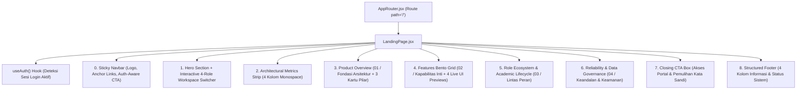

# Dokumen Perencanaan & Perancangan Desain Landing Page School Class Progress (SCP)

**Nama Proyek:** School Class Progress (SCP)  
**Institusi Target:** SMK Negeri 1 Bantul (Konteks Uji Kompetensi Keahlian / UKK RPL)  
**Versi Dokumen:** 1.0 (Design & Architectural Blueprint)  
**Tanggal Penyusunan:** 7 November 2026  
**Target Implementasi:** Frontend Website (`frontend/scp_web/`)  
**Referensi Inspirasi Struktural:** Linear Website (Komposisi Layout, Hierarki Tipografi, Whitespace, & Bento Product Showcase)  
**Identitas Visual yang Dipertahankan:** Exness Precision Clean — Light Enterprise (`tokens.css` & `global.css`)

---

## Daftar Isi

1. [Hasil Analisis Kondisi Project Saat Ini](#1-hasil-analisis-kondisi-project-saat-ini)
2. [Identitas Visual dan Design System yang Dipertahankan](#2-identitas-visual-dan-design-system-yang-dipertahankan)
3. [Konsep Desain Landing Page yang Diusulkan](#3-konsep-desain-landing-page-yang-diusulkan)
4. [Rancangan Layout Setiap Section Secara Berurutan (Wireframe)](#4-rancangan-layout-setiap-section-secara-berurutan-wireframe)
5. [Detail Elemen UI dan Informasi pada Setiap Section](#5-detail-elemen-ui-dan-informasi-pada-setiap-section)
6. [Rekomendasi Warna, Tipografi, Spacing, dan Komposisi Visual](#6-rekomendasi-warna-tipografi-spacing-dan-komposisi-visual)
7. [Rekomendasi Aset Visual & Preview Produk yang Dibutuhkan](#7-rekomendasi-aset-visual--preview-produk-yang-dibutuhkan)
8. [Rancangan Responsivitas (Desktop, Tablet, dan Mobile)](#8-rancangan-responsivitas-desktop-tablet-dan-mobile)
9. [Struktur Komponen dan Gambaran Teknis Implementasi](#9-struktur-komponen-dan-gambaran-teknis-implementasi)
10. [Tahapan Implementasi yang Disarankan & Ruang Lingkup Pekerjaan](#10-tahapan-implementasi-yang-disarankan--ruang-lingkup-pekerjaan)

---

## 1. Hasil Analisis Kondisi Project Saat Ini

Berdasarkan pemeriksaan menyeluruh terhadap kode sumber aktual pada `frontend/scp_web/` dan `scp/`, berikut adalah kondisi arsitektur antarmuka dan fungsional proyek saat ini:

### 1.1 Alur Rute Awal (`Root Route`) Saat Ini
- Pada `frontend/scp_web/src/routes/AppRouter.jsx` (Baris 118–120), rute akar `/` saat ini langsung melakukan *redirect* ke halaman login:
  ```jsx
  <Route path="/" element={<Navigate to="/login" replace />} />
  <Route path="*" element={<Navigate to="/login" replace />} />
  ```
- Proyek **belum memiliki halaman Landing Page publik** yang memperkenalkan fungsi sistem, alur kerja lintas peran, maupun kapabilitas unggulan sebelum pengguna masuk ke halaman `LoginPage.jsx`.

### 1.2 Identitas & Konteks Fungsional Proyek (Bukan Data Dummy)
- **Nama Sistem:** School Class Progress (SCP) — Sistem Manajemen Operasional Akademik Terpadu.
- **Institusi Target:** SMK Negeri 1 Bantul (dikembangkan dalam konteks Uji Kompetensi Keahlian / UKK RPL).
- **Arsitektur Sistem:** Headless REST API (Laravel 12/13 + PostgreSQL + Queue Worker + Python PDF Parser + Google Gemini AI) yang dikonsumsi oleh aplikasi Web (React 19 + Vite 8 + Tailwind CSS 4) dan Mobile (Flutter).
- **4 Peran Utama & 2 Penugasan Khusus:**
  1. **Waka Kurikulum (`vice_principal` / `waka`):**
     - Pengelolaan terpusat jadwal Putaran 1 & Putaran 2 dengan proteksi kata sandi (*Step-Up Authentication*).
     - Import otomatis 2 berkas PDF jadwal dari aplikasi FET (`Jadwal_Kelas.pdf` & `Jadwal_Ruangan.pdf`) berbasis *subprocess* Python dan *3-Tier Matching* (`Matched`, `Unmatched`, `Conflict`, `Duplicate`) serta pencocokan guru `TeacherMatcherService`.
     - Pengaturan status Hari Senin (`monday_is_upacara`: Upacara Bendera vs KBM Reguler) dan Tahun Ajaran/Semester aktif.
     - Manajemen Kalender Akademik (`holiday`, `school_event`, `class_event`, `exam`) dengan sakelar `disables_teaching` yang otomatis memblokir pembukaan jurnal KBM pada hari/kelas terdampak.
     - Pengelolaan 5 pilar Master Data (Kelas, Ruangan, Mata Pelajaran, Guru, Siswa) lengkap dengan fitur Import Excel, Matriks Penugasan Wali Kelas & BK, serta sistem *Smart Delete* / Tempat Sampah (*Recycle Bin* retensi 30 hari).
     - Simulasi pemetaan dan eksekusi Kenaikan Kelas (`X → XI → XII → Lulus/Alumni`) serta penandaan siswa tinggal kelas (*Hold Back*).
  2. **Guru Pengampu (`teacher`):**
     - Melihat jadwal mengajar *read-only* yang waktunya di-resolve secara dinamis melalui `period_templates`.
     - Membuka sesi Jurnal KBM (`ongoing`), mengambil foto dokumentasi KBM via kamera langsung (*WebRTC*) atau unggah file dengan kompresi ganda (di sisi client dan server menjadi $\le 800\text{px}$ JPEG quality 35%, target $< 150\text{KB}$).
     - Mengisi presensi siswa berbasis pengecualian (*Exception-Based Attendance*: guru cukup menandai siswa yang `Sakit`, `Izin`, atau `Alpa`; seluruh siswa aktif lainnya otomatis tercatat `Hadir`), tersinkronisasi otomatis dengan surat izin siswa yang telah disetujui (`approved_leaves`).
     - Mengajukan izin tidak mengajar beserta surat bukti dan **Instruksi Tugas Titipan** (*task instruction* & *attachment*) untuk guru pengganti.
     - Menyusun, mempublikasikan, dan mengevaluasi **Kuis Berbantuan AI (Google Gemini `gemini-3.1-flash-lite`)** melalui 3 metode pembuatan soal:
       - *Metode 1: Generator Prompt AI* (dengan validasi ketat komposisi jumlah Pilihan Ganda & Esai).
       - *Metode 2: Ekstraksi Dokumen Berbantuan AI* (unggah file PDF/TXT untuk diekstrak menjadi butir soal dengan penanda `needs_review`).
       - *Metode 3: Input Soal Manual* satu per satu.
     - Meninjau hasil koreksi otomatis Pilihan Ganda dan koreksi semantik Esai oleh AI, melakukan *Override Skor/Feedback* lengkap dengan *audit trail* (`is_overridden`, `overridden_by`, `overridden_at`), serta mempublikasikan hasil (`published_result`).
  3. **Guru Kesiswaan/BK (`kesiswaan`) & Wali Kelas (`wali_kelas`):**
     - Verifikasi persetujuan/penolakan pengajuan izin siswa (`tidak_masuk` maupun `keluar_sekolah`) dan izin mengajar guru.
     - Penandaan jam kosong (`teacher_absent`) apabila guru berhalangan hadir tanpa pengganti.
     - Pengambilan alih sesi kelas sebagai guru pengganti (`substitute_teacher_id`) beserta tampilan tugas titipan guru pengampu asli.
     - Monitoring rekapitulasi kehadiran dan jurnal KBM seluruh kelas binaan beserta fitur ekspor laporan ke format Microsoft Excel (`.xlsx`).
  4. **Siswa (`student`) & Orang Tua (`parent`):**
     - Melihat ringkasan persentase kehadiran pribadi, jadwal pelajaran harian/mingguan, dan kalender kegiatan sekolah.
     - Mengajukan perizinan mandiri (2 Tipe: `tidak_masuk` multi-hari & `keluar_sekolah` *same-day*; 2 Kategori: `sakit` wajib lampiran surat dokter & `lainnya`).
     - Mengerjakan Kuis AI aktif dengan timer hitung mundur, penyimpanan draf otomatis di `sessionStorage`, dan melihat nilai serta umpan balik AI setelah hasil dirilis.
     - Pemantauan transparan oleh Orang Tua melalui akun yang di-generate otomatis saat pendaftaran siswa (`P-{NIS}`).

### 1.3 Aset & Komponen Eksisting yang Dapat Digunakan Kembali (*Reusable*)
- **Komponen UI Bersama (`frontend/scp_web/src/components/shared/`):**
  - `Button.jsx` & `Button.css` (Varian: `primary`/`accent`, `dark`, `secondary`, `outline`, `ghost`, `danger`; Ukuran: `sm`, `md`, `lg`).
  - `Badge.jsx` & `Badge.css` (Varian: `default`, `neutral`, `primary`, `info`, `success`, `warning`, `danger` dengan dukungan `dot` indikator).
  - `Card.jsx` & `Card.css`, `StatCard.jsx` & `StatCard.css`, `RowCard.jsx` & `RowCard.css`.
  - `Tabs.jsx` & `Tabs.css`, `Table.jsx` & `Table.css`.
- **Utilitas CSS Global (`frontend/scp_web/src/styles/global.css` Baris 98–157):**
  - Indikator status bergaya Linear/Vercel: `.status-dot`, `.status-dot--success`, `.status-dot--warning`, `.status-dot--danger`, `.status-dot--info`, dan animasi `.status-dot--pulse`.
  - Garis aksen kartu: `.accent-border-top--*` dan `.accent-border-left--*`.
  - Elemen tombol keyboard `<kbd>` dan tipografi `.section-label-enterprise`.
- **Ikonografi:** Pustaka `lucide-react` (`^0.511.0`) yang sudah terpasang di `package.json`.
- **Hook Autentikasi:** `useAuth.js` (`src/hooks/useAuth.js`) untuk mendeteksi status autentikasi pengunjung secara langsung.

---

## 2. Identitas Visual dan Design System yang Dipertahankan

Seluruh rancangan Landing Page **wajib mematuhi** identitas visual **Exness Precision Clean (Light Enterprise)** yang didefinisikan pada `frontend/scp_web/src/styles/tokens.css` dan `global.css`. Kita **tidak menyalin warna latar gelap (dark mode) Linear**, melainkan mengadaptasi **struktur komposisi, ketajaman garis grid, hierarki tipografi, dan cara penyajian produk Linear** ke dalam sistem desain terang (Light Theme) milik SCP:

| Aspek Design System | Token / Spesifikasi Aktual Proyek SCP (`tokens.css`) | Penerapan pada Landing Page SCP |
|---|---|---|
| **Palet Latar Utama** | `--color-bg: #FFFFFF`<br>`--color-surface: #F9FAFB`<br>`--color-surface-hover: #F3F4F6` | Latar belakang utama halaman putih bersih (`#FFFFFF`), diselingi seksi dan kartu Bento berlatar `#F9FAFB` untuk menciptakan pemisahan visual yang bersih tanpa bayangan berat. |
| **Garis & Pembatas (*Hairline Grid*)** | `--color-border: #E5E7EB`<br>`--color-border-light: #F3F4F6`<br>Hover Border: `#CBD5E1` | Mengadaptasi gaya *exposed hairline grid* khas Linear (`1px solid #E5E7EB`) untuk membingkai seksi, matriks metrik, kartu fitur Bento, dan jendela simulasi aplikasi. |
| **Tipografi & Warna Teks** | `--color-text-primary: #0F172A` (Slate 900)<br>`--color-text-secondary: #64748B` (Slate 500)<br>`--color-text-muted: #94A3B8` (Slate 400) | Headline utama menggunakan `#0F172A` dengan *tight letter-spacing* (`-0.035em`), sub-narasi menggunakan `#64748B`, dan label penomoran teknis menggunakan `#94A3B8`. |
| **Warna Aksen Utama** | `--color-accent: #FFDE00` (Exness Yellow)<br>`--color-accent-hover: #FFE63B`<br>`--color-accent-text: #000000`<br>Varian Dark: `#0F172A` | Tombol CTA utama menggunakan `<Button variant="primary">` (`#FFDE00` dengan teks hitam `#000000` tebal) dan `<Button variant="dark">` (`#0F172A` teks putih). |
| **Warna Status Semantik** | Success: `#10B981` (`#ECFDF5`)<br>Warning: `#F59E0B` (`#FFFBEB`)<br>Danger: `#EF4444` (`#FEF2F2`)<br>Info: `#3B82F6` (`#F1F5F9`) | Digunakan secara fungsional pada *micro-preview UI* di dalam kartu fitur (contoh: badge `Matched` hijau pada preview Import PDF, `Hadir` hijau pada Jurnal KBM, dan `Kandidat 98%` kuning). |
| **Pasangan Font** | `--font-family: 'Plus Jakarta Sans', sans-serif`<br>`--font-family-mono: 'JetBrains Mono', monospace` | `Plus Jakarta Sans` untuk seluruh judul dan narasi; `JetBrains Mono` untuk nomor indeks seksi (`01`, `02`), jam pelajaran (`07:15 - 08:00`), kode NIS/NIP, dan statistik angka. |
| **Sudut & Elevasi** | `--radius-sm: 4px`, `--radius-md: 6px`, `--radius-lg: 8px`<br>`--shadow-dropdown: 0 4px 16px rgba(0,0,0,0.06)` | Sudut presisi tegas (`4px`–`8px`, bukan *pill* membulat penuh) dan elevasi datar (*flat architectural precision*). |

---

## 3. Konsep Desain Landing Page yang Diusulkan

### Tema Konsep: *"Architectural Academic Precision"*

Mengambil inspirasi dari cara **Linear** menyajikan sistem manajemen kerja yang kompleks menjadi tampak sangat terstruktur, tenang, dan berorientasi alur kerja (*workflow-driven*), Landing Page SCP dirancang dengan 4 pilar konsep utama:

1. **Penggantian Ilustrasi Generik dengan *Code-Rendered UI Micro-Mockups*:**
   Sebagaimana pada referensi Linear, setiap fitur tidak dijelaskan menggunakan gambar vektor/kartun generik, melainkan dengan **cuplikan komponen antarmuka asli SCP yang dirender secara langsung dengan HTML/CSS** (menggunakan komponen `Badge`, `.status-dot--pulse`, potongan matriks jadwal pelajaran, kartu presensi *exception-based*, dan widget koreksi Kuis AI).
2. **Sistem Penomoran Seksi Editorial (`01` s/d `04`):**
   Mengadopsi pola penomoran bab Linear menggunakan font `JetBrains Mono` dan kelas `.section-label-enterprise` (`01 / FONDASI ARSITEKTUR`, `02 / KAPABILITAS INTI`, `03 / EKOSISTEM LINTAS PERAN`, `04 / KEANDALAN & KEAMANAN`) untuk memandu alur baca pengunjung secara kronologis dari perencanaan kurikulum hingga evaluasi pembelajaran.
3. **Tata Letak *Exposed Hairline Grid* & *Bento Box*:**
   Memanfaatkan kontainer terpusat (`max-width: 1200px`) dengan garis pembatas struktural tipis (`1px solid #E5E7EB`) yang menyatukan seksi Hero, Metrics Bar, Overview, dan Bento Grid menjadi satu kesatuan arsitektural yang rapi.
4. **Navigasi & CTA yang Sadar Status Autentikasi (*Auth-Aware UX*):**
   Mengintegrasikan `useAuth()` sehingga apabila pengguna yang membuka Landing Page sudah memiliki sesi login aktif di browser, tombol aksi utama otomatis menyesuaikan dari *"Masuk ke Portal SCP"* menjadi *"Buka Dashboard Saya"* yang langsung mengarah ke rute peran masing-masing (`/web/dashboard`, `/teacher/dashboard`, `/student/home`, atau `/parent/monitoring`).

---

## 4. Rancangan Layout Setiap Section Secara Berurutan (Wireframe)

Berikut adalah tata letak vertikal (*vertical blueprint*) dari bagian paling atas hingga bagian kaki halaman:

```
+===================================================================================+
| [0] STICKY TOP NAVBAR (Tinggi: 56px, Backdrop Blur, Border Bottom 1px #E5E7EB)    |
|  [Logo SCP + Badge SMK N 1 Bantul]   [Fondasi] [Fitur] [Peran] [Keamanan] [Masuk] |
+===================================================================================+
|                                                                                   |
| [1] HERO SECTION (Editorial Headline + Framed Interactive 4-Role Workspace)       |
|  • Status Pill : [● SISTEM MANAJEMEN OPERASIONAL AKADEMIK TERPADU]                |
|  • Headline H1 : Satu sumber kebenaran untuk jadwal pelajaran, jurnal KBM,        |
|                  presensi kelas, dan evaluasi kuis AI.                            |
|  • Subheadline : Dirancang untuk ekosistem akademik SMK Negeri 1 Bantul.          |
|                  Mengotomatisasi ekstraksi jadwal PDF FET, menyederhanakan        |
|                  presensi harian berbasis pengecualian, & evaluasi Kuis AI.       |
|  • CTA Group   : [ Masuk ke Portal SCP → ] (Accent #FFDE00)  [ Jelajahi Modul ↓ ] |
|                                                                                   |
|  +-----------------------------------------------------------------------------+  |
|  | [FRAMED WORKSPACE SHOWCASE — Interactive Role Tab Switcher]                 |  |
|  | Tabs: [ 🏛️ Waka Kurikulum ] [ 👨‍🏫 Guru & Wali Kelas ] [ 🛡️ Kesiswaan ] [ 🎓 Siswa ] |
|  | +-------------------------------------------------------------------------+ |  |
|  | | Pratinjau UI Aktual Sesuai Tab yang Dipilih (Matriks / Jurnal / Kuis)   | |  |
|  | +-------------------------------------------------------------------------+ |  |
|  +-----------------------------------------------------------------------------+  |
+===================================================================================+
| [2] ARCHITECTURAL METRICS BAR (4-Column Exposed Hairline Grid, Bg #F9FAFB)        |
|  [ Putaran 1 & 2 ]  |  [ 5 Tipe Hari KBM ]  |  [ Exception-Based ]  |  [ Step-Up ]|
+===================================================================================+
|                                                                                   |
| [3] PRODUCT OVERVIEW ("Menghilangkan Fragmentasi Operasional Akademik")           |
|  Indeks: 01 / FONDASI ARSITEKTUR                                                  |
|  Kiri  : Judul Besar Editorial        | Kanan: Paragraf Penjelasan Masalah & Solusi|
|  +-------------------------+ +-------------------------+ +----------------------+ |
|  | Pilar 1: Sentralisasi   | | Pilar 2: Sinkronisasi   | | Pilar 3: Pemrosesan  | |
|  | Jadwal di Waka Kurikulum| | Izin ke Presensi Kelas  | | Asinkron Queue & AI  | |
|  +-------------------------+ +-------------------------+ +----------------------+ |
+===================================================================================+
|                                                                                   |
| [4] FEATURES & PRODUCT SHOWCASE SECTION (Bento Grid 2x2 dengan Live UI Snippets)  |
|  Indeks: 02 / KAPABILITAS INTI                                                    |
|  +---------------------------------------+-------------------------------------+  |
|  | BENTO A: Import Otomatis 2 PDF FET    | BENTO B: Jurnal KBM & Presensi      |  |
|  | • Narasi + Tabel Mini 3-Tier Matching | • Narasi + Kartu Sesi KBM Ongoing,  |  |
|  |   (Matched / Kandidat Guru / Shared)  |   Kompresi Foto & Exception Status  |  |
|  +---------------------------------------+-------------------------------------+  |
|  | BENTO C: Evaluasi Kuis Berbantuan AI  | BENTO D: Kalender & Tugas Titipan   |  |
|  | • Narasi + Widget 3 Metode Soal,      | • Narasi + Banner Eksklusi KBM      |  |
|  |   Skor Semantik Esai & Audit Override |   (`disables_teaching`) & Handover  |  |
|  +---------------------------------------+-------------------------------------+  |
+===================================================================================+
|                                                                                   |
| [5] WORKFLOW & ROLE ECOSYSTEM SECTION (Siklus Operasional Lintas Peran)           |
|  Indeks: 03 / EKOSISTEM LINTAS PERAN                                              |
|  Grid 4 Kartu Peran: [Waka Kurikulum] [Guru & Wali Kelas] [Kesiswaan] [Siswa/Ortu]|
|  Dilengkapi Alur Siklus Tahunan: Master Data → Jadwal → KBM → Evaluasi → Promosi  |
+===================================================================================+
|                                                                                   |
| [6] ADDITIONAL INFO: RELIABILITY & DATA GOVERNANCE (Keandalan & Tata Kelola Data) |
|  Indeks: 04 / KEANDALAN & KEAMANAN                                                |
|  Grid 4 Kartu: [Smart Delete & Recycle Bin 30 Hari] [Promosi & Retensi Alumni]    |
|                [Resolusi Jam Pelajaran Dinamis]     [Google SSO & Verifikasi OTP] |
+===================================================================================+
|                                                                                   |
| [7] CLOSING CTA SECTION (High-Contrast Precision Box)                             |
|  "Siap Mengelola Operasional Akademik dengan Presisi?"                            |
|  [ Masuk ke Sistem SCP → ]                 [ Pulihkan Kata Sandi Akun ]           |
+===================================================================================+
| [8] FOOTER (Multi-Column Informasi Institusi, Modul, Peran, & Status Operasional) |
+===================================================================================+
```

---

## 5. Detail Elemen UI dan Informasi pada Setiap Section

### Section 0: Sticky Top Navigation Bar (`LandingNavbar`)
- **Dimensi & Gaya:** Tinggi tetap `56px` (`var(--topbar-height)`), posisi `sticky top: 0`, `z-index: 40`, latar `rgba(255, 255, 255, 0.90)` dengan `backdrop-filter: blur(8px)`, border bawah `1px solid var(--color-border)`.
- **Bagian Kiri (Brand Identity):**
  - Simbol persegi `28x28px` (`border-radius: 6px`, latar `#0F172A`, teks `#FFDE00`, `font-mono`, `font-weight: 700`) bertuliskan `SCP`.
  - Teks merek **School Class Progress** (`14px`, `font-weight: 700`, `#0F172A`) berdampingan dengan `<Badge variant="neutral">SMK N 1 Bantul</Badge>`.
- **Bagian Tengah (Anchor Navigation — Desktop):**
  - 4 tautan navigasi internal: `Fondasi` (`#overview`), `Fitur Utama` (`#features`), `Ekosistem Peran` (`#roles`), dan `Keamanan` (`#security`).
- **Bagian Kanan (Action Controls):**
  - **Kondisi Belum Login:** Tautan teks `"Pemulihan Sandi"` (`/forgot-password`) dan tombol `<Button variant="primary" size="sm">Masuk Sistem</Button>` (`/login`).
  - **Kondisi Sudah Login (`isAuthenticated === true`):** Menampilkan `<Badge variant="success" dot>{user.name}</Badge>` dan `<Button variant="dark" size="sm">Buka Dashboard →</Button>` yang mengarahkan pengguna langsung ke `getHomeRoute()`.

---

### Section 1: Hero Section & Interactive Workspace Showcase (`HeroSection`)
- **Inspirasi Linear:** Mengadopsi komposisi tipografi tajam Linear di bagian atas yang langsung disambung dengan jendela pratinjau aplikasi berbingkai presisi.
- **Elemen Teks Hero:**
  1. **Label Status Atas:** Pill berbingkai `1px solid #E2E8F0` berlatar `#F8FAFC` dengan `.status-dot--success .status-dot--pulse` dan teks `PLATFORM OPERASIONAL AKADEMIK & KBM TERPADU` (`11px`, `JetBrains Mono`).
  2. **Headline Utama (`<h1>`):**
     *"Satu sumber kebenaran untuk jadwal pelajaran, jurnal KBM, dan evaluasi kelas."*
  3. **Deskripsi Singkat:**
     *"Menyatukan pengelolaan jadwal sistem putaran, ekstraksi otomatis dokumen PDF FET, presensi siswa berbasis pengecualian, hingga asesmen kuis berbantuan AI dalam satu arsitektur terpusat untuk SMK Negeri 1 Bantul."*
  4. **Grup Tombol CTA:**
     - Tombol Utama: `<Button variant="primary" size="lg">Masuk ke Portal SCP →</Button>` (menuju `/login` atau `getHomeRoute()`).
     - Tombol Sekunder: `<Button variant="outline" size="lg">Lihat Kapabilitas Sistem</Button>` (scroll halus ke `#features`).
     - Meta Info di bawah tombol: Teks mikro `Mendukung autentikasi NIP / NIS / Akun Orang Tua (P-NIS) & Google SSO`.

- **Visual Pendukung — *Interactive 4-Role Workspace Preview*:**
  - Sebuah bingkai jendela aplikasi (`border: 1px solid #E5E7EB`, `border-radius: 8px`, latar `#FFFFFF`, header bar setinggi `40px` berlatar `#F9FAFB`) yang dilengkapi **4 Tab Peran Interaktif** yang dapat diklik oleh pengunjung:
    1. **Tab 1: `Waka Kurikulum` (Default):**
       - Menampilkan bar kontrol atas: Badge `Putaran 1 (Aktif)`, Status Senin `Upacara Bendera (Jam ke-1: 08:00 WIB)`, Tahun Ajaran `2025/2026 Ganjil`, serta indikator `Step-Up Password Protected`.
       - Menampilkan cuplikan matriks jadwal kelas `XII RPL 1` & `XI TKJ 2` beserta kartu ringkasan hasil ekstraksi **Import 2 PDF FET** (`Matched: 142 Baris`, `Kandidat Guru: 3 Baris`, `Konflik Ruang: 0`).
    2. **Tab 2: `Guru & Wali Kelas`:**
       - Menampilkan kartu **Sesi Jurnal KBM Aktif (`ongoing`)** untuk mata pelajaran *Pemrograman Web & Perangkat Bergerak* di `XI RPL 1` (JP 1–4, `07:30 - 10:30 WIB`).
       - Menampilkan status kompresi foto dokumentasi kamera (`Terunggah • 800px JPEG • 86 KB`) dan daftar presensi *Exception-Based* di mana 34 siswa otomatis `Hadir` dan 2 siswa ditandai pengecualian (`Sakit` — otomatis terisi dari surat izin yang disetujui).
    3. **Tab 3: `Tim Kesiswaan / BK`:**
       - Menampilkan meja verifikasi perizinan terpusat: pengajuan izin siswa (`tidak_masuk` & `keluar_sekolah`) beserta tombol `Setujui` / `Tolak`, serta kartu **Izin Mengajar Guru** yang memuat *Instruksi Tugas Titipan* dan tombol `Ambil Alih Kelas (Substitute)` / `Tandai Jam Kosong`.
    4. **Tab 4: `Siswa & Orang Tua`:**
       - Menampilkan kartu ringkasan kehadiran siswa (`97.4% Hadir`), jadwal pelajaran hari ini, serta kartu hasil **Kuis Berbantuan AI** berstatus `Published Result` dengan rincian nilai Pilihan Ganda + umpan balik semantik Esai.

---

### Section 2: Architectural Metrics Bar (`MetricsStrip`)
- Baris pembatas struktural dengan 4 kolom (`border-top: 1px solid #E5E7EB`, `border-bottom: 1px solid #E5E7EB`, latar `#F9FAFB`):
  1. **`Putaran 1 & 2`** — Penyimpanan jadwal multi-siklus berdampingan dengan riwayat pergantian putaran (`cycle_history`) yang tercatat utuh.
  2. **`5 Tipe Hari Dinamis`** — Resolusi waktu jam pelajaran otomatis (`senin_upacara`, `senin_reguler`, `selasa`, `rabu_kamis`, `jumat`) lewat `period_templates`.
  3. **`Exception-Based`** — Pencatatan presensi atomik: guru hanya menginput pengecualian ketidakhadiran, mempercepat administrasi kelas.
  4. **`Step-Up Auth`** — Proteksi verifikasi ulang kata sandi Waka pada setiap aksi mutasi jadwal, konfirmasi import PDF, dan pengaturan siklus.

---

### Section 3: Product Overview (`ProductOverviewSection`)
- **Inspirasi Linear:** Mengadaptasi seksi pengantar filosofi produk Linear (*split 2-column header* diikuti 3 kartu vertikal).
- **Header Seksi:**
  - Label Indeks: `01 / FONDASI ARSITEKTUR` (`.section-label-enterprise .font-mono`).
  - Judul Kiri (`<h2>`): *"Menghilangkan fragmentasi data antara kurikulum, ruang kelas, dan orang tua."*
  - Narasi Kanan: *"Perubahan jadwal mingguan, rekapitulasi absen kertas, dan surat izin manual sering kali berjalan terpisah. SCP mengintegrasikan seluruh proses tersebut ke dalam satu alur kerja otomatis yang saling terhubung secara real-time."*
- **3 Kartu Pilar Utama (Menggunakan `.card` dengan `.accent-border-top--*`):**
  1. **Jadwal Terpusat & Bebas Bentrok** (`.accent-border-top--info`):
     Seluruh mutasi jadwal dikendalikan satu pintu oleh Waka Kurikulum dengan validasi prasyarat Master Data dan deteksi tabrakan guru, kelas, serta ruangan (termasuk pengecualian cerdas untuk fasilitas bersama seperti `Lapangan Olahraga / OR`).
  2. **Sinkronisasi Izin ke Jurnal KBM** (`.accent-border-top--success`):
     Permohonan izin siswa bertipe `tidak_masuk` yang telah diverifikasi oleh Kesiswaan langsung ter-pre-fill sebagai status default `Sakit` atau `Izin` saat guru membuka sesi jurnal di kelas.
  3. **Pemrosesan Asinkron untuk Beban Berat** (`.accent-border-top--warning`):
     Ekstraksi koordinat tabel PDF jadwal menggunakan Python dan pembuatan/penilaian esai Kuis AI dijalankan di latar belakang melalui *Queue Worker* tanpa membekukan antarmuka pengguna.

---

### Section 4: Features & Product Showcase Section (`FeaturesBentoSection`)
- **Inspirasi Linear:** Mengadaptasi kartu fitur Bento Linear yang memadukan teks penjelasan lugas dengan komponen UI fungsional di dalamnya.
- **Header Seksi:**
  - Label Indeks: `02 / KAPABILITAS INTI`
  - Judul (`<h2>`): *"Dirancang untuk presisi operasional harian sekolah kejuruan."*
- **Komposisi Bento Grid (2 Baris x 2 Kolom pada Desktop):**

#### Bento 1: Import Jadwal Otomatis dari 2 PDF FET & Resolusi Cerdas
- **Narasi:** Unggah berkas PDF Jadwal Kelas dan Jadwal Ruangan hasil ekspor aplikasi FET. Subprocess Python mengekstrak struktur sel tabel, mencocokkan nama guru melalui `TeacherMatcherService` (mendukung pencocokan persis, kamus alias, nama inti tanpa gelar, dan kemiripan fonetik), serta mendaftarkan ruangan/mapel baru secara otomatis.
- **Elemen UI Preview di Dalam Kartu:**
  - Daftar 3 baris hasil parsing (`ScheduleImportRow`):
    1. `X RPL 1 • Senin JP 1-4 • Pemrograman Dasar (R. Lab RPL 1)` $\to$ `<Badge variant="success" dot>Matched</Badge>`
    2. `XI DKV 2 • Selasa JP 5-8 • Kemiripan Nama Guru (98%)` $\to$ `<Badge variant="warning" dot>Pilih Kandidat</Badge>`
    3. `XII TKJ 1 • Jumat JP 1-2 • Pendidikan Jasmani (Lapangan OR)` $\to$ `<Badge variant="info">Shared Room Valid</Badge>`

#### Bento 2: Jurnal Mengajar KBM, Kompresi Kamera & Presensi Exception-Based
- **Narasi:** Guru membuka sesi kelas dengan satu klik, mendokumentasikan kegiatan belajar melalui kamera perangkat yang dikompresi otomatis ($\le 800\text{px}$ JPEG), dan mencatat presensi secara instan. Dilengkapi deteksi otomatis jadwal yang terlambat mengisi jurnal ($> 30\text{ menit}$ pasca-jam selesai).
- **Elemen UI Preview di Dalam Kartu:**
  - Simulasi antarmuka presensi kelas:
    - Baris 1: `12045 • Ahmad Fauzan Pratama` $\to$ Pill Aktif `Hadir` (Hijau)
    - Baris 2: `12046 • Anisa Rahmawati` $\to$ Pill Aktif `Sakit` + tag `Auto-sync Izin Kesiswaan`
    - Baris 3: `12048 • Dimas Prasetyo` $\to$ Pill Aktif `Izin` + catatan `"Lomba LKS Kabupaten"`
    - Baris Status Bawah: `Kompresi Foto KBM: 2.1 MB → 94 KB (JPEG 35%)`

#### Bento 3: Sistem Kuis Berbantuan AI & Evaluasi Esai Semantik
- **Narasi:** Mendukung 3 metode penyusunan soal: *Generator Prompt AI* (dengan validasi wajib komposisi Pilihan Ganda & Esai), *Ekstraksi Dokumen PDF/TXT* (mempertahankan konteks soal asli dan menandai soal ambigu dengan `needs_review`), serta *Input Manual*. Jawaban esai siswa dievaluasi secara semantik oleh AI berdasarkan rubrik guru, disertai fitur *Override Nilai* ber-audit trail.
- **Elemen UI Preview di Dalam Kartu:**
  - Simulasi kartu hasil evaluasi `GradeQuizSubmissionJob`:
    - Header: `Kuis Arsitektur MVC & REST API • Attempt #1` $\to$ `<Badge variant="success">Graded: 92 / 100</Badge>`
    - Detail: `Pilihan Ganda: 7/7 Benar` | `Esai Semantik AI: 85/100`
    - Umpan Balik AI: *"Konsep pemisahan Controller dan Service sudah tepat, namun perlu menyebutkan peran Middleware..."* + badge `Dapat Di-override Guru`.

#### Bento 4: Kalender Akademik, Eksklusi KBM & Manajemen Izin Berjenjang
- **Narasi:** Agenda kalender akademik dengan cakupan fleksibel (Seluruh Sekolah, Tingkat Kelas 10/11/12, atau Rombel Spesifik). Jika agenda ditandai `disables_teaching`, sistem otomatis menonaktifkan kewajiban pengisian jurnal dan mengecualikan jadwal dari peringatan keterlambatan. Mendukung izin mengajar guru lengkap dengan *Tugas Titipan* bagi guru pengganti.
- **Elemen UI Preview di Dalam Kartu:**
  - Simulasi banner eksklusi & kartu tugas titipan:
    - Banner Kalender: `Penilaian Akhir Semester Ganjil • Cakupan: Kelas 10, 11, 12` $\to$ `<Badge variant="danger">KBM Ditiadakan</Badge>`
    - Kartu Handover: `Guru Pengganti: Tim Kesiswaan / Wali Kelas` • `Instruksi Tugas: Kerjakan Latihan Basis Data Hal. 40 (Berkas PDF Terlampir)`.

---

### Section 5: Workflow & Role Ecosystem Section (`RoleWorkflowSection`)
- **Header Seksi:**
  - Label Indeks: `03 / EKOSISTEM LINTAS PERAN`
  - Judul (`<h2>`): *"Satu platform, enam perspektif peran yang saling bersinergi."*
- **Bagian A — Alur Siklus Akademik End-to-End (5 Tahap Berurutan):**
  1. `01. Master Data & Penugasan` (Import Excel Siswa/Guru, auto-create Kelas & Akun Ortu `P-NIS`, matriks Wali Kelas & BK).
  2. `02. Penyusunan & Import Jadwal` (Upload 2 PDF FET / input manual per Putaran 1 & 2, resolusi jam `period_templates`).
  3. `03. Pelaksanaan KBM Harian` (Buka jurnal, foto kamera terkompresi, presensi *exception-based*, sinkronisasi izin).
  4. `04. Asesmen AI & Monitoring` (Kuis AI 3 metode, verifikasi izin Kesiswaan, ekspor rekap `.xlsx`, portal Orang Tua).
  5. `05. Kenaikan Kelas & Kelulusan` (Simulasi promosi `X → XI → XII → Lulus`, penandaan *Hold Back*, auto-reset penugasan).
- **Bagian B — Grid 4 Kartu Peran & Hak Akses Spesifik:**
  - Menampilkan ringkasan kapabilitas untuk: **(1) Waka Kurikulum**, **(2) Guru Pengampu & Wali Kelas**, **(3) Guru Kesiswaan / BK**, dan **(4) Siswa & Orang Tua**, lengkap dengan daftar modul utama yang diakses oleh masing-masing peran.

---

### Section 6: Additional Information — Keandalan & Tata Kelola Data (`ReliabilitySection`)
- **Header Seksi:**
  - Label Indeks: `04 / KEANDALAN & KEAMANAN`
  - Judul (`<h2>`): *"Tata kelola data akademik yang aman dan terukur."*
- **Grid 4 Kartu Keunggulan Teknis:**
  1. **Smart Delete & Tempat Sampah (Recycle Bin 30 Hari):**
     Mencegah penghapusan tidak sengaja. Entitas Kelas, Guru, Siswa, Ruangan, atau Mapel yang masih direferensikan oleh jadwal aktif dilindungi dari penghapusan (HTTP 409), dan data yang dihapus disimpan di Tempat Sampah selama 30 hari sebelum pembersihan permanen.
  2. **Siklus Kenaikan Kelas & Retensi Lulusan 14 Hari:**
     Mendukung pemetaan rombel lanjutan (`next_class_id`), pencatatan riwayat kelas siswa (`student_class_histories`), serta penjadwalan otomatis penghapusan permanen data siswa lulusan 14 hari setelah `graduation_date`.
  3. **Tautan Akun Mandiri & Pemulihan Multi-Saluran:**
     Pengguna dapat menautkan akun Google (*Single Sign-On*), memverifikasi alamat email melalui kode OTP SMTP, serta menautkan nomor WhatsApp melalui OTP Fonnte untuk kemudahan pemulihan kata sandi mandiri.
  4. **Standar Respons RESTful & Rate Limiting:**
     Seluruh komunikasi API dilindungi oleh token Laravel Sanctum dengan masa kedaluwarsa terukur, *throttling* 60 permintaan/menit, serta pencegahan *N+1 query* melalui *in-memory caching* pada resolusi jam pelajaran dan kalender akademik.

---

### Section 7: Closing CTA Section (`ClosingCtaSection`)
- **Inspirasi Linear:** Seksi penutup yang bersih, fokus, dan memiliki kontras tegas sebelum memasuki Footer.
- **Desain Kontainer:** Kotak berbingkai `1px solid #0F172A` dengan latar `#0F172A` (teks putih) dan garis aksen atas `#FFDE00` setebal `4px` (`border-radius: 8px`, padding `48px 32px`).
- **Konten:**
  - Headline: *"Siap mengelola operasional kelas dan akademik secara terpadu?"*
  - Sub-teks: *"Masuk menggunakan NIP, NIS, ID Orang Tua (P-NIS), atau akun Google yang telah ditautkan pada profil Anda."*
  - Tombol Aksi:
    - `<Button variant="primary" size="lg">Masuk ke Portal SCP →</Button>` (`/login`)
    - `<Button variant="secondary" size="lg">Lupa Kata Sandi?</Button>` (`/forgot-password`)

---

### Section 8: Footer (`LandingFooter`)
- **Komposisi:** Latar `#FFFFFF`, border atas `1px solid #E5E7EB`, dibagi menjadi 4 kolom pada layar Desktop:
  1. **Kolom 1 (Identitas Sistem):** Logo `SCP`, judul **School Class Progress**, deskripsi singkat platform manajemen operasional akademik SMK Negeri 1 Bantul.
  2. **Kolom 2 (Modul Operasional):** Manajemen Jadwal & Import PDF FET, Jurnal Mengajar & Presensi KBM, Asesmen Kuis Berbantuan AI, Kalender Akademik, Kenaikan Kelas & Tempat Sampah.
  3. **Kolom 3 (Portal Pengguna):** Waka Kurikulum (`/web/dashboard`), Guru & Wali Kelas (`/teacher/dashboard`), Tim Kesiswaan & BK (`/teacher/permissions`), Siswa (`/student/home`), Orang Tua (`/parent/monitoring`).
  4. **Kolom 4 (Akses & Keamanan Akun):** Masuk Sistem (`/login`), Pemulihan Kata Sandi (`/forgot-password`), Pengaturan Profil & SSO (`/profile`).
- **Bottom Bar:** Hak cipta `© 2026 School Class Progress — SMK Negeri 1 Bantul` di sisi kiri, dan indikator `.status-dot--success` `REST API v4.6 • Timezone Asia/Jakarta (WIB)` di sisi kanan.

---

## 6. Rekomendasi Warna, Tipografi, Spacing, dan Komposisi Visual

Seluruh aturan gaya pada `LandingPage.css` wajib mengimpor dan menggunakan variabel dari `tokens.css` tanpa mendefinisikan ulang palet warna global:

### 6.1 Variabel Warna yang Digunakan
- **Background Utama:** `var(--color-bg)` (`#FFFFFF`)
- **Background Seksi Alternatif & Header Mockup:** `var(--color-surface)` (`#F9FAFB`)
- **Background Elemen Interaktif Hover:** `var(--color-surface-hover)` (`#F3F4F6`)
- **Garis Grid & Pembatas:** `var(--color-border)` (`#E5E7EB`) dan `var(--color-border-light)` (`#F3F4F6`)
- **Teks Utama:** `var(--color-text-primary)` (`#0F172A`)
- **Teks Sekunder:** `var(--color-text-secondary)` (`#64748B`)
- **Teks Muted / Nomor Indeks:** `var(--color-text-muted)` (`#94A3B8`)
- **Aksen Utama (CTA):** `var(--color-accent)` (`#FFDE00`) dengan teks `var(--color-accent-text)` (`#000000`)

### 6.2 Hierarki Tipografi Landing Page
| Elemen | Font Family | Ukuran (Desktop / Mobile) | Font Weight | Line Height & Tracking |
|---|---|---|---|---|
| **Hero Display (`h1`)** | `var(--font-family)` (`Plus Jakarta Sans`) | `48px` / `32px` | `700` (Bold) | `1.12` / `-0.035em` |
| **Section Heading (`h2`)** | `var(--font-family)` (`Plus Jakarta Sans`) | `32px` / `24px` | `700` (Bold) | `1.20` / `-0.025em` |
| **Card Title (`h3`)** | `var(--font-family)` (`Plus Jakarta Sans`) | `18px` / `16px` | `600` (SemiBold) | `1.35` / `-0.015em` |
| **Hero & Overview Lead** | `var(--font-family)` (`Plus Jakarta Sans`) | `16px` / `14.5px` | `400` (Regular) | `1.60` / `normal` |
| **Card Body Copy** | `var(--font-family)` (`Plus Jakarta Sans`) | `13.5px` (`var(--font-size-body)`) | `400` (Regular) | `1.55` / `normal` |
| **Section Index (`01`, `02`)** | `var(--font-family-mono)` (`JetBrains Mono`) | `11px` (`var(--font-size-micro)`) | `600` (SemiBold) | `1.25` / `0.06em` (Uppercase) |
| **Metric Value** | `var(--font-family-mono)` (`JetBrains Mono`) | `22px` / `18px` | `700` (Bold) | `1.20` / `-0.02em` |

### 6.3 Spacing & Komposisi Grid
- **Lebar Kontainer Maksimum:** `1200px` (`margin: 0 auto`, padding horizontal `24px` pada Desktop/Tablet, `16px` pada Mobile).
- **Jarak Antar-Seksi Vertikal:** `80px` pada Desktop, `56px` pada Tablet, dan `44px` pada Mobile.
- **Pola Komposisi Linear:**
  - Setiap seksi diawali oleh garis horizontal penuh (`1px solid #E5E7EB`) atau dipisahkan oleh perubahan latar `#FFFFFF` $\leftrightarrow$ `#F9FAFB`.
  - Kartu Bento menggunakan `border: 1px solid #E5E7EB`, `border-radius: 8px` (`var(--radius-lg)`), `padding: 28px`, dengan pemisahan rõ antara area teks di bagian atas dan area *UI Micro-Preview* berlatar `#F8FAFC` di bagian bawah kartu.

---

## 7. Rekomendasi Aset Visual & Preview Produk yang Dibutuhkan

Untuk menjaga keaslian representasi sistem, kecepatan muat halaman (*zero external heavy images*), dan ketajaman visual pada segala ukuran layar, seluruh preview produk direkomendasikan menggunakan **Komponen Mockup Berbasis Kode (*Code-Rendered Interactive Previews*)**:

1. **Interactive 4-Role Workspace Preview (Hero Section):**
   - State lokal `activeRoleTab` (`'waka' | 'teacher' | 'kesiswaan' | 'student'`).
   - Merender susunan kartu mini, tabel jadwal, dan badge status menggunakan kelas CSS asli proyek sehingga pengunjung dapat mengklik tab dan merasakan langsung kualitas antarmuka SCP sebelum login.
2. **4 Micro-Previews pada Bento Grid:**
   - **Mockup 1 (Import PDF FET):** Tabel 3 baris dengan badge `Matched`, `Kandidat 98%`, dan `Shared Room Valid`.
   - **Mockup 2 (Jurnal & Presensi):** Baris daftar siswa dengan pill status `Hadir`, `Sakit`, `Izin` dan indikator ukuran kompresi foto kamera.
   - **Mockup 3 (Kuis AI):** Kartu ringkasan skor Pilihan Ganda + kotak umpan balik esai semantik Gemini AI.
   - **Mockup 4 (Kalender & Handover):** Banner peringatan hari bebas KBM (`disables_teaching`) dan kartu instruksi tugas titipan guru.

---

## 8. Rancangan Responsivitas (Desktop, Tablet, dan Mobile)

| Dimensi Layar | Breakpoint CSS | Perilaku Tata Letak & Adaptasi UI |
|---|---|---|
| **Desktop** | `> 1024px` | • Navbar menampilkan logo, 4 tautan anchor tengah, dan grup tombol kanan secara lengkap.<br>• Hero Workspace Preview menampilkan bilah samping simulasi (*mini sidebar* `180px`) + area utama.<br>• Metrics Strip ditampilkan 4 kolom sejajar (`repeat(4, 1fr)`).<br>• Product Overview menggunakan *split header* 2 kolom (`5fr 7fr`) dan 3 kartu pilar sejajar (`repeat(3, 1fr)`).<br>• Bento Grid menggunakan tata letak 2 kolom (`repeat(2, 1fr)`), dan Role Ecosystem menggunakan 4 kolom (`repeat(4, 1fr)`). |
| **Tablet** | `768px – 1024px` | • Tautan anchor tengah pada Navbar tetap tampil dengan jarak lebih rapat (`gap: 16px`).<br>• Mini sidebar pada Hero Workspace Preview disembunyikan agar area tabel pratinjau tetap lega.<br>• Metrics Strip, Bento Grid, Role Ecosystem, dan Reliability Grid otomatis beradaptasi menjadi `2 kolom x 2 baris` (`repeat(2, 1fr)`).<br>• Product Overview Header ditumpuk vertikal, diikuti kartu pilar dalam grid responsif. |
| **Mobile** | `< 768px` | • Navbar menyembunyikan tautan anchor tengah agar tidak sempit, menyisakan **Logo SCP** di kiri dan tombol **`Masuk Sistem`** di kanan.<br>• Tombol CTA pada Hero Section disusun vertikal penuh (`width: 100%`).<br>• Tab pemilih peran pada Hero Workspace Preview mendukung geser horizontal (`overflow-x: auto`, `white-space: nowrap`).<br>• Seluruh grid (Metrics, Overview, Bento, Role Ecosystem, Reliability, dan Footer) beradaptasi menjadi **1 kolom vertikal penuh (`1fr`)** dengan padding kartu `20px`. |

---

## 9. Struktur Komponen dan Gambaran Teknis Implementasi

### 9.1 Struktur File yang Akan Dibuat / Diperbarui (Saat Tahap Implementasi Disetujui)
```
frontend/scp_web/src/
├── pages/
│   └── landing/
│       ├── LandingPage.jsx      # Komponen utama Landing Page beserta sub-seksi modular
│       └── LandingPage.css      # Stylesheet khusus Landing Page berbasis tokens.css
└── routes/
    └── AppRouter.jsx            # Pendaftaran lazy route '/' menuju LandingPage
```

### 9.2 Diagram Arsitektur Komponen `LandingPage.jsx`


### 9.3 Opsi Konfigurasi Routing pada `AppRouter.jsx` (Membutuhkan Keputusan Pengguna)
Saat ini pada `AppRouter.jsx`, rute `/` mengarah langsung ke `/login`. Terdapat 2 opsi integrasi rute Landing Page:
- **Opsi A (Direkomendasikan — Landing Page Selalu Dapat Diakses di `/`):**
  - Rute `/` merender `<LandingPage />` secara langsung di luar pembungkus `PublicRoute`.
  - Pengunjung yang belum login melihat tombol *"Masuk ke Portal SCP"* (`/login`), sedangkan pengguna yang sudah login tetap dapat melihat Landing Page dan melihat tombol *"Buka Dashboard Saya"* yang mengarah ke `getHomeRoute()`.
- **Opsi B (Landing Page Hanya untuk Pengunjung Belum Login):**
  - Rute `/` ditempatkan di dalam `<Route element={<PublicRoute />}>`, sehingga pengguna yang sudah login dan mengakses `/` akan otomatis diarahkan langsung ke dashboard masing-masing.

---

## 10. Tahapan Implementasi yang Disarankan & Ruang Lingkup Pekerjaan

Setelah dokumen perencanaan ini ditinjau dan disetujui, implementasi akan dilakukan melalui 4 tahap terukur tanpa mengubah kode Backend, Database, maupun halaman internal lainnya:

1. **Tahap 1 — Penyusunan Stylesheet `LandingPage.css`:**
   - Membangun sistem grid terekspos (*exposed hairline grid*), skala tipografi display responsif, bingkai jendela pratinjau aplikasi, kartu Bento, serta aturan *media queries* untuk Tablet (`1024px`) dan Mobile (`768px`) dengan memanfaatkan variabel `tokens.css`.
2. **Tahap 2 — Pembangunan Komponen `LandingPage.jsx`:**
   - Mengimplementasikan ke-8 seksi secara berurutan, termasuk state interaktif pemilih 4 peran pada Hero Workspace Preview dan ke-4 *UI Micro-Previews* pada Bento Grid menggunakan komponen bersama (`Button`, `Badge`) dan ikon `lucide-react`.
3. **Tahap 3 — Pembaruan Rute pada `AppRouter.jsx`:**
   - Menambahkan *lazy import* `const LandingPage = lazy(() => import('../pages/landing/LandingPage'));` dan memperbarui rute `/` sesuai opsi yang dipilih (Opsi A atau Opsi B).
4. **Tahap 4 — Pengujian Kualitas Kode (Lint & Production Build):**
   - Menjalankan `npm run lint` dan `npm run build` pada direktori `frontend/scp_web` untuk memastikan tidak ada *error* sintaks, *unused variables*, maupun masalah kompatibilitas bundel Vite.
