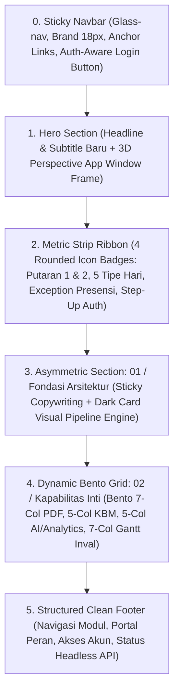

# Dokumen Perencanaan: Redesign Landing Page SCP Berdasarkan Referensi HTML

> **Status:** Menunggu Konfirmasi & Persetujuan Pengguna  
> **Target:** `frontend/scp_web/src/pages/landing/LandingPage.jsx` & `LandingPage.css`  
> **Design System:** *Exness Precision Clean* (Monokrom Slate, Aksen Emas `#FFDE00`, Permukaan `#FFFFFF` / `#F8FAFC`)  
> **Tipografi:** Tunggal (*Plus Jakarta Sans* pada seluruh elemen)  

---

## 1. Hasil Analisis File HTML Referensi

File referensi HTML (`Page: SCP SMKN 1 Bantul - Dynamic Bento Features`) memperkenalkan pola visual modern bertaraf SaaS kelas dunia (*Linear/Vercel style*), dengan karakteristik utama sebagai berikut:

1. **Komposisi Layout & Hierarki Visual:**
   - **Hero Section:** Judul editorial yang bersih, headline H1 terfokus, dan preview aplikasi melayang (*Elevated 3D Perspective Card* dengan `perspective(1200px) rotateX(4deg)` serta hover transition halus).
   - **App Window Frame:** Header jendela browser lengkap dengan 3 kontrol dot (merah, kuning, hijau), mock URL `scp.smkn1bantul.sch.id/dashboard`, dan indikator badge `LIVE SYNC: AKTIF`.
   - **Metric Ribbon:** Pita metrik horizontal 4 kolom yang memisahkan hero dan konten dengan kartu mini ber-icon rounded badge (`w-12 h-12 rounded-2xl`).
   - **Asymmetric Split Section (01 / Fondasi Arsitektur):**
     - Sisi Kiri (*Sticky*): Headline filosofis arsitektur sekolah vokasi dan daftar ceklis kapabilitas.
     - Sisi Kanan: Kartu gelap (*Dark Card* `bg-slate-900`) yang memvisualisasikan alur pipeline sistem (*Visual Flow: Engine SCP*) dengan garis putus-putus vertikal 4 tahap.
   - **Dynamic Bento Grid (02 / Kapabilitas Inti):**
     - Menggunakan sistem grid 12 kolom asimetris:
       - **Bento 1 (7 Kolom):** Engine Ekstraksi PDF FET (Dropzone berkas ganda + jendela terminal interaktif dengan efek *typing* dan kursor berkedip).
       - **Bento 2 (5 Kolom):** Live Feed KBM & Presensi Atomik (thumbnail kamera blur, status berjalan, tombol hitung cepat presensi, dan progress ring sinkronisasi 97%).
       - **Bento 3 (5 Kolom):** Analitik & Visualisasi Grafik Tren Harian (Sparkline area SVG dengan gradien halus).
       - **Bento 4 (7 Kolom):** Kalender Akademik & Resolusi Tugas Inval (Gantt chart strip jam JP 1-10 dan kartu resolusi otomatis mutasi guru inval).
   - **Footer:** Tampilan minimalis berorientasi teknis dengan teks hak cipta, badge versi sistem, dan tautan kebijakan.

2. **Elemen yang Perlu Disesuaikan / Ditolak dari Referensi HTML:**
   - **Palet Warna Biru (`#4361EE`):** **DITOLAK SECARA MUTLAK.** Referensi menggunakan electric blue yang bertabrakan dengan identitas visual project kita. Seluruh elemen biru wajib dipetakan ke palet *Exness Precision Clean* kita (Dark Slate `#0F172A`, Slate `#1E293B`, Aksen Emas `#FFDE00`, dan semantic Emerald/Amber).
   - **Font Campuran (Inter & JetBrains Mono):** **DISESUAIKAN.** Sesuai instruksi pengguna sebelumnya, seluruh halaman Landing Page wajib **100% menggunakan satu font saja: Plus Jakarta Sans**.
   - **Simulasi UI Generik (Aksara Jawa Toggle):** **DISESUAIKAN.** Fitur toggle Aksara Jawa pada Bento 3 referensi tidak ada di backend SCP. Bagian ini akan diganti dengan kapabilitas asli SCP yang sangat berharga: **Asesmen Kuis AI Gemini (Semantic Grading Rubric)** atau **Analisis Rasio Keterisian Lab & Kelas**.
   - **Closing CTA Box Biru:** **DITIADAKAN.** Pada iterasi sebelumnya, pengguna secara eksplisit meminta bagian kotak CTA penutup dihapus agar alur landing page langsung bermuara ke footer. Keputusan ini akan tetap dipertahankan.

---

## 2. Kondisi dan Struktur Landing Page Saat Ini

- **Lokasi Komponen:** [`frontend/scp_web/src/pages/landing/LandingPage.jsx`](file:///d:/MyUKK/SchoolClassProject/frontend/scp_web/src/pages/landing/LandingPage.jsx) dan [`LandingPage.css`](file:///d:/MyUKK/SchoolClassProject/frontend/scp_web/src/pages/landing/LandingPage.css).
- **Routing:** Didaftarkan secara lazy-loaded di [`AppRouter.jsx`](file:///d:/MyUKK/SchoolClassProject/frontend/scp_web/src/routes/AppRouter.jsx) pada root path `/` dan `/landing`.
- **Integrasi Autentikasi:** Menggunakan hook `useAuth()` untuk tombol dinamis di navbar:
  - *Guest (Belum Login):* Menampilkan tombol tunggal `Login` (kuning/dark) yang mengarah ke `/login`.
  - *Authenticated (Sudah Login):* Menampilkan badge nama pengguna dan tombol `Buka Dashboard →` yang mengarah ke rute peran masing-masing (`getHomeRoute()`).
- **Status Elemen Terkini:**
  - Logo kotak hitam "SCP" telah dihapus dari navbar dan footer atas permintaan pengguna.
  - Teks brand navbar `School Class Progress` telah diperbesar ke `18px bold`.
  - Tombol "Lupa Sandi?" pada navbar telah dihapus.
  - Headline utama telah diperbarui menjadi: **"Sistem Informasi KBM & Akademik SMK Negeri 1 Bantul"**.
  - Sub-headline telah diperbarui menjadi: **"Semua kebutuhan operasional belajar-mengajar kini terhubung dalam satu sistem yang rapi, akurat, dan mudah digunakan oleh seluruh warga sekolah."**
  - Kotak CTA penutup telah dihapus dari halaman.

---

## 3. Perbandingan Desain Saat Ini vs Desain Referensi

| Bagian Halaman | Desain Saat Ini | Desain Referensi HTML | Rencana Desain Baru (Sintesis) |
| :--- | :--- | :--- | :--- |
| **Navbar** | Sticky putih flat, menu anchor tengah, tombol Login | Glassmorphism blur (`glass-nav`), tinggi 80px, rounded button | Pertahankan teks brand `School Class Progress` 18px (tanpa logo SCP), navigasi anchor halus, tombol `Login` beraksen emas/dark dengan ikon panah. |
| **Hero Title & Subtitle** | Headline baru SMK N 1 Bantul + teks deskriptif | Badge status pill + H1 + Subtitle | Terapkan H1 dan Subtitle baru yang sudah disepakati, tanpa badge status pill di atasnya (sesuai revisi sebelumnya). |
| **Hero Preview Window** | Tab bar 4 role datar (*flat mockup cards*) | Kartu 3D melayang (*3D perspective tilt* `rotateX(4deg)`), window frame 3 dots, grid 12 kolom (stats sidebar + tabel KBM) | **Adopsi 3D Perspective Window Frame** dengan browser header dots, live sync pulse badge, dan data aktual SCP (Matched 102/102, Presensi 98.4%, verifikasi KBM kelas nyata RPL, TKJ, DKV). |
| **Pita Metrik (Ribbon)** | 4 kolom border grid minimalis | 4 kartu rounded badge dengan background warna lembut (`bg-amber-50`, `bg-emerald-50`, dll.) | **Adopsi Rounded Icon Badge Ribbon**, menggunakan ikon `lucide-react` dengan warna lembut bertema Exness Clean. |
| **Seksi 01 (Arsitektur)** | 3 kartu pilar sejajar horizontal | Asymmetric Split: Sticky left text + Dark Card `Visual Flow: Engine SCP` vertikal timeline | **Adopsi Asymmetric Split & Engine Pipeline**, memvisualisasikan alur backend SCP: Ekstraksi PDF &rarr; Parser Koordinat &rarr; Resolusi Bentrok &rarr; Verifikasi Jurnal KBM. |
| **Seksi 02 (Bento Grid)** | 4 kartu bento 2x2 reguler | 4 kartu bento asimetris 12 kolom: Col 7 (Terminal + Dropzone), Col 5 (Live KBM), Col 5 (Analytics), Col 7 (Gantt Inval) | **Adopsi Komposisi 12-Kolom Bento**, diperkaya interaktivitas realistis dan data backend SCP nyata. |
| **Seksi Penutup (CTA)** | Dihapus (Seksi 6 langsung ke Footer) | Kotak biru solid | **Tetap Dihapus**, halaman mengalir anggun langsung ke footer terstruktur. |
| **Footer** | Footer terstruktur 4 kolom bersih | Footer 1 baris | **Pertahankan Footer Terstruktur 4 Kolom**, tanpa logo kotak SCP (murni teks `School Class Progress` bold), dengan indikator status API headless di bawahnya. |

---

## 4. Rencana Perubahan Layout & Setiap Section



### Detail Seksi-seksi Baru:

1. **Section 0: Sticky Glass Navbar**
   - Brand kiri: `School Class Progress` (18px, font Plus Jakarta Sans, tanpa icon box SCP).
   - Menu tengah: Anchor jump links (*Fondasi*, *Fitur Utama*, *Keamanan*).
   - Tombol kanan:
     - Jika Guest: Tombol `Login` (`variant="primary"` kuning emas `#FFDE00` atau `variant="dark"`).
     - Jika Login: Badge Nama Siswa/Guru/Waka + Tombol `Buka Dashboard →`.

2. **Section 1: Hero Section & 3D Perspective App Window Frame**
   - Headline H1: `Sistem Informasi KBM & Akademik SMK Negeri 1 Bantul` (Plus Jakarta Sans 800, clamp 36px–64px).
   - Sub-headline: *"Semua kebutuhan operasional belajar-mengajar kini terhubung dalam satu sistem yang rapi, akurat, dan mudah digunakan oleh seluruh warga sekolah."*
   - **Hero App Window Frame:**
     - Efek CSS: `.hero-perspective` (`perspective(1200px) rotateX(4deg)`, hover `rotateX(1deg) translateY(-8px)`).
     - Titlebar jendela: 3 kontrol dot macOS (`bg-rose-400`, `bg-amber-400`, `bg-emerald-400`), mock URL pill `scp.smkn1bantul.sch.id/dashboard`, dan badge `LIVE SYNC: AKTIF` dengan radar dot hijau berkedip.
     - Konten Dalam Jendela (Grid 12-kolom):
       - *Sidebar 3-kolom:* Kartu statistik ringkas (Matched Jadwal: 102/102 progress bar hijau; Presensi KBM Guru: 98.4% progress bar biru) dan kartu otorisasi Waka Kurikulum.
       - *Main Content 9-kolom:* Tabel sesi KBM real-time (Kelas XII RPL 1, XI TKJ 2, X DKV 1 dengan mata pelajaran nyata, guru nyata, dan badge status `VERIFIED` hijau atau `IN PROGRESS` kuning).

3. **Section 2: Metric Strip Ribbon**
   - Mengadopsi tata letak pita kartu mini dengan rounded icon box (`w-12 h-12 rounded-2xl`):
     - **Putaran 1 & 2:** Ikon `RefreshCcw`, badge soft slate/blue, label "Dual-Cycle Sync".
     - **5 Tipe Hari:** Ikon `CalendarRange`, badge soft amber, label "Dynamic Scheduling".
     - **Exception-Based:** Ikon `Zap`, badge soft emerald, label "Atomic Monitoring".
     - **Step-Up Auth:** Ikon `ShieldCheck`, badge soft slate, label "Level 3 Security".

4. **Section 3: Asymmetric Split Section (01 / Fondasi Arsitektur)**
   - **Sisi Kiri (Sticky 50%):**
     - Tag: `01 / FONDASI ARSITEKTUR` (emas/slate, uppercase tracking lebar).
     - Judul: *"Menghilangkan fragmentasi data antara kurikulum, ruang kelas, dan orang tua."*
     - Paragraf: Penjelasan integrasi database terpusat SMK N 1 Bantul.
     - 2 Kartu Fitur Ceklis: Sinkronisasi Izin Guru ke Jurnal KBM & Pemrosesan Asinkron Queue.
   - **Sisi Kanan (50% Dark Engine Card):**
     - Kartu berlatar gelap elegan (`#0F172A`) dengan border halus `#1E293B`.
     - Header: `Visual Flow: Engine SCP`.
     - Vertical Stepper (garis putus-putus dengan 4 node interaktif):
       1. **PDF Upload:** Ekstraksi berkas PDF FET dari Tim Kurikulum.
       2. **Parser Engine:** Deteksi koordinat grid tabel dan validasi nama guru via `TeacherMatcherService`.
       3. **Conflict Check:** Resolusi tabrakan ruang (Lab vs Kelas Teori).
       4. **Verified Badge:** Jadwal terbit dan otomatis terdiseminasi ke Jurnal Guru masing-masing.

5. **Section 4: Feature Bento Grid (02 / Kapabilitas Inti)**
   - Mengadopsi susunan asimetris 12 kolom dari referensi HTML:
     - **Bento 1 (7 Kolom) &mdash; Parser Engine PDF FET Otomatis:**
       - Dropzone interaktif dengan berkas nyata: `jadwal_kelas_sem2.pdf` & `jadwal_ruang_sem2.pdf`.
       - Jendela Terminal Gelap (`bg-slate-950`) dengan preview log eksekusi nyata:
         ```bash
         $ scp-engine --process inputs/
         [1] Parsing cell coordinate matrices (142 JP)...
         [2] Running TeacherMatcherService (Levenshtein match > 0.85)...
         [3] 42 classes identified. 0 room conflicts detected.
         [v] Database committed cleanly [Execution complete]
         ```
       - Dilengkapi kursor terminal berkedip (*blinking cursor*).
     - **Bento 2 (5 Kolom) &mdash; Jurnal KBM & Presensi Atomik Real-Time:**
       - Header dengan indikator sesi berjalan live dot pulse.
       - Mock sesi aktif: `XII RPL 1 • Pemrograman Web Backend • Sisa Waktu 01:24:10`.
       - Bukti dokumentasi kamera KBM terkompresi.
       - Tiga tombol counter presensi: `Hadir: 34`, `Izin: 1`, `Alfa: 0`.
       - SVG Circular Progress Ring 97% sinkronisasi data presensi.
     - **Bento 3 (5 Kolom) &mdash; Analitik KBM & Evaluasi Kuis AI Gemini:**
       - Menyesuaikan referensi generic dengan fitur unggulan SCP: Asesmen esai otomatis menggunakan Google Gemini API.
       - Header: Evaluasi Esai Berbantuan AI.
       - Metrik: Waktu respon penilaian (< 1.8 detik), akurasi semantic rubric matching 94.6%.
       - SVG Sparkline Area Chart dengan gradien halus menampilkan distribusi nilai formatif siswa.
     - **Bento 4 (7 Kolom) &mdash; Kalender Akademik 5 Tipe Hari & Resolusi Tugas Inval:**
       - Visual Gantt strip interaktif jam pelajaran harian (JP 1 sampai JP 10).
       - Visualisasi dinamis: Jam 1-2 Berjalan normal, Jam 3 Guru Izin Dinas Luar, Jam 4 Otomatis Inval (*Tugas Terdistribusi ke Guru Piket*), Jam 5-6 Istirahat/Normal.
       - Kartu resolusi konflik otomatis: Menampilkan peralihan tugas mengajar dari Guru Izin ke Guru Inval yang bertugas.

6. **Section 5: Structured Footer**
   - Mempertahankan susunan navigasi 4 kolom yang rapi (*Modul Sistem*, *Portal Pengguna*, *Akses Akun*, *Legal/Copyright*).
   - Menghapus kotak logo SCP (hanya teks brand `School Class Progress` tebal).
   - Menampilkan status API headless v4.6 & zona waktu WIB.

---

## 5. Rencana Penerapan Palet Warna & Design System

Sesuai instruksi mutlak dari pengguna: **TIDAK menggunakan warna biru `#4361EE` dari referensi HTML.** Seluruh warna dipetakan ke sistem warna Exness Precision Clean yang telah disetujui sebelumnya:

| Token Desain | Nilai Hex / CSS | Pemetaan Elemen pada Redesign |
| :--- | :--- | :--- |
| `--color-bg` | `#FFFFFF` | Latar belakang utama halaman & kartu bento putih. |
| `--color-surface` | `#F8FAFC` | Latar belakang kanvas sekunder, dropzone, dan ribbon. |
| `--color-text-primary` | `#0F172A` | Judul H1, judul seksi, judul kartu bento, teks tombol dark. |
| `--color-text-secondary` | `#475569` / `#64748B` | Sub-headline, paragraf deskriptif, teks sekunder tabel. |
| `--color-text-muted` | `#94A3B8` | Label tanggal, timestamp, dan catatan kaki. |
| `--color-border` | `#E2E8F0` / `#CBD5E1` | Garis tepi kartu bento, separator tabel, dan border container. |
| `--color-accent` | `#FFDE00` | Aksen warna emas untuk highlight tombol login atau status aktif terpilih. |
| `--color-dark-panel` | `#0F172A` / `#020617` | Latar belakang kartu gelap pipeline arsitektur dan jendela terminal code snippet. |
| Semantic Success | `#10B981` (Emerald) | Badge `LIVE SYNC: AKTIF`, status `VERIFIED`, counter hadir. |
| Semantic Warning | `#F59E0B` (Amber) | Badge `IN PROGRESS`, blok jadwal Inval, guru izin dinas. |
| Semantic Danger | `#EF4444` (Rose) | Dot penutup jendela browser, counter siswa alfa. |

---

## 6. Rencana Penyesuaian Simulated Product UI / Micro-UI

Seluruh preview antarmuka dan data tiruan disesuaikan 100% dengan database, model, dan alur kerja aplikasi SCP:

1. **Struktur Data Tabel Jadwal:**
   - Menggunakan kelas riil SMK N 1 Bantul: `XII RPL 1`, `XI TKJ 2`, `X DKV 1`.
   - Menggunakan mata pelajaran kurikulum vokasi nyata: *Pemrograman Web Backend*, *Administrasi Infrastruktur Jaringan*, *Dasar Desain Komunikasi Visual*.
2. **Pipeline Parser FET PDF:**
   - Menampilkan pemanggilan riil service backend: `TeacherMatcherService` (dengan ambang skor kecocokan string > 0.85).
   - Memvalidasi pembagian 2 berkas PDF: jadwal kelas dan jadwal ruang lab.
3. **Presensi Exception-Based:**
   - Menampilkan mekanisme bawaan SCP di mana seluruh siswa default hadir (34 hadir), dan guru hanya mengklik siswa yang berhalangan (1 izin, 0 alfa).
   - Sinkronisasi otomatis dengan perizinan yang disetujui tim Kesiswaan / BK.
4. **Kalender & Inval:**
   - Resolusi penugasan inval sesuai model database `leaves` & `inval_assignments`.
   - Templating 5 tipe hari: `reguler_10`, `reguler_11`, `jumat`, `upacara`, `literasi`.

---

## 7. Daftar Komponen yang Perlu Dibuat, Diperbarui, atau Dipertahankan

- **Komponen & File yang Dipertahankan:**
  - `src/routes/AppRouter.jsx` &mdash; Tidak ada perubahan routing, tetap mempertahankan root lazy loading.
  - `src/hooks/useAuth.js` &mdash; Tetap digunakan untuk deteksi autentikasi dinamis di navbar.
  - `src/components/shared/Button.jsx` & `Badge.jsx` &mdash; Tetap digunakan sebagai komponen tombol & badge standar project.
  - Tautan ikon `lucide-react` &mdash; Menggunakan library bawaan project tanpa perlu menyuntikkan script eksternal Iconify CDN.

- **File yang Diperbarui:**
  - `src/pages/landing/LandingPage.jsx` &mdash; Mengganti struktur JSX dengan arsitektur layout baru (Hero 3D Window, Ribbon Badges, Asymmetric Engine Pipeline, dan 12-Column Bento Grid).
  - `src/pages/landing/LandingPage.css` &mdash; Menyusun ulang styling CSS modern (`hero-perspective`, terminal typing, bento 12-col grid, glass-nav) dengan tetap mempertahankan warna Exness Clean dan font tunggal Plus Jakarta Sans.

---

## 8. Rencana Responsivitas dan Interaksi

1. **Desktop Viewport (> 1024px):**
   - Hero 3D window tampil dengan sudut elevasi 4 derajat dan efek hover relaxation.
   - Seksi 01 split 50:50 dengan sisi kiri sticky saat menggulir pipeline di sisi kanan.
   - Bento grid tersusun penuh dalam 12 kolom (7:5 dan 5:7).
2. **Tablet Viewport (768px – 1024px):**
   - Elevasi 3D dinetralkan menjadi 0 derajat demi kemudahan membaca.
   - Seksi 01 mengalir secara vertikal bersusun (kiri di atas, kanan di bawah).
   - Bento grid bertransformasi menjadi 2 kolom simetris.
3. **Mobile Viewport (< 768px):**
   - Seluruh grid bento, ribbon, dan app preview reflow menjadi 1 kolom penuh (*single column stack*).
   - Terminal dropzone bersusun vertikal.
   - Seluruh tabel mockup dilengkapi `overflow-x: auto` dengan scrollbar halus.
   - Menu anchor navbar disembunyikan, menyisakan teks brand dan tombol `Login`.

---

## 9. Identifikasi Risiko dan Mitigasi

| Potensi Risiko | Tingkat Risiko | Strategi Mitigasi |
| :--- | :---: | :--- |
| **Ketergantungan Eksternal (Iconify CDN)** | Rendah | Mengganti seluruh tag `<iconify-icon>` dari referensi HTML dengan komponen `lucide-react` bawaan project (`GraduationCap`, `CheckCircle2`, `RefreshCcw`, `Terminal`, dll.) agar tidak bergantung pada koneksi CDN eksternal. |
| **Ketidakkonsistenan Warna** | Sedang | Menghapus seluruh kelas `bg-[#4361EE]` dan warna biru referensi. Menggantinya secara ketat dengan token warna Exness Clean (`#0F172A`, `#FFDE00`, `#F8FAFC`). |
| **Performa Animasi 3D pada GPU Rendah** | Rendah | Menggunakan `transform: perspective() rotateX()` dengan `will-change: transform` dan menonaktifkan 3D tilt pada viewport tablet/mobile melalui media query. |
| **Dampak ke Halaman Lain** | Nol | Seluruh perubahan terisolasi 100% pada folder `src/pages/landing/` (`LandingPage.jsx` dan `LandingPage.css`). Tidak ada komponen global atau halaman portal lain yang diubah. |

---

## 10. Tahapan Implementasi yang Disarankan

1. **Tahap 1: Persiapan CSS & Token Styling (`LandingPage.css`)**
   - Menambahkan utilitas kelas visual baru: `.glass-nav`, `.hero-perspective`, `.custom-card`, `.terminal-window`, `.typing-effect`, dan grid bento 12-kolom.
   - Memastikan font tunggal *Plus Jakarta Sans* dan palet *Exness Precision Clean* terpasang secara ketat.
2. **Tahap 2: Implementasi Komponen JSX Baru (`LandingPage.jsx`)**
   - Mengganti struktur JSX: Glass Navbar, Hero 3D Window Frame, Ribbon Metric Badges, Asymmetric Engine Flow, dan 12-Column Bento Grid dengan data riil SCP.
   - Menghubungkan handler interaksi (scroll anchor, auth dynamic action, terminal visualizer).
3. **Tahap 3: Pengujian Fungsional, Linting & Build**
   - Menjalankan `npx eslint src/pages/landing/LandingPage.jsx`.
   - Menjalankan `npm run build` untuk memverifikasi isolasi chunk dan keberhasilan kompilasi tanpa error.
   - Verifikasi tampilan pada resolusi Desktop, Tablet, dan Mobile.
