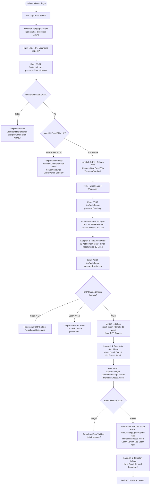

# Analisis Arsitektur dan Rencana Implementasi: Fitur Lupa Kata Sandi (Forgot Password) Berbasis OTP

**Project:** School Class Progress (SCP) — SMK Negeri 1 Bantul  
**Versi Dokumen:** v1.0 (Hasil Audit Arsitektur & Perencanaan Teknis)  
**Status:** Menunggu Persetujuan Pengguna (*Pending User Approval — Read-Only Planning Phase*)  
**Lokasi Dokumen:** `D:\MyUKK\SchoolClassProject\scp\MD\rencana_fitur_lupa_kata_sandi_otp.md`  

> [!IMPORTANT]
> **Pernyataan Kepatuhan Prinsip Perencanaan:**  
> Dokumen ini disusun sebagai hasil analisis menyeluruh terhadap arsitektur backend Laravel, frontend React, database PostgreSQL, serta data aktual pada project School Class Progress (SCP). Sesuai arahan, **tidak ada perubahan kode, migrasi database, manipulasi akun, maupun modifikasi konfigurasi sistem yang dieksekusi** pada tahap ini. Implementasi baru akan dimulai setelah seluruh poin keputusan teknis mendapatkan persetujuan eksplisit.

---

## Daftar Isi

1. [Ringkasan dan Tujuan Fitur](#1-ringkasan-dan-tujuan-fitur)
2. [Hasil Analisis Sistem Autentikasi Saat Ini](#2-hasil-analisis-sistem-autentikasi-saat-ini)
3. [Identifikasi Kebutuhan dan Temuan Kritis (Reality Check Data)](#3-identifikasi-kebutuhan-dan-temuan-kritis-reality-check-data)
4. [Rancangan Alur Pengguna (User Flow)](#4-rancangan-alur-pengguna-user-flow)
5. [Rancangan Arsitektur dan Mekanisme Kerja Sistem](#5-rancangan-arsitektur-dan-mekanisme-kerja-sistem)
6. [Rancangan API dan Kebutuhan Backend](#6-rancangan-api-dan-kebutuhan-backend)
7. [Rancangan UI/UX Frontend](#7-rancangan-uiux-frontend)
8. [Rancangan Perubahan atau Penambahan Database](#8-rancangan-perubahan-atau-penambahan-database)
9. [Rancangan Integrasi Layanan Email dan WhatsApp/SMS Gateway](#9-rancangan-integrasi-layanan-email-dan-whatsappsms-gateway)
10. [Analisis Keamanan dan Mitigasi Risiko](#10-analisis-keamanan-dan-mitigasi-risiko)
11. [Skenario Pengujian dan Kriteria Keberhasilan](#11-skenario-pengujian-dan-kriteria-keberhasilan)
12. [Tahapan Implementasi Beserta Dependensinya](#12-tahapan-implementasi-beserta-dependensinya)
13. [Daftar Keputusan yang Membutuhkan Konfirmasi Saya](#13-daftar-keputusan-yang-membutuhkan-konfirmasi-saya)

---

## 1. Ringkasan dan Tujuan Fitur

Fitur **Lupa Kata Sandi (Forgot Password) Berbasis OTP** dirancang untuk memberikan fasilitas pemulihan akses akun secara mandiri (*self-service account recovery*) bagi seluruh pengguna sistem School Class Progress (SCP) di SMK Negeri 1 Bantul, yang mencakup 4 peran:
1. **Waka Kurikulum / Administrator (`vice_principal`)**
2. **Guru Mata Pelajaran / Wali Kelas / Guru BK (`teacher`)**
3. **Peserta Didik / Siswa (`student`)**
4. **Wali Murid / Orang Tua (`parent`)**

### Tujuan Utama:
1. **Mengurangi Beban Administratif:** Menghilangkan ketergantungan reset kata sandi manual oleh Waka Kurikulum ketika guru, siswa, atau wali murid lupa kata sandi akunnya.
2. **Verifikasi Kepemilikan Sah (Multi-Channel OTP):** Memverifikasi kepemilikan akun secara aman melalui kode OTP 6-digit yang dikirimkan ke saluran kontak terverifikasi (Alamat Email resmi/pribadi atau Nomor WhatsApp/Telepon).
3. **Transisi Sandi yang Aman (Tokenized Reset):** Mencegah celah pemulihan langsung dengan menerapkan pertukaran kode OTP menjadi *Signed Single-Use Reset Token* berdurasi terbatas (15 menit).
4. **Perlindungan Terhadap Penyalahgunaan Akun:** Memblokir serangan *brute force*, *user enumeration*, *flooding OTP*, dan pembajakan sesi tanpa merusak mekanisme login maupun skema kredensial bawaan yang sedang berjalan.

---

## 2. Hasil Analisis Sistem Autentikasi Saat Ini

Pemeriksaan menyeluruh terhadap kode sumber aktual SCP (`/scp` dan `/frontend/scp_web`) menghasilkan temuan arsitektur berikut:

### 2.1 Mekanisme Login dan Autentikasi Pengguna
- **Framework & Sesi:** Menggunakan Laravel 13 dengan **Laravel Sanctum** (`HasApiTokens`) pada tabel `personal_access_tokens`.
- **Endpoint Login:** `POST /api/login` pada [`AuthController@login`](file:///d:/MyUKK/SchoolClassProject/scp/app/Http/Controllers/API/AuthController.php#L12).
- **Pengenal Akun (Identifier):** Form login menerima kolom `username` atau `nis_nip`. Di backend, sistem mencari kecocokan pada:
  1. `users.nis_nip` (NIS untuk siswa, NIP untuk guru/waka, `P-[NIS]` untuk orang tua).
  2. `users.email` (alamat email terdaftar).
  3. `users.phone_number` (nomor telepon/WhatsApp terdaftar yang dinormalisasi ke format `08...`).
- **Verifikasi Sandi:** Menggunakan `Hash::check($request->password, $user->password)` dengan hashing default Laravel (`bcrypt`).
- **Penanganan Status Akun:** Memeriksa `SoftDeletes` (`trashed()`) dan flag `is_active === false`. Akun nonaktif/terhapus otomatis ditolak dengan HTTP `403 Forbidden`.
- **Kewajiban Ganti Kata Sandi (`must_change_password`):** Kolom boolean `must_change_password`. Jika bernilai `true`, respon login mengembalikan flag tersebut dan frontend React langsung mengalihkan pengguna ke halaman [`/change-password`](file:///d:/MyUKK/SchoolClassProject/frontend/scp_web/src/pages/auth/ChangePasswordPage.jsx).

### 2.2 Struktur Kredensial Bawaan Tiap Role
Sistem SCP saat ini memiliki format kredensial bawaan (*default credentials*) yang dihasilkan oleh seeder atau import:
- **Siswa (`student`):** ID Login = NIS (contoh: `19413`), Kata Sandi Awal = NIS + Nomor Absen (contoh: `194131`).
- **Guru (`teacher`):** ID Login = NIP 18 digit atau No. Telepon, Kata Sandi Awal = `GuruSCP@{4_digit_tahun_lahir}!`.
- **Waka (`vice_principal`):** ID Login = NIP / `12345678`, Kata Sandi Terenkripsi.
- **Orang Tua (`parent`):** ID Login = `P-[NIS]` (contoh: `P-19413`), Kata Sandi Awal = `WaliSCP@{NIS}!`.

### 2.3 Pondasi OTP & Notifikasi yang Sudah Ada di Codebase
Meskipun fitur *Lupa Kata Sandi* belum diimplementasikan, sistem SCP **sudah memiliki modul dasar OTP** yang sebelumnya dirancang untuk verifikasi kontak mandiri pada menu profil:
1. **Model & Tabel `otp_codes`:**
   - Didefinisikan di [`OtpCode.php`](file:///d:/MyUKK/SchoolClassProject/scp/app/Models/OtpCode.php) dan migrasi `2026_10_20_000003_create_otp_codes_table.php`.
   - Kolom: `user_id`, `target` (string), `code` (string 6 karakter), `purpose` (`enum('email', 'phone')`), `expires_at` (timestamp), `created_at`, `updated_at`.
2. **Layanan Pengiriman WhatsApp:**
   - Kelas [`WhatsAppService.php`](file:///d:/MyUKK/SchoolClassProject/scp/app/Services/WhatsAppService.php) sudah aktif.
   - Menggunakan gateway **Fonnte API** (`https://api.fonnte.com/send`) dengan driver fallback `'log'`.
   - Token Fonnte (`FONNTE_TOKEN`) dan konfigurasi URL sudah terdaftar di `.env`.
3. **Layanan Pengiriman Email:**
   - Mailable [`VerifyEmailOtpMail.php`](file:///d:/MyUKK/SchoolClassProject/scp/app/Mail/VerifyEmailOtpMail.php) dan template tampilan Blade [`verify-otp.blade.php`](file:///d:/MyUKK/SchoolClassProject/scp/resources/views/emails/verify-otp.blade.php).
   - Konfigurasi SMTP Gmail (`smtp.gmail.com:587`) aktif di `.env`.
4. **Pembersihan Otomatis:**
   - Artisan Command [`scp:prune-expired-otps`](file:///d:/MyUKK/SchoolClassProject/scp/app/Console/Commands/PruneExpiredOtps.php) untuk menghapus kode OTP kedaluwarsa.

---

## 3. Identifikasi Kebutuhan dan Temuan Kritis (Reality Check Data)

Hasil audit langsung terhadap data aktual pada database PostgreSQL `db_scp` mengungkap **kondisi riil yang sangat krusial**:

```
=== HASIL AUDIT DATA KONTAK PENGGUNA SCP (AKTUAL) ===
-----------------------------------------------------------------------------------------
Role                Total Akun   Memiliki Email   Memiliki No. HP   Kontak Lengkap Kosong
-----------------------------------------------------------------------------------------
vice_principal               2                2                 0                       0
teacher                     90                0                 0                      90 (100%)
student                  1.711                0                 0                   1.711 (100%)
parent                   1.711                0                 0                   1.711 (100%)
-----------------------------------------------------------------------------------------
TOTAL AKUN               3.514                2                 0                   3.512 (99.9%)
-----------------------------------------------------------------------------------------
```

### Analisis Dampak Temuan Kritis:
1. **99.9% Akun Tidak Memiliki Email Maupun Nomor Telepon:**
   - Saat ini, data akun Guru, Siswa, dan Orang Tua yang diimpor dari master data belum memiliki nilai pada kolom `email` maupun `phone_number` (`NULL`).
   - Hanya 2 akun Waka Kurikulum yang memiliki email (`waka@smkn1bantul.sch.id`).
2. **Konsekuensi terhadap Alur OTP Mandiri:**
   - Jika pengguna (Guru/Siswa/Orang Tua) langsung menekan "Lupa Kata Sandi" saat ini, **sistem tidak memiliki alamat email atau nomor telepon tujuan untuk mengirimkan kode OTP**.
3. **Solusi Arsitektural yang Diperlukan:**
   - **Solusi 1 (Graceful Administrative Fallback):** Sistem lupa kata sandi wajib mendeteksi kondisi akun tanpa kontak, dan menampilkan panduan ramah: *"Akun Anda belum menautkan email atau nomor WhatsApp. Silakan hubungi Waka Kurikulum / Administrator Sekolah untuk reset kata sandi."*
   - **Solusi 2 (Kebijakan Pendaftaran Kontak / Onboarding):** Pada saat pengguna login pertama kali (saat ganti password wajib `must_change_password`), sistem dapat menganjurkan atau mewajibkan pengguna mengisi minimal 1 kontak (Email atau WhatsApp) agar fitur pemulihan mandiri siap digunakan sewaktu-waktu.
   - **Solusi 3 (Dukungan Pemulihan Kontak Orang Tua $\leftrightarrow$ Siswa):** Untuk akun siswa yang belum memiliki HP/email, sistem dapat mengevaluasi apakah kode OTP diizinkan dikirim ke nomor kontak wali murid yang tertaut (`linkedStudent`), atau sebaliknya (memerlukan persetujuan).

---

## 4. Rancangan Alur Pengguna (User Flow)

Alur pemulihan kata sandi dirancang dalam **5 Langkah Bertahap (Step-by-Step Wizard)** untuk memastikan kenyamanan pengguna (*UX*) dan keamanan bertingkat (*Defense in Depth*):



---

## 5. Rancangan Arsitektur dan Mekanisme Kerja Sistem

### 5.1 Komponen Arsitektur Terlibat

```
[ FRONTEND: React 19 (Vite) ]
   ├── LoginPage.jsx (Tautan "Lupa Kata Sandi?")
   ├── ForgotPasswordPage.jsx (Wizard 5 Langkah)
   └── authApi.js (Service Pemanggilan Endpoint Forgot Password)
         │
         │ HTTPS JSON REST API
         ▼
[ BACKEND: Laravel 13 ]
   ├── Routing (scp/routes/api.php)
   ├── Rate Limiting (Throttle Middleware: IP & Identifier based)
   ├── ForgotPasswordController.php
   │      ├── checkIdentity()
   │      ├── sendOtp()
   │      ├── verifyOtp()
   │      └── resetPassword()
   ├── Service Layer
   │      ├── PasswordResetOtpService.php (Kalkulasi OTP, Hash, Cooldown, Expiry)
   │      ├── WhatsAppService.php (Gateway Fonnte API)
   │      └── Mail::to()->send(ResetPasswordOtpMail) (SMTP Gmail)
   └── Database Layer (PostgreSQL)
          ├── users (Pencocokan akun & update hash password)
          └── password_reset_otps (Penyimpanan OTP ter-hash & reset_token)
```

### 5.2 Mekanisme Token Penjaga (Reset Token Guard)
Salah satu celah keamanan terbesar dalam implementasi fitur lupa kata sandi adalah mengizinkan request reset password hanya bermodalkan `identifier` tanpa bukti verifikasi OTP.
- **Solusi yang Diterapkan:**
  1. Pada saat verifikasi OTP berhasil (`verifyOtp`), backend tidak langsung mengubah kata sandi, melainkan membuat string kriptografi acak `reset_token` (64 karakter acak `Str::random(64)`).
  2. Hash token disimpan di database dengan masa berlaku 15 menit.
  3. Frontend menyimpan token ini di memory state (bukan `localStorage` permanen).
  4. Endpoint reset kata sandi (`resetPassword`) **wajib** menerima `reset_token`. Jika token tidak ada, salah, atau kedaluwarsa, permintaan ditolak dengan `403 Forbidden`.
  5. Setelah kata sandi berhasil diubah, `reset_token` langsung dihapus (*Single-Use Guarantee*).

---

## 6. Rancangan API dan Kebutuhan Backend

Seluruh endpoint pemulihan kata sandi berada di luar middleware `auth:sanctum` (karena pengguna belum login), namun **wajib dilindungi oleh Rate Limiter khusus** untuk mencegah eksploitasi.

### 6.1 Daftar Endpoint Baru

| No | Method | Endpoint | Fungsi | Rate Limit |
| :---: | :---: | :--- | :--- | :---: |
| 1 | `POST` | `/api/auth/forgot-password/check-identity` | Memeriksa identitas akun & mengembalikan opsi kontak tersamar (*masked*) | 10 req/menit per IP |
| 2 | `POST` | `/api/auth/forgot-password/send-otp` | Membuat kode OTP & mengirimkannya ke saluran yang dipilih (Email/WA) | 3 req/15 menit per user, 1 req/menit |
| 3 | `POST` | `/api/auth/forgot-password/verify-otp` | Memverifikasi 6-digit kode OTP & menerbitkan `reset_token` | 5 percobaan gagal per OTP |
| 4 | `POST` | `/api/auth/forgot-password/reset-password` | Menyimpan kata sandi baru menggunakan `reset_token` sah | 5 req/menit per IP |

---

### 6.2 Rincian Spesifikasi Kontrak Request & Response

#### 1. Endpoint: `POST /api/auth/forgot-password/check-identity`
- **Request Body:**
  ```json
  {
    "identifier": "19413"
  }
  ```
  *(Parameter `identifier` dapat berupa NIS, NIP, Username, Alamat Email, atau Nomor WhatsApp).*

- **Response Berhasil (Akun Memiliki Kontak Terdaftar):**
  ```json
  {
    "success": true,
    "message": "Identitas akun terverifikasi.",
    "data": {
      "identifier": "19413",
      "user_name": "Ahmad Fajar",
      "role": "student",
      "channels": {
        "email": {
          "available": true,
          "masked": "a*****r@gmail.com"
        },
        "whatsapp": {
          "available": true,
          "masked": "0812****7890"
        }
      }
    }
  }
  ```

- **Response Akun Terdaftar Tetapi Belum Ada Kontak (Temuan Data Aktual):**
  ```json
  {
    "success": true,
    "message": "Akun terdaftar, namun belum menautkan alamat email atau nomor WhatsApp terverifikasi.",
    "data": {
      "identifier": "19413",
      "user_name": "Ahmad Fajar",
      "role": "student",
      "has_contact": false,
      "channels": {
        "email": { "available": false, "masked": null },
        "whatsapp": { "available": false, "masked": null }
      },
      "guidance": "Akun Anda belum memiliki data kontak untuk pengiriman kode OTP. Silakan hubungi Waka Kurikulum atau Administrator sekolah di ruang kurikulum untuk mereset kata sandi Anda."
    }
  }
  ```

- **Response Identitas Tidak Ditemukan (Anti-Enumeration Safe):**
  ```json
  {
    "success": false,
    "message": "ID Pengguna tidak ditemukan. Silakan periksa kembali NIS, NIP, atau nomor yang Anda masukkan.",
    "errors": {
      "identifier": ["ID Pengguna tidak terdaftar dalam sistem."]
    }
  }
  ```

---

#### 2. Endpoint: `POST /api/auth/forgot-password/send-otp`
- **Request Body:**
  ```json
  {
    "identifier": "19413",
    "channel": "whatsapp"
  }
  ```
  *(Nilai `channel`: `'email'` atau `'whatsapp'`).*

- **Response Berhasil:**
  ```json
  {
    "success": true,
    "message": "Kode OTP berhasil dikirimkan ke nomor WhatsApp Anda.",
    "data": {
      "target_masked": "0812****7890",
      "channel": "whatsapp",
      "expires_in_seconds": 600,
      "cooldown_seconds": 60
    }
  }
  ```

- **Response Cooldown Aktif (HTTP 429 Too Many Requests):**
  ```json
  {
    "success": false,
    "message": "Harap tunggu 48 detik sebelum meminta pengiriman kode OTP kembali.",
    "cooldown_remaining": 48
  }
  ```

---

#### 3. Endpoint: `POST /api/auth/forgot-password/verify-otp`
- **Request Body:**
  ```json
  {
    "identifier": "19413",
    "channel": "whatsapp",
    "code": "481920"
  }
  ```

- **Response Berhasil:**
  ```json
  {
    "success": true,
    "message": "Kode OTP berhasil diverifikasi.",
    "data": {
      "reset_token": "a8f9c1e0b3d54821a7c4...64_chars_hex_string...",
      "token_expires_in_minutes": 15
    }
  }
  ```

- **Response Kode Salah (HTTP 422 Unprocessable Entity):**
  ```json
  {
    "success": false,
    "message": "Kode OTP yang Anda masukkan salah. Sisa percobaan: 3 kali.",
    "errors": {
      "code": ["Kode OTP tidak valid."]
    },
    "remaining_attempts": 3
  }
  ```

- **Response Kode Kedaluwarsa / Hangus (HTTP 410 Gone / 422):**
  ```json
  {
    "success": false,
    "message": "Kode OTP telah kedaluwarsa atau batas percobaan telah habis. Silakan kirim ulang kode baru.",
    "expired": true
  }
  ```

---

#### 4. Endpoint: `POST /api/auth/forgot-password/reset-password`
- **Request Body:**
  ```json
  {
    "identifier": "19413",
    "reset_token": "a8f9c1e0b3d54821a7c4...64_chars_hex_string...",
    "new_password": "PasswordBaru123!",
    "new_password_confirmation": "PasswordBaru123!"
  }
  ```

- **Response Berhasil (HTTP 200 OK):**
  ```json
  {
    "success": true,
    "message": "Kata sandi Anda berhasil diperbarui. Silakan masuk menggunakan kata sandi baru Anda."
  }
  ```

- **Response Token Tidak Valid / Kedaluwarsa (HTTP 403 Forbidden):**
  ```json
  {
    "success": false,
    "message": "Sesi pemulihan kata sandi tidak valid atau telah berakhir. Silakan ulangi proses lupa kata sandi.",
    "session_expired": true
  }
  ```

---

## 7. Rancangan UI/UX Frontend

### 7.1 Modifikasi pada Halaman Login (`LoginPage.jsx`)
Pada form login saat ini, tepat di bawah input `Kata Sandi Akun` dan di atas tombol `Masuk`:
- Ditambahkan link sekunder:  
  **"Lupa kata sandi akun Anda?"**  
  Tautan ini mengarahkan ke rute publik `/forgot-password`.

### 7.2 Halaman Baru: `ForgotPasswordPage.jsx`
- **Lokasi File:** `frontend/scp_web/src/pages/auth/ForgotPasswordPage.jsx`
- **Styling:** `frontend/scp_web/src/pages/auth/ForgotPassword.css`
- **Desain Tema:** Mengikuti estetika *Exness Clean Precision* (kartu putih berbayang halus di tengah layar, sudut membulat `rounded-2xl`, aksen biru `blue-600`, tipografi Inter, dan kontras tinggi).

#### Tampilan Komponen Tiap Langkah (Wizard Progression):
1. **Langkah 1: Identifikasi Akun:**
   - Input `ID Pengguna / NIS / NIP` dengan icon pencarian/pengguna.
   - Tombol `Periksa Akun`.
   - Link `Kembali ke Halaman Masuk`.
2. **Langkah 2: Pemilihan Saluran Kontak (Jika Akun Memiliki Kontak):**
   - Menampilkan kartu radio interaktif:
     - Kartu 1: *Kirim ke Alamat Email* (dengan label tersamar, contoh: `m*****@gmail.com`).
     - Kartu 2: *Kirim ke WhatsApp* (dengan label tersamar, contoh: `0812****7890`).
   - Tombol `Kirim Kode OTP`.
   - *Kasus Khusus (Jika Kontak Kosong):* Menampilkan banner peringatan ramah (warna oranye/biru) berisi nama pengguna dan petunjuk menemui Waka Kurikulum, dengan tombol kembali ke login.
3. **Langkah 3: Input Kode Verifikasi OTP:**
   - 6 kotak input terpisah (*6-Box Segmented OTP Inputs*) dengan penanganan otomatis navigasi kursor, *backspace*, dan *paste*.
   - Timer countdown 60 detik (*"Kirim ulang kode dalam 00:45"*).
   - Teks panduan: *"Kode verifikasi telah dikirim ke [Email/WhatsApp tersamar]"*.
   - Pesan error jelas jika kode salah disertai sisa percobaan.
4. **Langkah 4: Pembuatan Kata Sandi Baru:**
   - Input `Kata Sandi Baru` (dengan toggle lihat sandi).
   - Input `Konfirmasi Kata Sandi Baru`.
   - Bar meter indikator kekuatan kata sandi (*Weak / Medium / Strong*).
   - Daftar syarat kata sandi:
     - Minimal 8 karakter.
     - Konfirmasi harus cocok.
     - Disarankan kombinasi huruf dan angka.
   - Tombol `Simpan Kata Sandi Baru`.
5. **Langkah 5: Sukses & Navigasi Kembali:**
   - Kartu animasi centang hijau (*Success State*).
   - Informasi bahwa seluruh sesi lama telah dikeluarkan demi keamanan.
   - Tombol `Masuk ke Portal Sekarang` atau hitung mundur otomatis 3 detik ke `/login`.

---

## 8. Rancangan Perubahan atau Penambahan Database

Terdapat **dua alternatif arsitektur tabel** untuk menangani OTP pemulihan kata sandi:

### Opsi A: Menggunakan Tabel `otp_codes` yang Sudah Ada (Penyesuaian Kolom)
Tabel `otp_codes` saat ini memiliki skema:
```php
$table->enum('purpose', ['email', 'phone']);
```
- **Kelebihan:** Menghemat tabel baru, memanfaatkan tabel yang sudah ada.
- **Kekurangan:** Kolom `purpose` bertipe `enum` di PostgreSQL. Untuk menambahkan nilai seperti `'password_reset'` atau membedakan tujuan, diperlukan migrasi `ALTER TABLE` untuk memodifikasi enum type di PostgreSQL yang berisiko jika tidak hati-hati. Selain itu, kode disimpan dalam teks biasa (*plaintext*).

### Opsi B (Direkomendasikan): Membuat Tabel Mandiri `password_reset_otps`
Membuat migrasi tabel baru yang terisolasi khusus untuk siklus hidup pemulihan kata sandi:

```php
Schema::create('password_reset_otps', function (Blueprint $table) {
    $table->id();
    $table->foreignId('user_id')->constrained('users')->cascadeOnDelete();
    $table->string('identifier_input'); // Nilai yang diinput user (NIS/NIP)
    $table->string('target'); // Email atau No HP tujuan
    $table->enum('channel', ['email', 'whatsapp']);
    $table->string('code_hash'); // Hash SHA-256 dari 6-digit OTP (Bukan plaintext!)
    $table->string('reset_token', 64)->nullable()->unique(); // Token untuk step 4
    $table->tinyInteger('attempts')->default(0); // Counter salah input (maks 5)
    $table->timestamp('expires_at'); // 10 menit
    $table->timestamp('token_expires_at')->nullable(); // 15 menit setelah verify
    $table->boolean('is_verified')->default(false);
    $table->timestamps();

    $table->index(['user_id', 'is_verified']);
    $table->index('expires_at');
    $table->index('reset_token');
});
```

- **Kelebihan Opsi B:**
  1. **Keamanan Maksimal:** Kode OTP tidak disimpan dalam bentuk teks biasa, melainkan `hash('sha256', $code)` sehingga aman dari kebocoran log/database.
  2. **Isolasi Penuh:** Tidak ada potensi bentrok dengan modul OTP profil pengguna yang sudah ada di `otp_codes`.
  3. **Manajemen State Aman:** Menyimpan `reset_token` langsung pada baris verifikasi yang sama, memastikan hanya token terverifikasi yang dapat mereset sandi.
  4. **Pembersihan Bersih:** Mudah dibersihkan secara berkala tanpa menyentuh riwayat kontak pengguna.

---

## 9. Rancangan Integrasi Layanan Email dan WhatsApp/SMS Gateway

### 9.1 Kanal Pengiriman 1: Email (SMTP Gmail)
- **Status:** **Sudah Siap & Terkonfigurasi** di `.env` SCP (`MAIL_MAILER=smtp`, `MAIL_HOST=smtp.gmail.com`).
- **Komponen yang Dibuat:**
  - Mailable: `App\Mail\ResetPasswordOtpMail.php`.
  - Template Email: `resources/views/emails/reset-password-otp.blade.php`.
- **Desain Email:**
  - Header berlogo resmi SMK Negeri 1 Bantul.
  - Kotak besar 6 digit OTP berjarak spasi lebar (`letter-spacing: 6px`).
  - Informasi masa berlaku: **10 menit**.
  - Peringatan keamanan tegas: *"Jika Anda tidak merasa meminta kode ini, abaikan email ini. Jangan pernah memberikan kode ini kepada siapa pun termasuk pihak sekolah."*

### 9.2 Kanal Pengiriman 2: WhatsApp Gateway (Fonnte API)
- **Status:** **Sudah Siap & Terkonfigurasi** di `.env` SCP (`WHATSAPP_DRIVER=fonnte`, `FONNTE_TOKEN=...`, `FONNTE_BASE_URL=https://api.fonnte.com`).
- **Komponen yang Digunakan:**
  - Menggunakan [`WhatsAppService::sendMessage($target, $message)`](file:///d:/MyUKK/SchoolClassProject/scp/app/Services/WhatsAppService.php#L37).
- **Template Pesan WhatsApp:**
  ```text
  [SCP SMKN 1 BANTUL]
  Halo *{Nama Pengguna}*,

  Kode verifikasi pemulihan kata sandi akun SCP Anda adalah:
  👉 *{Kode OTP}*

  Kode ini berlaku selama *10 menit*.
  JANGAN bagikan kode ini kepada siapa pun demi keamanan akun Anda.

  Jika Anda tidak meminta pemulihan kata sandi, segera amankan akun Anda atau hubungi pihak sekolah.
  ```

### 9.3 Evaluasi Terhadap SMS Gateway Tradisional
- Penggunaan SMS reguler melalui operator telekomunikasi (misal Twilio SMS atau Telkomsel SMS API) membutuhkan biaya pulsa per pengiriman (berkisar Rp200 - Rp500 per SMS).
- Sebaliknya, **WhatsApp melalui Fonnte** sudah memiliki paket aktif di project SCP dan menjadi kanal pesan instan utama bagi orang tua dan guru di Indonesia.
- **Rekomendasi:** Gunakan kombinasi **Email + WhatsApp Fonnte** yang sudah tersedia tanpa menambah biaya SMS baru.

---

## 10. Analisis Keamanan dan Mitigasi Risiko

| No | Potensi Ancaman / Risiko | Skenario Serangan | Mitigasi yang Diterapkan di Desain |
| :---: | :--- | :--- | :--- |
| 1 | **User Enumeration (Pengintaian Akun)** | Penyerang memasukkan ribuan NIS siswa untuk mengetahui NIS mana saja yang valid dan membaca email/HP mereka. | - Respon `check-identity` menyamarkan (*masking*) sebagian besar karakter kontak (contoh: `0812****7890` dan `a*****r@gmail.com`).<br>- Penerapan Rate Limiter 10 request/menit per IP. |
| 2 | **Brute Force Kode OTP** | Penyerang mencoba menebak 6-digit angka (000000 - 999999). | - Dibatasi maksimal **5 kali percobaan salah**.<br>- Jika mencapai 5 kali salah, baris OTP otomatis **dihanguskan (*void*)** dan pengguna dipaksa meminta kode baru. |
| 3 | **OTP Flooding / SMS Bombing** | Penyerang menekan tombol kirim OTP berulang-ulang untuk menghabiskan kuota email/WA atau mengganggu korban. | - **Cooldown Timer 60 Detik:** Permintaan kode baru ditolak jika belum lewat 60 detik.<br>- **Daily Cap:** Maksimal 3 kali pengiriman OTP per akun dalam rentang 15 menit. |
| 4 | **Bypass Step Pembuatan Sandi (Direct API Call)** | Penyerang langsung memanggil endpoint `POST /api/auth/forgot-password/reset-password` tanpa melalui verifikasi OTP. | - Wajib menyertakan `reset_token` kriptografis (64 karakter acak).<br>- Token hanya diterbitkan jika OTP terverifikasi, dan langsung dihapus setelah 1 kali pakai. |
| 5 | **Sesi Akun Lama Masih Terbuka (Session Hijacking)** | Pengguna mengubah kata sandi karena perangkat lamanya hilang/dicuri, tetapi token sesi lama masih aktif. | - Saat kata sandi baru disimpan, sistem mengeksekusi `$user->tokens()->delete();` untuk **mencabut seluruh sesi login Sanctum aktif di perangkat lain**. |
| 6 | **Penyimpanan OTP di Database** | Database administrator atau penyerang yang membaca database bisa melihat OTP yang sedang aktif. | - Kode OTP disimpan menggunakan `hash('sha256', $code)` (Opsi B), bukan plain text. |

---

## 11. Skenario Pengujian dan Kriteria Keberhasilan

### 11.1 Matriks Skenario Uji Otomatis & Manual

1. **Uji Identifikasi Akun:**
   - Input NIS/NIP valid yang memiliki email & WhatsApp $\rightarrow$ mengembalikan data kontak tersamar (HTTP 200).
   - Input NIS/NIP valid tetapi kontak kosong $\rightarrow$ mengembalikan respon panduan hubungi Waka tanpa error sistem (HTTP 200).
   - Input NIS/NIP fiktif / tidak terdaftar $\rightarrow$ mengembalikan pesan kesalahan aman (HTTP 404/422).
2. **Uji Pengiriman OTP:**
   - Permintaan kirim OTP via Email $\rightarrow$ kode 6 digit terkirim ke email, baris hash tersimpan di database.
   - Permintaan kirim OTP via WhatsApp $\rightarrow$ kode 6 digit terkirim via Fonnte.
   - Permintaan kirim ulang dalam kurun $< 60$ detik $\rightarrow$ ditolak dengan HTTP 429 (*Cooldown Active*).
   - Permintaan kirim $> 3$ kali dalam 15 menit $\rightarrow$ ditolak oleh throttle rate limiter.
3. **Uji Verifikasi OTP:**
   - Input kode OTP benar sebelum 10 menit $\rightarrow$ OTP valid, menerima `reset_token` 64-karakter.
   - Input kode OTP salah ke-1 sampai ke-4 $\rightarrow$ pesan kode salah disertai sisa percobaan.
   - Input kode OTP salah ke-5 $\rightarrow$ kode langsung kedaluwarsa/hangus, dipaksa mengulang.
   - Input kode OTP setelah $> 10$ menit $\rightarrow$ ditolak (*Expired*).
4. **Uji Reset Kata Sandi:**
   - Reset sandi dengan `reset_token` valid dan sandi $\ge 8$ karakter $\rightarrow$ sandi berhasil diperbarui, seluruh sesi lama dicabut.
   - Percobaan reset ulang dengan `reset_token` yang sama $\rightarrow$ ditolak HTTP 403 (*Single-Use Prevention*).
   - Percobaan login menggunakan kata sandi lama $\rightarrow$ ditolak HTTP 401.
   - Percobaan login menggunakan kata sandi baru $\rightarrow$ berhasil masuk (HTTP 200).

### 11.2 Kriteria Keberhasilan:
- [ ] Tautan "Lupa Kata Sandi?" muncul dengan elegan di halaman Login.
- [ ] Wizard pemulihan berjalan mulus di layar Desktop dan Mobile.
- [ ] Pengiriman OTP via Email dan WhatsApp berjalan andal.
- [ ] Akun yang belum memiliki kontak mendapatkan informasi administratif yang ramah dan jelas.
- [ ] Seluruh pengujian fitur test (PHPUnit) lulus 100%.
- [ ] Build produksi frontend (`npm run build`) berhasil tanpa error.

---

## 12. Tahapan Implementasi Beserta Dependensinya

Pekerjaan implementasi akan dibagi ke dalam **4 Fase Terstruktur**:

```
[ Fase 1: Backend Database & Service Layer ]
  ├── Migrasi tabel password_reset_otps
  ├── PasswordResetOtpService (Hash, Expiry, Throttle)
  └── Mailable ResetPasswordOtpMail & WhatsApp Message Template
        │
        ▼
[ Fase 2: Backend API Endpoints & Keamanan ]
  ├── ForgotPasswordController (4 endpoints)
  ├── Pendaftaran rute di routes/api.php dengan Rate Limiter
  └── Automated Feature Test: ForgotPasswordTest.php
        │
        ▼
[ Fase 3: Frontend UI Wizard & Integrasi Login ]
  ├── Penambahan tautan di LoginPage.jsx
  ├── Pembuatan ForgotPasswordPage.jsx & ForgotPassword.css
  ├── Pendaftaran rute publik /forgot-password di AppRouter.jsx
  └── Service API di authApi.js
        │
        ▼
[ Fase 4: Pengujian Menyeluruh & Verifikasi Build ]
  ├── Eksekusi PHPUnit Test Suite
  ├── Pengujian manual multi-skenario (Email & WA)
  └── Verifikasi npm run build
```

---

## 13. Daftar Keputusan yang Membutuhkan Konfirmasi Saya

Sebelum memasuki tahap implementasi kode, mohon konfirmasi dan persetujuan Anda terhadap **4 poin keputusan penting** berikut:

### 1. Penanganan Akun yang Belum Memiliki Kontak (Temuan: 99.9% Akun Masih Kosong)
Karena data aktual menunjukkan 90 guru, 1.711 siswa, dan 1.711 orang tua belum memiliki email maupun nomor HP di database:
- **Opsi A (Direkomendasikan - Solusi Bertahap):**
  - Pada sistem Lupa Sandi: Jika akun belum memiliki kontak, sistem menampilkan pesan panduan yang jelas agar pengguna menghubungi pihak Waka Kurikulum / Administrator sekolah untuk reset manual.
  - Ditambah: Pada saat pengguna login (terutama yang terkena `must_change_password`), sistem dapat menampilkan pengingat untuk menautkan email/WhatsApp di profil agar ke depannya bisa memulihkan sandi mandiri.
- **Opsi B:** Membuka fasilitas bagi Siswa untuk meminjam nomor kontak Wali Murid yang tertaut (`linked_student_id`) sebagai saluran darurat penerimaan OTP (jika orang tua sudah mengisi kontak).

### 2. Saluran Pengiriman OTP (WhatsApp vs SMS vs Email)
- **Opsi A (Direkomendasikan):** Menggunakan **Email (SMTP Gmail)** dan **WhatsApp (Fonnte API)** yang konfigurasinya sudah tersedia di file `.env` SCP tanpa biaya operasional SMS baru.
- **Opsi B:** Mengintegrasikan vendor pihak ketiga SMS Gateway berbayar (misal Twilio SMS / Zenziva) dengan biaya pulsa per SMS.

### 3. Pilihan Arsitektur Tabel Penyimpanan OTP
- **Opsi A (Direkomendasikan):** Membuat tabel baru yang terisolasi `password_reset_otps` dengan penyimpanan kode berbentuk hash SHA-256 dan kolom `reset_token`. (Lebih aman dan tidak mengganggu tabel profil).
- **Opsi B:** Mengubah struktur enum kolom `purpose` pada tabel `otp_codes` yang sudah ada.

### 4. Kebijakan Keamanan dan Durasi Kedaluwarsa
- **Usulan Kebijakan:**
  - Masa berlaku kode OTP: **10 Menit**.
  - Waktu tunggu kirim ulang (*cooldown*): **60 Detik**.
  - Batas maksimal salah input kode: **5 Kali** (setelah 5x, OTP hangus).
  - Masa berlaku `reset_token` untuk membuat sandi baru: **15 Menit**.
  - Pencabutan seluruh sesi login lama setelah sandi berhasil diubah: **Ya (Revoke all active Sanctum tokens)**.

---

*Dokumen ini telah disimpan di:*  
[`d:\MyUKK\SchoolClassProject\scp\MD\rencana_fitur_lupa_kata_sandi_otp.md`](file:///d:/MyUKK/SchoolClassProject/scp/MD/rencana_fitur_lupa_kata_sandi_otp.md)
