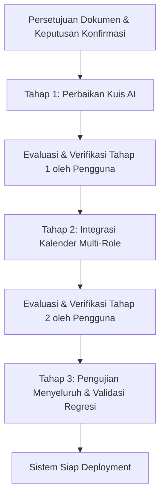

# Rencana Implementasi & Perbaikan Kuis AI dan Kalender Akademik Multi-Role
**Sistem School Class Progress (SCP)**  
*Dokumen Rencana Teknis, Analisis Sistem, dan Panduan Pelaksanaan 3 Tahap*  
*Tanggal Penyusunan: 6 November 2026*  
*Status: DISETUJUI PENGGUNA (Tahap 1 Mulai Diimplementasikan)*

---

## 1. Ringkasan Proyek & Tujuan Pengembangan

Sistem **School Class Progress (SCP)** mengintegrasikan proses akademik harian sekolah, mencakup manajemen pembelajaran, presensi, jurnal mengajar, perizinan, kalender akademik, dan evaluasi pembelajaran berbantuan AI.

Berdasarkan audit fungsional aktual dan pengujian awal pra-deployment, ditemukan kendala pada dua fitur utama sistem:
1. **Modul Kuis Berbantuan AI (`ai_quizzes`)**:
   - Guru belum dapat memilih kelas yang tepat berdasarkan penugasan mengajarnya.
   - Ketiadaan fitur dan aksi pembatalan kuis yang telah dibuat/dipublikasikan.
   - Kuis yang telah dipublikasikan guru belum muncul secara tepat pada antarmuka Siswa, serta terjadi *access denied* (HTTP 403) saat siswa memulai pengerjaan kuis.
   - Status pengerjaan kuis di portal siswa belum variatif dan belum mencerminkan kondisi pengerjaan riil.
2. **Modul Kalender Akademik Multi-Role (`academic_events`)**:
   - Event yang dibuat/dikelola Waka Kurikulum tidak muncul secara konsisten pada akun Guru, Kesiswaan, Siswa, dan Orang Tua karena mekanisme penyaringan (*over-filtering*) di backend menyatukan aturan "eksklusi jam mengajar" dengan "visibilitas visual agenda sekolah".
   - Ketiadaan penanganan spesifik untuk peran guru penugasan Kesiswaan.

Pengembangan dan perbaikan ini disusun dalam **3 Tahap Bertahap**:
- **Tahap 1:** Perbaikan & Penyempurnaan Fitur Kuis AI (Frontend Guru & Siswa, Backend API, Integrasi Endpoint Soal & Validasi Rombel).
- **Tahap 2:** Perbaikan Integrasi Kalender Akademik Multi-Role (Refactoring Query Visibilitas, Pengayaan Tagging Rombel/Tingkat, Penyesuaian Antarmuka Guru/Kesiswaan/Siswa/Ortu).
- **Tahap 3:** Pengujian Menyeluruh, Verifikasi Lintas Fitur, dan Validasi Regresi Sistem.

> [!IMPORTANT]
> **Kebijakan Eksekusi:** Pada tahap ini **HANYA dilakukan analisis sistem dan penyusunan dokumen perencanaan**. Tidak ada perubahan kode program, database, maupun konfigurasi yang dijalankan sebelum pengguna memberikan persetujuan eksplisit terhadap rencana dan poin-poin keputusan yang diajukan.

---

## 2. Hasil Analisis Kondisi Sistem Saat Ini

Pemeriksaan mendalam telah dilakukan terhadap *source code* Backend Laravel (`scp/`) dan Frontend React (`frontend/scp_web/`). Berikut temuan teknis kondisi aktual:

### 2.1 Arsitektur Kuis AI Saat Ini
1. **Skema Database (`ai_quizzes`, `quiz_questions`, `quiz_submissions`):**
   - Tabel `ai_quizzes` menyimpan relasi `teacher_id` (ke `users`) dan `class_id` (ke `classes`).
   - Kolom status saat ini bertipe enum: `['generating', 'draft_review', 'published', 'published_result']`.
   - **Belum ada status `cancelled`** pada skema database.
   - Tabel `quiz_questions` menyimpan butir soal pilihan ganda (`options` format JSON) dan esai, serta `correct_answer`.
   - Tabel `quiz_submissions` mencatat jawaban siswa (`answers_payload`), `attempt_number`, `ai_score`, `ai_feedback`, dan status koreksi (`pending`/`graded`).
2. **Endpoint Backend (`QuizController.php`):**
   - Pembuatan Kuis (`POST /api/quizzes`): Menerima `title`, `class_id`, `due_date`, `max_attempts`. Validasi `class_id` hanya menggunakan aturan `exists:classes,id`. **Tidak ada validasi apakah guru yang login benar-benar mengajar di kelas tersebut**.
   - Pengambilan Daftar Kuis (`GET /api/quizzes`):
     - Guru: Memfilter `where('teacher_id', $user->id)`.
     - Siswa: Memfilter `where('class_id', $user->class_id)->whereIn('status', ['published', 'published_result'])`.
   - Pengambilan Butir Soal Guru (`GET /api/quizzes/{id}/questions`): Dibatasi middleware `role:teacher` dan pengecekan `$quiz->teacher_id === $user->id`. Endpoint ini diperuntukkan bagi Guru pada tahap pratinjau.
   - Detail Kuis Siswa (`GET /api/quizzes/{id}`): Terbuka untuk seluruh user terautentikasi, memvalidasi kelas siswa, menyembunyikan `correct_answer` via `makeHidden()`.
   - Pembatalan Kuis: **Tidak ada endpoint maupun method pembatalan/penghapusan kuis**. Route `DELETE` atau `PATCH /quizzes/{id}/cancel` belum tersedia di `routes/api.php`.
3. **Frontend Guru (`TeacherQuizPage.jsx`):**
   - Pemilihan kelas saat membuat kuis mengambil seluruh data kelas dari `masterDataApi.classes.getClasses()` tanpa filter jadwal mengajar guru (`schedules`). Akibatnya, semua rombel di sekolah (misal X AK 1 s.d. XII AK 4) muncul di dropdown, dan sistem memilih indeks pertama secara default.
   - Tidak ada tombol "Batalkan Kuis" atau "Hapus Kuis" pada tabel kuis maupun modal rincian kuis.
4. **Frontend Siswa (`StudentQuizPage.jsx`):**
   - Siswa mengambil data kuis via `quizApi.getQuizzes()`.
   - Ketika siswa mengklik tombol "Mulai Kerjakan", kode frontend memanggil `quizApi.getQuizQuestions(quiz.id)` (`GET /api/quizzes/{id}/questions`). Endpoint ini terproteksi `role:teacher`, sehingga **siswa selalu mendapatkan HTTP 403 Forbidden**, menyebabkan soal tidak dapat dimuat.
   - Tampilan status kuis di tabel siswa hanya mengecek `published_result` ("Hasil Tersedia") atau fallback "Sedang Berlangsung". Tidak ada informasi apakah siswa sudah mencoba, sisa kesempatan pengerjaan, atau batas waktu telah lewat.

---

### 2.2 Arsitektur Kalender Akademik Saat Ini
1. **Skema Database (`academic_events`):**
   - Kolom: `title`, `description`, `start_date`, `end_date`, `type` (`holiday`, `school_event`, `class_event`, `exam`), `scope_type` (`all`, `grade`, `class`), `scope_targets` (JSON array), `disables_teaching` (boolean), `academic_year`, `created_by`.
2. **Endpoint Backend (`AcademicEventController.php` & `AcademicCalendarExclusionService.php`):**
   - Pengambilan kalender utama via `GET /api/academic-events/my-calendar`.
   - **Penyebab Masalah Event Waka Tidak Muncul di Role Lain (*Over-Filtering*):**
     - **Guru:** Pada method `myCalendar()`, event dengan `scope_type: 'grade'` atau `'class'` difilter secara ketat menggunakan `$allRelevantClassIds` dan `$allRelevantGrades` yang diturunkan dari tabel `schedules` guru. Jika guru hanya mengajar kelas XI & XII, maka event sekolah untuk tingkat X (misal "Kemah Bakti Tingkat X") **dihilangkan 100% dari kalender guru**. Jika jadwal guru belum diisi oleh Waka, guru sama sekali tidak melihat event selain `scope_type: 'all'`.
     - **Kesiswaan:** Guru kesiswaan yang memiliki penugasan per rombel tertentu tidak memiliki bypass untuk melihat seluruh kegiatan siswa sekolah, karena `$isGlobalKesiswaan` bernilai false.
     - **Siswa:** Event dengan `scope_type: 'grade'` atau `'class'` yang tidak persis mencakup kelas siswa difilter keluar. Siswa kelas XII tidak dapat melihat bahwa di sekolah sedang ada kegiatan ujian atau porseni untuk kelas X dan XI.
     - **Orang Tua:** Orang tua hanya diperlihatkan event yang mencakup rombel anak yang terhubung.
   - **Akar Masalah:** Logika backend saat ini mencampuradukkan antara **"Keterdampakan Jam Mengajar / Kehadiran (Eksklusi KBM)"** dengan **"Hak Melihat Informasi Kalender Kegiatan Sekolah (Visibilitas Visual)"**. Seluruh pengguna berhak mengetahui seluruh agenda sekolah yang diselenggarakan, namun informasi dampaknya (apakah kelas libur/bebas KBM) harus dipersonalisasi.

---

## 3. Daftar Permasalahan yang Ditemukan

| No | Modul | Komponen Terdampak | Deskripsi Masalah | Dampak Sistem |
|:--:|:---|:---|:---|:---|
| **P-01** | Kuis AI | `TeacherQuizPage.jsx`, `QuizController.php` | Dropdown kelas pada pembuatan kuis menampilkan seluruh kelas sekolah, bukan kelas yang diajar guru. Backend tidak memvalidasi relasi guru-kelas. | Guru dapat salah mendistribusikan kuis ke kelas yang tidak diajarnya; siswa kelas sebenarnya tidak menerima kuis. |
| **P-02** | Kuis AI | `QuizController.php`, `ai_quizzes`, `TeacherQuizPage.jsx` | Tombol dan alur pembatalan kuis belum tersedia di frontend maupun backend. Skema database belum memiliki status `cancelled`. | Guru tidak dapat membatalkan kuis yang salah rilis atau salah target kelas. |
| **P-03** | Kuis AI | `StudentQuizPage.jsx`, `routes/api.php` | Siswa memanggil endpoint Guru `GET /api/quizzes/{id}/questions` saat memulai kuis, menghasilkan HTTP 403 Forbidden. | Siswa tidak dapat membuka butir soal dan tidak dapat mengerjakan kuis AI sama sekali. |
| **P-04** | Kuis AI | `StudentQuizPage.jsx`, `QuizController.php` | Status kuis di portal siswa hanya dua jenis statis ("Hasil Tersedia" dan "Sedang Berlangsung") tanpa memperhitungkan riwayat submisi siswa, sisa kuota percobaan, dan deadline. | Siswa bingung apakah kuis sudah pernah dikerjakan, sedang dikerjakan, atau sudah kedaluwarsa. |
| **P-05** | Kalender | `AcademicEventController.php` | Query `myCalendar` memfilter agenda berdasarkan jadwal ajar guru & kelas siswa secara kaku, menyembunyikan event tingkat/kelas lain. | Event yang dibuat Waka hilang dari kalender Guru, Siswa, Kesiswaan, dan Orang Tua jika tidak cocok 100% dengan rombelnya. |
| **P-06** | Kalender | `Sidebar.jsx`, `TeacherCalendarPage.jsx` | Belum ada pembedaan mode pandang untuk Guru yang mengemban tugas Kesiswaan dalam memantau seluruh kegiatan kesiswaan. | Kesiswaan tidak memiliki akses komprehensif terhadap kalender kegiatan seluruh angkatan. |
| **P-07** | Kalender | `SharedCalendarView.jsx`, `AcademicCalendarPage.jsx` | Sinkronisasi filter kategori, status badges, dan penanda multi-day event belum sepenuhnya seragam di seluruh role. | Pengalaman pengguna (*user experience*) tidak konsisten antar peran pengguna. |

---

## 4. Rencana Tahap 1 – Perbaikan dan Penyempurnaan Fitur Kuis AI

### 4.1 Sub-tahap 1.1: Pemilihan Kelas yang Diajar Guru
- **Backend:**
  - Tambahkan method pembantu di `QuizController` atau `TeacherAssignment`/`Schedule` untuk mengambil daftar kelas aktif yang diampu oleh Guru:
    - Sumber data: `Schedule::where('teacher_id', $user->id)->pluck('class_id')` digabung dengan kelas penugasan guru jika relevan.
    - Sediakan endpoint khusus atau parameter filter: `GET /api/classes?taught_by_me=true` atau `GET /api/teacher/classes`.
  - Tambahkan validasi pada `QuizController::store`:
    - Guru biasa hanya boleh memilih `class_id` yang terdaftar dalam daftar kelas yang diajarnya (kecuali Waka/Admin yang memiliki hak bypass untuk semua kelas).
    - Jika input kelas tidak valid atau di luar penugasan guru, kembalikan HTTP 422 Unprocessable Entity dengan pesan edukatif: *"Anda tidak memiliki jadwal mengajar aktif pada kelas yang dipilih."*
- **Frontend (`TeacherQuizPage.jsx`):**
  - Ubah pengambilan daftar kelas pada modal inisialisasi kuis: panggil daftar kelas yang diajar oleh guru yang sedang login (bukan seluruh kelas sekolah).
  - Tampilkan nama kelas, tingkat, dan jurusan secara jelas pada dropdown (misal: "X AK 1 - Akuntansi").
  - Berikan *empty state* yang informatif jika guru belum memiliki jadwal mengajar yang terdaftar di sistem.

### 4.2 Sub-tahap 1.2: Mekanisme Pembatalan Pengiriman Kuis
- **Backend:**
  - Tambahkan status `'cancelled'` pada enum status kuis di database (via migrasi aman) atau mekanisme status terintegrasi.
  - Buat route dan controller method: `POST /api/quizzes/{id}/cancel` (khusus pemilik kuis atau Waka).
  - Tambahkan validasi otorisasi: hanya guru pembuat kuis atau Waka yang dapat membatalkan kuis.
  - Tangani status kuis yang dibatalkan:
    - Kuis berstatus `cancelled` ditolak pada endpoint `POST /api/quizzes/{id}/submissions` dengan pesan: *"Kuis telah dibatalkan oleh guru pengampu dan tidak menerima jawaban."*
    - Siswa tidak dapat lagi mengakses soal kuis yang dibatalkan.
  - Logging dan audit trail: catat waktu pembatalan (`cancelled_at`) dan alasan pembatalan jika diperlukan.
- **Frontend Guru (`TeacherQuizPage.jsx`):**
  - Tambahkan tombol aksi "Batalkan Kuis" (ikon *XCircle* / warna *danger-subtle*) pada tabel kuis untuk kuis yang berstatus `published` atau `draft_review`.
  - Tampilkan modal konfirmasi (*ConfirmDialog*) sebelum membatalkan:
    - Menampilkan judul kuis, kelas target, dan jumlah siswa yang telah mengumpulkan jawaban.
    - Teks peringatan yang jelas mengenai dampak pembatalan.
  - Tampilkan badge status khusus: `Dibatalkan` (merah/abu-abu).
- **Penanganan Submisi Siswa yang Sudah Masuk:**
  - *(Memerlukan keputusan pengguna — lihat Bagian 11 untuk alternatif detail).*

### 4.3 Sub-tahap 1.3: Perbaikan Tampilan & Akses Kuis pada Role Siswa
- **Backend:**
  - Perbaiki query `QuizController::index` untuk role `student`:
    - Muat kuis aktif kelas siswa (`where('class_id', $user->class_id)`).
    - Pastikan eager loading memuat data guru pengampu, mata pelajaran, serta jumlah soal.
    - Sertakan relasi atau atribut `my_submission` / `attempts_count` spesifik untuk siswa yang sedang login agar frontend dapat langsung menentukan status pengerjaan siswa.
  - Pastikan endpoint `GET /api/quizzes/{id}` (`QuizController::show`) dapat diakses oleh Siswa dengan aman:
    - Verifikasi bahwa siswa terdaftar di kelas target kuis.
    - Sembunyikan atribut `correct_answer` pada seluruh butir soal.
    - Sertakan batas waktu pengerjaan (`due_date`) dan durasi menit.
- **Frontend Siswa (`StudentQuizPage.jsx`):**
  - **Perbaikan Bug 403 Forbidden:** Ganti pemanggilan `quizApi.getQuizQuestions(quiz.id)` pada fungsi `handleStartQuiz` menjadi `quizApi.getQuizDetail(quiz.id)` (`GET /api/quizzes/{id}`). Ambil butir soal dari atribut `res.data.questions`.
  - **Diferensiasi Status Kuis yang Komprehensif:**
    - `Belum Dikerjakan`: Siswa belum memiliki submission dan `now() <= due_date` (Badge Biru / Tombol "Mulai Kerjakan").
    - `Sedang Dikerjakan`: Draf jawaban tersimpan di `sessionStorage` lokal siswa (Badge Kuning / Tombol "Lanjutkan Pengerjaan").
    - `Sudah Mengumpulkan`: Siswa telah mengumpulkan jawaban dan masih ada kuota attempt atau menunggu hasil rilis (Badge Hijau / Informasi Attempt Digunakan).
    - `Batas Waktu Habis`: Batas waktu `due_date` terlampaui dan siswa belum menyelesaikan seluruh kuota (Badge Abu-abu / Tombol Dinonaktifkan).
    - `Dibatalkan`: Kuis dibatalkan oleh guru (Badge Merah / Keterangan Pembatalan).
    - `Hasil Tersedia`: Status kuis telah dirilis oleh guru (`published_result`) (Badge Indigo / Tombol "Lihat Nilai & Evaluasi AI").
  - Sediakan tab filter pada halaman Siswa: "Semua Kuis", "Perlu Dikerjakan", dan "Riwayat Selesai".

### 4.4 Sub-tahap 1.4: Evaluasi Alur Kuis AI Menyeluruh
- Verifikasi alur menyeluruh tanpa cela:
  1. Guru mengisi konfigurasi (judul, kelas yang diajar, deadline, batas percobaan).
  2. Guru memilih metode pembuatan: Prompt AI (Google AI `gemini-3.1-flash-lite`), Ekstraksi Dokumen PDF/TXT, atau Input Manual.
  3. AI menghasilkan butir soal berstatus `draft_review`.
  4. Guru memeriksa, mengedit butir soal, menyesuaikan opsi atau rubrik esai pada modal pratinjau.
  5. Guru mengklik "Konfirmasi & Publikasikan Kuis" -> status berubah menjadi `published`.
  6. Siswa melihat kuis pada portalnya, memulai kuis, timer berjalan mundur, dan auto-submit aktif saat waktu habis.
  7. Sistem mengevaluasi jawaban secara otomatis dan asinkron.
  8. Guru memeriksa hasil pengerjaan, dapat meng-override nilai AI, dan mengklik "Rilis Hasil Kuis ke Siswa & Ortu" (`published_result`).
  9. Siswa dan Orang Tua dapat melihat skor akhir dan ulasan evaluasi AI.

---

## 5. Rencana Tahap 2 – Perbaikan Integrasi Kalender Akademik Multi-Role

### 5.1 Sub-tahap 2.1: Analisis Masalah & Perbaikan Model Visibilitas Event
- **Pemisahan Konseptual:**
  - **Lapisan 1 — Visibilitas Visual Agenda Kalender (*Informational Visibility*):**
    - Kalender akademik adalah papan informasi resmi sekolah.
    - Seluruh warga sekolah (Waka, Guru, Kesiswaan, Siswa, Orang Tua) **berhak melihat seluruh agenda kegiatan yang diselenggarakan sekolah** (baik agenda umum, agenda per tingkat, maupun agenda rombel tertentu) agar memiliki kesadaran agenda (*event awareness*).
    - Setiap event ditampilkan dengan label/tag cakupan yang jelas (misal: `[Umum]`, `[Tingkat X]`, `[X AK 1]`).
  - **Lapisan 2 — Eksklusi Jam Mengajar & Presensi (*Operational Exemption*):**
    - Fitur penyesuaian otomatis jadwal mengajar guru (libur/bebas jam ajar) dan presensi siswa **HANYA diterapkan secara spesifik** pada kelas dan guru yang benar-benar cocok dengan target event (`scope_targets`).
- **Backend Refactoring (`AcademicEventController.php` & `AcademicCalendarExclusionService.php`):**
  - Pada method `myCalendar()`:
    - Ambil seluruh agenda dalam rentang bulan aktif tanpa memfilter keras (*hard-filter*) berdasarkan rombel guru atau siswa.
    - Tetap hitung atribut personalisasi per pengguna:
      - Untuk Guru: `affects_my_teaching` (true jika event membebaskan jadwal ajar guru tersebut), `affected_my_classes` (nama rombel guru yang bebas KBM).
      - Untuk Siswa: `is_my_class_affected` (true jika kelas siswa menjadi target kegiatan/libur).
      - Untuk Orang Tua: `applicable_children` (daftar anak yang relevan dengan kegiatan tersebut).
    - Sediakan parameter filter opsional di request jika pengguna secara sengaja ingin mempersempit tampilan:
      - `only_my_scope=true` atau `only_affects_my_teaching=true`.

### 5.2 Sub-tahap 2.2: Dukungan Khusus Peran Kesiswaan
- Guru yang memiliki penugasan `kesiswaan` (baik global maupun spesifik rombel) membutuhkan informasi menyeluruh terhadap seluruh agenda kegiatan pembinaan siswa, ekstrakurikuler, asesmen, dan upacara.
- Tambahkan konteks `is_kesiswaan` pada payload respon kalender dan sediakan filter cepat kategori: *"Agenda Kesiswaan & Kegiatan Lapangan"*.

### 5.3 Sub-tahap 2.3: Konsistensi Antarmuka Kalender Seluruh Role
- **Tampilan Kalender Bulanan (`SharedCalendarView.jsx`):**
  - Pastikan event multi-hari (rentang tanggal mulai hingga selesai) terentang rapi pada grid kalender bulanan.
  - Gunakan palet warna yang konsisten sesuai standar SCP:
    - Merah/Rose: Hari Libur Resmi Sekolah (`holiday`).
    - Amber/Orange: Kegiatan Sekolah (`school_event`).
    - Biru/Indigo: Asesmen / Masa Ujian (`exam`).
    - Zamrud/Emerald: Kegiatan Khusus Rombel / Tingkat (`class_event`).
- **Modal Detail Event (`AcademicEventDetailModal.jsx`):**
  - Menampilkan informasi lengkap: judul, deskripsi, tanggal pelaksanaan, kategori, cakupan kelas sasaran, status KBM (apakah meliburkan KBM atau KBM tetap berjalan), dan panduan kehadiran resmi.
- **Dukungan Tampilan Desktop & Mobile:**
  - Kalender responsif dengan beralih ke format daftar agenda (*list view*) yang nyaman dibaca pada layar perangkat bergerak.

---

## 6. Rencana Tahap 3 – Pengujian Menyeluruh dan Validasi Sistem

### 6.1 Uji Modul Kuis AI
- [ ] Pembuatan kuis oleh Guru: verifikasi dropdown hanya menampilkan kelas yang diajar.
- [ ] Percobaan pemilihan kelas yang tidak diajar melalui manipulasi request API: pastikan backend menolak dengan HTTP 422.
- [ ] Pembuatan butir soal melalui Google AI Studio API (`gemini-3.1-flash-lite`).
- [ ] Pratinjau, pengeditan butir soal, dan publikasi kuis.
- [ ] Pembatalan kuis oleh Guru dengan modal konfirmasi dan pemeriksaan status kuis.
- [ ] Pengujian kuis yang dibatalkan: pastikan siswa tidak dapat memulai atau mengirim jawaban.
- [ ] Tampilan kuis di akun Siswa kelas sasaran: pastikan muncul seketika setelah dipublikasikan.
- [ ] Pengerjaan kuis oleh Siswa: butir soal termuat tanpa error 403, timer berjalan, auto-submit berfungsi.
- [ ] Evaluasi nilai otomatis dan override penilaian oleh Guru.
- [ ] Rilis hasil kuis dan verifikasi tampilan skor di portal Siswa dan Orang Tua.

### 6.2 Uji Modul Kalender Akademik
- [ ] Waka membuat event baru (tipe libur, kegiatan sekolah, tingkat, dan ujian).
- [ ] Login sebagai Guru: verifikasi event muncul di kalender guru dengan indikator dampak jam ajar yang akurat.
- [ ] Login sebagai Kesiswaan: verifikasi seluruh agenda kegiatan siswa dapat dipantau secara utuh.
- [ ] Login sebagai Siswa: verifikasi event sekolah muncul dengan tag kelas/tingkat yang transparan.
- [ ] Login sebagai Orang Tua: verifikasi penandaan anak (*tagging multi-anak*) berjalan benar.
- [ ] Pengujian event multi-hari dan pembaruan (*edit/delete*) agenda oleh Waka secara *real-time*.

### 6.3 Uji Integrasi, Keamanan, & Regresi
- [ ] Menjalankan *test suite* backend Laravel: `php artisan test` (memastikan seluruh test tetap lulus).
- [ ] Memeriksa kebersihan lint frontend: `npm run lint` (0 error).
- [ ] Memeriksa build bundle frontend: `npm run build` (sukses).
- [ ] Memastikan tidak ada fitur presensi, jadwal, jurnal mengajar, atau perizinan yang terganggu oleh perubahan ini.

---

## 7. Dependensi Antar Tahap

Pelaksanaan wajib mengikuti urutan berjenjang berikut:

- **Tahap 1 mendahului Tahap 2** karena perbaikan kuis AI mencakup perbaikan bug kritis hak akses (HTTP 403) yang langsung menghalangi operasional siswa.
- **Tahap 2 dijalankan setelah Tahap 1 terverifikasi**, berfokus pada refactoring data distribution kalender akademik.
- **Tahap 3 dijalankan sebagai validasi akhir** untuk memastikan stabilitas sistem secara menyeluruh.

---

## 8. Perubahan Backend dan Frontend yang Diperlukan

### 8.1 Komponen Backend (Laravel `scp/`)
1. `routes/api.php`:
   - Penambahan route pembatalan kuis: `POST /api/quizzes/{id}/cancel`.
   - Penataan hak akses route detail kuis siswa agar tidak tumpang tindih.
2. `app/Http/Controllers/API/QuizController.php`:
   - Validasi kepemilikan jadwal ajar guru pada method `store`.
   - Method baru `cancel($id, Request $request)` dengan audit status.
   - Peningkatan respon `index` untuk siswa dengan penyertaan status submisi mandiri.
3. `app/Http/Controllers/API/AcademicEventController.php`:
   - Refactoring method `myCalendar` untuk menerapkan pemisahan antara visibilitas visual dan eksklusi operasional.
   - Penyesuaian filter agar guru dan siswa tetap dapat melihat seluruh kegiatan sekolah dengan penandaan target kelas yang rapi.
4. `database/migrations/`:
   - Migrasi penambahan nilai status `'cancelled'` pada tabel `ai_quizzes`.

### 8.2 Komponen Frontend (React `frontend/scp_web/`)
1. `src/services/quizApi.js`:
   - Penambahan fungsi API `cancelQuiz(id, data)`.
2. `src/pages/teacher/TeacherQuizPage.jsx`:
   - Filter dropdown kelas saat buat kuis hanya menampilkan kelas yang diajar.
   - Penambahan tombol "Batalkan Kuis" dengan dialog konfirmasi dan informasi submisi masuk.
   - Penyesuaian tab filter dan indikator status kuis dibatalkan.
3. `src/pages/student/StudentQuizPage.jsx`:
   - Perbaikan pengambilan butir soal menggunakan `quizApi.getQuizDetail(quiz.id)` (mengatasi HTTP 403).
   - Pembaruan sistem badge status kuis menjadi 6 kondisi riil (Belum Dikerjakan, Sedang Dikerjakan, Sudah Mengumpulkan, Batas Waktu Habis, Dibatalkan, Hasil Tersedia).
4. `src/pages/teacher/TeacherCalendarPage.jsx`, `StudentCalendarPage.jsx`, `ParentCalendarPage.jsx`:
   - Penyesuaian pemanggilan parameter dan tampilan badge cakupan event.
   - Dukungan penanda peran Kesiswaan.

---

## 9. Potensi Perubahan Database

Untuk menjamin integritas data dan meminimalkan risiko, perubahan database dibatasi secara ketat:
1. **Tabel `ai_quizzes`:**
   - Menambahkan status `'cancelled'` pada kolom enum `status`.
   - Menambahkan kolom opsional `cancelled_at` (nullable datetime) dan `cancelled_reason` (nullable string) untuk kebutuhan audit trail.
2. **Tidak ada tabel baru yang dibuat, dan tidak ada data kuis, jadwal, atau kalender yang dihapus.**

---

## 10. Analisis Risiko & Mitigasi

| Potensi Risiko | Tingkat Risiko | Mitigasi yang Diterapkan |
|:---|:---:|:---|
| Migrasi enum `ai_quizzes.status` berpotensi bentrok pada database produksi MySQL/PostgreSQL | Sedang | Menggunakan sintaks migrasi Laravel standar yang aman (*safe alter*) tanpa memicu drop tabel. |
| Guru membatalkan kuis saat sebagian siswa sedang aktif mengerjakan di browser | Sedang | Sistem mendeteksi status `cancelled` saat siswa mencoba mengirim jawaban dan memberikan notifikasi penjelasan yang santun tanpa merusak tampilan. |
| Keterbukaan agenda kalender untuk seluruh role berpotensi membingungkan siswa terkait kewajiban hadir | Rendah | Menggunakan *badge* tegas: "Wajib Hadir / Bebas KBM" vs "Hanya Tingkat Tertentu / KBM Reguler Berjalan Normal". |
| Kuota Google AI Studio Free Tier (15 RPM) terlampaui saat pembuatan kuis serentak | Rendah | Sistem telah dilengkapi mekanisme penanganan *rate limit* eksponensial di `AIService.php`. |

---

## 11. Daftar Keputusan & Kesepakatan Final Pengguna

Berikut keputusan resmi yang telah disetujui oleh pengguna untuk dijadikan acuan baku dalam implementasi:

### Keputusan 1: Perlakuan Jawaban Siswa Ketika Kuis Dibatalkan
- **KEPUTUSAN: Alternatif C (Dipilih oleh Pengguna)**  
  Ketika kuis dibatalkan/dihapus oleh guru, kuis beserta seluruh butir soal dan submisi jawaban siswa yang telah masuk **dihapus secara menyeluruh (*Hard Delete*)** melalui relasi cascade database. Tidak ada data kuis atau submisi menggantung di sistem, status bersih dan tuntas.

---

### Keputusan 2: Kebijakan Pembatalan Kuis yang Sudah Memiliki Jawaban Masuk
- **KEPUTUSAN: Alternatif A (Dipilih oleh Pengguna)**  
  Guru **tetap diizinkan membatalkan/menghapus kuis meskipun sudah ada siswa yang mengirimkan jawaban**, dengan pengamanan berupa dialog konfirmasi tegas (*ConfirmDialog*). Dialog konfirmasi akan menampilkan jumlah jawaban siswa yang terdampak secara transparan sebelum proses penghapusan dijalankan.

---

### Keputusan 3: Aturan Distribusi Kuis ke Beberapa Kelas Sekaligus
- **KEPUTUSAN: Alternatif B (Dipilih oleh Pengguna)**  
  Guru dapat **mencentang beberapa kelas sekaligus (Multi-Class Selection)** dari daftar kelas yang diajarnya saat membuat kuis. Sistem secara otomatis menduplikasi / membuat entitas kuis mandiri untuk masing-masing rombel terpilih, sehingga setiap kelas memiliki ruang submisi dan rekapitulasi nilai tersendiri secara rapi.

---

### Keputusan 4: Kebijakan Visibilitas Event Kalender Berdasarkan Role
- **KEPUTUSAN: Konfigurasi Selektif Berbasis Peran (Dipilih oleh Pengguna)**  
  - **Guru dan Kesiswaan:** Dapat melihat seluruh agenda kegiatan sekolah (`all`, `grade`, maupun `class`) untuk mendukung koordinasi pengajaran dan pembinaan kesiswaan secara menyeluruh, disertai indikator dampak jam ajar masing-masing.
  - **Siswa dan Orang Tua:** HANYA melihat agenda event yang secara spesifik ditujukan untuk kelas/tingkatnya, atau agenda yang memang ditujukan untuk seluruh sekolah (`all`). Event rombel/tingkat lain tidak ditampilkan agar tidak menimbulkan kerancuan informasi.

---
## 12. Kriteria Keberhasilan Setiap Tahap

### Kriteria Keberhasilan Tahap 1 (Kuis AI)
1. Guru hanya melihat kelas yang menjadi tanggung jawab mengajarnya pada dropdown pembuatan kuis.
2. Backend menolak pembuatan kuis jika kelas di luar kewenangan mengajar guru.
3. Tombol "Batalkan Kuis" berfungsi sempurna dengan dialog konfirmasi dan pembaruan status real-time.
4. Siswa kelas target dapat melihat kuis yang dipublikasikan secara langsung pada portalnya.
5. Siswa dapat membuka butir soal dan mengerjakan kuis tanpa mengalami kendala HTTP 403 Forbidden.
6. Status kuis pada halaman siswa menampilkan keterangan yang akurat (Belum Dikerjakan, Sedang Dikerjakan, Mengumpulkan, Kedaluwarsa, Dibatalkan, atau Hasil Tersedia).

### Kriteria Keberhasilan Tahap 2 (Kalender Akademik)
1. Agenda yang dibuat oleh Waka muncul secara konsisten pada kalender Guru, Kesiswaan, Siswa, dan Orang Tua.
2. Perubahan (edit/hapus) agenda oleh Waka langsung tercermin pada halaman seluruh role.
3. Dampak pembebasan jam mengajar guru dan presensi siswa terhitung dengan akurat sesuai rombel sasaran.
4. Guru penugasan Kesiswaan dapat memantau seluruh agenda kegiatan siswa dengan leluasa.

### Kriteria Keberhasilan Tahap 3 (Pengujian & Validasi)
1. Seluruh skenario pengujian Kuis AI dan Kalender Akademik berstatus **PASS**.
2. *Automated tests* backend Laravel lulus 100% (`php artisan test`).
3. Linter dan build frontend bebas dari error (`npm run lint` & `npm run build` lulus).
4. Tidak ada regresi pada modul Master Data, Jadwal, Presensi, Jurnal Mengajar, dan Perizinan.

---
*Dokumen ini disusun untuk dijadikan acuan baku dalam pelaksanaan implementasi setelah mendapatkan konfirmasi dan persetujuan pengguna.*
