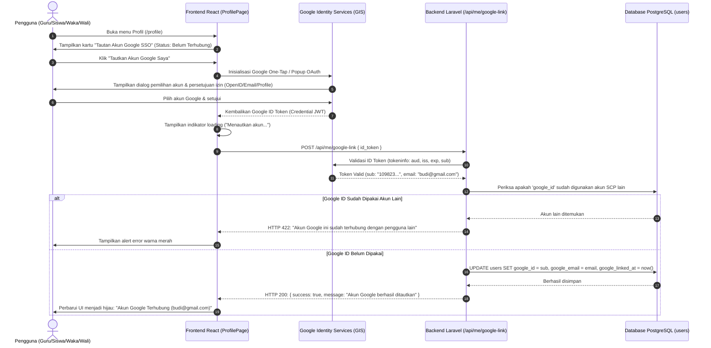
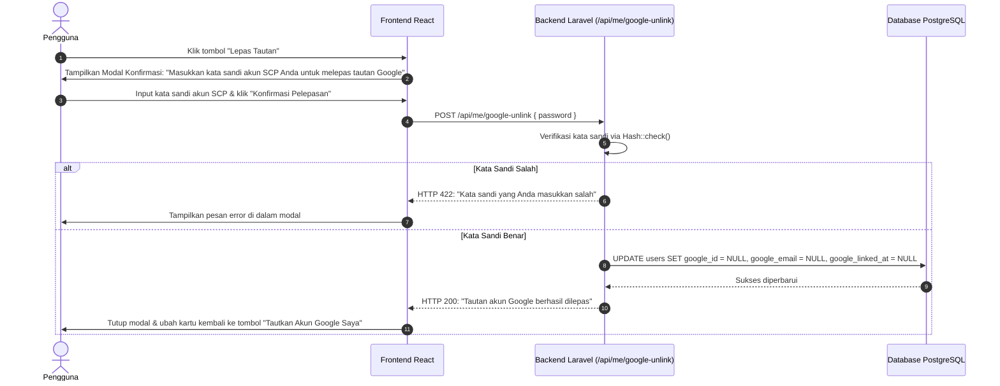
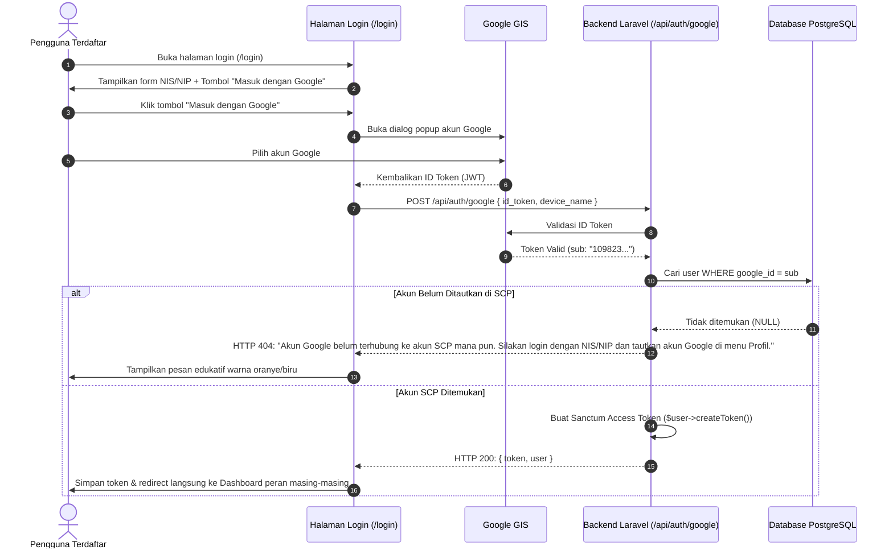

# Analisis Arsitektur dan Rencana Implementasi: Fitur Tautkan Akun Google & Google Single Sign-On (SSO)

**Project:** School Class Progress (SCP) — SMK Negeri 1 Bantul  
**Versi Dokumen:** v1.0 (Hasil Audit Arsitektur & Perencanaan Teknis)  
**Status:** Menunggu Persetujuan Pengguna (*Pending User Approval — Read-Only Planning Phase*)  
**Lokasi Dokumen:** `D:\MyUKK\SchoolClassProject\scp\MD\rencana_implementasi_google_sso.md`  

> [!IMPORTANT]
> **Pernyataan Kepatuhan Prinsip Perencanaan:**  
> Dokumen ini disusun sebagai hasil analisis menyeluruh terhadap arsitektur backend Laravel, frontend React, database PostgreSQL, serta integrasi Google API yang sudah tersedia pada project School Class Progress (SCP). Sesuai arahan, **tidak ada perubahan kode, migrasi database, manipulasi akun, maupun modifikasi konfigurasi Google Cloud Console yang dieksekusi** pada tahap ini. Implementasi baru akan dimulai setelah seluruh poin keputusan teknis mendapatkan persetujuan eksplisit.

---

## Daftar Isi

1. [Ringkasan dan Tujuan Pengembangan](#1-ringkasan-dan-tujuan-pengembangan)
2. [Hasil Analisis Implementasi Demo Saat Ini](#2-hasil-analisis-implementasi-demo-saat-ini)
3. [Identifikasi Masalah dan Kebutuhan Sistem](#3-identifikasi-masalah-dan-kebutuhan-sistem)
4. [Rancangan Alur Pengguna (User Flow)](#4-rancangan-alur-pengguna-user-flow)
5. [Rancangan Arsitektur Google SSO](#5-rancangan-arsitektur-google-sso)
6. [Rancangan Integrasi Backend Laravel](#6-rancangan-integrasi-backend-laravel)
7. [Rancangan Integrasi Frontend React](#7-rancangan-integrasi-frontend-react)
8. [Rancangan Database dan Relasi Akun](#8-rancangan-database-dan-relasi-akun)
9. [Rancangan Keamanan dan Mitigasi Risiko](#9-rancangan-keamanan-dan-mitigasi-risiko)
10. [Kompatibilitas dengan Seluruh Role SCP](#10-kompatibilitas-dengan-seluruh-role-scp)
11. [Kebutuhan Konfigurasi Google Cloud Console](#11-kebutuhan-konfigurasi-google-cloud-console)
12. [Skenario Pengujian dan Kriteria Keberhasilan](#12-skenario-pengujian-dan-kriteria-keberhasilan)
13. [Tahapan Implementasi dan Dependensi](#13-tahapan-implementasi-dan-dependensi)
14. [Daftar Keputusan yang Membutuhkan Konfirmasi Saya](#14-daftar-keputusan-yang-membutuhkan-konfirmasi-saya)

---

## 1. Ringkasan dan Tujuan Pengembangan

Fitur **Tautkan Akun Google (Google SSO)** dirancang untuk memberikan kemudahan autentikasi modern (*seamless authentication*) bagi seluruh pengguna sistem School Class Progress (SCP) di SMK Negeri 1 Bantul, yang mencakup 4 peran:
1. **Waka Kurikulum / Administrator (`vice_principal`)**
2. **Guru Mata Pelajaran / Wali Kelas / Guru BK (`teacher`)**
3. **Peserta Didik / Siswa (`student`)**
4. **Wali Murid / Orang Tua (`parent`)**

Saat ini, tampilan antarmuka (UI) penautan akun Google pada halaman Profil pengguna masih berupa **simulasi demo lokal (*dummy mock-up*)** yang hanya mengubah state memori browser tanpa berinteraksi dengan API Google maupun menyimpan data ke basis data server.

### Tujuan Utama Pengembangan:
1. **Transisi dari Simulasi Demo ke Integrasi Produksi:** Menggantikan tombol tiruan dengan Google Identity Services (GIS) / OAuth 2.0 resmi dari Google.
2. **Verifikasi Identitas Sah (Google Subject ID):** Mengaitkan identitas unik pengguna Google (`sub`) secara aman ke akun pengguna SCP di database PostgreSQL.
3. **Mendukung Fitur Lepas Tautan (*Unlink Google Account*):** Menyediakan mekanisme bagi pengguna untuk memutus tautan akun Google secara aman dengan validasi kata sandi akun (*Step-Up Authentication*).
4. **Peluang Login Sekali Klik (1-Click Google Login):** Menyediakan opsi masuk instan bagi akun yang telah tertaut tanpa perlu mengetikkan NIS/NIP dan kata sandi berulang kali.
5. **Mempertahankan Keamanan & Skema Sekolah:** Memastikan sistem tetap bersifat tertutup (*closed school system*)—tidak mengizinkan akun Google asing mendaftar otomatis tanpa akun SCP yang sah dari pihak sekolah.

---

## 2. Hasil Analisis Implementasi Demo Saat Ini

Pemeriksaan mendalam terhadap kode sumber frontend dan backend SCP menghasilkan temuan berikut:

### 2.1 Kondisi Frontend Saat Ini (`ProfilePage.jsx`)
Pada [`frontend/scp_web/src/pages/profile/ProfilePage.jsx`](file:///d:/MyUKK/SchoolClassProject/frontend/scp_web/src/pages/profile/ProfilePage.jsx#L400-L426):
```jsx
{/* Google SSO Linking */}
<div className="bg-white border border-gray-200 rounded-lg p-5 sm:p-6">
  <div className="mb-2">
    <h2 className="text-base font-semibold text-gray-900">Tautan Akun Google SSO</h2>
  </div>
  <p className="text-xs text-gray-500 mb-3">
    Tautkan akun Google untuk mempermudah login sekali klik tanpa perlu mengetik kata sandi.
  </p>
  {googleConnected ? (
    <div className="flex items-center justify-between p-3 bg-emerald-50 border border-emerald-200 rounded text-emerald-800 text-xs font-medium">
      <span className="flex items-center gap-2">
        <span className="status-dot status-dot--success" />
        <span>Akun Google Terhubung</span>
      </span>
      <span className="text-[11px] text-emerald-600 font-semibold">Aktif</span>
    </div>
  ) : (
    <Button
      variant="outline"
      size="sm"
      onClick={() => {
        setGoogleConnected(true);
        updateUserProfile({ google_id: 'google_linked_demo' });
      }}
    >
      Tautkan Akun Google Saya
    </Button>
  )}
</div>
```

#### Kelemahan Implementasi Demo Frontend:
1. **Hanya Mutasi State Lokal:** Ketika tombol ditekan, fungsi hanya menjalankan `setGoogleConnected(true)` dan menyimpan teks fiktif `'google_linked_demo'` ke `localStorage` melalui `updateUserProfile()`.
2. **Tidak Ada Panggilan Jaringan:** Tidak ada request HTTP apa pun ke endpoint backend (`/api/me/google-link`).
3. **Data Kontak Google Tidak Muncul:** Kotak hijau "Akun Google Terhubung" tidak menampilkan informasi akun mana yang terhubung (alamat email Google, nama akun Google, maupun foto profil).
4. **Tidak Ada Fitur Lepas Tautan (*Unlink*):** Pengguna yang sudah berada pada status terhubung tidak memiliki tombol untuk memutuskan tautan akun Google.
5. **Belum Ada Integrasi di Halaman Login:** Pada [`LoginPage.jsx`](file:///d:/MyUKK/SchoolClassProject/frontend/scp_web/src/pages/auth/LoginPage.jsx), belum tersedia tombol "Masuk dengan Google".

---

### 2.2 Kondisi Backend Saat Ini (`ProfileController.php` & `AuthController.php`)
Di sisi backend Laravel, sebenarnya **sudah terdapat pondasi controller awal**, namun belum dihubungkan dengan frontend:
1. **Endpoint Penautan:** `POST /api/me/google-link` pada [`ProfileController@linkGoogle`](file:///d:/MyUKK/SchoolClassProject/scp/app/Http/Controllers/API/ProfileController.php#L272).
   - Menerima parameter `id_token` (JWT dari Google).
   - Memvalidasi token melalui helper `self::verifyGoogleIdToken($idToken)`.
   - Mengambil klaim `sub` (Google Subject ID) dan `email`.
   - Menolak jika `google_id` sudah digunakan oleh user lain.
   - Mengisi otomatis `users.email` dan `email_verified_at` jika email akun SCP masih kosong.
2. **Helper Verifikasi Token:** `ProfileController::verifyGoogleIdToken`
   - Memanggil endpoint resmi Google: `https://oauth2.googleapis.com/tokeninfo?id_token={idToken}`.
   - Memeriksa klaim `aud` (audience) terhadap `config('services.google.client_id')`.
3. **Endpoint Login Google:** `POST /api/auth/google` pada [`AuthController@loginWithGoogle`](file:///d:/MyUKK/SchoolClassProject/scp/app/Http/Controllers/API/AuthController.php#L115).
   - Menerima `id_token` dan `device_name`.
   - Mencari akun berdasarkan `google_id`. Jika tidak ditemukan, mengembalikan HTTP 404: *"Akun Google belum terhubung ke akun SCP mana pun. Silakan login menggunakan NIS/NIP dan tautkan akun Google di menu profil."*
4. **Kekurangan Backend Saat Ini:**
   - **Belum Ada Endpoint Pelepasan Tautan:** Tidak ada rute `DELETE /api/me/google-link` atau `POST /api/me/google-unlink`.
   - **Belum Ada Proteksi Kata Sandi Saat Unlink:** Melepas tautan autentikasi sensitif belum memiliki pengaman kata sandi.

---

### 2.3 Kondisi Database Saat Ini
- Pada tabel `users`: Kolom `google_id` sudah tersedia (`$table->string('google_id')->nullable()`).
- **Audit Data Aktual:** Berdasarkan query database, saat ini **jumlah akun dengan `google_id` adalah 0 akun (0%)**.
- **Kelemahan Skema:** Kolom `google_id` belum memiliki constraint `UNIQUE` maupun `INDEX` di PostgreSQL. Jika dua request penautan terjadi serentak, ada potensi race condition di level database. Selain itu, belum ada kolom untuk menyimpan email Google secara eksplisit jika berbeda dari email utama akun.

---

## 3. Identifikasi Masalah dan Kebutuhan Sistem

Berdasarkan perbandingan antara sistem aktual dengan kebutuhan integrasi Google SSO produksi:

| No | Komponen | Kondisi Saat Ini | Kebutuhan Solusi Produksi |
| :---: | :--- | :--- | :--- |
| 1 | **Frontend SDK** | Tidak ada script Google Identity Services (GIS). | Memuat SDK resmi Google GIS (`https://accounts.google.com/gsi/client`) secara aman di React. |
| 2 | **Alur Penautan** | Dummy string `google_linked_demo` di localStorage. | Membuka popup resmi Google, menerima ID Token (JWT), mengirim ke backend via `POST /api/me/google-link`. |
| 3 | **Alur Lepas Tautan** | Tidak ada tombol lepas tautan. | Menyediakan tombol "Lepas Tautan" dengan dialog konfirmasi dan verifikasi kata sandi akun (*Step-Up Auth*). |
| 4 | **Informasi Akun** | Hanya teks statis "Aktif". | Menampilkan email Google yang tertaut (contoh: `budi.santoso@gmail.com`) dan status aktif. |
| 5 | **Tombol Login** | Tidak ada di halaman login. | Menambahkan tombol "Masuk dengan Google" di `LoginPage.jsx` yang memanfaatkan token Google untuk login 1-klik. |
| 6 | **Integritas DB** | `google_id` tidak terindeks & tidak unik. | Menambahkan migrasi index unik pada kolom `google_id` serta kolom metadata pendukung (`google_email`, `google_linked_at`). |
| 7 | **Pengamanan Kredensial** | `GOOGLE_CLIENT_SECRET` ada di `.env` backend. | Memastikan `CLIENT_SECRET` tetap rahasia di backend, sementara frontend hanya memegang `VITE_GOOGLE_CLIENT_ID`. |

---

## 4. Rancangan Alur Pengguna (User Flow)

### 4.1 Alur Penautan Akun Google dari Halaman Profil (*Linking Flow*)



---

### 4.2 Alur Pelepasan Tautan Akun Google (*Unlinking Flow*)



---

### 4.3 Alur Login 1-Klik Menggunakan Akun Google (*SSO Login Flow*)



---

## 5. Rancangan Arsitektur Google SSO

### 5.1 Perbandingan Dua Pendekatan Arsitektur

| Kriteria Evaluasi | Pendekatan A: Google Identity Services (GIS) ID Token (Direkomendasikan) | Pendekatan B: OAuth 2.0 Authorization Code Flow (Socialite Redirect) |
| :--- | :--- | :--- |
| **Mekanisme Kerja** | Frontend memicu popup Google resmi $\rightarrow$ Google mengembalikan JWT ID Token $\rightarrow$ Frontend mengirim ID Token ke endpoint REST API Laravel. | Browser di-redirect ke Google $\rightarrow$ Google redirect kembali ke URL callback backend $\rightarrow$ Backend tukar code ke access token. |
| **Kesesuaian dengan Arsitektur SCP** | **Sangat Sesuai.** SCP memisahkan frontend (React SPA di port 5173) dan backend (Laravel API di port 8000). | **Kurang Sesuai.** Menimbulkan masalah penanganan state cookie sesi lintas origin/port (CORS & SameSite cookie issue). |
| **Kesiapan Kode Aktual** | **90% Siap.** Backend SCP sudah memiliki `ProfileController::verifyGoogleIdToken` dan rute `POST /api/auth/google`. | **0% Siap.** Perlu instalasi package `laravel/socialite`, konfigurasi redirect URL ganda, dan penanganan session state server. |
| **Pengalaman Pengguna (UX)** | **Modern & Mulus.** Berjalan dalam popup overlay tanpa reload halaman penuh. | **Kaku.** Layar browser reload berpindah domain ke Google lalu kembali lagi. |
| **Kebutuhan Rahasia (Client Secret)** | Client Secret hanya disimpan di backend `.env` untuk verifikasi tambahan jika diperlukan. | Client Secret mutlak digunakan backend untuk menukar code. |

> [!TIP]
> **Rekomendasi Arsitektural:**  
> Gunakan **Pendekatan A (Google Identity Services - GIS ID Token)** karena sangat selaras dengan REST API Sanctum SCP yang sudah berjalan, tidak memerlukan perubahan routing frontend SPA, dan bebas dari isu CORS cookie redirect.

---

## 6. Rancangan Integrasi Backend Laravel

### 6.1 Service Layer Baru: `GoogleAuthService.php`
Untuk merapikan kode dan tidak menumpuk logika verifikasi di controller, dibuat service mandiri:  
📁 `scp/app/Services/GoogleAuthService.php`

Tanggung jawab service:
1. `verifyIdToken(string $idToken): ?array`:
   - Memvalidasi ID Token ke endpoint Google (`https://oauth2.googleapis.com/tokeninfo`).
   - Memvalidasi kecocokan `aud` dengan `GOOGLE_CLIENT_ID`.
   - Memvalidasi bahwa issuer (`iss`) berasal dari `accounts.google.com` atau `https://accounts.google.com`.
   - Memvalidasi bahwa token belum kedaluwarsa (`exp > now()`).
2. `linkAccount(User $user, array $googleData): array`:
   - Memastikan `google_id` (`sub`) belum digunakan akun SCP lain.
   - Menyimpan `google_id`, `google_email`, dan `google_linked_at`.
   - Mengisi otomatis `users.email` jika akun SCP belum memiliki email (dengan persetujuan).
3. `unlinkAccount(User $user, string $passwordConfirmation): array`:
   - Memvalidasi kata sandi saat ini (`Hash::check`).
   - Mengosongkan `google_id`, `google_email`, dan `google_linked_at`.

### 6.2 Endpoint API Backend

| Method | Endpoint | Hak Akses | Fungsi |
| :---: | :--- | :---: | :--- |
| `POST` | `/api/me/google-link` | Terautentikasi (`auth:sanctum`) | Menautkan akun Google yang sedang aktif di browser pengguna ke akun SCP login. |
| `POST` | `/api/me/google-unlink` | Terautentikasi (`auth:sanctum`) | Melepas tautan akun Google dengan konfirmasi kata sandi. |
| `POST` | `/api/auth/google` | Publik | Login 1-klik bagi akun yang sudah menautkan Google. |

#### Spesifikasi Request & Response:

1. **`POST /api/me/google-link`**
   - **Request:**
     ```json
     {
       "id_token": "eyJhbGciOiJSUzI1NiIsImtpZCI6..."
     }
     ```
   - **Response Berhasil (HTTP 200):**
     ```json
     {
       "success": true,
       "message": "Akun Google berhasil ditautkan ke profil Anda.",
       "data": {
         "google_id": "108293817293812739182",
         "google_email": "budi.santoso@gmail.com",
         "google_linked_at": "2026-11-05 12:30:00",
         "user": { ... }
       }
     }
     ```
   - **Response Konflik (HTTP 422):**
     ```json
     {
       "success": false,
       "message": "Akun Google ini sudah terhubung dengan akun pengguna lain di sistem SCP.",
       "errors": {
         "google_id": ["Akun Google sudah digunakan oleh pengguna lain."]
       }
     }
     ```

2. **`POST /api/me/google-unlink`**
   - **Request:**
     ```json
     {
       "password": "PasswordSaatIni123!"
     }
     ```
   - **Response Berhasil (HTTP 200):**
     ```json
     {
       "success": true,
       "message": "Tautan akun Google berhasil dilepas dari profil Anda."
     }
     ```
   - **Response Password Salah (HTTP 422):**
     ```json
     {
       "success": false,
       "message": "Kata sandi yang Anda masukkan salah.",
       "errors": {
         "password": ["Kata sandi tidak valid."]
       }
     }
     ```

---

## 7. Rancangan Integrasi Frontend React

### 7.1 Pemuatan Google Identity Services (GIS) Script
Agar tidak memberatkan performa awal aplikasi, script Google Identity Services (`https://accounts.google.com/gsi/client`) dimuat secara asinkron (*lazy-loaded*) melalui custom hook:  
📁 `frontend/scp_web/src/hooks/useGoogleAuth.js`

Hook ini menangani:
- Inisialisasi Google Client ID dari `import.meta.env.VITE_GOOGLE_CLIENT_ID`.
- Pemicu popup pemilihan akun Google menggunakan API `google.accounts.id.initialize` dan `google.accounts.id.prompt` (atau OAuth 2.0 Token Client).
- Penanganan callback saat pengguna membatalkan dialog atau menutup popup (*Error handling & cancel listener*).

### 7.2 Pembaruan Komponen Halaman Profil (`ProfilePage.jsx`)
Bagian kartu penautan Google pada `ProfilePage.jsx` diperbarui menjadi **komponen interaktif dinamis**:
- **Saat Akun Belum Ditautkan:**
  - Menampilkan deskripsi manfaat login 1-klik.
  - Tombol bermerek resmi Google: *"Tautkan Akun Google Saya"* dengan logo Google SVG multi-warna.
  - Status indikator proses (*loading spinner*) saat dialog Google terbuka.
- **Saat Akun Sudah Ditautkan:**
  - Kotak hijau berdesain presisi:
    - Label: **"Akun Google Terhubung"**
    - Email tertaut: **`budi.santoso@gmail.com`**
    - Tanggal penautan: *"Ditautkan pada 5 Nov 2026"*
  - Tombol sekunder: **"Lepas Tautan"** (warna abu-abu/merah halus).
  - Mengklik "Lepas Tautan" membuka modal konfirmasi keamanan:
    - Input kata sandi akun saat ini.
    - Tombol "Batal" dan "Ya, Lepas Tautan".
    - Notifikasi toast berhasil setelah pelepasan selesai.

### 7.3 Penambahan Tombol Login pada Halaman Masuk (`LoginPage.jsx`)
Jika disetujui untuk mengaktifkan login Google:
- Pada `LoginPage.jsx`, di bawah tombol "Masuk":
  - Diberikan garis pemisah (*divider*): *"atau masuk dengan"*
  - Tombol Google berukuran penuh: *"Masuk dengan Akun Google"*
  - Jika akun Google yang dipilih belum pernah ditautkan di profil, sistem menampilkan notifikasi ramah:  
    *"Akun Google belum terhubung. Silakan login menggunakan NIS/NIP Anda terlebih dahulu, kemudian tautkan akun Google di menu Profil."*

---

## 8. Rancangan Database dan Relasi Akun

### 8.1 Evaluasi Skema Tabel `users`
Tabel `users` saat ini sudah memiliki kolom `google_id` bertipe string nullable. Namun untuk kebutuhan sistem produksi, diperlukan penambahan kolom metadata dan penguatan integritas data:

```php
// Migrasi Baru: 2026_11_08_000001_enhance_google_sso_in_users_table.php
public function up(): void
{
    Schema::table('users', function (Blueprint $table) {
        // 1. Simpan email akun Google secara spesifik
        $table->string('google_email')->nullable()->after('google_id');
        
        // 2. Catat waktu penautan
        $table->timestamp('google_linked_at')->nullable()->after('google_email');
        
        // 3. Tambahkan index unik agar 1 akun Google tidak bisa ditautkan ke 2 user berbeda
        $table->unique('google_id', 'users_google_id_unique');
    });
}
```

### 8.2 Manfaat Penambahan Kolom Ini:
1. **Pemisahan Email Sekolah vs Email Google:** Akun sekolah mungkin memiliki email `19413@smkn1bantul.sch.id`, sedangkan akun Google yang digunakan siswa adalah `ahmad.fajar@gmail.com`. Dengan kolom `google_email`, sistem tetap mengetahui alamat Google pengguna tanpa menimpa alamat email utama sekolah.
2. **Audit Keamanan:** `google_linked_at` memberikan kejelasan bagi pengguna dan Waka kapan penautan akun tersebut dilakukan.
3. **Pencegahan Akun Ganda (Unique Constraint):** Mencegah celah di mana seorang siswa menautkan akun Google yang sama ke akun temannya.

---

## 9. Rancangan Keamanan dan Mitigasi Risiko

| No | Potensi Serangan / Risiko | Skenario Celah | Mitigasi yang Diterapkan di Desain |
| :---: | :--- | :--- | :--- |
| 1 | **Account Takeover via Komputer Bersama** | Komputer di lab sekolah ditinggalkan dalam kondisi login. Siswa lain menekan "Tautkan Akun Google" dan memasukkan akun Google miliknya untuk membajak akun. | - Saat penautan akun Google, sistem dapat mewajibkan konfirmasi kata sandi akun SCP.<br>- Saat pelepasan tautan, **wajib** memasukkan kata sandi akun SCP saat ini (*Step-Up Auth*). |
| 2 | **Pemalsuan Token Google (Token Spoofing)** | Penyerang mengirim ID Token sembarang atau token dari aplikasi lain ke backend SCP. | - Backend memvalidasi token langsung ke server Google (`tokeninfo`).<br>- Backend **memeriksa klaim `aud` (audience)**: token ditolak jika `aud !== GOOGLE_CLIENT_ID`.<br>- Backend memeriksa `iss` (harus `accounts.google.com`). |
| 3 | **Pendaftaran Akun Liar (Unregulated Registration)** | Orang luar yang memiliki sembarang akun `@gmail.com` mencoba login via tombol Google untuk membuat akun di SCP. | - **Kebijakan Nol Registrasi Mandiri:** Backend menolak login jika `google_id` belum pernah ditautkan sebelumnya oleh pengguna sah dari dalam menu profil. |
| 4 | **Kebocoran Client Secret** | Client Secret terpasang pada kode bundle React di browser pengguna. | - `GOOGLE_CLIENT_SECRET` **hanya disimpan di server backend** (`.env` Laravel).<br>- Frontend React hanya memegang `VITE_GOOGLE_CLIENT_ID` yang bersifat publik aman (*Public Client ID*). |
| 5 | **Satu Akun Google untuk Banyak Akun SCP** | Seorang pengguna mencoba menautkan akun Google yang sama ke beberapa akun sekaligus. | - Ditegakkan melalui constraint database `users_google_id_unique` dan validasi controller `where('google_id', $sub)->where('id', '!=', $user->id)`. |

---

## 10. Kompatibilitas dengan Seluruh Role SCP

Fitur Google SSO dirancang sepenuhnya netral terhadap peran pengguna (*Role-Agnostic*):

1. **Waka Kurikulum (`vice_principal`):**
   - Dapat menautkan akun Google resmi instansi (`waka@smkn1bantul.sch.id`) atau email kedinasan.
2. **Guru (`teacher`):**
   - Guru dapat menautkan akun Google untuk mempercepat login harian saat mengisi jurnal KBM dan presensi kelas tanpa repot memasukkan NIP 18-digit setiap hari.
3. **Siswa (`student`):**
   - Siswa dapat menautkan akun Google mereka di ponsel/laptop untuk akses cepat ke jadwal pelajaran, presensi harian, dan kuis.
4. **Orang Tua / Wali Murid (`parent`):**
   - Sangat membantu orang tua yang sering lupa format ID login `P-[NIS]`. Cukup login 1-klik menggunakan akun Google pribadi yang sudah ditautkan.
5. **Kemandirian Kredensial Asli:**
   - **Kredensial reguler (NIS/NIP dan Kata Sandi) TIDAK AKAN PERNAH DIHAPUS.** Seluruh pengguna tetap dapat masuk menggunakan NIS/NIP dan kata sandi seperti biasa, kapan pun mereka inginkan.

---

## 11. Kebutuhan Konfigurasi Google Cloud Console

Untuk mengaktifkan integrasi Google secara nyata, sistem membutuhkan konfigurasi pada **Google Cloud Console**:

1. **Project GCP:** Proyek aktif di Google Cloud Console (misal: `SCP-SMKN1-Bantul`).
2. **OAuth Consent Screen (Layar Persetujuan OAuth):**
   - Nama Aplikasi: **School Class Progress (SCP)**
   - Logo Sekolah: Logo SMKN 1 Bantul.
   - User Support Email: Email administrator sekolah.
   - Scopes: `.../auth/userinfo.email`, `.../auth/userinfo.profile`, `openid`.
3. **OAuth 2.0 Client ID (Web Application):**
   - **Authorized JavaScript Origins:**
     - `http://localhost:5173` (Frontend Development Vite)
     - `http://localhost:8000` (Backend Development)
     - `https://scp.smkn1bantul.sch.id` (Domain Produksi Sekolah)
   - **Authorized Redirect URIs:**
     - `http://localhost:5173`
     - `https://scp.smkn1bantul.sch.id`
4. **Environment Variables:**
   - Backend (`scp/.env`):
     ```env
     GOOGLE_CLIENT_ID=517786684277-xxxxxxxxxxxx.apps.googleusercontent.com
     GOOGLE_CLIENT_SECRET=GOCSPX-xxxxxxxxxxxx
     ```
   - Frontend (`frontend/scp_web/.env`):
     ```env
     VITE_GOOGLE_CLIENT_ID=517786684277-xxxxxxxxxxxx.apps.googleusercontent.com
     ```

---

## 12. Skenario Pengujian dan Kriteria Keberhasilan

### 12.1 Matriks Skenario Uji Otomatis & Manual

1. **Uji Validasi Token Google Backend:**
   - Mengirim request penautan dengan token fiktif/palsu $\rightarrow$ Ditolak HTTP 422 (*Invalid Token*).
   - Mengirim token dengan `aud` yang berbeda dari `GOOGLE_CLIENT_ID` $\rightarrow$ Ditolak HTTP 422 (*Audience Mismatch*).
   - Mengirim token valid $\rightarrow$ Diterima HTTP 200, `google_id` tersimpan di database.
2. **Uji Konflik Akun Google:**
   - Menautkan akun Google yang sudah ditautkan oleh Akun A ke Akun B $\rightarrow$ Ditolak HTTP 422 (*Google Account Already Linked to Another User*).
3. **Uji Pelepasan Tautan (Unlink):**
   - Meminta unlink dengan kata sandi akun SCP yang salah $\rightarrow$ Ditolak HTTP 422 (*Wrong Password*).
   - Meminta unlink dengan kata sandi akun SCP yang benar $\rightarrow$ Diterima HTTP 200, `google_id` dan `google_email` di database kembali `NULL`.
4. **Uji Login Google:**
   - Akun Google belum ditautkan ke akun SCP mana pun $\rightarrow$ Ditolak HTTP 404 disertai pesan instruksi login biasa.
   - Akun Google sudah ditautkan $\rightarrow$ Berhasil login HTTP 200, menerima Sanctum token.
   - Akun SCP berstatus nonaktif (`is_active = false`) $\rightarrow$ Ditolak HTTP 403 (*Account Inactive*).
5. **Uji Kompatibilitas Login Biasa:**
   - Setelah menautkan Google, pengguna mencoba login menggunakan NIS/NIP dan kata sandi biasa $\rightarrow$ Tetap berfungsi 100% normal.

### 12.2 Kriteria Keberhasilan:
- [ ] Tombol demo `updateUserProfile({ google_id: 'google_linked_demo' })` dihapus sepenuhnya.
- [ ] Penautan akun Google membuka popup resmi Google dan menyimpan data riil di server.
- [ ] Pengguna dapat melihat alamat email Google yang tertaut secara transparan.
- [ ] Pengguna dapat melepas tautan akun Google kapan saja dengan konfirmasi kata sandi.
- [ ] Tidak ada celah bagi akun Google sembarang untuk mendaftar otomatis ke sistem SCP.
- [ ] Build produksi frontend (`npm run build`) dan pengujian PHPUnit lulus 100%.

---

## 13. Tahapan Implementasi dan Dependensi

Pekerjaan implementasi akan dibagi ke dalam **4 Fase Terstruktur**:

```
[ Fase 1: Database Migration & Backend Service Layer ]
  ├── Migrasi: penambahan google_email, google_linked_at, unique index
  ├── Pembuatan GoogleAuthService (validasi tokeninfo, link, unlink)
  └── Pembaruan ProfileController & AuthController
        │
        ▼
[ Fase 2: Backend API Endpoints & Feature Test ]
  ├── Pendaftaran rute POST /api/me/google-unlink di routes/api.php
  └── Pembuatan Automated Feature Test: GoogleSsoTest.php
        │
        ▼
[ Fase 3: Frontend SDK, Hook, Profile UI & Login Integration ]
  ├── Pembuatan useGoogleAuth hook (integrasi Google Identity Services)
  ├── Konfigurasi VITE_GOOGLE_CLIENT_ID di frontend/.env
  ├── Refactoring ProfilePage.jsx (Tautan riil, kartu email tertaut, modal unlink)
  └── (Opsional) Penambahan tombol "Masuk dengan Google" di LoginPage.jsx
        │
        ▼
[ Fase 4: Pengujian Komprehensif & Verifikasi Build ]
  ├── Eksekusi PHPUnit test suite (GoogleSsoTest, ForgotPasswordTest, AcademicCalendarTest)
  ├── Pengujian manual flow popup Google
  └── Eksekusi npm run build (verifikasi bebas broken import & sintaks error)
```

---

## 14. Daftar Keputusan yang Membutuhkan Konfirmasi Saya

Sebelum memasuki tahap implementasi kode, mohon konfirmasi dan persetujuan Anda terhadap **4 poin keputusan penting** berikut:

### 1. Penyediaan Tombol "Masuk dengan Google" di Halaman Login (`LoginPage.jsx`)
- **Opsi A (Direkomendasikan):** Sediakan tombol resmi *"Masuk dengan Akun Google"* di bawah form login pada `LoginPage.jsx`. Jika akun Google sudah ditautkan di profil, pengguna dapat login 1-klik tanpa kata sandi. Jika belum pernah ditautkan, sistem menampilkan pesan panduan untuk login menggunakan NIS/NIP terlebih dahulu.
- **Opsi B:** Google SSO hanya digunakan sebagai status verifikasi di menu Profil saja, **tanpa** menyediakan tombol login Google di halaman depan.

### 2. Kebijakan Sinkronisasi Email Akun SCP dengan Email Google
Mengingat 99.9% akun guru, siswa, dan wali murid saat ini belum memiliki alamat email di database:
- **Opsi A (Direkomendasikan - Non-Destruktif):** Jika kolom `users.email` masih kosong saat pengguna menautkan Google, sistem otomatis mengisi `users.email` dengan email Google dan menandai `email_verified_at = now()`. Jika `users.email` sudah ada (misal email resmi sekolah), sistem mempertahankan email sekolah tersebut dan menyimpan email Google pada kolom terpisah `google_email`.
- **Opsi B:** Jangan pernah menyentuh kolom `users.email`, hanya simpan identitas Google pada `google_id` dan `google_email`.

### 3. Konfirmasi Keamanan Saat Melepas Tautan (*Unlink Google Account*)
- **Opsi A (Direkomendasikan - Sangat Aman):** Mewajibkan pengguna memasukkan kata sandi akun SCP saat ingin melepas tautan Google (*Step-Up Authentication*), demi mencegah sabotase jika perangkat ditinggal dalam keadaan login.
- **Opsi B:** Melepas tautan langsung melalui tombol konfirmasi biasa tanpa meminta kata sandi.

### 4. Pendekatan Library Integrasi di Frontend React
- **Opsi A (Direkomendasikan - Ringan & Resmi Google):** Memuat script resmi Google Identity Services (`https://accounts.google.com/gsi/client`) secara dinamis melalui custom React hook tanpa menambah beban paket npm eksternal (*Zero Dependency Overhead*).
- **Opsi B:** Menginstal paket npm pihak ketiga `@react-oauth/google`.

---

*Dokumen ini telah disimpan di:*  
[`d:\MyUKK\SchoolClassProject\scp\MD\rencana_implementasi_google_sso.md`](file:///d:/MyUKK/SchoolClassProject/scp/MD/rencana_implementasi_google_sso.md)
