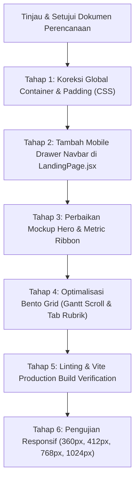

# Rencana Kerja: Optimalisasi Mobile Responsiveness Landing Page SCP
**Aplikasi:** School Class Progress (SCP) — SMK Negeri 1 Bantul  
**Target Halaman:** Landing Page (`frontend/scp_web/src/pages/landing/`)  
**Design System:** Exness Precision Clean &middot; Font Tunggal: Plus Jakarta Sans  
**Status Dokumen:** Perencanaan (Menunggu Persetujuan User)

---

## 1. Analisis & Audit Masalah Tampilan Mobile Saat Ini

Berdasarkan audit layout dan styling pada viewport mobile (< 768px, khususnya 360px – 430px), ditemukan beberapa masalah utama yang menyebabkan tampilan terasa sempit, terpotong, atau tidak rapi (*"masih jelek"*):

```
+-----------------------------------------------------------------------------------+
| 1. Double Padding Kiri-Kanan                                                      |
|    - Tag <section> memiliki class Tailwind 'px-6' (24px)                          |
|    - Tag '.landing-container' di dalamnya juga memiliki padding 24px              |
|    - Total padding samping = 48px kiri + 48px kanan = 96px terbuang!              |
|    - Pada layar 360px, lebar konten tersisa hanya 264px.                          |
+-----------------------------------------------------------------------------------+
| 2. Navigasi Terpotong Tanpa Menu Mobile                                           |
|    - Menu navigasi desktop ('Fondasi', 'Fitur Utama', 'Keandalan') di-hidden      |
|      total via CSS 'display: none', tanpa ada burger menu atau drawer mobile.     |
|    - Pengguna mobile tidak memiliki akses loncat section.                         |
+-----------------------------------------------------------------------------------+
| 3. Titlebar & Preview Hero Mockup Sempit & Overflow                               |
|    - Window titlebar memuat URL lengkap + status 'LIVE SYNC: AKTIF' secara sejajar|
|      menyebabkan tabrakan teks pada layar < 420px.                                |
|    - Tabel KBM internal terpotong secara canggung tanpa petunjuk scroll sentuh.   |
|    - Padding internal 'p-6' terlalu tebal untuk ukuran layar HP.                  |
+-----------------------------------------------------------------------------------+
| 4. Metric Strip Ribbon 2-Kolom Terlalu Rapat                                      |
|    - 'grid-cols-2' dengan gap 24px dan ikon 48px menyisakan lebar teks < 80px.    |
|    - Judul 'Dual-Cycle Sync' dan 'Exception-Based' terpotong menjadi 3-4 baris.   |
+-----------------------------------------------------------------------------------+
| 5. Engine Pipeline Card Terlalu Terkompresi                                       |
|    - Padding kartu gelap 36px kiri & kanan memakan 72px.                          |
|    - Garis putus-putus pipeline sebelumnya di-hidden pada layar < 1024px          |
|      sehingga lingkaran tampak mengambang tanpa alur proses yang jelas.           |
+-----------------------------------------------------------------------------------+
| 6. Bento Grid 4: Gantt Strip 10 JP Hancur di Layar Ponsel                         |
|    - 10 kolom jam pelajaran (J1 - J9 + IST) dipaksa masuk dalam 1 baris grid.     |
|    - Pada layar HP, lebar kolom hanya ~20px sehingga badge 'INVAL' dan 'IZIN'     |
|      terpotong dan tidak terbaca.                                                 |
+-----------------------------------------------------------------------------------+
| 7. Bento Grid 3: Tab Rubrik AI & Legend Grafik Bertumpuk                          |
|    - Tombol tab 'Nilai Rata-rata' vs 'Rubrik AI' berbenturan dengan judul card.   |
|    - Label sumbu X sparkline (07:00 s.d 15:00) saling bertumpuk pada layar kecil.|
+-----------------------------------------------------------------------------------+
```

---

## 2. Strategi Responsif & Standar Breakpoint

Mengacu pada prinsip arsitektur *Mobile-First Enhanced*:

| Breakpoint | Rentang Layar | Target Device | Penyesuaian Kunci |
| :--- | :--- | :--- | :--- |
| **`xs`** | `< 480px` | Ponsel Ringkas (360px – 430px: iPhone SE, Galaxy S, Redmi) | Padding container 16px, font judul proporsional, compact card padding (16px), drawer navigasi mobile. |
| **`sm`** | `480px – 639px` | Ponsel Lebar / Phablet | Padding container 20px, 2-kolom seimbang untuk ribbon & bento cards. |
| **`md`** | `640px – 1023px`| Tablet Portrait & Landscape (iPad, Galaxy Tab) | Padding 24px, 2-kolom grid, neutral 3D perspective, side-by-side elements. |
| **`lg` / `xl`**| `≥ 1024px` | Desktop & Laptop | Full dynamic 12-kolom bento grid, 3D perspective window frame tilt, fixed sticky editorial. |

---

## 3. Rencana Perubahan Detail per Section

### A. Global Layout & Spacing
- **Perbaikan Padding Kontainer:**
  - Mengubah `.landing-container` menjadi:
    ```css
    padding-left: 16px;
    padding-right: 16px;
    @media (min-width: 640px) {
      padding-left: 24px;
      padding-right: 24px;
    }
    ```
  - Menghapus redundansi utility `px-6` langsung dari tag `<section>` di JSX agar tidak terjadi padding ganda (*double nesting*).
- **Spasi Vertikal Section:**
  - Mengganti utility statis `py-24` menjadi responsif: `py-14 sm:py-20 md:py-24`.
  - Memberikan ruang napas yang pas di ponsel tanpa menciptakan area kosong (*dead space*) yang berlebihan.

---

### B. Section 0: Sticky Glass Navbar & Mobile Menu Drawer
- **Tombol Brand & Auth:**
  - Ukuran teks brand disesuaikan: `text-base sm:text-lg md:text-xl font-bold` agar tidak mendesak tombol Login pada layar 360px.
  - Tombol Login dibuat lebih proporsional di mobile (`px-3.5 py-2 text-xs`).
- **Navigasi Mobile (Hamburger Toggle + Drawer):**
  - Menambahkan tombol menu hamburger modern (`lucide-react: Menu / X`) di sebelah kanan tombol Login khusus layar `< 768px`.
  - Saat dibuka, drawer meluncur halus (*slide-down transition*) dengan latar belakang kaca blur (`backdrop-blur-md bg-white/95 border-b border-slate-200`).
  - Menampilkan tautan cepat: **Fondasi Arsitektur**, **Kapabilitas Inti (Bento)**, dan **Keandalan Sistem**, lengkap dengan aksi penutup otomatis saat tautan diklik.

---

### C. Section 1: Hero & 3D Perspective App Window Frame
- **Tipografi Hero:**
  - Headline utama: disesuaikan menggunakan `text-2xl sm:text-4xl md:text-5xl lg:text-6xl` dengan `leading-tight` yang rapi.
  - Sub-headline: ukuran font `text-sm sm:text-base text-slate-600`, margin bawah dikurangi dari `mb-14` menjadi `mb-8 sm:mb-12`.
- **Window Frame Mockup:**
  - **Titlebar:** Pada layar `< 480px`, teks URL disingkat menjadi `schoolclassprogress.my.id` (atau truncate elegan) dan badge live sync menjadi ringkas (titik hijau berkedip + label `LIVE`).
  - **Padding Internal:** Diturunkan dari `p-6` menjadi `p-3.5 sm:p-5 md:p-6`.
  - **Sidebar vs Main Table:** 
    - Pada mobile, 2 kotak statistik ringkas (Matched FET & Presensi) ditampilkan dalam format baris kompak (*2-column compact metric strip*) sebelum tabel, sehingga pengguna tidak perlu menggulir jauh untuk melihat tabel KBM.
  - **Tabel KBM:**
    - Dibungkus kontainer dengan `-webkit-overflow-scrolling: touch` dan ditambahkan indikator visual tipis di kanan (*fade edge*) sebagai penanda bahwa tabel dapat digeser secara horizontal jika layar terlalu sempit.

---

### D. Section 2: Metric Strip Ribbon
- **Layout Adaptif:**
  - Di layar `< 640px`: Menggunakan 2 kolom dengan susunan ikon yang lebih kompak (`w-10 h-10` dengan ikon ukuran 18px), gap diperkecil menjadi `gap-3.5`, dan ukuran font dioptimalkan (`text-xs sm:text-sm font-bold`).
  - Teks subjudul disederhanakan dengan `text-[10px]` agar tidak melipat hingga 4 baris.

---

### E. Section 3: Section 01 / Fondasi & Engine Pipeline
- **Editorial Kiri:**
  - Judul `h2`: `text-2xl sm:text-3xl md:text-4xl lg:text-5xl`.
  - Jarak pemisah antar kolom dikurangi dari `gap-16` menjadi `gap-8 sm:gap-12 lg:gap-16`.
- **Kartu Dark Engine Pipeline (`.engine-pipeline-card`):**
  - Padding di mobile diturunkan dari `36px` menjadi `20px sm:28px md:36px`.
  - **Garis Pipeline (`.engine-pipeline-line`):** Tetap ditampilkan di mobile/tablet dengan penyesuaian posisi tengah matematis di balik ikon lingkaran 48px, sehingga alur proses visual tetap terlihat elegan dan tidak putus.
  - Ikon lingkaran dipertahankan sebagai lingkaran sempurna berkat aturan `shrink-0` dan `aspect-ratio: 1 / 1`.

---

### F. Section 4: Section 02 / Dynamic Bento Grid (12-Kolom)
- **Bento 1 (Upload PDF FET & Terminal):**
  - Di mobile/tablet: Dropzone dan Terminal bertumpuk secara vertikal (*1 column stack*).
  - Terminal code: `padding: 14px sm:padding: 20px; font-size: 10.5px sm:11.5px;`. Kode tetap rapi dan tidak meluap keluar box.
- **Bento 2 (Jurnal KBM & Progress Ring):**
  - Tampilan KBM berjalan tetap rapi. Pada mobile, Progress Ring (97%) disejajarkan secara elegan di bawah rincian kehadiran siswa.
- **Bento 3 (Asesmen Kuis AI Gemini):**
  - Header kartu: Judul dan tab filter rubrik menggunakan `flex-col sm:flex-row gap-3` agar tab tidak bertabrakan dengan judul pada layar sempit.
  - Legend grafik: Dibuat `flex-wrap gap-2 text-[9px] sm:text-[10px]`.
  - Sumbu waktu grafik SVG: Ditampilkan secara proporsional (`07:00, 10:00, 13:00, 15:00`) agar label tidak saling tumpang tindih di layar 320px.
- **Bento 4 (Kalender Akademik & Gantt Strip 10 JP):**
  - **Solusi Kritis Gantt Strip:**
    - Membungkus grid 10 JP ke dalam kontainer scroll horizontal bertekstur halus (`overflow-x-auto pb-2 scrollbar-none`) dengan `min-w-[440px]`.
    - Di layar ponsel, pengguna dapat menggeser strip jam pelajaran secara horizontal dengan lancar tanpa ada teks `INVAL` atau `IZIN` yang hancur/terpotong.
    - Menambahkan petunjuk mikro di bawahnya (`Geser untuk melihat 10 JP →`) khusus pada layar `< 640px`.
  - Kartu Resolusi Konflik Otomatis:
    - Ditata ulang dengan `flex-col sm:flex-row items-start sm:items-center gap-2.5 sm:gap-3.5` agar badge `Auto Resolved` tidak terhimpit.

---

### G. Section 5 & 6: Keandalan Sistem & Footer
- **Section Keandalan (4 Kartu Fitur):**
  - `grid grid-cols-1 sm:grid-cols-2 lg:grid-cols-4 gap-4 sm:gap-6`.
  - Padding kartu di mobile: `p-5 sm:p-6`.
- **Footer:**
  - Grid 4 kolom footer: di layar ponsel bertransisi menjadi susunan 2 kolom kompak (`grid-cols-2 gap-6 sm:grid-cols-4`), bukan 1 kolom memanjang, sehingga footer tetap ringkas dan tidak memakan scroll yang terlalu panjang.
  - Area hak cipta dan status REST API v4.6 ditata rapi secara fleksibel di bagian bawah.

---

## 4. Tahapan Pengerjaan & Strategi Verifikasi



---

## 5. Keputusan yang Perlu Konfirmasi Pengguna

Sebelum eksekusi dimulai, mohon konfirmasi untuk 2 poin berikut:
1. **Navigasi Mobile:** Apakah Anda setuju ditambahkan tombol burger menu modern di mobile yang membuka drawer tautan section (*Fondasi, Fitur Utama, Keandalan*), atau cukup hanya menampilkan tombol *Login* saja di mobile navbar tanpa menu section?
2. **Gantt Strip 10 JP (Bento 4):** Apakah Anda setuju jadwal 10 JP di mobile menggunakan model *horizontal-scrollable strip* (lebar proporsional dan teks tidak terpotong) dengan penanda halus di bawahnya?

> Silakan tinjau rencana ini. Begitu Anda setuju atau memberikan arahan terkait dua poin di atas, implementasi akan segera dimulai.
