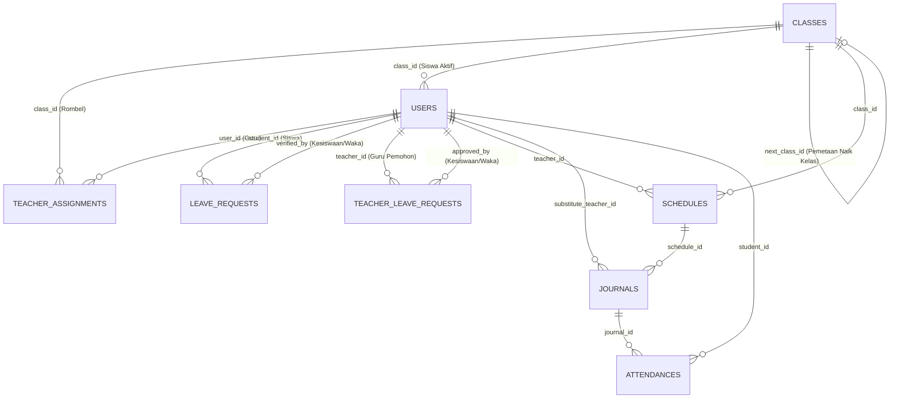
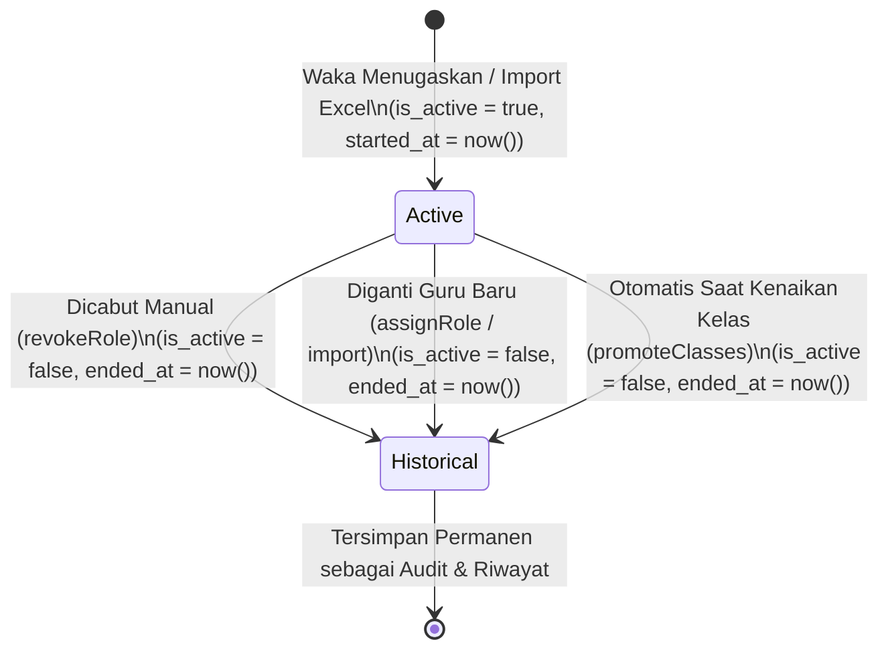

# Analisis Arsitektur dan Rencana Implementasi: Mekanisme Pergantian Wali Kelas dan Kesiswaan Saat Kenaikan Kelas & Pergantian Periode – SCP

> **Status Dokumen:** Rencana Teknis Final – Telah Dikonfirmasi & Siap Implementasi  
> **Tanggal Penyusunan:** 5 November 2026  
> **Target Sistem:** School Class Progress (SCP) – Backend Laravel & Frontend React  
> **Prinsip Utama:** *Zero Historical Data Corruption*, *Non-Destructive Assignment Lifecycle*, & *Context-Aware Access Control*  
> **Keputusan Kebijakan Terkunci:** 1 = Opsi A | 2 = Opsi A | 3 = Opsi A | 4 = Opsi A | 5 = Opsi A | 6 = Opsi B | 7 = Opsi A

---

## 1. Ringkasan Permasalahan

Dalam siklus operasional sekolah pada sistem **School Class Progress (SCP)**, penugasan guru sebagai **Wali Kelas** maupun **Kesiswaan (Guru BK)** bukanlah entitas statis, melainkan bersifat **temporal (terikat waktu dan periode akademik)**. Perubahan penugasan pasti terjadi pada dua momentum utama:
1. **Pergantian Tahun Ajaran / Kenaikan Kelas:** Siswa berpindah tingkat (X $\rightarrow$ XI $\rightarrow$ XII $\rightarrow$ Lulus), dan struktur Wali Kelas serta Guru BK/Kesiswaan untuk setiap rombongan belajar (rombel) dirombak atau diperbarui.
2. **Pergantian di Tengah Tahun Ajaran (*Mid-Year Replacement*):** Guru mengalami mutasi, cuti panjang, pensiun, atau rotasi internal sehingga posisi Wali Kelas atau Kesiswaan suatu kelas digantikan oleh guru lain sebelum tahun ajaran berakhir.

Berdasarkan audit menyeluruh terhadap kode sumber dan skema database SCP saat ini, ditemukan bahwa sistem penugasan (`teacher_assignments`) dan penempatan kelas siswa (`users.class_id`) masih dirancang dengan **model statis satu keadaan (*single current-state model*) tanpa pencatatan riwayat periode maupun snapshot kelas pada transaksi**.

Akibat dari arsitektur saat ini:
- Pencabutan atau penggantian Wali Kelas melakukan **`DELETE` permanen (*hard delete*)** pada baris `teacher_assignments`, sehingga jejak siapa yang pernah menjabat sebagai Wali Kelas/Kesiswaan di periode sebelumnya hilang total.
- Impor massal penugasan Excel (`TeacherAssignmentImportService`) menimpa (*overwrite*) Wali Kelas lama, dan untuk Kesiswaan menggunakan `firstOrCreate` tanpa menonaktifkan Kesiswaan lama sehingga menimbulkan **penumpukan pejabat Kesiswaan ganda yang tidak disengaja** pada satu kelas.
- Saat kenaikan kelas dieksekusi (`SchoolClassController::promoteClasses`), kolom `users.class_id` pada tabel `users` langsung diubah ke kelas baru. Karena modul **Perizinan Siswa (`LeaveRequestController`)** dan **Rekap Presensi (`AttendanceController`)** memfilter data berdasarkan `student.class_id` **saat ini** (bukan kelas siswa saat transaksi terjadi), maka seluruh riwayat izin dan presensi siswa waktu masih di Kelas X **ikut terseret berpindah menjadi data Kelas XI**, dan Wali Kelas X kehilangan seluruh rekam jejak siswanya.

Dokumen ini menyajikan analisis mendalam atas kondisi aktual sistem serta rancangan arsitektur menyeluruh untuk mengatasi permasalahan tersebut secara aman.

---

## 2. Hasil Analisis Sistem Saat Ini

Berikut adalah temuan faktual berdasarkan pemeriksaan kode dan skema database aktual di repositori SCP:

### 2.1. Struktur Tabel & Model `teacher_assignments`
- **File Migrasi:** `scp/database/migrations/2026_09_12_215945_create_teacher_assignments_table.php`
- **Model:** `scp/app/Models/TeacherAssignment.php`
- **Struktur Kolom Aktual:**
  ```sql
  id          BIGINT UNSIGNED PRIMARY KEY
  user_id     BIGINT UNSIGNED NOT NULL REFERENCES users(id) ON DELETE CASCADE
  type        ENUM('kesiswaan', 'wali_kelas') NOT NULL
  class_id    BIGINT UNSIGNED NULL REFERENCES classes(id)
  created_at  TIMESTAMP NULL
  updated_at  TIMESTAMP NULL
  ```
- **Temuan Kritis:**
  1. **Tidak ada dimensi waktu/periode:** Tidak terdapat kolom `academic_year`, `semester`, `is_active`, `started_at`, maupun `ended_at`.
  2. **Tidak ada audit trail:** Tidak tercatat siapa Waka yang menugaskan (`assigned_by`) atau mencabut penugasan (`revoked_by`), serta alasan pencabutan/penggantian.
  3. **Tidak menggunakan Soft Deletes:** Setiap pencabutan langsung menghapus baris dari tabel.

### 2.2. Mekanisme Pengelolaan Penugasan di `TeacherController` & `TeacherAssignmentImportService`
- **Penugasan Manual (`TeacherController::assignRole` - Baris 501–549):**
  - Menerapkan aturan ketat 1 Guru maksimal 1 Wali Kelas dan 1 Rombel maksimal 1 Wali Kelas.
  - Jika suatu kelas sudah memiliki Wali Kelas A, Waka tidak bisa langsung menggantinya ke Guru B tanpa mencabut (*revoke*) Guru A terlebih dahulu.
- **Pencabutan Penugasan (`TeacherController::revokeRole` - Baris 618–630):**
  - Mengeksekusi `$assignment->delete();` (**Hard Delete**). Begitu dicabut, sistem tidak lagi memiliki catatan bahwa guru tersebut pernah menjadi Wali Kelas atau Kesiswaan di kelas tersebut.
- **Impor Massal Excel (`TeacherAssignmentImportService::commit` - Baris 252–274):**
  - **Untuk Wali Kelas (Baris 254–263):**
    ```php
    TeacherAssignment::where('type', 'wali_kelas')
        ->where('class_id', $classId)
        ->where('user_id', '!=', $waliId)
        ->delete(); // <-- HARD DELETE WALI KELAS LAMA
    ```
  - **Untuk Kesiswaan/BK (Baris 268–272):**
    ```php
    TeacherAssignment::firstOrCreate([
        'user_id' => $bkId,
        'type' => 'kesiswaan',
        'class_id' => $classId,
    ]);
    ```
    **Celah Logika (Bug):** Saat terjadi pergantian Guru BK melalui impor Excel baru, Guru BK lama pada `class_id` tersebut **tidak dihapus dan tidak dinonaktifkan**. Akibatnya, baik Guru BK lama maupun Guru BK baru sama-sama tetap tercatat aktif memegang kelas tersebut.

### 2.3. Mekanisme Kenaikan Kelas (`SchoolClassController::promoteClasses`)
- **File:** `scp/app/Http/Controllers/API/SchoolClassController.php` (Baris 136–182)
- **Implementasi Aktual:**
  - Mengiterasi seluruh siswa (`role = 'student'`).
  - Jika `is_held_back == true`, flag di-reset ke `false` dan `class_id` tetap.
  - Jika naik kelas (`next_class_id != null`), langsung mengubah `users.class_id` ke `next_class_id`.
  - Jika lulus (`next_class_id == null` / Kelas XII), mengubah `users.class_id = null` dan mengisi `graduation_date`.
- **Temuan Kritis:**
  - Tidak ada pencatatan riwayat rombel siswa per tahun ajaran.
  - Tidak ada pembaruan tahun ajaran terintegrasi atau pengarsipan masa jabatan Wali Kelas/Kesiswaan periode berjalan saat promosi dieksekusi.

### 2.4. Mekanisme Perizinan Siswa (`LeaveRequestController`)
- **File:** `scp/app/Http/Controllers/API/LeaveRequestController.php`
- **Tabel `leave_requests`:** Memiliki kolom `student_id`, `applicant_id`, `type`, `category`, `start_date`, `end_date`, `status_approval`, `verified_by`, `verified_at`.
- **Temuan Kritis:**
  1. **Tidak ada kolom `class_id` pada `leave_requests`:** Tabel `leave_requests` hanya mencatat `student_id`.
  2. **Query Scoping Wali Kelas Bergantung pada `users.class_id` Saat Ini (Baris 44–45):**
     ```php
     $waliClassIds = $user->assignments()->where('type', 'wali_kelas')->pluck('class_id');
     $query->whereHas('student', fn ($q) => $q->whereIn('class_id', $waliClassIds));
     ```
     Ketika siswa naik dari `X AK 1` ke `XI AK 1`, `student.class_id` berubah menjadi ID `XI AK 1`. Akibatnya, seluruh izin siswa tersebut di tahun lalu tiba-tiba muncul di dashboard Wali Kelas `XI AK 1` dan hilang dari `X AK 1`.
  3. **Inkosistensi Scoping Kesiswaan antara Izin Siswa vs Izin Guru:**
     - Pada `LeaveRequestController` (Baris 37 & 303), Guru Kesiswaan (`$user->isKesiswaan()`) dapat melihat dan memverifikasi izin siswa dari **seluruh kelas di sekolah** tanpa difilter berdasarkan `$user->getKesiswaanClassIds()`.
     - Sebaliknya, pada `TeacherLeaveRequestController`, Guru Kesiswaan di-filter secara ketat hanya untuk kelas binaannya (`getKesiswaanClassIds()`).

### 2.5. Mekanisme Perizinan Guru (`TeacherLeaveRequestController` & `TeacherLeaveAuthorityResolver`)
- **File:** `scp/app/Services/TeacherLeaveAuthorityResolver.php`
- **Implementasi Aktual:**
  - `teacher_leave_requests` menyimpan `teacher_id`, `schedule_ids` (JSON array ID jadwal), `date`, `status`, `approved_by`, `verified_at`.
  - Kewenangan verifikasi Kesiswaan dihitung secara dinamis (*real-time*) dengan mengambil `class_id` dari `schedules` yang ada di `schedule_ids`, lalu mencari `TeacherAssignment` bertipe `kesiswaan` yang memiliki `class_id` tersebut.
  - Pada `TeacherLeaveRequestController::show()` (Baris 163), sudah terdapat pengecekan:
    `elseif ((int) $leaveRequest->approved_by === (int) $user->id) { $hasAccess = true; }`
    Artinya, untuk tampilan detail (`show`), verifikator lama masih diizinkan melihat detail izin yang pernah ia setujui, namun pada daftar (`index`), query `scopePendingRequestsForUser` masih hanya memfilter berdasarkan `getKesiswaanClassIds()` aktif saat ini.

### 2.6. Mekanisme Jurnal Mengajar & Presensi (`JournalController` & `AttendanceController`)
- **Jurnal (`journals`):** Terhubung ke `schedules` (`schedule_id`), dan `schedules` memiliki `class_id` serta `teacher_id`.
  - Di `JournalController::index()` (Baris 63), Wali Kelas melihat jurnal dengan memfilter `whereHas('schedule', fn($sq) => $sq->whereIn('class_id', $waliClassIds))`. Karena `schedule.class_id` terikat ke kelas, jurnal tetap berada di kelas yang benar.
- **Presensi (`attendances`):** Terhubung ke `journal_id` dan `student_id`.
  - **Celah Fatal di `AttendanceController::index()` (Baris 34, 39, 42, 52):**
    Filter kelas untuk Wali Kelas maupun parameter `class_id` menggunakan:
    ```php
    $query->whereHas('student', fn ($q) => $q->whereIn('class_id', $waliClassIds));
    ```
    Karena memfilter `student.class_id` (tabel `users`) dan **bukan** `journal.schedule.class_id`, maka begitu siswa naik kelas atau lulus (`class_id = null`), seluruh rekap kehadiran historis siswa pada kelas lama menjadi tidak akurat!

---

## 3. Pemetaan Relasi Database dan Dependensi Fitur

Berikut adalah diagram relasi entitas (ERD) aktual beserta titik ketergantungan (*coupling*) terhadap penugasan Wali Kelas, Kesiswaan, dan Kelas Siswa:



### Tabel Pemetaan Dependensi Fitur terhadap Penugasan & Kelas

| Modul / Fitur | File Controller / Service | Relasi Penentu Kewenangan Saat Ini | Ketergantungan pada `users.class_id` | Risiko Saat Pergantian / Naik Kelas |
| :--- | :--- | :--- | :--- | :--- |
| **Otorisasi Route** | `AssignmentMiddleware.php` | `$user->assignments()->where('type', $type)->exists()` | Tidak | Jika penugasan lama hanya di-*soft-flag* tanpa filter `is_active = true`, guru lama masih lolos middleware. |
| **Profil Auth (`/api/me`)** | `AuthController.php` | `$user->load('assignments')` | Ya (untuk siswa/ortu) | Jika `assignments` memuat riwayat lama tanpa filter `is_active`, frontend akan menganggap guru masih menjabat. |
| **Izin Siswa** | `LeaveRequestController.php` | `isKesiswaan()` (global) & `isWaliKelas()` (`student.class_id`) | **Sangat Tinggi** (`whereHas('student')`) | **Tinggi:** Izin tahun lalu ikut berpindah kelas saat siswa naik kelas/lulus. |
| **Izin Guru** | `TeacherLeaveRequestController.php` & `TeacherLeaveAuthorityResolver.php` | `Schedule::whereIn('id', $schedule_ids)->pluck('class_id')` $\leftrightarrow$ `TeacherAssignment` | Tidak (via `schedules.class_id`) | **Sedang:** Jika jadwal di-reset/diganti atau Kesiswaan berganti, perlu kejelasan akses riwayat & izin pending. |
| **Jurnal KBM** | `JournalController.php` | `isWaliKelas()` $\rightarrow$ `schedule.class_id` | Tidak (via `schedules.class_id`) | **Rendah-Sedang:** Aman per kelas, tetapi jika jadwal lama dihapus, jurnal ikut terdampak. |
| **Rekap Presensi** | `AttendanceController.php` | `isWaliKelas()` $\rightarrow$ `student.class_id` | **Sangat Tinggi** (`whereHas('student')`) | **Tinggi:** Presensi siswa tahun lalu ikut berpindah kelas saat siswa naik kelas. |
| **Impor Penugasan** | `TeacherAssignmentImportService.php` | `delete()` untuk Wali Kelas, `firstOrCreate()` untuk BK | Tidak | **Tinggi:** Menghapus riwayat Wali Kelas & menumpuk Guru BK lama dengan Guru BK baru. |

---

## 4. Analisis Dampak Pergantian Penugasan

Untuk menjamin integritas data, seluruh data dalam sistem SCP wajib diklasifikasikan ke dalam **3 kategori perlakuan**:

### 4.1. Kategori 1: Data Historis (*Historical / Immutable Records*)
Data yang telah selesai diproses atau terjadi di masa lalu sebelum tanggal pergantian penugasan/kenaikan kelas.
- **Cakupan Data:**
  - Pengajuan izin siswa (`leave_requests`) yang sudah berstatus `approved` atau `rejected`.
  - Pengajuan izin guru (`teacher_leave_requests`) yang sudah berstatus `approved` atau `rejected`.
  - Jurnal mengajar (`journals`) dan foto dokumentasi KBM yang telah selesai dilaksanakan.
  - Catatan presensi kehadiran siswa (`attendances`) pada tanggal-tanggal sebelumnya.
  - Riwayat masa jabatan Wali Kelas dan Kesiswaan pada periode sebelumnya.
- **Aturan Perlakuan:**
  1. **Atribusi Verifikator Tetap (*Immutable Verifier*):** Kolom `verified_by` (pada `leave_requests`) dan `approved_by` (pada `teacher_leave_requests`) **tidak boleh pernah diubah** ke pejabat baru. Jika Guru BK A yang menyetujui izin pada Oktober 2026, maka sampai kapan pun catatan tersebut harus menampilkan *"Disetujui oleh Guru BK A"*.
  2. **Konteks Kelas Tetap (*Immutable Class Context*):** Izin dan presensi yang dibuat saat siswa berada di kelas `X RPL 1` pada Tahun Ajaran `2025/2026` harus tetap tercatat sebagai transaksi kelas `X RPL 1 (2025/2026)`, meskipun siswa tersebut tahun depan sudah naik ke `XI RPL 1` atau telah lulus.

### 4.2. Kategori 2: Data Aktif (*Active State & Authority*)
Data dan kewenangan operasional yang berlaku pada saat ini (periode berjalan).
- **Cakupan Data:**
  - Daftar kelas binaan Wali Kelas aktif (`getWaliKelasClassId()`, `homeroomClassIds()`).
  - Daftar kelas binaan Kesiswaan aktif (`getKesiswaanClassIds()`).
  - Hak akses menyetujui/menolak pengajuan izin baru.
  - Tampilan badge tugas tambahan pada tabel Master Guru dan Sidebar navigasi frontend.
- **Aturan Perlakuan:**
  1. Hanya penugasan dengan status **`is_active = true`** yang memberikan hak akses operasional (verifikasi izin, monitoring kelas aktif, lolos `AssignmentMiddleware`).
  2. Pejabat lama yang penugasannya telah berakhir (`is_active = false`, `ended_at != null`) **seketika kehilangan hak operasional aktif** atas kelas tersebut.

### 4.3. Kategori 3: Data Transisi (*Transitional / In-Flight Records*)
Data yang dibuat pada masa penugasan pejabat lama, tetapi **masih berstatus `pending` (belum selesai diproses)** ketika terjadi pergantian Wali Kelas atau Kesiswaan.
- **Cakupan Data:**
  - `leave_requests` dengan `status_approval = 'pending'`.
  - `teacher_leave_requests` dengan `status = 'pending'`.
  - `journals` dengan `status = 'ongoing'` pada hari pergantian.
- **Aturan Perlakuan:**
  1. Karena kewenangan verifikasi melekat pada **jabatan atas rombel kelas (`class_id`)**, pengajuan `pending` tidak boleh terkatung-katung (*orphaned*) akibat pejabat lama dicabut.
  2. Kewenangan memproses izin `pending` pada kelas tersebut otomatis beralih (*handover*) ke Kesiswaan baru yang aktif membina kelas tersebut (atau Waka Kurikulum sebagai supervisor sentral).

---

## 5. Analisis Setiap Skenario Perubahan

### Skenario A – Kenaikan Kelas & Pergantian Tahun Ajaran
- **Alur Kejadian:**
  1. Tahun ajaran berganti dari `2025/2026` ke `2026/2027`.
  2. Waka mengeksekusi kenaikan kelas (`promoteClasses`): Siswa Kelas X naik ke Kelas XI, Kelas XI naik ke Kelas XII, Kelas XII lulus.
  3. Seluruh penugasan Wali Kelas dan Kesiswaan periode sebelumnya otomatis dinonaktifkan (**Keputusan 6 – Opsi B**), kemudian Waka memperbarui/mengimpor matriks Wali Kelas dan Kesiswaan tahun ajaran baru.
- **Analisis & Penanganan Sistem:**
  - Sebelum `users.class_id` siswa diubah ke kelas baru, sistem mencatat riwayat rombel siswa pada periode lama ke tabel `student_class_histories`.
  - Setiap transaksi `leave_requests` menyimpan snapshot `class_id` dan `academic_year` saat izin dibuat, dan `attendances` difilter melalui `journal.schedule.class_id`.
  - Saat `promoteClasses` dieksekusi, seluruh penugasan Wali Kelas & Kesiswaan yang sedang aktif tidak dihapus (`DELETE`), melainkan otomatis ditutup masa berlakunya (`is_active = false`, `ended_at = now()`, `revoked_by = $wakaId`, `notes = 'Berakhir otomatis saat eksekusi kenaikan kelas'`).
  - Ketika Waka mengimpor atau mengatur penugasan baru, sistem membuat baris penugasan baru untuk periode baru (`is_active = true`, `started_at = now()`).

### Skenario B – Pergantian Wali Kelas Tanpa Kenaikan Kelas
- **Alur Kejadian:**
  - Guru A (Wali Kelas `X RPL 1`) berhenti menjadi Wali Kelas dan digantikan oleh Guru B.
- **Analisis & Penanganan Sistem:**
  - Baris penugasan Guru A pada `teacher_assignments` diubah menjadi `is_active = false`, `ended_at = now()`, `revoked_by = $wakaId`.
  - Baris penugasan baru dibuat untuk Guru B pada `X RPL 1` dengan `is_active = true`, `started_at = now()`, `assigned_by = $wakaId`.
  - Validasi *"1 Kelas Maksimal 1 Wali Kelas"* dan *"1 Guru Maksimal 1 Wali Kelas"* hanya memeriksa baris dengan `is_active = true`.
  - Guru B langsung dapat memonitor siswa, jurnal, presensi, dan izin di kelas `X RPL 1`. Guru A otomatis tidak lagi memiliki akses Wali Kelas aktif atas `X RPL 1`.

### Skenario C – Pergantian Kesiswaan (Guru BK)
- **Alur Kejadian:**
  - Guru BK Lama tidak lagi membina kelas `XI TKJ 1` dan `XI TKJ 2`, digantikan oleh Guru BK Baru.
- **Analisis & Penanganan Sistem:**
  - Penugasan `kesiswaan` Guru BK Lama untuk `XI TKJ 1` dan `XI TKJ 2` dinonaktifkan (`is_active = false`, `ended_at = now()`).
  - Penugasan `kesiswaan` Guru BK Baru diaktifkan untuk kedua kelas tersebut.
  - Apabila perubahan dilakukan via **Impor Excel Penugasan (`TeacherAssignmentImportService`)**, sistem secara otomatis menonaktifkan Guru BK lama pada kelas yang diimpor jika guru BK-nya berubah (memperbaiki bug penumpukan Guru BK saat ini).
  - Seluruh izin siswa/guru yang pernah disetujui Guru BK Lama tetap mencatat nama Guru BK Lama pada kolom `verified_by` / `approved_by`.

### Skenario D – Perubahan Penugasan di Tengah Tahun Ajaran (*Mid-Year*)
- **Alur Kejadian:**
  - Pada tanggal 15 November 2026 (di tengah semester Ganjil `2026/2027`), Wali Kelas atau Kesiswaan diganti.
- **Analisis & Penanganan Sistem:**
  - Karena tabel `teacher_assignments` menyimpan timestamp presisi `started_at` dan `ended_at` (bukan sekadar string `academic_year`), sistem dapat mengetahui secara pasti bahwa:
    - Sebelum `2026-11-15 10:00:00`: Penanggung jawab adalah Guru Lama.
    - Sesudah `2026-11-15 10:00:00`: Penanggung jawab adalah Guru Baru.
  - Dalam satu tahun ajaran yang sama, satu kelas dapat memiliki $>1$ catatan riwayat penugasan secara berurutan (*sequential history*), tetapi pada satu titik waktu hanya boleh ada tepat **1 Wali Kelas aktif (`is_active = true`)** per kelas.

---

## 6. Alternatif Solusi Teknis Beserta Kelebihan dan Kekurangannya

Kami mengevaluasi 3 pendekatan arsitektur untuk diterapkan pada SCP:

### Alternatif 1: *In-Place Temporal Versioning* pada `teacher_assignments` + *Contextual Snapshot* pada Transaksi (DIREKOMENDASIKAN)
Memperkaya tabel `teacher_assignments` yang sudah ada dengan kolom siklus hidup (`is_active`, `academic_year`, `started_at`, `ended_at`, `assigned_by`, `revoked_by`, `notes`) serta menambahkan snapshot `class_id` & `academic_year` pada tabel transaksi yang sebelumnya hanya mengandalkan `student_id` (`leave_requests`) dan memperbaiki relasi query pada `AttendanceController`.

- **Kelebihan:**
  - **Kompatibilitas Tinggi (*Backward Compatible*):** Seluruh kode existing yang memanggil `$user->assignments()` otomatis bekerja dengan menambahkan `.where('is_active', true)` pada definisi relasi default `assignments()`, sementara riwayat lengkap dapat diakses melalui relasi `assignmentHistories()`.
  - **Mendukung Pergantian Tengah Tahun & Akhir Tahun Sekaligus:** Kombinasi `academic_year` + `started_at` / `ended_at` + `is_active` mampu menangani Skenario A, B, C, dan D dalam satu tabel yang bersih.
  - **Performa Query Cepat:** Dengan indeks komposit `(type, class_id, is_active)` dan `(user_id, type, is_active)`, resolusi hak akses tidak memerlukan `JOIN` ke tabel log eksternal.
- **Kekurangan:**
  - Membutuhkan kehati-hatian agar setiap query langsung ke model `TeacherAssignment::where(...)` menggunakan scope `->active()` (`where('is_active', true)`). (Dapat dijamin 100% jika menerapkan *Local Scope* atau *Default Relationship Condition*).

### Alternatif 2: Pemisahan Tabel `teacher_assignments` (Hanya Aktif) dan `teacher_assignment_histories` (Arsip)
Membiarkan tabel `teacher_assignments` seperti sekarang (hanya menyimpan data aktif dan tetap melakukan `DELETE`), tetapi setiap kali terjadi `delete` atau `update`, sistem menyalin baris lama ke tabel baru `teacher_assignment_histories`.

- **Kelebihan:**
  - Query ke tabel `teacher_assignments` yang sudah ada tidak perlu menambahkan `where('is_active', true)`.
- **Kekurangan:**
  - **Duplikasi Data & Risiko Desinkronisasi:** Harus menjaga sinkronisasi dua tabel setiap kali ada operasi assign, replace, import, atau revoke.
  - Tidak mencatat `started_at` dan `assigned_by` sejak awal penugasan aktif dibuat jika kolom tersebut hanya ada di tabel history.
  - Sulit melakukan query gabungan (misalnya menampilkan matriks penugasan lintas periode aktif & historis).

### Alternatif 3: *Full Academic Period & Enrollment Ledger Engine*
Membuat tabel master `academic_periods`, tabel `student_class_enrollments`, tabel `teacher_assignment_ledgers`, dan mengikat semua tabel di database dengan `academic_period_id` (FK).

- **Kelebihan:**
  - Normalisasi akademis tingkat lanjut untuk sistem ERP universitas/sekolah berskala sangat besar.
- **Kekurangan:**
  - **Over-Engineering & Invasif:** Merombak hampir seluruh endpoint API, form frontend, jadwal, dan seeder yang saat ini menggunakan `SystemConfiguration::first()->academic_year`. Berisiko tinggi merusak fitur yang sudah stabil.

---

## 7. Rekomendasi Arsitektur dan Struktur Database

Berdasarkan evaluasi di atas, **Alternatif 1 (*In-Place Temporal Versioning* + *Contextual Snapshot*)** ditambah tabel ringan **`student_class_histories`** (untuk mencatat jejak kenaikan kelas siswa) adalah arsitektur terbaik, paling aman, dan paling selaras dengan codebase SCP.

### 7.1. Rancangan Perubahan Skema Tabel `teacher_assignments`
Menambahkan kolom siklus hidup dan audit pada tabel `teacher_assignments`:

| Nama Kolom | Tipe Data | Nullable | Default | Keterangan |
| :--- | :--- | :--- | :--- | :--- |
| `academic_year` | `VARCHAR(50)` | Ya | `'2025/2026 Ganjil'` | Tahun ajaran & semester saat penugasan diberikan (diambil dari `SystemConfiguration`). |
| `is_active` | `BOOLEAN` | Tidak | `true` | Penanda apakah penugasan ini sedang aktif berlaku (`1` = Aktif, `0` = Berakhir/Riwayat). |
| `started_at` | `TIMESTAMP` | Ya | `CURRENT_TIMESTAMP` | Waktu mulai masa jabatan penugasan. |
| `ended_at` | `TIMESTAMP` | Ya | `NULL` | Waktu berakhirnya masa jabatan (diisi saat dicabut/diganti). |
| `assigned_by` | `BIGINT UNSIGNED` | Ya | `NULL` | FK ke `users.id` (Waka yang memberikan penugasan). |
| `revoked_by` | `BIGINT UNSIGNED` | Ya | `NULL` | FK ke `users.id` (Waka yang mencabut/mengganti penugasan). |
| `notes` | `VARCHAR(255)` | Ya | `NULL` | Catatan mutasi/alasan pergantian (misal: *"Digantikan melalui Impor Excel"*, *"Kenaikan Kelas"*, *"Pencabutan manual"*). |

**Indeks Komposit Baru pada `teacher_assignments`:**
- `idx_ta_active_class_type` pada `(class_id, type, is_active)`
- `idx_ta_active_user_type` pada `(user_id, type, is_active)`
- `idx_ta_academic_year` pada `(academic_year, is_active)`

### 7.2. Rancangan Snapshot Kontekstual pada Tabel `leave_requests`
Agar riwayat izin siswa tidak berpindah kelas ketika siswa naik kelas atau lulus:

| Nama Kolom Baru | Tipe Data | Nullable | Keterangan |
| :--- | :--- | :--- | :--- |
| `class_id` | `BIGINT UNSIGNED` | Ya (FK `classes.id` `nullOnDelete`) | **Snapshot ID Kelas** siswa pada saat pengajuan izin dibuat. Diisi otomatis dari `$student->class_id` saat `store()`. |
| `academic_year` | `VARCHAR(50)` | Ya | **Snapshot Tahun Ajaran** aktif saat pengajuan izin dibuat. |

*(Catatan: Untuk data `leave_requests` yang sudah ada di database sebelum migrasi, migrasi akan melakukan backfill otomatis `class_id` dari `users.class_id` siswa terkait).*

### 7.3. Rancangan Tabel Baru `student_class_histories` (Jejak Kenaikan Kelas Siswa)
Ketika `SchoolClassController::promoteClasses` dijalankan, sebelum `users.class_id` ditimpa dengan kelas baru, sistem menyimpan catatan riwayat kelas siswa:

```sql
CREATE TABLE student_class_histories (
    id BIGINT UNSIGNED AUTO_INCREMENT PRIMARY KEY,
    student_id BIGINT UNSIGNED NOT NULL REFERENCES users(id) ON DELETE CASCADE,
    from_class_id BIGINT UNSIGNED NULL REFERENCES classes(id) ON DELETE SET NULL,
    to_class_id BIGINT UNSIGNED NULL REFERENCES classes(id) ON DELETE SET NULL,
    academic_year VARCHAR(50) NOT NULL,
    action_type ENUM('promoted', 'held_back', 'graduated', 'transferred') NOT NULL,
    processed_by BIGINT UNSIGNED NULL REFERENCES users(id) ON DELETE SET NULL,
    processed_at TIMESTAMP NOT NULL DEFAULT CURRENT_TIMESTAMP,
    created_at TIMESTAMP NULL,
    updated_at TIMESTAMP NULL
);
```

---

## 8. Rancangan Mekanisme Riwayat Penugasan

Prinsip utama (**Terkonfirmasi – Keputusan 5 Opsi A: Hybrid Tahun Ajaran & Sewaktu-waktu**): **Tidak ada lagi operasi `DELETE` fisik pada `teacher_assignments` untuk penugasan yang dicabut, diganti, atau berakhir saat kenaikan kelas.** Setiap penugasan mencatat `academic_year` aktif sekaligus timestamp `started_at` dan `ended_at`.



### 8.1. Mekanisme Penugasan Baru & Penggantian Langsung (`assignRole` – Keputusan 7 Opsi A)
- Aturan kardinalitas penugasan aktif (**Keputusan 7 Opsi A**):
  - **1 Guru** maksimal hanya boleh menjadi **Wali Kelas di 1 Rombel aktif** (`type = 'wali_kelas'`, `is_active = true`).
  - **1 Rombel** maksimal hanya boleh memiliki **1 Wali Kelas aktif** dan **1 Guru BK/Kesiswaan aktif** (`is_active = true`).
  - **1 Guru** diperbolehkan menjadi Kesiswaan/Guru BK di banyak rombel sekaligus, serta diperbolehkan merangkap 1 Wali Kelas + Kesiswaan.
- Saat Waka menugaskan Guru B sebagai Wali Kelas atau Kesiswaan di `X RPL 1`:
  - Jika `X RPL 1` belum memiliki pejabat aktif (`is_active = true`) untuk tipe penugasan tersebut, buat record baru dengan `is_active = true`, `started_at = now()`, `academic_year = $currentAcademicYear`, `assigned_by = auth()->id()`.
  - Jika mendukung parameter `replace_existing = true` (atau penggantian langsung pejabat kelas), sistem dalam satu transaksi database (`DB::transaction`):
    1. Menonaktifkan pejabat lama pada kelas & tipe tugas tersebut (`is_active = false`, `ended_at = now()`, `revoked_by = auth()->id()`, `notes = 'Digantikan oleh ' . $newTeacher->name`).
    2. Membuat baris penugasan aktif baru untuk Guru B.

### 8.2. Mekanisme Pencabutan Penugasan (`revokeRole`)
- Mengubah implementasi `TeacherController::revokeRole()` dari `$assignment->delete()` menjadi:
  ```php
  $assignment->update([
      'is_active' => false,
      'ended_at' => now(),
      'revoked_by' => request()->user()?->id,
      'notes' => request()->input('notes', 'Dicabut oleh Waka Kurikulum'),
  ]);
  ```

### 8.3. Perbaikan Mekanisme Impor Massal Excel (`TeacherAssignmentImportService::commit`)
Saat Waka mengunggah dan meng-commit file Excel penugasan Wali Kelas & Guru BK:
1. **Validasi Konflik Wali Kelas:** Hanya memeriksa konflik terhadap penugasan dengan **`is_active = true`** di luar kelas yang sedang diimpor.
2. **Pemrosesan Wali Kelas per Kelas:**
   - Jika Wali Kelas aktif saat ini berbeda dengan guru di Excel:
     - Nonaktifkan Wali Kelas lama (`is_active = false`, `ended_at = now()`, `revoked_by = auth()->id()`, `notes = 'Digantikan melalui Impor Excel Penugasan'`).
     - Buat baris penugasan baru (`is_active = true`, `started_at = now()`, `academic_year = $activeAcademicYear`, `assigned_by = auth()->id()`).
   - Jika Wali Kelas aktif saat ini adalah guru yang **sama**, biarkan tetap aktif (tidak perlu duplikasi baris).
3. **Pemrosesan Guru BK / Kesiswaan per Kelas (Perbaikan Bug Penumpukan):**
   - Jika Guru BK aktif pada kelas tersebut berbeda dengan Guru BK di Excel:
     - Nonaktifkan penugasan Guru BK lama pada kelas tersebut (`is_active = false`, `ended_at = now()`, `revoked_by = auth()->id()`, `notes = 'Digantikan melalui Impor Excel Penugasan'`).
     - Buat baris penugasan Guru BK baru (`is_active = true`, `started_at = now()`, `academic_year = $activeAcademicYear`, `assigned_by = auth()->id()`).

### 8.4. Otomatisasi Penonaktifan Seluruh Penugasan Saat Eksekusi Kenaikan Kelas (`promoteClasses` – Keputusan 6 Opsi B)
Sesuai **Keputusan 6 Opsi B**, setiap kali Waka Kurikulum mengeksekusi **Kenaikan Kelas & Kelulusan Massal (`SchoolClassController::promoteClasses`)**:
1. Di dalam transaksi database (`DB::transaction`) kenaikan kelas:
   - Seluruh siswa dipromosikan / diluluskan dan riwayat perpindahan kelasnya dicatat ke tabel `student_class_histories`.
   - Seluruh penugasan Wali Kelas dan Kesiswaan yang sedang aktif (`is_active = true`) **otomatis dinonaktifkan secara serentak**:
     ```php
     TeacherAssignment::query()
         ->where('is_active', true)
         ->update([
             'is_active' => false,
             'ended_at' => now(),
             'revoked_by' => $request->user()?->id,
             'notes' => 'Berakhir otomatis saat eksekusi kenaikan kelas & pergantian tahun ajaran',
             'updated_at' => now(),
         ]);
     ```
2. Seluruh catatan penugasan periode sebelumnya tetap tersimpan utuh di `teacher_assignments` sebagai histori (`is_active = false`), dan Waka Kurikulum dapat langsung mengatur atau mengimpor penugasan Wali Kelas & Kesiswaan baru untuk tahun ajaran yang baru.

---

## 9. Rancangan Pengelolaan Hak Akses

### 9.1. Pemisahan Relasi `assignments()` (Aktif) vs `assignmentHistories()` (Riwayat) pada Model `User` (Keputusan 1 Opsi A)
Sesuai **Keputusan 1 Opsi A (*Strict Active Authority*)**, guru yang sudah dicabut atau berakhir masa tugasnya hanya memiliki akses sesuai penugasan aktifnya saat ini. Pada `scp/app/Models/User.php`:
```php
/**
 * Relasi penugasan tambahan yang SEDANG AKTIF (digunakan untuk seluruh pengecekan hak akses operasional).
 */
public function assignments(): HasMany
{
    return $this->hasMany(TeacherAssignment::class, 'user_id')
        ->where('is_active', true);
}

/**
 * Relasi seluruh riwayat penugasan tambahan (aktif maupun nonaktif/lampau).
 */
public function assignmentHistories(): HasMany
{
    return $this->hasMany(TeacherAssignment::class, 'user_id')
        ->orderByDesc('started_at')
        ->orderByDesc('id');
}
```
Dengan desain ini:
- `$user->isKesiswaan()`, `$user->isWaliKelas()`, `$user->getKesiswaanClassIds()`, `$user->getWaliKelasClassId()`, `$user->homeroomClassIds()`, `AssignmentMiddleware`, dan `/api/me` **secara otomatis hanya membaca penugasan yang sedang aktif (`is_active = true`)**.
- Begitu penugasan seorang guru dinonaktifkan (`is_active = false`), pada detik itu juga seluruh hak akses aktifnya atas kelas lama dicabut.
- **Pengecualian Riwayat Verifikasi Pribadi (Keputusan 1 Opsi A):** Untuk pengajuan izin guru (`TeacherLeaveRequestController::index` / `show`) maupun izin siswa (`LeaveRequestController::index` / `show`) yang **pernah diverifikasi sendiri** oleh guru tersebut (`approved_by = $user->id` atau `verified_by = $user->id`), guru tersebut tetap diizinkan melihat detail riwayat verifikasinya.

### 9.2. Cakupan Akses Pejabat Baru terhadap Riwayat Kelas (Keputusan 2 Opsi A)
Sesuai **Keputusan 2 Opsi A (*Full Class Continuity*)**:
- Wali Kelas baru maupun Kesiswaan baru yang ditugaskan pada suatu rombel (`class_id`) dapat melihat **seluruh riwayat perizinan, jurnal mengajar, dan rekap kehadiran** pada rombel kelas binaannya tersebut (termasuk data yang dibuat sebelum tanggal `started_at` pejabat baru), demi menjaga kesinambungan pembinaan siswa.
- Seluruh data yang telah diverifikasi oleh pejabat lama tetap menampilkan nama dan identitas verifikator lama (`verified_by` / `approved_by`).

### 9.3. Penyeragaman Scoping Kesiswaan pada Perizinan Siswa (`LeaveRequestController` – Keputusan 4 Opsi A)
Sesuai **Keputusan 4 Opsi A (*Seragamkan Berdasarkan Kelas Binaan*)**:
- Pada `LeaveRequestController::index()`, `show()`, dan `verify()`:
  - Jika pengguna adalah **Waka Kurikulum** (`role === 'waka'`) atau memiliki penugasan Kesiswaan **Global** (`type = 'kesiswaan'`, `is_active = true`, `class_id = null`), maka ia dapat melihat dan memverifikasi izin siswa dari seluruh kelas.
  - Jika pengguna adalah **Kesiswaan Kelas Binaan** (`getKesiswaanClassIds()` tidak kosong), maka ia **hanya dapat melihat dan memverifikasi izin siswa dari kelas-kelas binaannya yang sedang aktif** (ditambah izin yang pernah ia verifikasi sendiri `verified_by = $user->id`, atau kelas perwaliannya jika ia juga merangkap Wali Kelas).
  - Jika petugas Kesiswaan mencoba memverifikasi (`PATCH /api/leave-requests/{id}/verify`) izin siswa dari kelas di luar `getKesiswaanClassIds()` miliknya, sistem menolak dengan `403 Forbidden`.

### 9.4. Local Scope pada Model `TeacherAssignment` & `Classes`
Pada `scp/app/Models/TeacherAssignment.php`:
- Menambahkan `scopeActive(Builder $query)` $\rightarrow$ `$query->where('is_active', true)`.
- Menambahkan `scopeInactive(Builder $query)` $\rightarrow$ `$query->where('is_active', false)`.
- Pada `Classes::teacherAssignments()`, default relasi memfilter `->where('is_active', true)` agar matriks penugasan aktif hanya menampilkan pejabat yang sedang bertugas, dan menyediakan `Classes::teacherAssignmentHistories()` untuk melihat histori pejabat kelas tersebut.

### 9.5. Penanganan Guru yang Merangkap Jabatan (Wali Kelas + Kesiswaan – Keputusan 7 Opsi A)
Sistem SCP memperbolehkan seorang guru menjadi Wali Kelas di 1 kelas sekaligus Kesiswaan, atau Kesiswaan di banyak kelas:
- Pengecekan hak akses dievaluasi secara **kontekstual per kelas (`class_id`) dan per tipe tugas (`type`)**:
  - Jika Guru X adalah Wali Kelas `X RPL 1` sekaligus Kesiswaan untuk `XI TKJ 1`, maka pencabutan tugas Wali Kelas di `X RPL 1` hanya menonaktifkan baris `type = 'wali_kelas', class_id = X RPL 1`, tanpa menyentuh baris `type = 'kesiswaan', class_id = XI TKJ 1`.
  - Aturan Anti-Self-Approval pada `TeacherLeaveAuthorityResolver`: Jika seorang guru memiliki penugasan `kesiswaan` aktif (`is_active = true`), pengajuan izin mengajar pribadinya tetap wajib dieskalasikan ke Waka Kurikulum.

---

## 10. Rancangan Penanganan Data dan Pengajuan yang Masih Tertunda (*Pending Data* – Keputusan 3 Opsi A)

Ketika terjadi pergantian Wali Kelas atau Kesiswaan, terdapat kemungkinan adanya pengajuan izin siswa (`leave_requests`) atau izin guru (`teacher_leave_requests`) yang masih berstatus **`pending`**.

### 10.1. Mekanisme *Automatic Handover to New Officer* (Keputusan 3 Opsi A)
1. **Prinsip Dasar:** Kewenangan memverifikasi izin melekat pada **jabatan aktif atas kelas tersebut**, bukan melekat secara personal pada individu guru lama yang sudah dicabut tugasnya.
2. **Perizinan Siswa (`leave_requests` berstatus `pending`):**
   - Karena `leave_requests` menyimpan snapshot `class_id` (kelas siswa saat mengajukan izin):
   - Pejabat Kesiswaan Baru yang ditugaskan membina `class_id` tersebut (serta Waka Kurikulum) **secara otomatis menerima antrean dan dapat memproses** pengajuan izin `pending` tersebut.
   - Pejabat Kesiswaan Lama yang sudah tidak aktif di kelas tersebut **tidak lagi dapat menyetujui/menolak** izin `pending` itu (`403 Forbidden`).
3. **Perizinan Guru (`teacher_leave_requests` berstatus `pending`):**
   - `TeacherLeaveAuthorityResolver` memetakan `schedule_ids` $\rightarrow$ `class_id` $\rightarrow$ mencari `TeacherAssignment::active()->where('type', 'kesiswaan')->whereIn('class_id', $classIds)`.
   - Begitu Guru BK Lama digantikan oleh Guru BK Baru pada kelas tersebut, izin guru yang masih `pending` secara otomatis beralih ke antrean verifikasi Guru BK Baru (serta tetap dapat diverifikasi oleh Waka Kurikulum kapan saja).

---

## 11. Strategi Menjaga Integritas Data Historis

Berikut adalah strategi teknis konkret untuk memastikan tidak ada data historis yang rusak atau berubah makna:

1. **Snapshot `class_id` dan `academic_year` pada `leave_requests`:**
   - Saat siswa atau orang tua mengajukan izin (`LeaveRequestController::store`), sistem menyimpan `class_id` siswa saat itu dan `academic_year` aktif ke dalam baris `leave_requests`.
   - Saat memfilter daftar izin berdasarkan kelas (`LeaveRequestController::index`), query menggunakan kolom snapshot `leave_requests.class_id` (dengan fallback ke `student.class_id` hanya jika `leave_requests.class_id` bernilai `NULL`):
     ```php
     $query->where(function ($q) use ($allowedClassIds) {
         $q->whereIn('class_id', $allowedClassIds)
           ->orWhere(function ($sub) use ($allowedClassIds) {
               $sub->whereNull('class_id')
                   ->whereHas('student', fn ($sq) => $sq->whereIn('class_id', $allowedClassIds));
           });
     });
     ```
2. **Perbaikan Filter Kelas pada `AttendanceController::index`:**
   - Mengubah filter kelas presensi dari `whereHas('student', fn($q) => $q->where('class_id', ...))` menjadi **`whereHas('journal.schedule', fn($q) => $q->where('class_id', ...))`**.
   - Sebuah catatan presensi (`Attendance`) selalu milik sebuah `Journal`, dan `Journal` selalu milik sebuah `Schedule` yang terikat permanen ke `class_id` rombel tempat KBM berlangsung. Dengan demikian, walaupun siswa tahun depan sudah naik ke Kelas XI atau lulus, presensinya saat di Kelas X tetap 100% tercatat sebagai presensi Kelas X.
3. **Immutability pada `verified_by` & `approved_by`:**
   - Kolom `verified_by` pada `leave_requests` dan `approved_by` pada `teacher_leave_requests` hanya ditulis satu kali ketika transisi status `pending` $\rightarrow$ `approved`/`rejected`.
   - Relasi `verifier()` dan `approvedBy()` menggunakan `->withTrashed()` sehingga meskipun akun guru verifikator di masa depan dinonaktifkan atau diarsipkan, nama dan NIP verifikator asli tetap tampil utuh pada laporan dan bukti izin.
4. **Proteksi Penghapusan Guru yang Memiliki Riwayat Penugasan/Verifikasi:**
   - Pada `MasterDataDependencyService::hasLegalHistory()`, tambahkan pengecekan apakah guru pernah memverifikasi izin (`LeaveRequest::where('verified_by', $id)->exists()` atau `TeacherLeaveRequest::where('approved_by', $id)->exists()`) atau memiliki riwayat penugasan (`TeacherAssignment::where('user_id', $id)->exists()`), sehingga guru yang memiliki rekam jejak historis tetap terjaga integritas referensialnya.

---

## 12. Skenario Pengujian dan Kriteria Keberhasilan

Setiap skenario perubahan akan diverifikasi melalui pengujian otomatis PHPUnit (`scp/tests/Feature/TeacherAssignmentLifecycleTest.php`):

| ID Test | Skenario Pengujian | Langkah Pengujian | Kriteria Keberhasilan (Expected Result) |
| :--- | :--- | :--- | :--- |
| **TC-01** | Pergantian Wali Kelas (Mid-Year / Manual) | 1. Guru A jadi Wali Kelas X RPL 1.<br>2. Cabut/ganti Guru A dengan Guru B.<br>3. Cek tabel `teacher_assignments`. | Baris Guru A tetap ada dengan `is_active = false` & `ended_at != null`. Baris Guru B aktif dengan `is_active = true`. Guru A kehilangan akses Wali Kelas X RPL 1; Guru B mendapatkan akses penuh ke data kelas X RPL 1 (**Keputusan 1A & 2A**). |
| **TC-02** | Pergantian Kesiswaan via Impor Excel | 1. Guru BK 1 membina X RPL 1.<br>2. Impor Excel baru yang memetakan X RPL 1 ke Guru BK 2. | Penugasan Guru BK 1 pada X RPL 1 otomatis berubah menjadi `is_active = false`. Hanya Guru BK 2 yang `is_active = true` pada X RPL 1 (tidak terjadi duplikasi 2 Guru BK aktif). |
| **TC-03** | Integritas Izin, Presensi, & Penonaktifan Penugasan Saat Kenaikan Kelas (`promoteClasses`) | 1. Siswa Budi di X RPL 1 mengajukan izin & dicatat presensinya; Guru A = Wali Kelas, Guru BK 1 = Kesiswaan.<br>2. Eksekusi `promoteClasses` (Budi naik ke XI RPL 1).<br>3. Cek rekap izin & presensi Kelas X RPL 1 vs XI RPL 1 serta status `teacher_assignments`. | 1. Izin & presensi Budi saat di Kelas X **tetap tampil di rekap X RPL 1** dan tidak berpindah ke XI RPL 1.<br>2. Riwayat kenaikan kelas Budi tercatat di `student_class_histories`.<br>3. Seluruh penugasan aktif Guru A dan Guru BK 1 otomatis berubah menjadi `is_active = false` & `ended_at != null` (**Keputusan 6 Opsi B**). |
| **TC-04** | Integritas Nama Verifikator Historis & Akses Verifikator Lama | 1. Guru BK 1 menyetujui izin Siswa Budi & Guru Mapel.<br>2. Guru BK 1 dicabut dan diganti Guru BK 2.<br>3. Ambil detail izin tersebut. | Field `verifier` / `approved_by` tetap menampilkan identitas Guru BK 1 beserta timestamp `verified_at` asli. Guru BK 1 tetap dapat melihat item izin yang pernah ia verifikasi sendiri (**Keputusan 1 Opsi A**). |
| **TC-05** | Handover Pengajuan Izin `Pending` Saat Pergantian | 1. Ada izin guru & izin siswa berstatus `pending` di kelas X RPL 1.<br>2. Guru BK 1 diganti oleh Guru BK 2.<br>3. Guru BK 1 mencoba approve; Guru BK 2 mencoba approve. | Guru BK 1 ditolak (`403 Forbidden`). Guru BK 2 berhasil melihat izin `pending` tersebut di antreannya dan berhasil menyetujuinya (`200 OK`) (**Keputusan 3 Opsi A**). |
| **TC-06** | Scoping Kesiswaan Berdasarkan Kelas Binaan pada Izin Siswa | 1. Guru BK 1 hanya membina X RPL 1.<br>2. Siswa di XI TKJ 1 mengajukan izin.<br>3. Guru BK 1 mencoba melihat/memverifikasi izin siswa XI TKJ 1. | Izin siswa XI TKJ 1 tidak muncul di daftar verifikasi Guru BK 1 dan percobaan verifikasi langsung ditolak dengan `403 Forbidden` (**Keputusan 4 Opsi A**). |
| **TC-07** | Guru Merangkap Wali Kelas & Kesiswaan | 1. Guru X adalah Wali Kelas X RPL 1 dan Kesiswaan XI TKJ 1.<br>2. Cabut hanya tugas Wali Kelas X RPL 1. | Tugas Wali Kelas X RPL 1 menjadi `is_active = false`, namun tugas Kesiswaan XI TKJ 1 milik Guru X tetap `is_active = true` (**Keputusan 7 Opsi A**). |

---

## 13. Tahapan Implementasi dan Dependensi

Implementasi dirancang dalam 4 fase berurutan sesuai seluruh keputusan yang telah dikonfirmasi:

1. **Fase 1 – Migrasi Database & Pembaruan Model:**
   - Migrasi penambahan kolom siklus hidup pada `teacher_assignments` (`academic_year`, `is_active`, `started_at`, `ended_at`, `assigned_by`, `revoked_by`, `notes`).
   - Migrasi penambahan snapshot `class_id` & `academic_year` pada `leave_requests` (beserta backfill otomatis data lama dari `users.class_id`).
   - Migrasi pembuatan tabel `student_class_histories`.
   - Pembaruan model `TeacherAssignment`, `User`, `Classes`, `LeaveRequest`, dan `StudentClassHistory`.
2. **Fase 2 – Pembaruan Service & Controller Penugasan serta Kenaikan Kelas:**
   - Pembaruan `TeacherController` (`assignRole` dengan dukungan penggantian/validasi 1 Wali Kelas & 1 Guru BK aktif per kelas, `revokeRole` non-destruktif, `getAssignmentMatrix`, dan endpoint riwayat penugasan).
   - Pembaruan `TeacherAssignmentImportService::commit` agar menerapkan *non-destructive deactivation* untuk Wali Kelas dan Guru BK yang diganti.
   - Pembaruan `SchoolClassController::promoteClasses` agar mencatat `student_class_histories` dan **otomatis menonaktifkan seluruh penugasan Wali Kelas & Kesiswaan aktif (`is_active = false`)** (**Keputusan 6 Opsi B**).
3. **Fase 3 – Penyesuaian Hak Akses, Scoping Kesiswaan, Resolver, & Query Historis:**
   - Pembaruan `LeaveRequestController`:
     - Pengisian snapshot `class_id` & `academic_year` saat `store()`.
     - Penyeragaman scoping Kesiswaan berdasarkan kelas binaan aktif `getKesiswaanClassIds()` pada `index()`, `show()`, dan `verify()` (**Keputusan 4 Opsi A**), disertai akses baca bagi verifikator historis (`verified_by = user_id`, **Keputusan 1 Opsi A**).
     - Filter kelas menggunakan snapshot `leave_requests.class_id` dengan fallback aman.
   - Pembaruan `AttendanceController` (filter kelas melalui `journal.schedule.class_id`).
   - Pembaruan `TeacherLeaveAuthorityResolver` & `MasterDataDependencyService`.
4. **Fase 4 – Penyesuaian UI Frontend & Pengujian End-to-End:**
   - Penyesuaian UI di `MasterDataPage.jsx` (menampilkan informasi bahwa eksekusi Kenaikan Kelas akan sekaligus menutup/mengarsipkan masa penugasan Wali Kelas & Guru BK periode berjalan, mendukung penggantian penugasan, serta melihat riwayat penugasan).
   - Eksekusi test suite PHPUnit (`TeacherAssignmentLifecycleTest`) dan build produksi frontend.

---

## 14. Daftar Keputusan Kebijakan yang Telah Dikonfirmasi

Seluruh 7 keputusan kebijakan bisnis dan arsitektur telah dikonfirmasi oleh Pengguna pada tanggal **5 November 2026** dan dikunci sebagai spesifikasi implementasi:

| No | Aspek Kebijakan | Pilihan Terkonfirmasi | Ringkasan Spesifikasi yang Dikunci |
| :-: | :--- | :---: | :--- |
| **1** | **Hak Akses Wali Kelas & Kesiswaan Lama** | **Opsi A**<br>*(Strict Active Authority)* | Guru yang sudah berakhir/dicabut masa tugasnya hanya memiliki akses sesuai penugasan aktifnya saat ini. Namun, izin yang pernah diverifikasi sendiri (`verified_by` / `approved_by = user_id`) tetap dapat dilihat riwayatnya oleh guru tersebut. |
| **2** | **Cakupan Akses Pejabat Baru terhadap Riwayat Kelas** | **Opsi A**<br>*(Full Class Continuity)* | Wali Kelas / Kesiswaan baru dapat melihat seluruh riwayat perizinan, jurnal, dan rekap kehadiran pada rombel kelas binaannya (termasuk sebelum `started_at`), dengan nama verifikator lama tetap dipertahankan. |
| **3** | **Perlakuan Pengajuan Izin `Pending` Saat Pergantian** | **Opsi A**<br>*(Automatic Handover to New Officer)* | Pengajuan izin siswa maupun izin guru yang masih `pending` otomatis beralih ke antrean verifikasi Kesiswaan baru yang membina kelas tersebut (serta Waka Kurikulum); pejabat lama tidak lagi dapat memprosesnya. |
| **4** | **Scoping Kesiswaan pada Perizinan Siswa (`LeaveRequestController`)** | **Opsi A**<br>*(Seragamkan Berdasarkan Kelas Binaan)* | Diseragamkan dengan Izin Guru: petugas Kesiswaan hanya melihat & memverifikasi izin siswa dari kelas binaannya yang aktif (`getKesiswaanClassIds()`), kecuali memiliki penugasan global (`class_id = null`) atau Waka Kurikulum. |
| **5** | **Siklus Masa Berlaku Penugasan** | **Opsi A**<br>*(Hybrid: Tahun Ajaran & Sewaktu-waktu)* | Setiap penugasan mencatat `academic_year` sekaligus timestamp `started_at` dan `ended_at` sehingga mengikuti tahun ajaran sekaligus fleksibel diganti sewaktu-waktu di tengah semester. |
| **6** | **Perlakuan Penugasan Saat Eksekusi Kenaikan Kelas Massal (`promoteClasses`)** | **Opsi B**<br>*(Otomatis Nonaktifkan Seluruh Penugasan)* | Setiap kali `promoteClasses` dieksekusi, seluruh penugasan Wali Kelas dan Kesiswaan aktif otomatis dinonaktifkan (`is_active = false`, `ended_at = now()`) dan disimpan sebagai histori, siap untuk penugasan tahun ajaran baru. |
| **7** | **Aturan Rangkap Jabatan Guru** | **Opsi A**<br>*(Sesuai Implementasi Saat Ini)* | 1 Guru maks 1 Wali Kelas aktif; 1 Rombel maks 1 Wali Kelas aktif & 1 Guru BK/Kesiswaan aktif; 1 Guru BK boleh membina banyak kelas atau merangkap 1 Wali Kelas + Kesiswaan secara independen per baris penugasan. |
