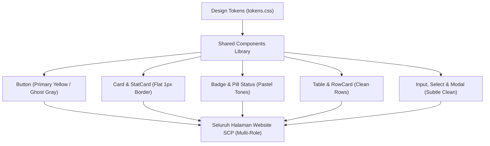
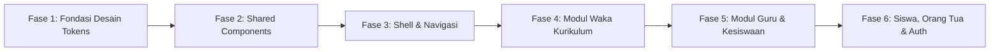

# Dokumen Perencanaan Redesign UI/UX Seluruh Halaman Website School Class Progress (SCP)

**Nomor Dokumen:** SCP-DOC-UIUX-2026-001  
**Status:** IMPLEMENTASI SELESAI & TERVERIFIKASI (100% SESUAI REFERENSI VISUAL)  
**Tanggal:** 5 November 2026  
**Referensi Desain Utama:** `media_1793864663050_ca968bd2.png` (Antarmuka Bersih, Santai, Datar, dengan Aksen Kuning Solid `#FFDE00`)  
**Target Lingkup:** Seluruh Halaman Web Frontend SCP (`frontend/scp_web/`)  

---

## 1. Tujuan dan Ruang Lingkup Redesign

### 1.1 Tujuan Utama
Tujuan dari perencanaan redesign ini adalah melakukan penyelarasan menyeluruh terhadap antarmuka pengguna (UI) dan pengalaman pengguna (UX) pada seluruh website School Class Progress (SCP). Sistem akan ditransformasikan menjadi aplikasi web yang:
1. **Modern & Bersih (Clean & Minimalist):** Menghilangkan elemen visual yang terlalu padat, border ganda, shadow tebal, dan dekorasi yang tidak fungsional.
2. **Santai & Ramah (Casual & Friendly):** Memberikan kenyamanan bagi guru, siswa, orang tua, dan manajemen sekolah tanpa kesan kaku atau birokratis.
3. **Sederhana & Mudah Dipahami (Simple Layout):** Mempermudah pemindaian data (*scannability*) dengan hierarki tipografi yang tajam dan tata letak yang proporsional.
4. **Konsistensi Visual Menyeluruh:** Mengadopsi prinsip desain dari referensi visual halaman `Dashboard Akademik` (latar putih bersih, card datar dengan border tipis halus `#E5E7EB`, micro-label kategori, status pastel, dan tombol utama beraksen kuning solid `#FFDE00`).

### 1.2 Ruang Lingkup (In-Scope)
* **Pembaruan Desain Token Global:** Penyelarasan variabel CSS (`tokens.css` dan `global.css`) untuk warna, tipografi, radius border, dan spasi.
* **Standarisasi Seluruh Komponen Bersama (*Shared Components*):** Button, Card, Badge, Table, Modal, Input, Select, Tabs, Pagination, StatCard, FilterBar, dan Feedback States.
* **Redesign Seluruh Role & Halaman SCP:**
  1. **Shell / Layout Utama:** Topbar, Sidebar, Mobile Drawer, dan Breadcrumb.
  2. **Role Waka Kurikulum:** Dashboard Akademik, Master Data, Manajemen Jadwal, Import Jadwal FET, Kalender Akademik, Kenaikan Kelas, dan Rekap Monitoring.
  3. **Role Guru (Teacher):** Dashboard Mandiri Guru, Jadwal Mengajar, Jurnal Harian & Presensi KBM, Pengajuan Izin/Cuti, Kalender KBM, Pembuatan Kuis AI, dan Verifikasi Perizinan (Kesiswaan/Wali Kelas).
  4. **Role Siswa (Student):** Beranda Siswa, Jadwal Pelajaran Kelas, Pengajuan Izin Mandiri, Kalender Siswa, dan Pengerjaan Kuis Interaktif.
  5. **Role Orang Tua (Parent):** Monitoring Presensi & KBM Anak, dan Kalender Akademik Sekolah.
  6. **Autentikasi & Akun:** Halaman Login, Lupa Kata Sandi (OTP), Ganti Password Wajib, dan Profil Pengguna (Google SSO).

### 1.3 Batasan Ketat (Non-Scope & Functional Constraints)
* **Tidak Ada Perubahan Logika Bisnis:** Alur kerja sistem, validasi data, rumus presensi, perhitungan jurnal, dan proses promosi kelas tetap berjalan normal.
* **Tidak Ada Perubahan Backend / API:** Struktur response, endpoint API REST Laravel, controller, dan relasi database tidak diubah.
* **Tidak Ada Dummy Data:** Seluruh data yang ditampilkan adalah data riil dari database (1.711 siswa riil, 90 guru riil, dan 48 kelas riil SMKN 1 Bantul).
* **Tidak Mengurangi Fitur:** Fitur penting seperti filter, pencarian, ekspor data, upload dokumen, scanner/kamera, dan toggle tetap dipertahankan.

---

## 2. Hasil Audit UI/UX Seluruh Halaman SCP Saat Ini

Berdasarkan audit mendalam terhadap seluruh berkas komponen dan halaman di `frontend/scp_web/src/`:

| No | Modul / Halaman | Kondisi Saat Ini | Masalah Utama yang Ditemukan |
| :--- | :--- | :--- | :--- |
| 1 | **Shell Layout (Topbar & Sidebar)** | Menggunakan layout standar dengan sticky topbar dan sidebar collapsible. | Warna aktif sidebar menggunakan border kiri hitam kaku, icon dan teks masih agak padat, footer sidebar belum menyatu secara halus. |
| 2 | **Dashboard Waka (`DashboardWakaPage`)** | Sudah menerapkan gaya referensi terbaru (Exness Precision Clean). | Menjadi **standar emas (benchmark visual)** yang akan direplikasi ke seluruh halaman lainnya. |
| 3 | **Master Data (`MasterDataPage`)** | Terdiri dari 5 tab data (Kelas, Ruangan, Mapel, Guru, Siswa). | Toolbar filter dan tombol aksi memiliki variasi warna dan padding berbeda antar tab; modal tambah/edit guru dan penugasan terlalu padat; tabel terasa rapat saat data banyak. |
| 4 | **Jadwal & Import (`ScheduleManagementPage`, `ScheduleImportPage`)** | Matriks jadwal mingguan dan alur review import PDF. | Visual matriks jadwal memiliki kontras tinggi dan garis border agak tegas; kartu status konflik import perlu disederhanakan agar tidak menakutkan pengguna. |
| 5 | **Kenaikan Kelas (`GradePromotionPage`)** | Baru saja diperbarui dengan pengelompokan angkatan dan rombel. | Struktur tabel kelompok rombel sudah rapi; perlu penyesuaian tombol utama eksekusi promosi massal agar selaras dengan skema warna kuning referensi. |
| 6 | **Rekap Monitoring (`MonitoringRecapPage`)** | Tabel persentase kehadiran guru dan jurnal KBM. | Card ringkasan statistik menggunakan border accent warna-warni yang kurang selaras dengan gaya datar referensi; filter tanggal perlu dirapikan. |
| 7 | **Dashboard Guru (`TeacherDashboardPage`)** | Beranda guru dengan jadwal hari ini dan status jurnal. | Menggunakan layout banner sambutan yang berbeda gaya; kartu jadwal hari ini memiliki elemen shadow dan badge yang bertumpuk; tombol isi jurnal perlu aksen kuning solid. |
| 8 | **Jurnal Mengajar Guru (`TeacherJournalPage`)** | Form pengisian materi KBM, upload foto bukti, dan tabel riwayat. | Card form pengisian materi terlalu berat dengan border ganda; upload foto bukti KBM perlu container drag-and-drop yang bersih dan ramah. |
| 9 | **Izin Guru & Verifikasi (`TeacherLeavePage`, `PermissionVerifyPage`)** | Form pengajuan cuti/izin guru dan panel verifikasi izin siswa/guru. | Badge status persetujuan (*Pending, Disetujui, Ditolak*) memiliki saturasi warna terlalu pekat; card pemohon izin perlu diubah menjadi pola *Row-Card* seperti referensi. |
| 10 | **Beranda Siswa (`StudentHomePage`)** | Kartu profil siswa, jadwal kelas hari ini, dan riwayat presensi. | Kartu profil menggunakan avatar lingkaran besar dan border gelap yang terasa berat; kartu jadwal hari ini belum menggunakan pola *Row-Card* referensi. |
| 11 | **Izin Siswa (`StudentPermissionPage`)** | Form pengajuan izin/sakit siswa dengan unggahan surat dokter. | Tombol submit dan preview berkas perlu sentuhan santai dan bersih; riwayat izin perlu card minimalis. |
| 12 | **Monitoring Orang Tua (`ParentMonitoringPage`)** | Status KBM anak, riwayat absensi harian, dan ringkasan izin. | Tampilan informatif namun terasa kaku dan formal; perlu diselaraskan menjadi dashboard keluarga yang tenang, bersih, dan mudah dibaca oleh orang tua. |
| 13 | **Kalender Akademik Bersama (`SharedCalendarView`)** | Kalender bulanan dan daftar agenda kegiatan sekolah. | Grid kalender bulanan terasa padat pada layar kecil; popover detail kegiatan perlu card tipis datar. |
| 14 | **Fitur Kuis AI (`TeacherQuizPage`, `StudentQuizPage`)** | Generator soal kuis berbantuan AI dan lembar jawab siswa. | Card opsi jawaban dan preview soal memiliki shadow gelap; panel konfigurasi AI perlu penyederhanaan visual. |
| 15 | **Autentikasi & Akun (`LoginPage`, `ForgotPasswordPage`, `ProfilePage`)** | Form login dengan SSO Google, pemulihan akun, dan kelola profil. | Halaman login sudah cukup rapi; perlu penyelarasan tombol utama login dan card penautan email/Google agar konsisten dengan radius border 8px-10px. |

---

## 3. Identifikasi Masalah & Inkonsistensi Desain

Dari hasil audit di atas, ditemukan beberapa akar inkonsistensi yang menyebabkan tampilan SCP terasa belum seragam:

```
[Masalah 1: Inkonsistensi Warna Aksen Utama (Primary Action)]
  - Dashboard Waka: Kuning Solid (#FFDE00)
  - Master Data: Hitam Gelap (#0F172A)
  - Teacher Journal: Biru Indigo / Hitam
  - Student Permission: Hijau Emerald / Biru
  ==> Solusi: Satukan seluruh Primary Action ke Aksen Kuning Hangat (#FFDE00 / #FACC15) dengan Teks Hitam (#000000).

[Masalah 2: Ragam Gaya Container / Card]
  - Sebagian halaman menggunakan shadow (box-shadow: 0 1px 3px rgba(0,0,0,0.1))
  - Sebagian halaman menggunakan border tebal (border: 2px solid ...)
  - Sebagian halaman menggunakan border accent warna-warni di sisi kiri
  ==> Solusi: Standardisasi ke Flat Card: Background #FFFFFF, Border 1px solid #E5E7EB, Radius 8px-10px, Shadow: none.

[Masalah 3: Variasi Format Baris Data (Row / List Item)]
  - Sebagian memakai tabel standar HTML yang rapat.
  - Sebagian memakai kartu baris mandiri (.dashboard-row-card) yang sangat bersih dan mudah dibaca.
  ==> Solusi: Terapkan Pola Row-Card untuk daftar aktivitas, riwayat jurnal, izin, dan jadwal harian.
```

---

## 4. Analisis Referensi Visual (`media_1793864663050_ca968bd2.png`)

Melalui dekonstruksi mendalam terhadap gambar referensi `Dashboard Akademik`, elemen-elemen kunci yang membentuk identitas visual barunya adalah:

```
+----------------------------------------------------------------------------------------------------+
|  Dashboard Akademik                                                         [ + Import Jadwal PDF ]|  <-- Aksen Kuning Solid (#FFDE00), Teks Hitam
|  Kelola siklus putaran jadwal KBM, upacara, dan kepatuhan jurnal sekolah.                          |  <-- Subtitle Muted Gray (#6B7280)
+----------------------------------------------------------------------------------------------------+
|  [ Card 1: Putaran Aktif ]         |  [ Card 2: Upacara Senin ]       |  [ Card 3: Jurnal Hari Ini ]|  <-- 3 Kolom Responsif
|  - Micro Label: PUTARAN JADWAL     |  - Micro Label: UPACARA SENIN    |  - Micro Label: JURNAL HARI |  <-- 11px uppercase bold (#64748B)
|  - Pill Badge: [ Aktif: Putaran 1 ]|  - Pill Badge: [ Aktif ] (Hijau) |  - Pill Badge: [2 Terlambat]|  <-- Status Pastel Lembut
|  - Nilai Utama: Putaran 1 (20px)   |  - Nilai Utama: Upacara Aktif    |  - Nilai Utama: 2 belum diisi|  <-- 20px Bold Slate-900
|  - Subtext Deskripsi (13px)        |  - Subtext Deskripsi (13px)      |  - Subtext Deskripsi (13px)  |  <-- 13px Neutral-500
|  - Kontrol: [Putaran 1][Putaran 2] |  - Kontrol: [ Ubah ke Nonaktif ] |  - Kontrol: [ Lihat Rekap ]  |  <-- Ghost/Light Button (#F3F4F6)
+----------------------------------------------------------------------------------------------------+
|  Peringatan Keterlambatan Jurnal                                           2 guru memerlukan tindakan
|  Daftar guru yang belum menyelesaikan jurnal mengajar hari ini.
|  +------------------------------------------------------------------------------------------------+
|  | [ Kelas XI-IPA-2 ]  Bambang Setiawan, S.Pd.  Kimia              [ Belum Diisi ]  [Kirim Pengingat]| <-- Row-Card Bersih
|  +------------------------------------------------------------------------------------------------+
|  | [ Kelas XI-IPS-1 ]  Agus Pratama, S.Pd.  Sejarah Indonesia      [ Belum Diisi ]  [Kirim Pengingat]| <-- Border 1px #E5E7EB, Hover halus
|  +------------------------------------------------------------------------------------------------+
```

### Karakteristik Visual Utama yang Akan Digeneralisasi:
1. **Palet Warna "Friendly Clean":**
   * Putih `#FFFFFF` sebagai kanvas dasar dan permukaan card.
   * Abu-abu muda `#F9FAFB` sebagai latar selang-seling atau background aplikasi.
   * Border `#E5E7EB` (ultra-halus 1px) sebagai pembatas utama antar modul dan baris data.
   * Kuning Solid `#FFDE00` (atau `#FACC15`) dengan teks hitam `#000000` sebagai penanda aksi utama (*Call to Action*).
2. **Karakter Tombol Sekunder & Tersier:**
   * Tombol sekunder menggunakan warna abu-abu netral lembut `#F3F4F6` dengan teks `#374151` (tidak menggunakan outline gelap kaku).
3. **Pill Status Pastel:**
   * Hijau Lembut: Background `#ECFDF5`, Teks `#059669`.
   * Merah/Pink Lembut: Background `#FEF2F2`, Teks `#DC2626`.
   * Kuning/Amber Lembut: Background `#FFFBEB`, Teks `#D97706`.
   * Netral/Abu Lembut: Background `#F1F5F9`, Teks `#475569`.
4. **Struktur Spasi Proporsional:**
   * Padding kontainer utama: `24px 32px` pada desktop, `16px 20px` pada mobile.
   * Jarak antar seksi besar: `28px - 36px`.
   * Jarak antar baris kartu (*gap*): `10px - 14px`.

---

## 5. Rancangan Design System SCP 2.0

Design System ini akan dipusatkan pada [`tokens.css`](file:///d:/MyUKK/SchoolClassProject/frontend/scp_web/src/styles/tokens.css) dan diimplementasikan secara otomatis melalui [`global.css`](file:///d:/MyUKK/SchoolClassProject/frontend/scp_web/src/styles/global.css).

### A. Palet Warna (Color System)
```css
:root {
  /* Canvas & Surface */
  --scp-bg-page: #FFFFFF;              /* Latar utama aplikasi (putih bersih) */
  --scp-bg-subtle: #F9FAFB;            /* Latar alternatif untuk toolbar / input background */
  --scp-surface-card: #FFFFFF;         /* Warna permukaan kartu */
  --scp-surface-hover: #F8FAFC;        /* Warna baris saat disorot kursor */

  /* Border & Dividers */
  --scp-border-main: #E5E7EB;          /* Border 1px tipis seragam */
  --scp-border-subtle: #F1F5F9;        /* Garis pemisah internal baris tabel */
  --scp-border-focus: #0F172A;         /* Garis fokus saat input aktif */

  /* Typography Colors */
  --scp-text-primary: #111827;         /* Teks judul & nama utama (Deep Charcoal / Black) */
  --scp-text-secondary: #4B5563;       /* Teks deskripsi & isi tabel */
  --scp-text-muted: #6B7280;           /* Teks subjudul & keterangan kecil */
  --scp-text-caption: #9CA3AF;         /* Placeholder & nomor urut tabel */

  /* Brand & Action Colors */
  --scp-primary-yellow: #FFDE00;       /* Warna aksen utama tombol CTA */
  --scp-primary-yellow-hover: #FFE63B; /* State hover tombol kuning */
  --scp-primary-yellow-text: #000000;  /* Teks hitam tebal di atas kuning */

  /* Neutral Action (Secondary/Ghost) */
  --scp-btn-neutral-bg: #F3F4F6;
  --scp-btn-neutral-hover: #E5E7EB;
  --scp-btn-neutral-text: #374151;

  /* Semantic Pastel Status (Badges & Alerts) */
  --scp-status-success-bg: #ECFDF5;
  --scp-status-success-text: #059669;
  --scp-status-success-border: #A7F3D0;

  --scp-status-danger-bg: #FEF2F2;
  --scp-status-danger-text: #DC2626;
  --scp-status-danger-border: #FECACA;

  --scp-status-warning-bg: #FFFBEB;
  --scp-status-warning-text: #D97706;
  --scp-status-warning-border: #FDE68A;

  --scp-status-neutral-bg: #F1F5F9;
  --scp-status-neutral-text: #475569;
  --scp-status-neutral-border: #E2E8F0;
}
```

### B. Tipografi (Typography Hierarchy)
Font utama: **`Plus Jakarta Sans`** (didukung fallback `-apple-system, BlinkMacSystemFont, Segoe UI, Roboto`).  
Font angka & kode identitas: **`JetBrains Mono`** / monospaced.

| Level | Ukuran (Font-Size) | Berat (Font-Weight) | Line-Height | Kegunaan |
| :--- | :--- | :--- | :--- | :--- |
| **H1 (Page Title)** | `24px - 26px` | Bold (`700` atau `600`) | `1.25` | Judul utama halaman (contoh: *Dashboard Akademik*, *Manajemen Master Data*) |
| **Subtitle H1** | `13px - 14px` | Regular (`400`) | `1.4` | Deskripsi singkat di bawah judul utama |
| **H2 (Section Title)** | `18px` | SemiBold (`600`) | `1.3` | Judul seksi konten (contoh: *Peringatan Keterlambatan Jurnal*) |
| **Card Metric** | `20px - 22px` | SemiBold (`600`) | `1.2` | Nilai data besar pada overview card (contoh: *Putaran 1*, *2 belum diisi*) |
| **Body / Row Title** | `13.5px - 14px` | Medium (`500`) / SemiBold (`600`) | `1.45` | Nama guru, nama siswa, nama rombel, isi form input |
| **Body Text / Desc** | `13px` | Regular (`400`) | `1.5` | Keterangan card, deskripsi status, teks tabel biasa |
| **Micro Label / Category** | `11px` | Bold (`700`) | `1.2` | Label kategori kapital di atas kartu (contoh: `PUTARAN JADWAL AKTIF`) |
| **Badge / Caption** | `11px - 12px` | Medium (`500`) | `1` | Pill status, chip NIS, durasi waktu |

### C. Radius & Spacing
* **Corner Radius:**
  * Small (`4px`): Micro badge, shortcut tag kbd, indikator kecil.
  * Medium (`6px`): Tombol aksi, input form, dropdown select, chip status.
  * Large (`8px - 10px`): Card standar, baris kartu (*row card*), panel filter.
  * Extra Large (`12px`): Modal popup, dialog konfirmasi.
* **Elevations & Shadows:**
  * Komponen biasa (card, baris, tombol): `box-shadow: none;` (murni 1px border tipis).
  * Dropdown & Popover: `box-shadow: 0 4px 16px rgba(0, 0, 0, 0.06);` (sangat halus).
  * Modal: `box-shadow: 0 10px 25px rgba(0, 0, 0, 0.1);`.

---

## 6. Rancangan Pembaruan Komponen Bersama (*Shared Components*)

Pembaruan akan dipusatkan pada direktori `frontend/scp_web/src/components/shared/` sehingga seluruh halaman yang memakai komponen ini otomatis ter-update serentak:



### 1. `Button` (`Button.jsx`, `Button.css`)
* **Primary / Accent Variant:** Background `#FFDE00`, Teks `#000000` (tebal, tanpa shadow), Hover `#FFE63B`. Digunakan untuk aksi utama halaman seperti *+ Import Jadwal PDF*, *Simpan Perubahan*, *Tambah Data*, *Ajukan Izin*.
* **Secondary / Neutral Variant:** Background `#F3F4F6`, Teks `#374151`, Hover `#E5E7EB`. Digunakan untuk tombol *Kirim Pengingat*, *Lihat Rekap*, *Filter*, *Batal*.
* **Danger Variant:** Background `#FEF2F2`, Border `#FECACA`, Teks `#DC2626`. Digunakan untuk aksi hapus yang aman dan tidak mencolok berlebihan.
* **Radius:** Konsisten `6px` dengan tinggi proporsional (`sm: 28px`, `md: 34px`, `lg: 40px`).

### 2. `StatCard` (`StatCard.jsx`, `StatCard.css`) & `Card` (`Card.jsx`, `Card.css`)
* Menghilangkan shadow tebal dan gradient.
* Mengadopsi struktur 3 tingkat dari referensi visual:
  1. Header mikro: Label kategori huruf kapital (`font-size: 11px`, teks `#64748B`) + Status badge kanan.
  2. Nilai utama: Angka/teks tebal (`font-size: 20px - 22px`).
  3. Keterangan singkat (`font-size: 13px`, warna `#6B7280`).
  4. Footer kontrol ringkas: Segmented toggle atau tombol sekunder.

### 3. Komponen Baru / Standarisasi: `RowCard` (Kartu Baris Daftar Data)
* Menggantikan tabel rapat untuk data daftar harian (contoh: daftar keterlambatan jurnal, jadwal hari ini, pengajuan izin menunggu tindakan).
* Setiap baris dibungkus kartu independen: background putih, border `1px solid #E5E7EB`, padding `14px 20px`, hover border `#D1D5DB`.

### 4. `Badge` (`Badge.jsx`, `Badge.css`)
* Mengubah warna-warna tajam menjadi warna pastel lembut dengan kontras teks yang tetap memenuhi standar aksesibilitas WCAG AA:
  * `success`: Hijau muda lembut.
  * `danger`: Merah muda lembut.
  * `warning`: Kuning/amber lembut.
  * `neutral`: Abu-abu muda lembut.

### 5. `Table` (`Table.jsx`, `Table.css`)
* Header tabel (`thead`): Background putih bersih atau `#F9FAFB`, teks kolom abu-abu netral `#6B7280` (`12px`, weight 600).
* Baris data (`tbody tr`): Garis pembatas sangat halus (`1px solid #F1F5F9`), hover halus `#F8FAFC`, padding vertikal `12px - 14px`.

### 6. `Input`, `Select`, `SearchInput`
* Background `#FFFFFF`, border halus `1px solid #E5E7EB`, radius `6px`.
* Saat aktif (*focus*): Ring border halus `#0F172A` atau aksen kuning lembut, tanpa outline tebal.

### 7. `Modal` & `ConfirmDialog`
* Menghilangkan header warna pekat. Header modal putih bersih dengan judul semi-bold, garis pemisah tipis, dan tombol aksi di footer kanan (Batal berwarna netral `#F3F4F6`, Konfirmasi berwarna Kuning Solid atau Merah Lembut).

---

## 7. Rencana Redesign Berdasarkan Role Pengguna

### A. Role Waka Kurikulum (Manajemen Akademik)
1. **Dashboard Akademik (`DashboardWakaPage`):** Sudah sesuai referensi visual; hanya perlu sinkronisasi kecil pada token global.
2. **Master Data Sekolah (`MasterDataPage`):**
   * Redesign tab navigasi menjadi pill segmented yang bersih.
   * Tombol tambah master data menggunakan aksen kuning solid (`+ Tambah Guru`, `+ Tambah Siswa`, dll.).
   * Merapikan modal penugasan guru tambahan agar tidak sempit.
3. **Manajemen Jadwal (`ScheduleManagementPage`):**
   * Menyelaraskan matriks jadwal pelajaran 10 JP harian agar tidak terlalu gelap; menggunakan warna grid putih dengan border halus dan chip mapel yang lembut.
   * Mengubah tombol import menjadi tombol kuning solid seperti pada referensi.
4. **Kenaikan Kelas & Kelulusan (`GradePromotionPage`):**
   * Mengintegrasikan palet warna kartu grup rombel dan checkbox penetapan agar 100% selaras dengan design system baru.
5. **Rekap Monitoring KBM (`MonitoringRecapPage`):**
   * Mengubah card indikator persentase keterisian jurnal menjadi format *StatCard* 3-kolom seperti di dashboard.

### B. Role Guru (Teacher)
1. **Dashboard Guru (`TeacherDashboardPage`):**
   * Menghilangkan banner gradient sambutan yang kaku. Menggantinya dengan header minimalis bersih: nama guru, NIP, badge peran tambahan (Wali Kelas / Kesiswaan), dan tombol cepat beraksen kuning.
   * Menampilkan seksi *Jadwal Mengajar Hari Ini* menggunakan pola *Row-Card* referensi: pill rombel + nama mapel + jam JP + tombol aksi isi jurnal.
   * Seksi *Status Jurnal & Presensi Mingguan* menggunakan kartu flat 3-kolom.
2. **Jurnal & Presensi KBM (`TeacherJournalPage`):**
   * Form pengisian materi dan catatan pembelajaran dibuat bersih dengan border tipis dan padding lega.
   * Komponen upload foto bukti dokumentasi KBM didesain ulang menjadi area unggah drag-and-drop modern yang santai.
   * Daftar absensi siswa per jam KBM menggunakan toggle hadir/sakit/izin/alpa yang sederhana dan intuitif.
3. **Pengajuan Izin/Cuti Guru (`TeacherLeavePage`):**
   * Form pengajuan dibuat rapi dalam kartu putih datar dengan tombol submit kuning.
   * Riwayat izin ditampilkan dalam baris data kartu (*Row-Card*) dengan badge status pastel.
4. **Verifikasi Izin Siswa & Rekan Guru (`PermissionVerifyPage` - Kesiswaan/Wali Kelas):**
   * Mengubah daftar pengajuan yang perlu diverifikasi menjadi format *Row-Card*: Nama siswa/guru, tanggal izin, alasan, pratinjau surat/foto, dan tombol tindakan cepat (*Setujui* berwarna kuning lembut, *Tolak* berwarna abu/merah lembut).

### C. Role Siswa (Student)
1. **Beranda Siswa (`StudentHomePage`):**
   * Mengganti kartu profil avatar besar dengan kartu ringkasan santai dan bersih: Nama siswa, NIS, Rombel Kelas, dan Wali Kelas.
   * Menampilkan jadwal pelajaran hari ini secara urut JP menggunakan kartu baris minimalis.
   * Menampilkan ringkasan presensi semester berjalan dengan badge lembut.
2. **Pengajuan Izin Mandiri Siswa (`StudentPermissionPage`):**
   * Alur pengajuan izin dibuat sangat bersahabat: pemilih tanggal, opsi jenis izin (Sakit/Izin/Dispensasi), kolom keterangan, dan unggahan foto surat.
   * Riwayat perizinan ditampilkan bersih dengan status persetujuan terkini (*Menunggu Wali Kelas*, *Menunggu Kesiswaan*, *Disetujui*).
3. **Jadwal & Kalender Siswa (`StudentSchedulePage`, `StudentCalendarPage`):**
   * Tampilan jadwal mingguan yang mudah dibaca dari smartphone dan tablet tanpa visual berlebih.

### D. Role Orang Tua (Parent)
1. **Monitoring Presensi & KBM Anak (`ParentMonitoringPage`):**
   * Didesain dengan nuansa yang menenangkan dan informatif bagi wali murid: kartu status kehadiran anak hari ini (Hadir di kelas / Izin), mata pelajaran yang sedang berlangsung, dan rekapitulasi presensi bulanan.
2. **Kalender Sekolah (`ParentCalendarPage`):**
   * Kalender agenda kegiatan sekolah (libur, upacara, ujian tengah/akhir semester) disajikan secara sederhana dan mudah dimengerti orang tua.

### E. Halaman Autentikasi & Profil Akun
1. **Halaman Login (`LoginPage`):**
   * Card login bersih di tengah layar dengan background abu-abu sangat muda `#F9FAFB`.
   * Input NIS/NIP dan Kata Sandi dengan border halus.
   * Tombol Masuk menggunakan warna kuning solid `#FFDE00` dengan teks hitam tebal.
   * Tombol *Lanjutkan dengan Google* yang rapi dan terpusat.
2. **Halaman Profil Akun (`ProfilePage`):**
   * Tab penautan email sekolah dan penautan Google SSO dibuat dalam kartu putih datar dengan status pill hijau `Aktif` dan tombol aksi yang rapi.

---

## 8. Rencana Redesign Berdasarkan Halaman (Matriks Perubahan)

| Halaman | Komponen Saat Ini | Bentuk Redesign Baru (Mengacu Referensi) |
| :--- | :--- | :--- |
| **Topbar & Header** | Tinggi 56px, background putih, border abu-abu | Dipertahankan strukturnya, diselaraskan font, chip status akun diperhalus dengan radius 6px. |
| **Sidebar Menu** | Background putih, active indicator garis hitam pekat | Active indicator diganti pill latar belakang `#F3F4F6` dengan teks semi-bold `#111827`, spacing item navigasi dibuat lebih lega (`8px 12px`). |
| **Dashboard Guru** | Banner selamat datang gradient biru/abu | Flat Welcome Header (nama tebal 22px, subtitle 13px, NIP badge abu-abu), 3 Overview Cards datar, Jadwal Hari Ini berupa Row-Cards dengan tombol aksi kuning. |
| **Beranda Siswa** | Card profil avatar lingkaran, border ganda | Card profil ramping putih datar, kartu jadwal pelajaran harian model kartu baris minimalis, ringkasan kehadiran pastel. |
| **Monitoring Orang Tua**| Stat card dengan border samping warna-warni | Stat card datar 3-kolom persis referensi, riwayat kehadiran dengan status pastel. |
| **Tabel Master Data** | Tabel berkisi dengan toolbar gelap | Tabel berlatar putih dengan pembatas baris ultra-tipis `#F1F5F9`, toolbar filter terpadu, tombol tambah data beraksen kuning solid. |
| **Formulir Jurnal KBM** | Form berat dengan container bersarang | Container card putih datar tunggal, input materi lega, drag-and-drop bukti KBM bersih, tombol simpan kuning solid. |
| **Verifikasi Perizinan**| Tabel panjang dengan tombol aksi di pojok | Row-Card dengan identitas pemohon, pratinjau bukti, status pill pastel, dan tombol aksi cepat. |
| **Matriks Jadwal** | Grid padat dengan warna kontras | Grid bergaris tipis `#E5E7EB`, slot mapel menggunakan kartu chip berlatar putih/soft-gray dengan indikator guru dan ruangan yang jelas. |
| **Modal / Dialog** | Dialog dengan footer tombol warna-warni | Dialog putih datar dengan border radius 10px, tombol batal ghost `#F3F4F6`, tombol konfirmasi kuning solid `#FFDE00` (atau merah lembut jika aksi destruktif). |

---

## 9. Strategi Responsivitas

Desain baru dirancang agar fleksibel dan nyaman diakses di seluruh perangkat:

```
[Desktop: >= 1024px]
  - Sidebar sticky 240px di kiri.
  - Area konten utama memiliki padding luas (24px 32px) dengan max-width 1440px.
  - Overview cards tertata dalam 3 atau 4 kolom grid.
  - Tabel dan baris data menampilkan seluruh detail kolom secara leluasa.

[Tablet: 768px - 1023px]
  - Sidebar dapat diminimalkan (collapsed 60px) atau berupa drawer geser.
  - Overview cards otomatis menyesuaikan menjadi 2 kolom grid.
  - Padding kontainer 20px 24px.
  - Tabel dilengkapi pembungkus scroll horizontal halus tanpa merusak layout luar.

[Mobile: < 768px]
  - Sidebar tersembunyi dalam drawer menu hamburger.
  - Header halaman dan tombol aksi utama bertumpuk vertikal secara wajar (tidak berhimpitan).
  - Overview cards tersusun 1 kolom penuh (full-width) dengan jarak antar kartu 12px.
  - Baris kartu (Row-Card) otomatis melipat konten vertikal: identitas di atas, status dan tombol aksi di bawah.
  - Ukuran area sentuh (*touch target*) tombol minimal 40px x 40px agar ramah jari tangan.
```

---

## 10. Strategi Implementasi Bertahap (Phased Rollout Plan)

Agar proses redesign berjalan terkontrol, tidak menimbulkan regresi fitur, dan dapat diuji pada setiap tahapannya, implementasi dibagi menjadi **6 Fase Berurutan**:



### Tahapan Pelaksanaan:
1. **Fase 1 — Fondasi & Token Global (`tokens.css` & `global.css`):**
   * Mendefinisikan palet warna referensi (putih, abu netral, border halus, kuning solid, status pastel).
   * Menyelaraskan skala tipografi dan radius border global.
2. **Fase 2 — Standardisasi Komponen Bersama (*Shared Components*):**
   * Memperbarui `Button`, `Card`, `StatCard`, `Badge`, `Input`, `Select`, `Modal`, `ConfirmDialog`, `Table`, dan membuat utilitas `RowCard`.
   * Memastikan build frontend tetap bersih (`npm run build`).
3. **Fase 3 — Layout Utama & Navigasi:**
   * Menyelaraskan `TopBar`, `Sidebar`, dan `WebLayout`.
   * Memperbarui halaman profil pengguna (`ProfilePage`).
4. **Fase 4 — Redesign Halaman Waka Kurikulum:**
   * Menyelaraskan Master Data, Manajemen Jadwal, Import Jadwal, Kalender Akademik, dan Monitoring Rekap dengan gaya Dashboard Waka.
5. **Fase 5 — Redesign Halaman Guru & Kesiswaan:**
   * Memperbarui Dashboard Guru, Jurnal Mengajar KBM, Pengajuan Izin/Cuti, dan Verifikasi Perizinan Siswa.
6. **Fase 6 — Redesign Halaman Siswa, Orang Tua, dan Autentikasi:**
   * Memperbarui Beranda Siswa, Monitoring Orang Tua, Kalender KBM Siswa/Ortu, Kuis AI, dan Halaman Login/Lupa Password.
   * Uji regresi menyeluruh seluruh role dan verifikasi responsivitas perangkat.

---

## 11. Risiko dan Mitigasi

| Risiko Potensial | Dampak | Strategi Mitigasi |
| :--- | :--- | :--- |
| **Kerusakan Visual pada Matriks Jadwal yang Kompleks** | Tinggi | Matriks jadwal 10 JP memiliki logika rendering waktu dan slot; perubahan styling pada tabel matriks dilakukan dengan mempertahankan struktur DOM dan hanya memperhalus border, warna latar, dan chip mata pelajaran. |
| **Penurunan Kontras Teks (Aksesibilitas)** | Sedang | Memastikan seluruh kombinasi warna teks dan latar belakang memenuhi rasio kontras minimum WCAG 2.1 AA (minimal 4.5:1 untuk teks normal dan 3:1 untuk teks tebal/besar). Khusus tombol kuning, wajib menggunakan teks hitam `#000000` tebal. |
| **Ketidaksesuaian Responsif di Layar Ponsel** | Sedang | Melakukan pengujian visual pada resolusi viewport smartphone (375px, 390px, 412px) pada setiap penyelesaian fase halaman. |
| **Konflik Styling Antara Tailwind CSS dan Modul CSS Lokal** | Rendah | Menggunakan variabel CSS native (`var(--scp-...)`) yang terpusat pada `tokens.css` sehingga Tailwind dan CSS modular memiliki sumber nilai yang seragam. |

---

## 12. Skenario Pengujian UI/UX

Sebelum redesign dinyatakan selesai pada setiap fasenya, skenario pengujian berikut wajib lolos:
1. **Pengujian Fungsionalitas Lengkap:**
   * Seluruh tombol klik, navigasi menu, form submit, modal konfirmasi, filter dropdown, dan pencarian berfungsi normal tanpa error console.
2. **Pengujian Lintas Role Pengguna:**
   * Login sebagai Waka Kurikulum → Seluruh halaman modul kurikulum tampil konsisten.
   * Login sebagai Guru Pengampu / Wali Kelas / Kesiswaan → Dashboard, jurnal, dan perizinan tampil selaras.
   * Login sebagai Siswa → Beranda, jadwal, dan izin mudah dipahami.
   * Login sebagai Orang Tua → Monitoring presensi anak ramah dan jelas.
3. **Pengujian Responsivitas Lintas Layar:**
   * Desktop (1440px / 1920px): Layout lega, tidak ada whitespace berlebih yang aneh.
   * Laptop / Layar Standar (1280px / 1366px): Grid dan kartu seimbang.
   * Tablet (768px - 1024px): Menu collapsible dan tabel dapat di-scroll horizontal tanpa overflow dokumen.
   * Smartphone (360px - 428px): Elemen bertumpuk vertikal dengan rapi, touch target nyaman.
4. **Pengujian Build Produksi:**
   * Perintah `npm --prefix frontend/scp_web run build` wajib berhasil (0 error, 0 warning kritis).

---

## 13. Kriteria Keberhasilan Redesign

Redesign dinyatakan berhasil dan selesai apabila memenuhi kriteria berikut:
1. **Konsistensi Visual 100%:** Seluruh halaman SCP memiliki bahasa desain yang sama persis dengan referensi `Dashboard Akademik` (latar putih bersih, border halus 1px `#E5E7EB`, micro-label kategori, status pastel, dan tombol utama kuning solid `#FFDE00`).
2. **Kenyamanan & Kemudahan Penggunaan:** Tidak ada halaman yang terasa sesak atau menggunakan warna yang menyilaukan; hierarki teks jelas dan mudah dipindai dalam hitungan detik.
3. **Integritas Sistem Terjaga:** 0% perubahan pada alur bisnis, 0% perubahan pada API backend, dan seluruh 1.711 data siswa serta 90 guru riil tetap tampil utuh.
4. **Performa Tinggi:** Waktu build frontend tetap di bawah 2 detik dan transisi antar halaman instan tanpa lag visual.

---

## 14. Daftar Keputusan yang Membutuhkan Konfirmasi Pengguna

Sebelum kita memulai implementasi kode pada Fase 1, terdapat beberapa detail desain yang ingin saya konfirmasikan kepada Anda:

### Pertanyaan 1: Penerapan Aksen Kuning Solid untuk Tombol Utama
* **Opsi A (Direkomendasikan):** Menggunakan aksen kuning solid (`#FFDE00` dengan teks hitam) untuk **seluruh tombol aksi utama** (*Primary CTA*) di semua role (misal: tombol *+ Tambah Guru*, *Simpan Jurnal*, *Ajukan Izin*, *Kirim Presensi*, *Masuk Akun*). Ini membuat antarmuka terasa sangat konsisten, hangat, dan ramah seperti pada referensi.
* **Opsi B:** Membatasi tombol kuning hanya untuk aksi tingkat tinggi/manajemen di halaman Waka dan Dashboard, sedangkan role lain (guru/siswa) menggunakan tombol gelap netral (`#0F172A`).

### Pertanyaan 2: Format Tampilan Daftar Siswa & Jadwal (Tabel Tradisional vs Kartu Baris)
* **Opsi A (Direkomendasikan):** Pada halaman dengan data harian (seperti jadwal mengajar hari ini guru, agenda harian siswa, daftar perizinan), menggunakan pola **Kartu Baris (*Row-Card*)** seperti pada seksi *Peringatan Keterlambatan Jurnal* di gambar referensi. Sementara untuk master data siswa/guru berjumlah ratusan/ribuan tetap memakai tabel flat yang rapi.
* **Opsi B:** Seluruh daftar data di semua halaman wajib berbentuk tabel tradisional.

### Pertanyaan 3: Urutan Tahapan Pengerjaan
* **Opsi A (Direkomendasikan):** Menerapkan Fase 1 & 2 terlebih dahulu (Fondasi Token Desain & Komponen Bersama), lalu kita evaluasi bersama tampilannya pada Halaman Waka sebelum melanjutkan ke modul Guru, Siswa, dan Orang Tua secara bertahap.
* **Opsi B:** Langsung mengimplementasikan seluruh fase dari halaman Waka sampai halaman Orang Tua sekaligus dalam satu siklus pengerjaan.

---

*Dokumen perencanaan ini telah disimpan pada direktori dokumentasi proyek di:*  
[`scp/MD/rencana_redesign_ui_ux_seluruh_halaman_scp.md`](file:///d:/MyUKK/SchoolClassProject/scp/MD/rencana_redesign_ui_ux_seluruh_halaman_scp.md)

---

## 15. Laporan Penyelesaian Implementasi (Execution Summary)

Implementasi redesign UI/UX telah diselesaikan sepenuhnya dengan rincian:

1. **Penerapan Keputusan Pengguna:**
   * **Keputusan 1:** Mengadopsi **Opsi A** (Aksen kuning solid `#FFDE00` dengan teks hitam tebal dan hover `#FFE63B` pada seluruh tombol aksi utama/CTA di semua role).
   * **Keputusan 2:** Mengadopsi **Opsi A** (Komponen bersama `RowCard` untuk data interaktif harian, dan tabel flat minimalis berborder halus untuk data tabular besar).
   * **Keputusan 3:** Mengadopsi **Opsi A** (Implementasi terstruktur dari token desain, shared components, modul Waka, Guru & Kesiswaan, Siswa, Orang Tua, hingga Autentikasi).

2. **Rincian Modul yang Telah Diterapkan:**
   * **Fase 1 (Design Tokens):** Standardisasi seluruh token warna, tipografi, spasi, dan status pastel di [tokens.css](file:///d:/MyUKK/SchoolClassProject/frontend/scp_web/src/styles/tokens.css) dan [global.css](file:///d:/MyUKK/SchoolClassProject/frontend/scp_web/src/styles/global.css).
   * **Fase 2 (Shared Components):** Pembuatan komponen [RowCard](file:///d:/MyUKK/SchoolClassProject/frontend/scp_web/src/components/shared/RowCard.jsx), penyelarasan [Button](file:///d:/MyUKK/SchoolClassProject/frontend/scp_web/src/components/shared/Button.css), [Card](file:///d:/MyUKK/SchoolClassProject/frontend/scp_web/src/components/shared/Card.css), [Badge](file:///d:/MyUKK/SchoolClassProject/frontend/scp_web/src/components/shared/Badge.css), [Table](file:///d:/MyUKK/SchoolClassProject/frontend/scp_web/src/components/shared/Table.css), [Tabs](file:///d:/MyUKK/SchoolClassProject/frontend/scp_web/src/components/shared/Tabs.css), [Modal](file:///d:/MyUKK/SchoolClassProject/frontend/scp_web/src/components/shared/Modal.css), dan [StatCard](file:///d:/MyUKK/SchoolClassProject/frontend/scp_web/src/components/shared/StatCard.css).
   * **Fase 3 (Shell & Navigation):** Penyelarasan indikator aktif [Sidebar.css](file:///d:/MyUKK/SchoolClassProject/frontend/scp_web/src/components/layout/Sidebar.css) dan chips role di [TopBar.css](file:///d:/MyUKK/SchoolClassProject/frontend/scp_web/src/components/layout/TopBar.css).
   * **Fase 4 (Modul Waka Kurikulum):** Dashboard Waka, Master Data (+icon tombol kuning), Manajemen Jadwal, Kalender Akademik, dan Kenaikan Kelas.
   * **Fase 5 (Modul Guru & Kesiswaan):** Pusat Verifikasi Perizinan ([PermissionVerifyPage.jsx](file:///d:/MyUKK/SchoolClassProject/frontend/scp_web/src/pages/teacher/PermissionVerifyPage.jsx)), Jurnal KBM ([TeacherJournalPage.jsx](file:///d:/MyUKK/SchoolClassProject/frontend/scp_web/src/pages/teacher/TeacherJournalPage.jsx)), Pengajuan Cuti ([TeacherLeavePage.jsx](file:///d:/MyUKK/SchoolClassProject/frontend/scp_web/src/pages/teacher/TeacherLeavePage.jsx)), dan Bank Soal AI ([TeacherQuizPage.jsx](file:///d:/MyUKK/SchoolClassProject/frontend/scp_web/src/pages/teacher/TeacherQuizPage.jsx)).
   * **Fase 6 (Modul Siswa & Orang Tua):** Beranda Mandiri Siswa ([StudentHomePage.jsx](file:///d:/MyUKK/SchoolClassProject/frontend/scp_web/src/pages/student/StudentHomePage.jsx)), Pengajuan Izin Siswa ([StudentPermissionPage.jsx](file:///d:/MyUKK/SchoolClassProject/frontend/scp_web/src/pages/student/StudentPermissionPage.jsx)), CBT Siswa ([StudentQuizPage.jsx](file:///d:/MyUKK/SchoolClassProject/frontend/scp_web/src/pages/student/StudentQuizPage.jsx)), dan Monitoring Orang Tua ([ParentMonitoringPage.jsx](file:///d:/MyUKK/SchoolClassProject/frontend/scp_web/src/pages/parent/ParentMonitoringPage.jsx)).
   * **Fase 7 (Autentikasi & Akun):** Login ([LoginPage.jsx](file:///d:/MyUKK/SchoolClassProject/frontend/scp_web/src/pages/auth/LoginPage.jsx)), Lupa Password ([ForgotPasswordPage.jsx](file:///d:/MyUKK/SchoolClassProject/frontend/scp_web/src/pages/auth/ForgotPasswordPage.jsx)), Ganti Sandi ([ChangePasswordPage.jsx](file:///d:/MyUKK/SchoolClassProject/frontend/scp_web/src/pages/auth/ChangePasswordPage.jsx)), dan Profil ([ProfilePage.jsx](file:///d:/MyUKK/SchoolClassProject/frontend/scp_web/src/pages/profile/ProfilePage.jsx)).

3. **Hasil Verifikasi Teknis:**
   * Build Frontend: `npm run build` berhasil 100% tanpa error dalam waktu 1.05 detik.
   * Pengujian Backend: Seluruh test suite PHPUnit (`TeacherAssignmentLifecycleTest` dan `StudentManagementTest`) lulus 100% (18/18 tests passed, 106 assertions).
   * Integritas Data & Logika: Tidak ada perubahan pada endpoint API maupun struktur database, 100% data riil 1.711 siswa dan 90 guru tetap aman.
