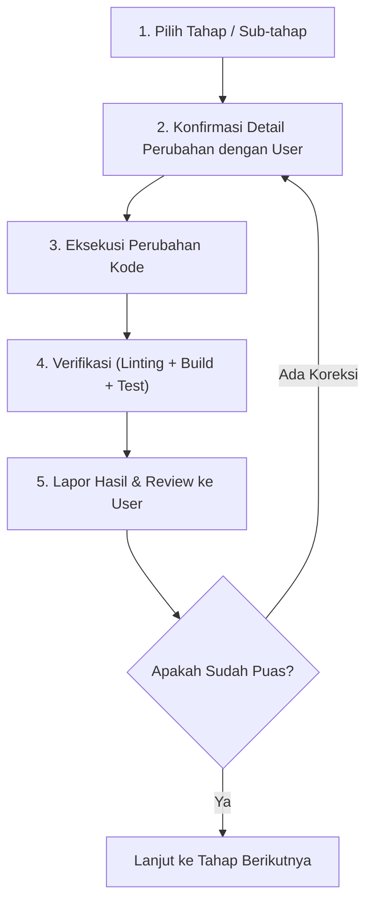

# Rencana Pembahasan dan Revisi Aplikasi School Class Project (SCP)

**Dokumen Versi:** 1.4  
**Tanggal Dibuat:** 5 November 2026 (Diperbarui: 6 November 2026)  
**Status:** SELURUH TAHAP (1 s.d. 5) SELESAI & TERVERIFIKASI PENUH  
**Lingkup:** Backend Laravel (`scp/`) & Frontend Website React (`frontend/scp_web/`)

---

## 1. Pendahuluan

Dokumen ini disusun sebagai panduan terstruktur dan terukur untuk membahas serta mengeksekusi perbaikan bug, penyesuaian fungsional, dan pembersihan kode (*code health*) yang ditemukan selama proses analisis menyeluruh arsitektur project.

Pengerjaan revisi akan dibagi menjadi **5 Tahapan Bertahap (Phases)** dengan prinsip:
1. **Tidak ada implementasi langsung tanpa persetujuan user.**
2. **Isu sensitif (perubahan skema data, hak akses, atau alur bisnis inti) wajib didiskusikan terlebih dahulu.**
3. **Setiap tahap memiliki kriteria verifikasi yang jelas (Unit Test / Build / Uji Antarmuka).**

---

## 2. Peta Tahapan Revisi (Roadmap)

```
[Tahap 1: Bug Kritis & Konsistensi Inti]
  ├─ 1.1 Perbaikan Logic Jam Kosong (TeacherJournalPage)
  ├─ 1.2 Perbaikan Rules of Hooks Crash (ClassAssignmentEditModal)
  └─ 1.3 Sinkronisasi Dinamis Tahun Ajaran (TopBar)
           │
           ▼
[Tahap 2: Pembersihan Code Health & Linter (ESLint)]
  ├─ 2.1 Pembersihan 63 Unused Variables/Imports
  └─ 2.2 Penataan Pola useEffect & State di React 19
           │
           ▼
[Tahap 3: Modul Guru & Alur KBM (Jurnal, Presensi, Kuis AI)]
  ├─ 3.1 Verifikasi Alur Buka Sesi KBM & Guru Pengganti
  ├─ 3.2 Alur Presensi Siswa & Upload Foto Bukti KBM
  └─ 3.3 Uji Integrasi Kuis AI dari Pembuatan hingga Penilaian
           │
           ▼
[Tahap 4: Modul Waka Kurikulum (Jadwal, Kalender, Master Data)]
  ├─ 4.1 Validasi Plotting Jadwal & Deteksi Bentrok
  ├─ 4.2 Integrasi Kalender Akademik (Disabling Event pada KBM)
  └─ 4.3 Alur Recycle Bin & Smart Delete Siswa/Guru/Kelas
           │
           ▼
[Tahap 5: Modul Kesiswaan, Siswa & Orang Tua]
  ├─ 5.1 Dashboard Rekapitulasi Presensi Kesiswaan
  ├─ 5.2 Antarmuka Pengerjaan Kuis Siswa & Tinjauan Nilai AI
  └─ 5.3 Portal Monitoring Orang Tua & Sinkronisasi Data Anak
```

---

## 3. Rincian Temuan & Rencana Aksi per Tahap

### Tahap 1: Perbaikan Bug Kritis & Konsistensi Inti (Prioritas Tertinggi)

Tahap ini mencakup bug logika dan pelanggaran aturan React yang dapat menyebabkan crash aplikasi (*white screen*) atau kegagalan API (*404 Not Found*).

#### 1.1 Logic Bug Penandaan Jam Kosong Guru (`TeacherJournalPage.jsx`)
- **Lokasi Kode:**
  - `frontend/scp_web/src/pages/teacher/TeacherJournalPage.jsx:478`
  - `frontend/scp_web/src/services/journalApi.js:46`
  - `scp/app/Http/Controllers/Api/JournalController.php:161-228 & 302-339`
- **Akar Masalah:**
  - Di `TeacherJournalPage.jsx`:
    ```javascript
    await journalApi.markTeacherAbsent(journalId || schedule.id, {
      schedule_id: schedule.id,
    });
    ```
  - Jika sesi KBM belum dibuka, `journalId` bernilai `null`, sehingga kode mengirimkan `schedule.id` ke endpoint `PATCH /api/journals/{id}`.
  - Backend mencari `Journal::findOrFail($id)` dengan ID jadwal, bukan ID jurnal. Ini memicu HTTP 404 (atau salah mengubah jurnal milik orang lain jika ID-nya kebetulan sama).
- **Rencana Solusi:**
  - Sesuaikan `journalApi.markTeacherAbsent`:
    - Jika `journalId` sudah ada $\rightarrow$ panggil `PATCH /api/journals/${journalId}`.
    - Jika `journalId` belum ada $\rightarrow$ panggil `POST /api/journals` dengan payload `{ schedule_id: schedule.id, status: 'teacher_absent' }` (karena backend `store()` sudah memiliki logika `updateOrCreate` untuk `teacher_absent`).
- **Poin Diskusi dengan User:**
  - *Apakah tombol "Tandai Jam Kosong" hanya boleh ditekan oleh Kesiswaan/Waka, atau guru yang bersangkutan juga boleh menandai dirinya sendiri jika berhalangan?* (Sesuai kode saat ini, backend membatasi `teacher_absent` via `store` hanya untuk Kesiswaan dan Waka Kurikulum).

---

#### 1.2 Pelanggaran React Rules of Hooks (`ClassAssignmentEditModal.jsx`)
- **Lokasi Kode:**
  - `frontend/scp_web/src/pages/waka/components/ClassAssignmentEditModal.jsx:75-95`
- **Akar Masalah:**
  - Baris 75 melakukan return bersyarat:
    ```javascript
    if (!classItem) return null;

    const waliOptions = useMemo(...);
    const bkOptions = useMemo(...);
    ```
  - Memanggil Hook di bawah kondisi return melanggar aturan mutlak React (*"Don't call Hooks inside loops, conditions, or nested functions"*). Ketika modal dibuka/ditutup dan `classItem` berubah, React melempar error *Rendered more hooks than during the previous render* yang memicu crash aplikasi.
- **Rencana Solusi:**
  - Pindahkan hook `useMemo` ke atas sebelum `if (!classItem) return null;`.
  - Berikan fallback aman di dalam callback memo (`classItem?.class_id`).

---

#### 1.3 Label Tahun Ajaran Hardcoded (`TopBar.jsx`)
- **Lokasi Kode:**
  - `frontend/scp_web/src/components/layout/TopBar.jsx:136-138`
- **Akar Masalah:**
  - Teks tahun ajaran `"2025/2026 Ganjil"` ditulis langsung secara statis (hardcoded).
  - Backend sebenarnya sudah mengirimkan data dinamis melalui `AuthController::me`:
    ```php
    $userData['academic_year'] = $sysConfig?->academic_year ?? '2025/2026 Ganjil';
    ```
- **Rencana Solusi:**
  - Ambil nilai dari hook autentikasi: `const { user } = useAuth();` dan tampilkan `{user?.academic_year || 'Tahun Ajaran Aktif'}`.

---

### Tahap 2: Pembersihan Code Health & Linter (ESLint React 19)

- **Temuan:** Terdapat 66 masalah ESLint (63 error, 3 warning).
- **Rencana Aksi:**
  1. Hapus unused imports (terutama icon Lucide seperti `Clock`, `Users`, `CheckCircle2`, `MapPin`, dll. yang diimpor tetapi tidak dirender).
  2. Rapikan pemanggilan fungsi fetch dalam `useEffect` agar mematuhi standar React 19 tanpa cascading renders.
  3. Target: `npm run lint` menghasilkan **0 error**.

---

### Tahap 3: Modul Guru & Alur KBM (Jurnal, Presensi, Kuis AI)

- **Fokus Pembahasan:**
  1. **Presensi Siswa (Exception-Based):**
     - Sesuai arsitektur backend, presensi hanya menyimpan data siswa yang *sakit*, *izin*, atau *alpa* untuk menghemat baris database. Siswa tanpa catatan otomatis dihitung *hadir*.
     - Kita akan pastikan UI `TeacherJournalPage.jsx` merefleksikan status default "Hadir" dengan jelas tanpa membingungkan guru.
  2. **Bukti Foto KBM & Kompresi:**
     - Memastikan fungsi `compressImage` menghasilkan file JPEG ~800px (< 500 KB) agar pengiriman data ke endpoint `PUT /api/journals/{id}` berjalan cepat di koneksi internet sekolah.
  3. **Fitur Kuis AI:**
     - Menguji alur `TeacherQuizCreatePage.jsx` dengan model `gemini-3.1-flash-lite` yang baru saja disiapkan:
       - Generator soal otomatis berdasarkan topik & indikator.
       - Penyimpanan draft dan publikasi kuis.
       - Penilaian esai otomatis saat siswa submit.

---

### Tahap 4: Modul Waka Kurikulum (Jadwal, Kalender, Master Data)

- **Fokus Pembahasan:**
  1. **Plotting Jadwal & Deteksi Bentrok:**
     - Backend memiliki validasi ketat agar 1 guru atau 1 kelas tidak memiliki 2 jadwal di jam dan hari yang sama. Kita pastikan notifikasi error di `ScheduleManagementPage.jsx` menampilkan informasi guru/kelas yang bentrok secara spesifik.
  2. **Kalender Akademik & Agenda Khusus:**
     - Sesuai aturan PRD, jika ada event sekolah bertipe libur atau ujian (`TEACHING_DISABLED_BY_EVENT`), jadwal KBM otomatis dieksklusi (*exempted*). Kita verifikasi bahwa badge dan status jadwal di dashboard Waka & Guru sinkron.
  3. **Master Data & Recycle Bin:**
     - Memastikan proses penghapusan data siswa/guru/kelas menggunakan `softDeletes` dan dapat dipulihkan (*restore*) dari menu Recycle Bin tanpa meninggalkan data yatim (*orphan records*).

---

### Tahap 5: Modul Kesiswaan, Siswa & Orang Tua

- **Fokus Pembahasan:**
  1. **Dashboard Kesiswaan:**
     - Memastikan rekap kehadiran harian dan grafik ketidakhadiran siswa per kelas terisi akurat dari tabel `attendances` dan `leave_requests`.
  2. **Aplikasi Siswa:**
     - Alur pengerjaan kuis (`StudentQuizDoPage.jsx`), batas waktu pengerjaan, dan tampilan skor instan.
     - Pengajuan izin sakit/izin (`StudentPermissionPage.jsx`) dengan unggah bukti surat.
  3. **Portal Orang Tua:**
     - Memastikan data presensi anak yang ditautkan (`linkedStudent`) muncul secara akurat di `ParentMonitoringPage.jsx`.

---

## 4. Alur Kerja Eksekusi per Sesi

Untuk menjaga kerapian dan keamanan kode, setiap tahapan akan dieksekusi dengan langkah berikut:



---

## 5. Pertanyaan Awal untuk User Sebelum Memulai

Sebelum kita memulai eksekusi **Tahap 1**, mohon konfirmasi untuk hal-hal berikut:
1. **Apakah rencana pembagian tahapan (Tahap 1 s.d. 5) di atas sudah sesuai dengan ekspektasi Anda?**
2. **Untuk Tahap 1.1 (Tombol Jam Kosong / Guru Berhalangan Hadir):**
   - Apakah penandaan jam kosong memang diatur khusus untuk akun ber-role **Kesiswaan dan Waka Kurikulum** saja saat guru yang bersangkutan tidak hadir, atau apakah akun **Guru** itu sendiri juga diizinkan menandai jam kosong? (Di backend saat ini diatur hanya Waka & Kesiswaan).
3. **Apakah kita bisa langsung memulai dari Tahap 1 (Bug Kritis & Konsistensi Inti)?**
